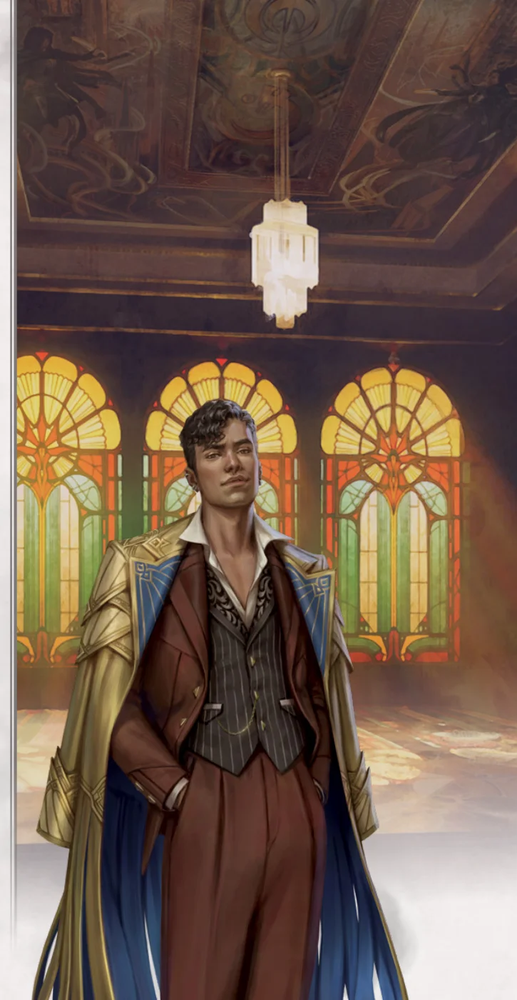
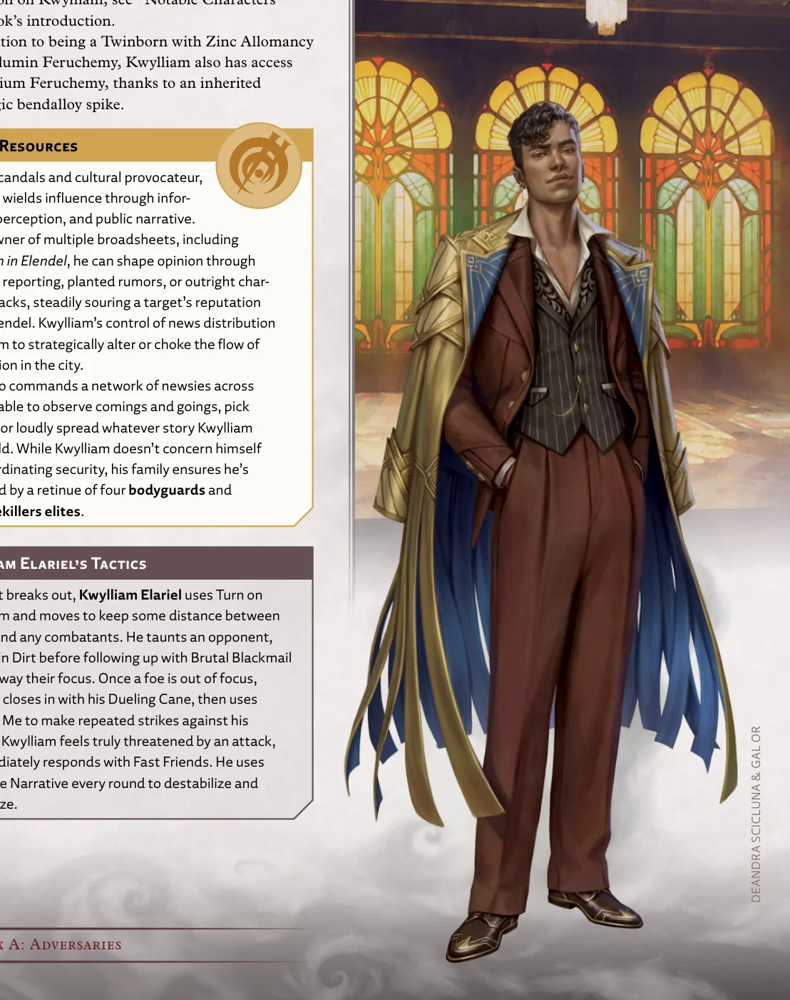

### Kwylliam Elariel（第二時代）

Kwylliam Elariel 是依藍戴歷史悠久、影響力深遠的家族之一的繼承人。他是個行事不檢的花花公子，仗著財富與特權，多次莽撞行事都沒真正付出代價。Kwylliam 是鍍金三人組成員。三人的合作讓他走出無所事事、縱情享樂的生活，捲入危險而致命的陰謀。關於 Kwylliam 的詳情，見本書導言的「重要角色」。Kwylliam 是具備鋅鎔金術和硬鋁藏金術的雙生師，也透過繼承的彎管合金血金尖刺取得鉻藏金術。

Kwylliam Elariel 的戰術

戰鬥一開始，Kwylliam Elariel 會用施展魅力，並移動以和交戰者保持距離。他會出言挑釁，先用套取把柄，再以無情勒索消耗對手的專注點。敵人的專注點一耗盡，Kwylliam 就會手持決鬥杖上前，再用你真無趣反覆打擊目標。若一項攻擊真的威脅到 Kwylliam，他會立刻用一見如故回應。他每回合都會用操弄輿論擾亂局勢並打擊士氣。

鍍金三人組的資源

Kwylliam 是醜聞大王，擅長挑起文化爭議，也懂得透過消息、觀感和公眾議論施加影響。他擁有包括《依藍戴真相報》在內的多家報紙，能靠選擇性報導、散布流言，甚至公然抹黑來左右輿論，逐步敗壞目標在依藍戴的名聲。他掌握報紙發行，可以有計畫地改變或封鎖市內的消息流通。他在依藍戴各處都有報童替他留意人員出入、扒竊，或大聲散布他想讓人聽見的故事。Kwylliam 不費心安排警備，他的家族則安排四名保鑣和兩名殺霧者精銳隨行保護。

附錄 A：敵手 224

DEANDRA SCICLUNA & GAL OR

### Kwylliam Elariel

階層 2 首領 — 中型類人生物

實體（力量 防禦 速度） 意識（智力 防禦 意志） 靈魂（察覺 防禦 風采） 3 17 4 2 16 4 4 19 5

生命值：130（103–156） 專注點：6 授予：7

移動：30 呎。感知：20 呎（視覺）。實體技能：敏捷 +7、運動 +6、竊術 +7、

輕型武器 +8。意識技能：威嚇 +8。靈魂技能：欺瞞 +8、洞察 +7、感知 +7、

說服 +8。金屬技藝技能：鎔金術 +7（3 技能等級，鋅）、

藏金術 +5（3 技能等級，硬鋁、鉻）。

特徵

首領。Kwylliam 每回合可以採取一個快速輪次和一個慢速輪次。敵人結束輪次後，Kwylliam 可以花費 1 專注點，立刻額外使用 [1行動] 或 [自由行動]。此外，他也可以在自己的輪次花費 1 專注點，解除自身的一項狀態。

操弄輿論（Shape the Narrative）。每回合一次，Kwylliam 可以迫使一名他能感知的角色重擲劇情骰。該角色必須採用新結果。

唯恐天下不亂（Drama Fiend）。一名 Kwylliam 能感知的角色獲得變故後，Kwylliam 恢復 1 專注點。

金屬意識庫。Kwylliam 有兩個金屬意識庫，各儲存 5 充能，分別是鉻意識（儲存運氣）和硬鋁意識（儲存牽繫）。

行動

[1行動] 打擊：決鬥杖。攻擊 +8，觸及 5 呎，造成 1d8 + 8 衝擊傷害。命中時，若目標沒有專注點，目標額外受到 2d8 傷害。

[1行動] 打擊：「劇情急轉」獵用步槍（鋁彈）。攻擊 +8，射程 150/600 呎，造成 1d8 + 8 銳利傷害。穿刺：目標的偏轉值無法減免這次傷害。

裝填 [4]：花費 [1行動] 將這件武器的彈藥裝滿。

[1行動] 你真無趣（You Bore Me）。Kwylliam 對沒有專注點的目標進行一次額外打擊，即使他已經使用過該打擊行動也一樣。

[1行動] 刻意挑釁（Edgelord，花費 2 鉻意識充能）。直到 Kwylliam 下一個輪次結束，其他角色在他 80 呎內進行攻擊檢定時，必須提高賭注，並帶一個劣勢擲劇情骰。

[1行動] 無情勒索（Brutal Blackmail，花費 1 授予）。Kwylliam 煽動目標的羞恥和絕望。他選擇自身 80 呎內一名能影響、且握有其把柄的目標，例如他透過套取把柄得到情報的對象，進行洞察檢定對抗其靈性防禦。成功時，目標陷入減損 [意志 −2] 與減損 [風采 −2]，直到場景結束，並失去 1d4 專注點。若目標沒有足夠的專注點可失去，該回合還會陷入震懾。Kwylliam 一旦以無情勒索鎖定某個角色，必須先取得此人的新把柄，才能再次以此行動鎖定對方。

[1行動] 施展魅力（Turn on the Charm，花費 1 硬鋁意識充能）。直到場景結束，Kwylliam 獲得下列效果：

- 他獲得增益 [風采 +2]。

- 他能說也能聽懂自身 80 呎內角色使用的所有語言。

- 試圖抵抗 Kwylliam 的影響需額外花費 2 專注點。

[2行動] 套取把柄（Gain Dirt，花費 1 授予）。Kwylliam 把全部注意力放在自身 80 呎內一名能影響的目標身上，瞬間煽動對方的衝動。目標必須花費 2 專注點抵抗影響，或透露足以揭露弱點、可供指控的細節或難堪往事的個人資訊。

[反應] 一見如故（Fast Friends，花費 2 授予另加 1 硬鋁意識充能）。在自身 80 呎內一名 Kwylliam 能感知的角色對他發動攻擊前，他試著與目標建立牽繫並煽動其罪惡感。Kwylliam 進行說服檢定，對抗目標的靈性防禦。成功時，直到場景結束，目標每次要攻擊 Kwylliam 前都必須花費 2 專注點抵抗影響。如果 Kwylliam 攻擊受影響的角色，該角色身上的效果便結束。

機遇與變故

機遇。敵人可以花費 [機遇] 打中 Kwylliam 的一個金屬意識庫，並從刻意挑釁、施展魅力或一見如故中選擇一項結束其效果。

變故。GM 可以花費敵人檢定擲出的 [變故]，讓 Kwylliam 目睹該敵人做出難堪的蠢事。目標陷入迷惑，直到花費 [1行動]，選擇支付

2 專注點或成功通過 DC 14 的紀律檢定，解除此狀態。

附錄 A：敵手 225
