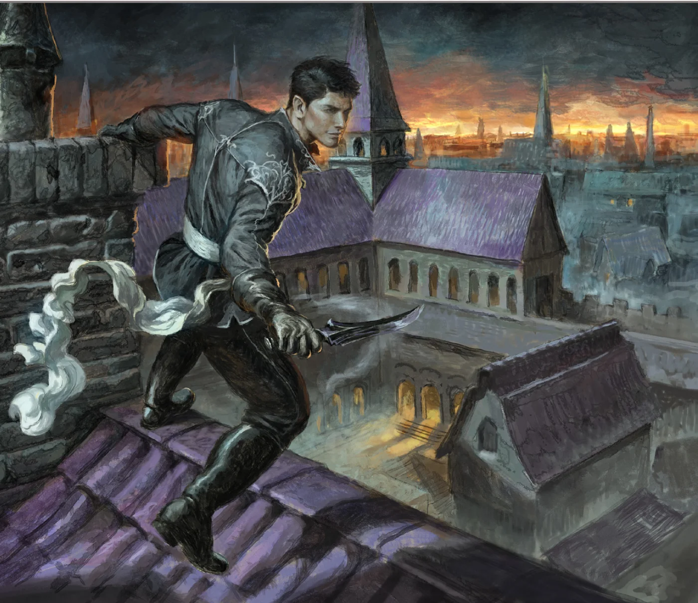

### 迷霧之子（第一時代）

### 詹在夜裡悄悄穿行

於陸沙德。

### 詹

詹是史特拉夫．泛圖爾的私生子，也是他的私人迷霧之子刺客。他看來總是漫不經心，彷彿凡事都讓他覺得好笑，卻可能突然施暴。詹替自己植入血金尖刺後，滅絕開始私下對這名迷霧之子說話，驅使他大開殺戒。談話時，滅絕的低語可能讓詹分心，或使他話說到一半就突然中斷。儘管性情反覆無常，詹仍是能幹的間諜與刺客，在最後帝國各地執行父親的命令。

迷霧之子是強大的鎔金術師，能燃燒全部十六種金屬。他們掌握著原始而強大的技藝，往往行事果決而大膽，最常為大家族效力。一名迷霧之子的出現，就足以大幅改變力量的平衡。

迷霧之子刺客的戰術

迷霧之子刺客在戰鬥中行動敏捷、應變靈活，很難被困住。燃燒錫與燃燒鐵／鋼讓他們難以遭到突襲，鐵拉／鋼推讓他們能迅速移動，而燃燒天金則讓他們能壓制敵人。

ANTTI HAKOSAARI

### 迷霧之子刺客

階層 3 首領 — 中型類人生物

實體（力量 防禦 速度） 意識（智力 防禦 意志） 靈魂（察覺 防禦 風采） 3 18 5 3 17 4 3 17 4

生命值：190（152–228） 專注點：8 授予：8

移動：40 呎。感知：20 呎（視覺）。實體技能：敏捷 +9、輕型武器 +9。意識技能：紀律 +8、威嚇 +8。靈魂技能：洞察 +7、領導 +8、感知 +7、

求生 +7。金屬技藝技能：鎔金術 +8（4 技能等級，所有金屬）。

特徵

首領。迷霧之子每回合可以採取一個快速輪次和一個慢速輪次。敵人結束輪次後，迷霧之子可以花費 1 專注點，立刻額外使用 ▶ 或 ▷。此外，迷霧之子也可以在自己的輪次花費 1 專注點，解除自身的一項狀態。

迷霧披風（Mistcloak）。迷霧之子對非迷霧之子角色進行威嚇檢定時，獲得一個優勢。此外，迷霧之子身處遮蔽視線的區域時，若某些角色的主要感官被該區域遮蔽，迷霧之子對這些角色進行隱匿檢定時獲得一個優勢，而這些角色對迷霧之子進行感知檢定時承受一個劣勢。

行動

▶ 打擊：黑曜石刀。攻擊 +9，觸及 5 呎或射程 20/60 呎，造成 1d4 + 9 銳利傷害。命中時，迷霧之子可以花費 1 專注點，額外造成 2d8 傷害。

▶ 射出錢幣（Shoot Coin，花費 1–4 授予）。攻擊 +8，每花費一點授予，射程為 20 呎，造成 1d10 + 8 衝擊傷害。

[2行動] 刺客之舞（Assassin’s Dance）。迷霧之子移動最多等於自身移動速率的距離，並進行一次打擊。命中時，目標也陷入迷惑，直到目標的下一個輪次結束。

▶ 燃燒鐵／鋼（Burn Iron/Steel）。直到場景結束，迷霧之子能感知自身 160 呎內所有非鋁且未受授予的金屬來源。

▶ 燃燒錫（Burn Tin，花費 1–4 授予）。迷霧之子強化自身感官，獲得下列效果，直到場景結束，或直到迷霧之子在之後的輪次用 ▷ 結束這些效果：

- 迷霧之子獲得增益 [察覺]。此屬性的加值等於燃燒錫所花授予的一半，無條件進位。

- 迷霧之子的所有感官都成為超自然感官。每回合第一次受到強烈的感官刺激時，迷霧之子必須成功通過紀律檢定（DC 等於 12 加上增益 [察覺] 狀態的數值），否則陷入迷惑，直到其下一個輪次結束。

迷霧之子以推理或察覺技能成功使用獲取優勢時，對該目標的下一次攻擊額外造成 1d10 傷害。

▶ 鐵拉／鋼推（Ironpull/Steelpush，花費 1–4 授予）。迷霧之子選擇一件以燃燒鐵／鋼感知到的金屬物品，讓自己或該物品沿直線朝另一方移動或遠離。每花費一點授予，最多可移動 20 呎。尺寸較小的物品會朝迷霧之子移動或遠離。若物品尺寸與迷霧之子相同或更大，則由迷霧之子朝物品移動或遠離。若物品固定在其他東西上，該東西也計入物品的尺寸。這項能力可以靈活運用，例如解除敵人武裝，或打擊物品飛行路徑上的敵人。若要這樣影響不情願的角色，迷霧之子

必須進行鎔金術檢定，並成功對抗目標的實體防禦。若效果會造成傷害，迷霧之子必須進行鎔金術攻擊，擲出 1d10 + 8 衝擊傷害。

[2行動] 燃燒天金（Burn Atium，可用 1 次）。接下來 4 回合，迷霧之子進行與其他角色實體互動的檢定時，包括對抗實體防禦的檢定，都不擲任何 d20。改將所有 d20 的數值設為 15，包括因優勢或劣勢而使用的骰子。同樣地，敵人進行與迷霧之子實體互動的檢定時，包括對抗實體防禦的檢定，將其 d20 的數值設為 5。在效果結束前，迷霧之子可以花費額外一次燃燒天金的使用次數，以 ▷ 維持效果。額外次數可透過變故取得，見下文。

↻ 投射物拉引（Projectile Lurch，花費 1 授予）。當一名位於

迷霧之子 160 呎內的盟友即將受到金屬投射物攻擊時，若迷霧之子能以燃燒鐵／鋼感知到該投射物，就取代盟友成為這次攻擊的目標。

機遇與變故

機遇。敵人可以花費 [機遇]，結束迷霧之子的燃燒天金、燃燒錫及燃燒鐵／鋼的效果。

變故。GM 可以花費敵人檢定擲出的 [變故]，讓迷霧之子用 ↻ 使用飲用金屬液行動，或讓迷霧之子額外獲得一次燃燒天金的使用次數。

附錄 A：敵手 231

