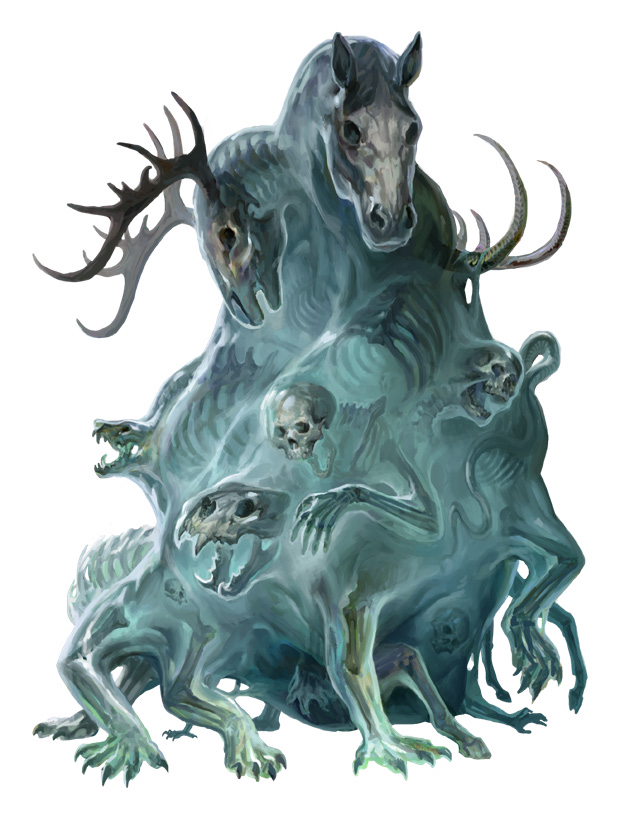

### 霧魅

#### 霧魅戰術

在戰鬥遭遇中，霧魅更像是環境危害。牠們還沒看見可吞食的屍體時，只能跟隨活物，詳見「陰魂跟隨」特徵。霧魅性情被動，即使受到攻擊通常也沒有反應，但「詭異氣場」和「駭人外貌」往往能讓潛在的敵人不敢靠得太近。

階層 2 嘍囉，巨型實體

| 力量 | 實體防禦 | 速度 | 智力 | 認知防禦 | 意志 | 察覺 | 靈性防禦 | 風采 |
| --- | --- | --- | --- | --- | --- | --- | --- | --- |
| 2 | 12 | 0 | 1 | 13 | 2 | 5 | 18 | 3 |

**生命值** 26（21–31）　**專注點** 4　**授予** 0  
**移動** 20 呎　**感知** 50 呎（嗅覺）  
**實體技能** 運動 +4  
**靈魂技能** 感知 +8、求生 +8

#### 特徵

**陰魂跟隨。** 霧魅每個輪次都必須先花費行動「移動」，盡可能接近牠能感知到的最近一具屍體。一旦與屍體的距離在 5 呎內，牠就必須盡快使用「吞食屍體」。如果感知不到任何屍體，牠便改用「移動」跟隨活著的角色。

**駭人外貌。** 專注點為 0 且能感知到霧魅的角色，不能主動朝牠移動。

**詭異氣場。** 每當角色在至少一隻自己能感知到的霧魅 30 呎內開始輪次，該角色必須抵抗影響，否則陷入精疲力竭［−1］。

**無害。** 角色若通過 DC 18 的學識檢定或消耗 [機遇]，便會認出霧魅並無威脅。該角色忽略霧魅的「駭人外貌」與「詭異氣場」特徵。

**食屍者。** 角色結束輪次時若與霧魅接觸，便受到 1d6 命力傷害。

#### 行動

**[2行動] 吞食屍體。** 霧魅吞食 5 呎內的一具屍體，並恢復 10 生命值。

**↻ 食腐者。** 霧魅能感知到的一名角色的生命值降至 0 或受到傷勢後，霧魅朝該角色移動，最多移動其移動距離。

霧魅在夜間蹣跚爬行，遊蕩於迷霧中，吞食屍體，將其拼入自己臃腫的身軀。每次進食，牠們不斷長大的身體便多了些肌肉、頭顱和四肢。隔著霧魅半透明的皮膚，仍可看見這些亂七八糟拼接在一起的部位。霧魅通常約有 10 呎高、20 呎長。這些生物幾乎不會老死，沒有智慧，只憑本能行動，一生大多在進食與繁殖。

霧魅的外貌怪誕，實際上是無害的食腐動物，民眾卻多半不知情。這些神祕生物的傳聞到處流傳，有些人甚至懷疑牠們是否真的存在。民間傳說有許多關於霧魅的迷信，司卡人的傳統尤其如此。落灰之終後，有些人會在墓園放置霧魅雕像，想把據說有領域性的霧魅嚇走，這種做法大概只是出於迷信。

ANA GRIGORIEVA

附錄 A：敵手 232

