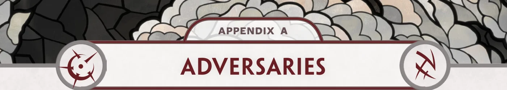
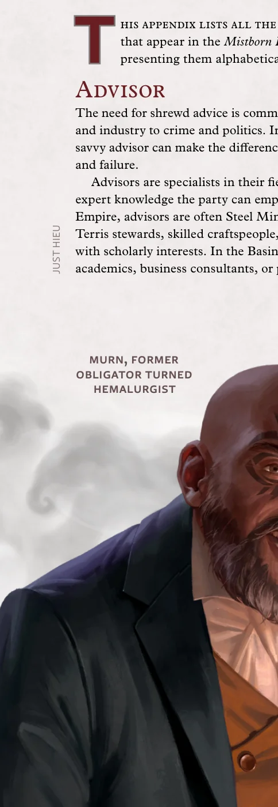
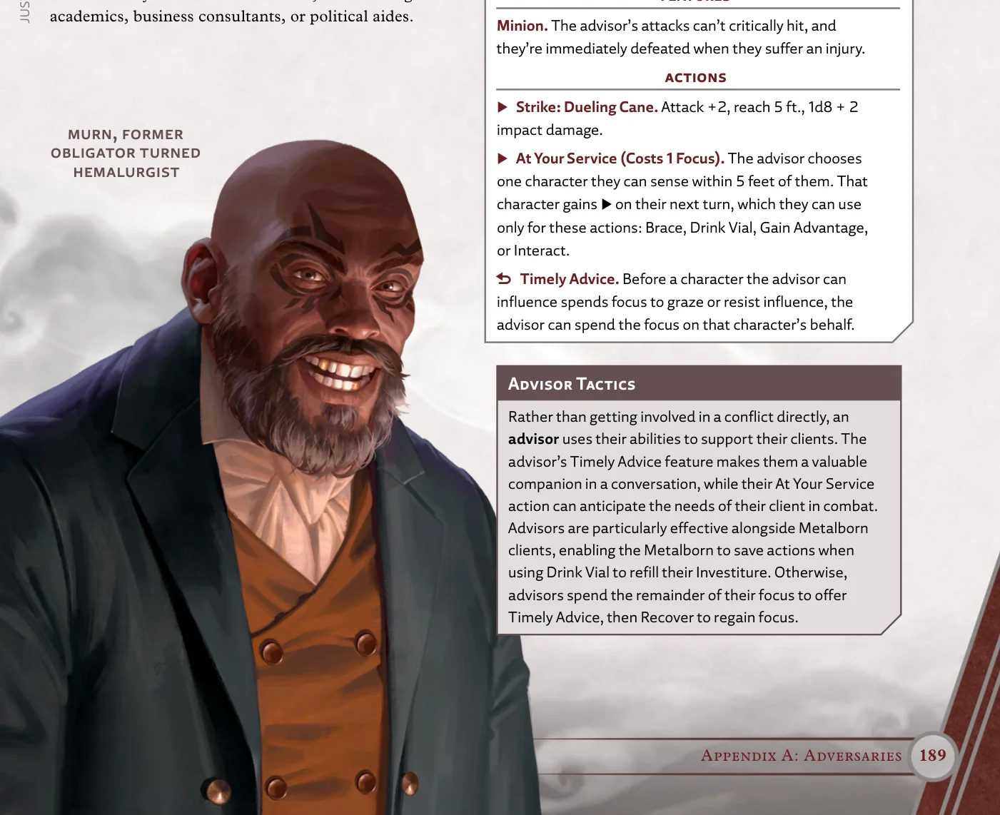

### 顧問

### 附錄 A

### 敵手

本附錄依英文字母順序列出《迷霧之子傳承》冒險中出現的所有敵手。

從學界、產業到犯罪與政治，都少不了高明的建議。不論做什麼，精明的顧問都可能左右成敗。顧問是各自領域的專家，能提供隊伍用得上的專業知識。在最後帝國，顧問通常是鋼鐵教廷官員、泰瑞司侍從官、技藝精湛的工匠，或熱衷學問的小貴族。在盆地，顧問可能是學者、商業顧問或政治幕僚。

階層 2 嘍囉 – 中型類人生物

實體（力量 防禦 速度） 意識（智力 防禦 意志） 靈魂（察覺 防禦 風采） 1 13 2 4 16 2 3 15 2

生命值：20（16–24） 專注點：5 授予：0

移動：25 呎。感知：20 呎（視覺）。實體技能：隱匿 +5。意識技能：推理 +7、學識 +7。靈魂技能：洞察 +6、說服 +5。

特徵

嘍囉（Minion）。顧問的攻擊無法造成致命一擊，且一旦受到傷勢就會立即被擊敗。

行動

▶ 打擊（Strike）：決鬥杖。攻擊 +2，觸及 5 呎，造成 1d8 + 2 衝擊傷害。

▶ 為您效勞（At Your Service，花費 1 專注點）。顧問選擇 5 呎內一名能感知到的角色。該角色在下一個輪次獲得 ▶，只能用於下列行動：架防、飲用金屬液、獲取優勢或互動。

↻ 及時建言（Timely Advice）。在顧問能影響的一名角色

花費專注點造成擦傷或抵抗影響前，顧問可以代為支付所需的專注點。

### Murn，曾任

### 聖務官，後成為

### 血金術師

附錄 A：敵手 189

顧問的戰術

顧問會以自身能力支援委託人，避免直接捲入衝突。及時建言讓顧問在談話中成為有力的同伴，為您效勞則能在戰鬥中提前照應委託人的需求。顧問與金屬之子並肩時尤其有效，能讓對方用飲用金屬液補充授予時省下行動。其餘時候，顧問會把剩下的專注點花在及時建言上，再用恢復取回專注點。

JUST HIEU

