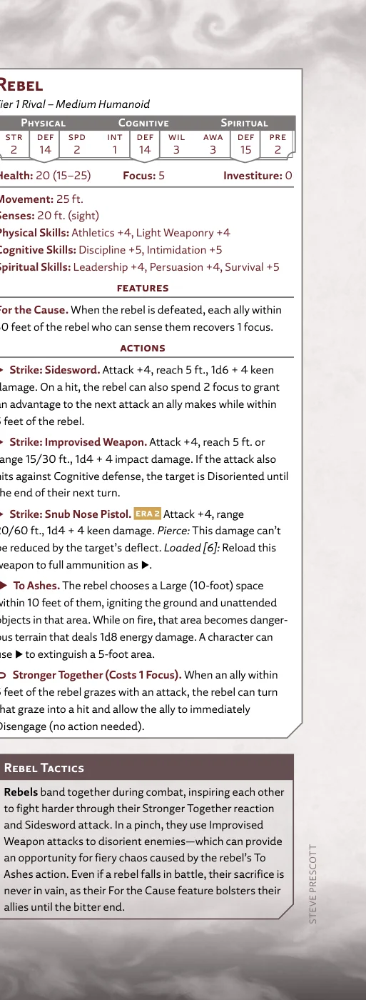
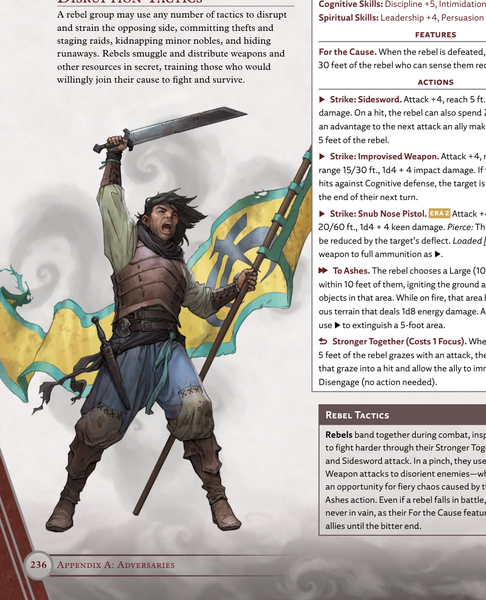

## 反抗者

體制失靈時，反抗者便會挺身而出，力求帶來真正且長久的改變。他們擅長出奇招擾亂對方，忠於理念，集結起來尤其難以對付。即使只有破舊的護甲和粗陋的武器，反抗者也能憑意志與人數推翻不義的領袖，連曾自以為能永遠掌權的人也不例外。

### 擾亂戰術

反抗團體會採用各種手段擾亂對方、使其疲於應付，包括竊盜、突襲、綁架小貴族和藏匿逃亡者。他們暗中走私和分發武器及其他資源，並訓練自願加入的人戰鬥與求生。

**階層 1 勁敵｜中型類人生物**

| 力量 | 實體防禦 | 速度 | 智力 | 認知防禦 | 意志 | 察覺 | 靈性防禦 | 風采 |
| --- | --- | --- | --- | --- | --- | --- | --- | --- |
| 2 | 14 | 2 | 1 | 14 | 3 | 3 | 15 | 2 |

- **生命值** 20（15–25）　**專注點** 5　**授予** 0
- **移動** 25 呎　**感知** 20 呎（視覺）
- **實體技能** 運動 +4、輕型武器 +4
- **意識技能** 紀律 +5、威嚇 +5
- **靈魂技能** 領導 +4、說服 +4、求生 +5

### 特徵

**為了理念。** 反抗者被擊敗時，距離其 30 呎內且能感知到他的每名盟友恢復 1 專注點。

### 行動

[1行動] **打擊：佩劍。** 攻擊 +4，觸及 5 呎，造成 1d6 + 4 銳利傷害。命中時，反抗者也可花費 2 專注點，使盟友下一次在反抗者 5 呎內發動的攻擊獲得一項優勢。

[1行動] **打擊：臨時武器。** 攻擊 +4，觸及 5 呎或射程 15/30 呎，造成 1d4 + 4 衝擊傷害。若攻擊也命中目標的認知防禦，目標陷入迷惑，直到自己的下個輪次結束。

[1行動] **打擊：短管手槍。** [第二時代] 攻擊 +4，射程 20/60 呎，造成 1d4 + 4 銳利傷害。穿刺：目標的偏轉值無法減免此傷害。裝填 [6]：花費 [1行動] 將彈藥補滿。

[2行動] **化為灰燼。** 反抗者選擇距離自己 10 呎內一處大型（10 呎）空間，點燃區域內的地面和無人看管的物體。燃燒期間，該區域成為造成 1d8 能量傷害的危險地形。角色可以花費 [1行動] 撲滅一處 5 呎區域的火焰。

[反應] **團結更強（消耗 1 專注點）。** 距離反抗者 5 呎內的一名盟友以攻擊造成擦傷時，反抗者可以將這次擦傷改為命中，並讓該盟友立刻脫離，無須花費行動。

### 反抗者戰術

反抗者在戰鬥中相互照應，以「團結更強」反應和佩劍攻擊激勵彼此奮戰。情急時，他們會用臨時武器攻擊使敵人陷入迷惑，趁機以「化為灰燼」讓火勢加劇混亂。即使反抗者在戰鬥中倒下，「為了理念」特徵仍會讓盟友振作，繼續奮戰到底。

STEVE PRESCOTT

附錄 A：對手 236

