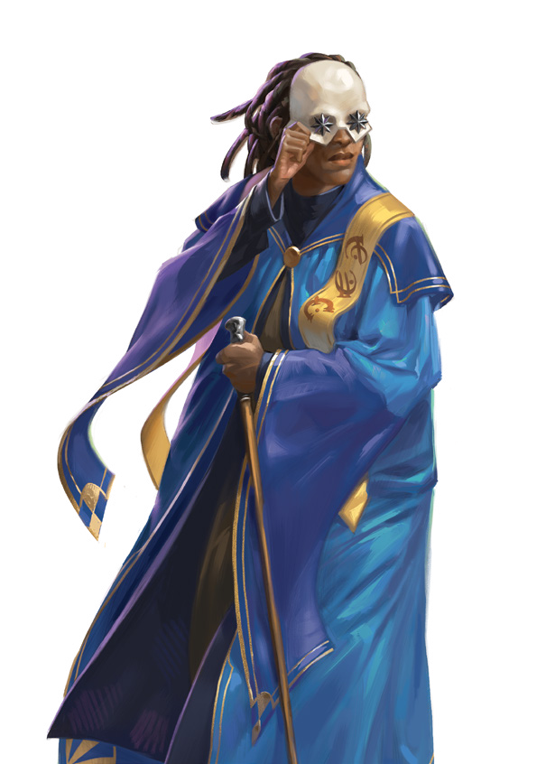

## 結社成員（第二時代）

自恃特權的貴族經常秘密集會，追求政治、社會或玄祕方面的目標。千眼會就是一例。這個祕密結社招收依藍戴大學的菁英學生，依血統決定會員資格，並以家族世代相傳的尖刺鞏固這項制度。候補成員須通過競爭激烈的午夜試煉才能正式入會。只有展現資格的人才能加入千眼會，得知其祕密。久而久之，取得會內知識及影響力的門檻愈來愈高，多數成員只知道自己應扮演的角色。

### 候補成員變體

若要用候補成員資料區塊呈現迷霧人，可以移除「倚仗身分」，改用本節列出的技能與行動。

#### 射幣候補成員

**金屬技藝技能** 鎔金術 +4（2 技能等級，鋼）

[1行動] **燃燒鋼。** 直到場景結束，候補成員能感知自己 40 呎內所有鋁以外、未受授予的金屬來源。

[1行動] **鋼推（消耗 1–2 授予）。** 候補成員選擇以「燃燒鋼」感知到的一件金屬物體，使自己或物體沿直線遠離對方，每花費 1 授予最多移動 20 呎。較小的物體會遠離候補成員，與其同體型或更大的物體則會使候補成員遠離它。物體若附著於其他東西，後者也計入其體型。這項能力可以靈活運用，例如繳械，或讓候補成員短距離「飛行」。若要以此影響不情願的角色，候補成員必須成功進行對抗目標實體防禦的鎔金術檢定。

#### 扯手候補成員

**金屬技藝技能** 鎔金術 +4（2 技能等級，鐵）

[1行動] **燃燒鐵。** 直到場景結束，候補成員能感知自己 40 呎內所有鋁以外、未受授予的金屬來源。

[1行動] **鐵拉（消耗 1–2 授予）。** 候補成員選擇能感知到的一件金屬物體，使自己或物體沿直線靠近對方，每花費 1 授予最多移動 20 呎。較小的物體會靠近候補成員，與其同體型或更大的物體則會使候補成員靠近它。物體若附著於其他東西，後者也計入其體型。這項能力可以靈活運用，例如繳械或打擊物體飛行路徑上的敵人。若要以此影響不情願的角色，候補成員必須成功進行對抗目標實體防禦的鎔金術檢定。若效果會造成傷害，則必須改為進行鎔金術攻擊，擲 1d6 + 4 衝擊傷害。

若要加入其他迷霧人候補成員，可以使用《世界指南》第 8 章的鎔金術模組，給予和射幣與扯手變體相同的鎔金術等級。

> 「火焰能驗出礦石的純度。」
>
> ——千眼會格言

附錄 A：對手 238

PIERRE IGNASZEWSKI

## 正式成員

**階層 2 勁敵｜中型類人生物**

| 力量 | 實體防禦 | 速度 | 智力 | 意識防禦 | 意志 | 察覺 | 靈魂防禦 | 風采 |
| --- | --- | --- | --- | --- | --- | --- | --- | --- |
| 2 | 15 | 3 | 2 | 15 | 3 | 2 | 15 | 3 |

- **生命值** 35（26–44）　**專注點** 5　**授予** 0
- **移動** 30 呎　**感知** 10 呎（視覺）
- **實體技能** 運動 +5、輕型武器 +6、隱匿 +6
- **意識技能** 紀律 +6、威嚇 +6、學識 +5
- **靈魂技能** 欺瞞 +6、領導 +6
- **金屬技藝技能** 藏金術 +5（3 技能等級，金）

### 特徵

**特權人生。** 每次檢定限一次，正式成員可以重擲該次擲骰中所有骰面為 1 的骰子。

**顯赫家名。** 正式成員亮出家族姓氏時，在威嚇和說服檢定中獲得一項優勢。

**不可侵犯。** 正式成員可以花費 1 專注點，將一次擦傷改為未命中。

### 行動

[1行動] **打擊：鍍金佩劍。** 攻擊 +6，觸及 5 呎，造成 1d6 + 6 銳利傷害。命中時，若目標沒有專注點，額外受到 2d6 銳利傷害。

[1行動] **打擊：左輪手槍。** 攻擊 +6，射程 20/80 呎，造成 1d6 + 6 銳利傷害。穿刺：目標的偏轉值無法減免此傷害。裝填 [6]：花費 [1行動] 將彈藥補滿。

[2行動] **剷除弱者。** 正式成員對一個沒有專注點的目標額外進行一次打擊，即使已使用過該打擊行動也可以。

[2行動] **你不配（消耗 1 專注點）。** 正式成員對距離自己 30 呎內一名能影響的敵人進行威嚇檢定，對抗其意識防禦。成功時，目標受到以下效果，直到其下個輪次結束。

- 所有檢定獲得一項劣勢。
- 每次檢定失敗後，失去 2 專注點。

角色可以抵抗此影響，但抵抗後會額外失去 2 專注點。

[1行動] **汲取健康。** 正式成員立刻恢復生命值，且直到場景結束，每個自己的輪次開始時也會恢復生命值。每次恢復 1d8 生命值。

## 候補成員

**階層 1 嘍囉｜中型類人生物**

| 力量 | 實體防禦 | 速度 | 智力 | 意識防禦 | 意志 | 察覺 | 靈魂防禦 | 風采 |
| --- | --- | --- | --- | --- | --- | --- | --- | --- |
| 2 | 14 | 2 | 2 | 14 | 2 | 1 | 13 | 2 |

- **生命值** 11（8–14）　**專注點** 4　**授予** 4
- **移動** 25 呎　**感知** 10 呎（視覺）
- **實體技能** 運動 +4、輕型武器 +3、隱匿 +4
- **意識技能** 威嚇 +6、學識 +4
- **靈魂技能** 欺瞞 +4

### 特徵

**嘍囉。** 候補成員的攻擊無法造成致命一擊，且受到傷勢時會立刻被擊敗。

**特權人生。** 每次檢定限一次，候補成員可以重擲該次擲骰中所有骰面為 1 的骰子。

**顯赫家名。** 候補成員亮出家族姓氏時，在威嚇和說服檢定中獲得一項優勢。

### 行動

[1行動] **打擊：鍍金手杖。** 攻擊 +3，觸及 5 呎，造成 1d8 + 3 衝擊傷害。命中時，若目標沒有專注點，額外受到 2d4 傷害。

[2行動] **倚仗身分（消耗 2 專注點）。** 候補成員對距離自己 10 呎內且能感知到自己的一名敵人進行威嚇檢定，對抗其靈魂防禦。成功時，目標若有能力，就必須花費 2 專注點，或以 [反應] 在安全的前提下盡可能遠離候補成員，最多移動自身移動速度的一半。

### 候補成員與正式成員戰術

候補成員會在攻擊前使用「倚仗身分」，迫使敵人移動或消耗專注點。若本身是射幣或扯手，就改用鋼推或鐵拉。敵人的專注點一降至 0，候補成員便用鍍金手杖打擊。正式成員會對可能進行多次技能檢定的敵人使用「你不配」，再用左輪手槍或鍍金佩劍攻擊。敵人的專注點一降至 0，正式成員就用「剷除弱者」和打擊集中攻擊該敵人。

附錄 A：對手 239
