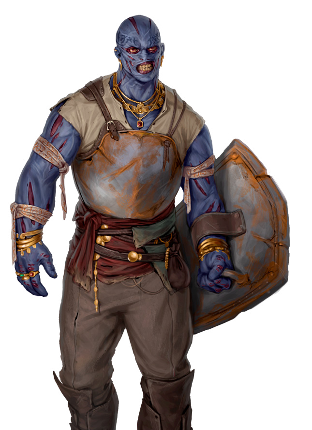

### 鐵砧（第二時代）

鐵砧（The Anvil）是以蠻橫區為據點的 Ironbrands 幫派首領，令人聞風喪膽。她原名 Elanda Wilko，父親死後捨棄家族姓氏，懷著一股怨氣以新身分再度現身。Elanda 曾是執法者，後來從執掌公權力走上帶領罪犯的路，建立了足以讓部下效忠的名聲。她的野心超越了打家劫舍，一心想讓蠻橫區獨立自主，長久立足。

鐵砧的戰術

鐵砧會燃燒鐵，並用手砲攻擊眼前最迫切的威脅。她靠堡壘之盾守住陣地，繼續用手砲從遠處射擊。帶著金屬的敵人靠近或企圖從她身旁通過時，她會用鐵拉將對方拉近，再以盾擊將對方推開。盟友被金屬投射物鎖定時，她會用投射物拉引替對方承受攻擊。只要附近還有盟友在戰鬥，鐵砧就會留在原地扛下攻勢，放任逃跑的敵人離開。

### 鐵砧

階層 2 勁敵 – 中型類人生物

實體（力量 防禦 速度） 意識（智力 防禦 意志） 靈魂（察覺 防禦 風采） 6 19 3 2 15 3 2 15 3

生命值：52（42–62） 專注點：5 授予：5

偏轉值：2（胸甲）。移動：30 呎。感知：10 呎（視覺）。實體技能：敏捷 +5、運動 +8、重型武器 +8。意識技能：紀律 +6、威嚇 +6。靈魂技能：領導 +5、說服 +4。金屬技藝技能：鎔金術 +6（3 技能等級，鐵）。

特徵

堡壘之盾（Fortress Shield）。持用巨盾時，鐵砧受到的遠程攻擊傷害減少 10，並可以把架防（Brace）當成 [自由行動] 使用。

不屈（Unyielding）。鐵砧在抵抗被移動或擊倒的檢定上獲得一個優勢。

行動

[1行動] 打擊：手砲。攻擊 +8，射程 20/80 呎，造成 1d8 + 8 銳利傷害。穿刺（Pierce）：這件武器造成的傷害無法被目標的偏轉值減免。裝填（Loaded）[6]：花費 [1行動] 將這件武器的彈藥裝滿。

[1行動] 打擊：盾擊。攻擊 +8，觸及 5 呎，造成 1d8 + 8 衝擊傷害。命中時，目標還會被推離最多 15 呎。如果撞上堅固表面，目標額外受到 1d4 衝擊傷害。

[1行動] 燃燒鐵（Burn Iron）。直到場景結束，鐵砧能感知自身 80 呎內所有非鋁且未受授予的金屬來源。

[1行動] 鐵拉（Ironpull，花費 1–3 授予）。鐵砧選擇一件透過燃燒鐵感知到的金屬物品，使自己或物品沿直線朝另一方移動。每花費一點授予，最多可移動 20 呎。尺寸比她小的物品會移向她，尺寸與她相同或更大的物品則會讓她移向物品。若物品連接到其他東西，該東西也算入尺寸。這項能力可靈活運用，例如解除敵人的武裝，或打擊物品飛行路徑上的敵人。要用這種方式影響不情願的角色，鐵砧必須進行鎔金術檢定，並成功對抗目標的實體防禦。若效果會造成傷害，她必須進行鎔金術攻擊，擲出 1d8 + 6 衝擊傷害。

[反應] 投射物拉引（Projectile Lurch，花費 1 授予）。在鐵砧 80 呎內一名盟友遭到鐵砧以燃燒鐵感知到的金屬投射物攻擊前，鐵砧取代盟友成為該次攻擊的目標。

GUILHERME CASTRO

191

