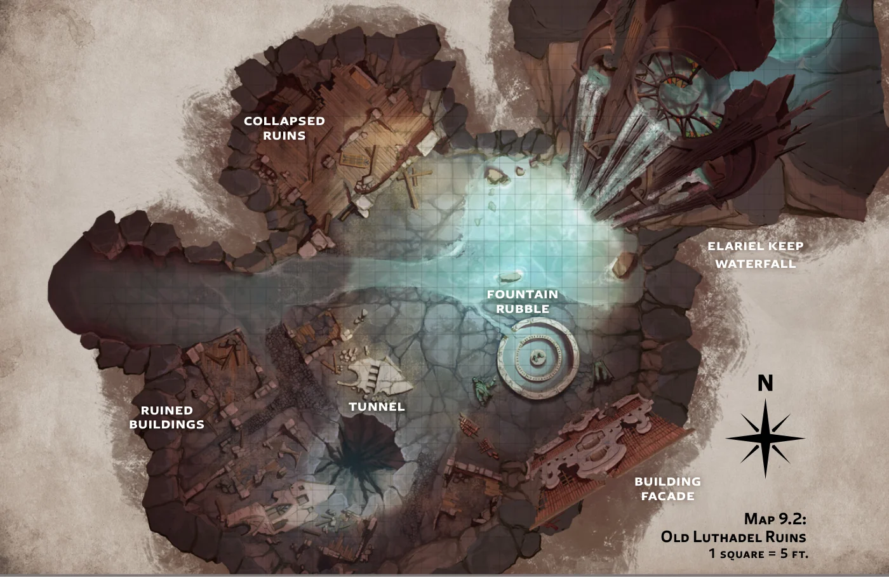
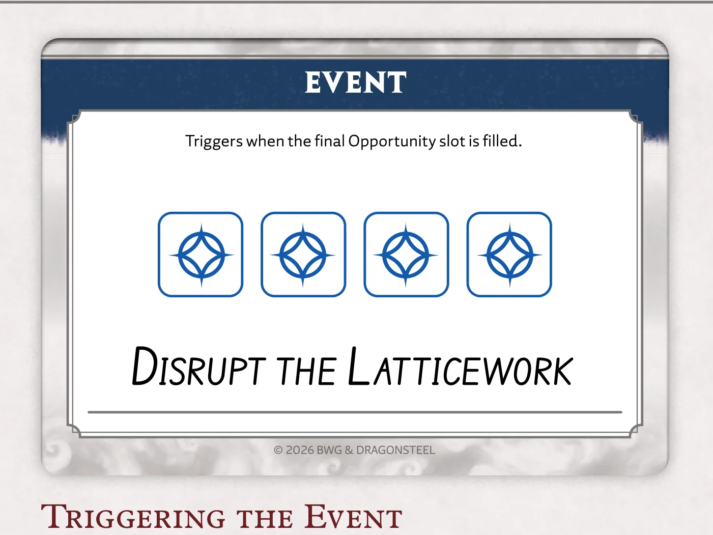
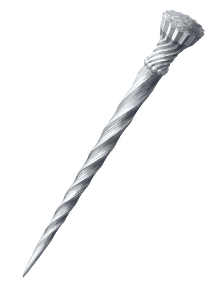
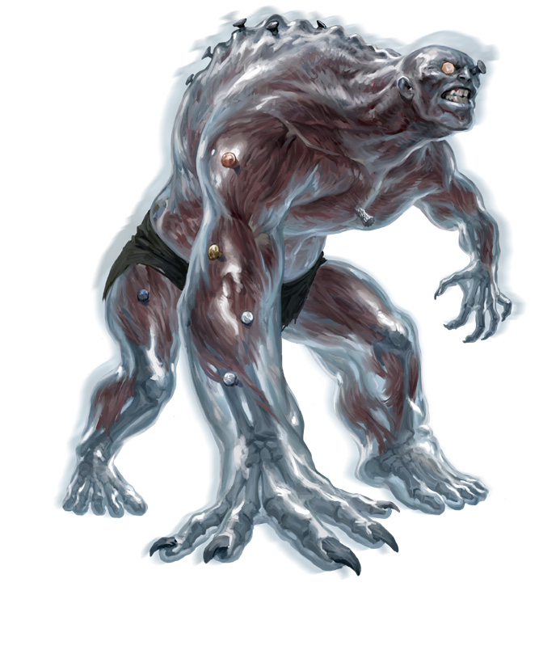

### 愚人的自由

第 9 章：一切終於陸沙德 184

PC 必須阻止血金術怪物逃到地面大肆破壞。鍍金三人組（Gilded Trio）的其餘成員也會加入戰局，企圖徹底除掉 PC。開始這場最終決戰前，請先閱讀「調整敵手生命值」和「鍍金三人組的戰術」。

### 調整敵手生命值

血金術怪物與至多兩名三人組成員並肩作戰，可能是 Bayron Conrad、Kwylliam Elariel 或 Lysarra Tekiel。未變身的成員在這場場景中失去首領（Boss）特徵。各方的起始生命值視倖存的三人組成員人數而定，見「調整後的敵手生命值」表。

### 調整後的敵手生命值

| 三人組的 倖存人數 | 未變身成員 的生命值 | 怪物的 生命值 |
| --- | --- | --- |
| 3 | 50 | 160 |
| 2 | 75 | 160 |
| 1 | — | 190 |

### 陸沙德廢墟

隊伍從血金術怪物挖出的隧道出來時，戰鬥便開始。朗讀：

|  | 你們沿著隧道往上，來到一座巨大的洞窟。 陽光從高處的裂縫透進來。 四周的泥地裡矗立著石造建築的殘骸。 風化的外牆與扭曲的金屬從天然岩層中斜斜冒出。 這裡就是舊陸沙德的廢墟。 |
| --- | --- |
|  |  |
|  | 東邊的瓦礫中倒著一尊青銅雕像 和一座老噴泉。東北方，一道瀑布 從數百呎高處傾瀉而下， 沖過一座古老貴族堡壘傾斜的殘骸。 水流穿過早已破碎的彩繪玻璃窗，碎片閃得像寶石。 瀑布在下方積成水潭，向西流去。正北方， 一座巨大的建築已經垮了一部分，隨時可能再度坍塌。 |
|  |  |
|  | 陽光下站著一道巨大的身影。半透明皮膚底下， 過長的骨骼與不自然地蠕動的肌肉糾成一團。 閃亮的尖刺嵌在畸形的身軀上。 那雙眼睛剛被尖刺穿透。 怪物仰面朝向陽光，放聲尖叫。 |
|  |  |
|  | 怪物伸屈帶爪的雙手，開始朝瀑布走去。 往上爬三百呎， 它就自由了。 |

如果 PC 中斷了昇華事件，也要描述其餘三人組成員分頭就位。Bayron 走向噴泉瓦礫，Kwylliam 移往坍塌廢墟，Lysarra 則鑽進隧道附近的毀損建築。如果昇華事件已觸發，其餘成員早已就位，暫時看不見他們。展示地圖 9.2，將血金術怪物放在隧道與瀑布的正中間。讓玩家把角色放在距離隧道入口 5 呎以內。若有 PC 在第 8 章聽過鐵眼的忠告，此刻便會想起他的警告。這股力量足以摧毀像依藍戴那樣的一整座城市。務必讓 PC 明白，他們得把怪物攔在舊陸沙德。

### 開始戰鬥

怪物心中只剩仇恨，不穩定的力量在體內奔竄。它怒吼著衝向地面。血金術怪物累積受到 30 點傷害，或有 PC 花費 [機遇] 使它墜落前，它會在快速輪次（Fast Turn）往瀑布移動並攀爬。適用下列規則：

- 每次以移動（Move，[1行動]）攀爬時，

  必須通過 DC 15 運動檢定。檢定失敗時，怪物不會墜落。

- 出口位於上方 300 呎。

- PC 可花費 [機遇]，使怪物失去立足點，墜落到洞窟底部。每墜落 10 呎，怪物就受到 1d6 衝擊傷害。

- 怪物攀爬時，PC 進行的所有檢定都要提高賭注。

在慢速輪次（Slow Turn），怪物使用運動技能獲取優勢（Gain Advantage，[1行動]），再用利爪（Claws，[1行動]）、反手揮擊（Backhand，[1行動]）或推射金屬（Propel Metal，[1行動]）攻擊觸及範圍內的 PC。如果沒有受到攻擊，它可能花費第三個動作移動（[1行動]），或躲到天然掩體後方架防（Brace，[1行動]）。

### 怪物暴怒

當怪物累積受到 30 點傷害或墜落到洞窟底部，以先發生者為準，它就會把注意力全轉向隊伍，直到每名 PC 都死了才會再次嘗試逃離。開始「破壞尖刺陣列」事件。

事件

### [變故]

### [機遇]

地圖 9.2：

### 舊陸沙德廢墟

每格 = 5 呎

### 事件：破壞

### 尖刺陣列

介紹「破壞尖刺陣列」事件時，朗讀：

曾是［Bayron／Kwylliam／Lysarra］的怪物緩緩轉身，

滿腔怒火全朝你們而來。每隔幾秒，怪物胸口的尖刺便像心臟般搏動一下。它的血肉隨之起伏，重新癒合，露出遍布全身的閃亮尖刺頭。

建立一項有四格的正面事件，代表 PC 拔除尖刺陣列、阻斷怪物再生能力的進度。

### 推進事件

PC 攻擊怪物時若獲得機遇，可選擇花費該機遇，將事件推進 1 格。能觸及怪物的角色也可以使用技能（Use a Skill，[1行動]），以怪物的實體防禦（19）為難度，進行運動、醫學或竊術檢定。擁有血金術師特殊專長的角色在這項檢定中獲得一個優勢。成功時，將事件推進 1 格。

### 觸發事件

填滿全部四格後，怪物便無法再恢復生命值。朗讀：

怪物巨大的畸形身軀猛然顫抖。

它驚慌地抓住釘在胸口的永恆尖刺（Eternity Spike），身上的傷口再也沒有癒合。

事件觸發後，怪物在本場景剩餘時間內無法再受益於永恆尖刺特性。

### 破壞尖刺陣列

### 破壞尖刺陣列

### 噴泉

### 瓦礫

### 隧道

### 埃拉瑞爾堡

### 瀑布

### 建築

### 外牆

### 毀損

### 建築

### 坍塌

### 廢墟

第 9 章：一切終於陸沙德 185

EDUARDO NONATO

### 鍍金三人組的戰術

未變身的三人組成員依本節所述方式參戰。

Bayron Conrad 的戰術

Bayron 躲在噴泉的瓦礫間，伺機使出「炸彈來了」（Fire in the Hole，[2行動]）擾亂 PC，隨後朝血金術怪物吼叫，要它「控制這股力量」。Bayron 嫉妒獲選的人，眼前的變身也讓他不知所措。他仍固執地拒絕承認事情已經脫離計畫。如果 PC 能利用他的不安或嫉妒，他可能在憤怒之下攻擊血金術怪物幾次，然後逃走。

Kwylliam Elariel 的戰術

Kwylliam 在坍塌廢墟就位，不斷騷擾 PC。Kwylliam 看得興高采烈，覺得同伴狂妄自大，變成怪物是活該。如果危險迫在眉睫，Kwylliam 可能躲起來，等危險過去再現身。

Lysarra Tekiel 的戰術

Lysarra 深感不安。她原以為尖刺會賦予同伴更強的力量，結果卻把人變成了怪物。她把一切都押在這個計畫上。Lysarra 以毀損建築為掩護，朝 PC 開火，一邊拚命試著讓變身的同伴聽進她的話。如果受到逼迫，或有人提出交易，Lysarra 可能為了保命而退出戰鬥。

第 9 章：一切終於陸沙德 186

ANNA VERHOOG & LUCAS TORQUATO

### 戰場效果

這場戰鬥中，角色可以利用下列地形：

**建築外牆。** 窗沿和陽臺提供了好幾處不同高度的落腳點。

攀爬建築外牆無須進行運動檢定。**坍塌廢墟。** 這座大樓向內坍塌了。

角色想抵達高處的陽臺，必須穿過內部腐朽的木造結構。這些結構搖搖欲墜，走起來相當危險。在這裡進行的所有檢定都要提高賭注。**埃拉瑞爾堡瀑布。** 這道超過三百呎高的瀑布

源自 香奈瑞河的一條支流。水流氣勢磅礴地沖過埃拉瑞爾堡的古老廢墟。**毀損建築。** 這裡的小建築歪斜得方向各異，

流水正在掏空它們的地基。**噴泉瓦礫。** 這裡有一座破裂的噴泉

和一尊古老的青銅雕像。角色可以用架防（▶）躲在瓦礫後，獲得掩護。**溪流。** 瀑布的水流進西邊的一座洞穴。

這片水域是困難地形（Difficult Terrain），水深仍可涉行。

### 愚人的自由

### 機遇與變故

| 結果 | 範例 |
| --- | --- |
| [機遇] | 一塊鬆動的洞壁或建築碎片砸向一名敵人。 敵人必須成功使用閃避危險（使用反應）， 否則受到 2d6 衝擊傷害。 |
| [機遇] | PC 找到一把沒有易碎（Fragile）特性的 黑曜石斧。 |
| [變故] | PC 驚動一群蝙蝠，引來蝙蝠 圍著自己亂飛。 PC 陷入迷惑（Disoriented），直到自己的下一個輪次結束。 |
| [變故] | 血金術怪物的力量暴漲。 它隨機使用「不穩定釋放」表中的一項力量， 且不會陷入震懾。 |

### 永恆尖刺（左）

### 和兩枚一般的

### 血金術尖刺

### 尾聲

### 戰後

血金術怪物會戰鬥到死，無法挽救、勸服或治癒。如果怪物被殺，身體會縮小，就像停止提取力量的藏金術師。其餘三人組成員若還活著，會精疲力竭地投降。PC 可以取回永恆尖刺（見附錄 C），並獲得兩枚第 3 階血金術尖刺（見《迷霧之子手冊》第 8 章的「血金術尖刺」）。從能提供血金術怪物「不穩定釋放」表所列金屬之子能力的尖刺中挑選。隊伍也會找到一枚銀色尖刺，泛著猩紅光澤，上面有鏽斑般的斑點。這是一枚 Trellium 血金術尖刺。Gilded Few 的裝備、發明和載具至少可賣得 4,000 盒金。接著進行「尾聲」。如果 PC 落敗，怪物會爬出洞窟，消失在北方蠻橫區的荒野中。幾週或幾個月後，它或許能適應新的身體，讓永恆尖刺聽從自己的意志。也可能從此四處遊蕩，成為司卡德利亞的禍患，直到一群新的英雄挺身而出。

### 血金術

### 怪物

隊伍離開洞窟時，朗讀下文，為冒險收尾：

你們走出舊陸沙德的洞窟，北方蠻橫區灼人的熱氣迎面而來。

你們解開了鍍金地圖與永恆寶庫埋藏了幾個世紀的謎團，也揭開了司卡德利亞歷史中一段被掩埋的往事。你們親眼見過古老的力量，也見識到不配擁有它們的人如何玩弄這些力量。你們直面過去的暴行，至少今天，司卡德利亞是安全的。然而，未來從來都不是理所當然的。它美麗而脆弱。有人盼望它，為它挺身而戰，為它流血。你們想怎麼度過自己的未來？

隊伍可以逮捕任何還活著的 Gilded Few 成員，將他們帶回依藍戴。至於永恆尖刺該怎麼處置，仍有待決定。選用場景「後記」提供了一種可能的答案。如果 NeBaal 沒有和 PC 一起進入永恆寶庫，會在隊伍走出洞窟時趕來會合。如果 PC 沒有救出 Wilko，她會趁三人組的部隊潰散時自行逃脫。若 PC 幾乎沒出手幫助 NeBaal 或 Wilko，也可以選擇擲劇情骰（Plot Die），判定該 NPC 的命運。若擲出變故，為該 NPC 進行傷勢擲骰（見《迷霧之子手冊》第 9 章）。冒險結束前，可以安排幾個短場景，讓 PC 有時間回顧自己達成的事，並和盟友一起慶祝勝利。問玩家在故事結束之際，自己的角色想和哪些 NPC 聊聊。你可以參考下列構想來帶領這些場景：

**NeBaal 的契約。** 這名坎得拉正在反思過往。

當初的 NeBaal 一心只想履行和 Vadilek 締結的原始契約，如今已走到這麼遠。NeBaal 從未料到司卡德利亞會如何改變，沒想過永恆尖刺會從此改變自己的一生，也沒想到這股無人能駕馭的力量竟是如此殘酷的諷刺。**Wilko 的任務完成了。** 儘管一路上危機重重，

Wilko 相信自己和隊伍真的改變了世界。她想繼續一起行動，協助擴大守護者組織，尤其是在 Merid 已經喪命的情況下。她也想探索舊陸沙德，尋找其他有待挖掘的歷史。**其他 NPC。** K.T.、Marthis 和 Merid 若還活著，

會對 Gilded Few 落敗大感驚訝。他們當中任何一人都能成為出色的第 2 階夥伴（見《迷霧之子手冊》第 8 章的「夥伴」）。若 Merid 先前還沒邀請過 PC，現在可能會邀請他們加入守護者組織。

第 9 章：一切終於陸沙德 187

ANA GRIGORIEVA

### 繼續你的戰役

### 永恆尖刺的未來

你可以選用「後記」，為玩家提供一個長期妥善保管永恆尖刺的辦法，也為往後的冒險留下伏筆。你可以採用這些構想，或用自己的點子，讓永恆尖刺成為更多冒險的起點。你也可以讓 PC 自己決定如何處置尖刺。是把它封存在國家檔案館，還是交由守護者組織保管？每支隊伍都會有自己的答案。《迷霧之子傳承》的冒險已經落幕，但你們的故事還可以繼續。更多構想見「繼續你的戰役」。

### 後記

PC 擊敗血金術怪物後，任何時候都可以安排這個選用場景。當所有 PC 帶著永恆尖刺一起行進時，一名黑衣人走近。他就是鐵眼（見第 8 章的「與死亡擦肩而過」），世上許多人都視他為死亡的化身。朗讀：

|  | 死亡就站在你們面前。 |
| --- | --- |
|  |  |
|  | 鐵眼，最後一名審判者，從傳說中走出來的人。 他用一雙嵌著尖刺的眼睛望著你們， 神情難以捉摸。 |
|  |  |
|  | 「永恆的持有者，」他開口說。 「你們已經為司卡德利亞立下一大功。現在，我還有一事相求。 請把尖刺交給我。我會妥善保存， 直到這股力量可以安全使用的時候。」 |
|  |  |
|  | 他伸出一隻手。「這是我的請求，由你們 自己決定。 只要你們答應，你們將得到和諧的眷顧，也會得到我的眷顧。」 |

如果 PC 拒絕交出尖刺，鐵眼會失望地離去。「組織」和鬼血等其他勢力很可能會對尖刺產生興趣，由此引發更多冒險。

如果角色同意交出永恆尖刺，可以選擇讓和諧親自擔任贊助者（Patron）。和諧日後會指派其他任務給 PC。此外，鐵眼也會開始關注隊伍。下次有一名 PC 身陷性命之危時，鐵眼會現身相助。

角色擊敗血金術怪物後，升至第 10 級。司卡德利亞還有許多精彩的冒險等著你們：

- 調查血金術怪物尖刺陣列中的 Trellium 尖刺從何而來，或許會與「組織」交鋒。

- 繼續帶 NeBaal 看看這個世界，並幫助 NeBaal 重返第二時代的坎得拉社會。

- 與 Wilko 教授合作，調查司卡德利亞往昔的其他謎團。

- 與鐵砧聯手，彌補 Gilded Few 造成的傷害。

- 加入守護者組織，駕駛飛艇，走遍依藍戴盆地，推進組織的計畫。

「沒有啊，我不擔心。

### 其實，我真的覺得

### 一切總算會

### 好起來了。」

——Lestibournes，

### 迷霧之子大人

第 9 章：一切終於陸沙德 188

