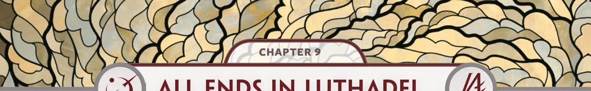
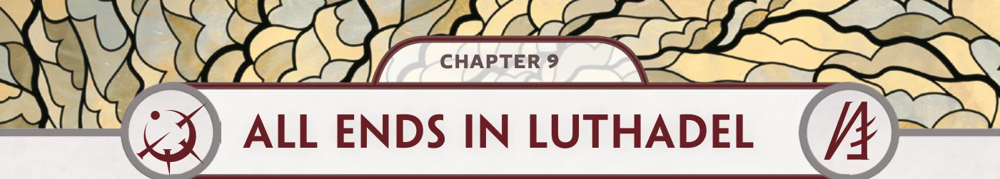
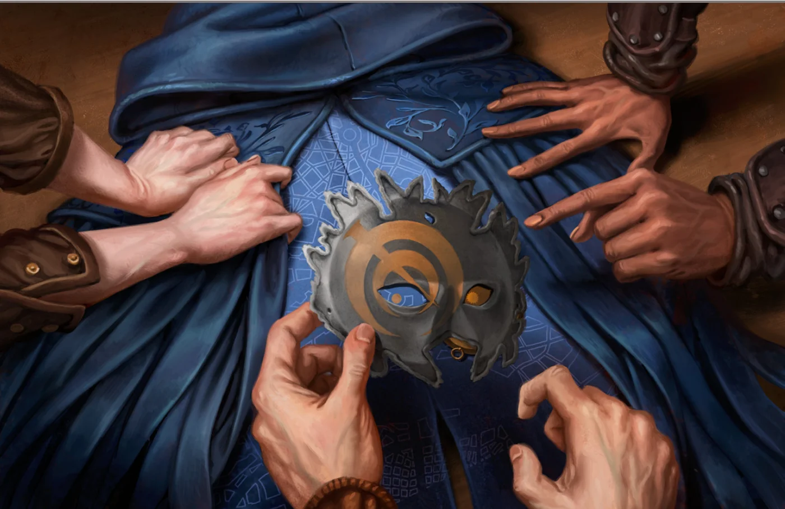
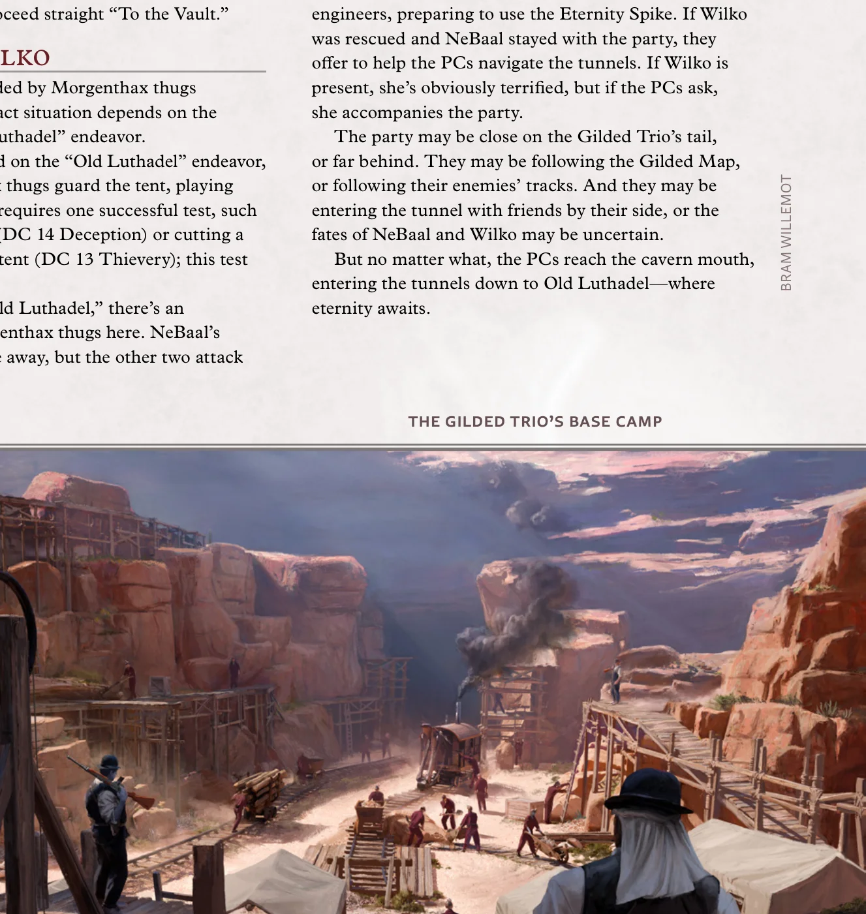
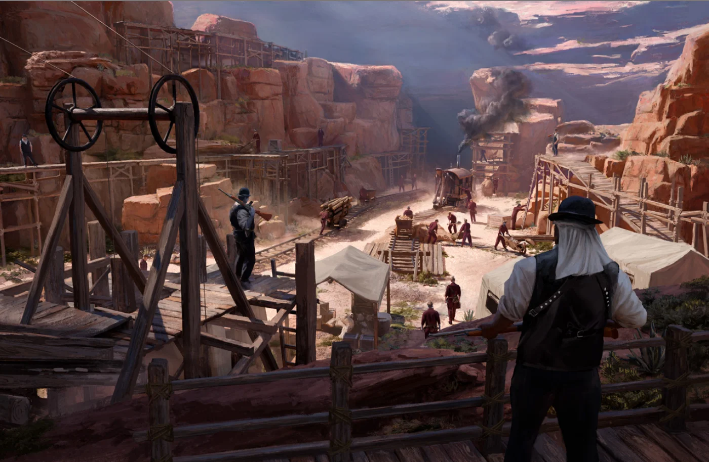

### 帶領本章冒險

### 前往過去

### 第 9 章

### 一切終於陸沙德

在第二時代的冒險中，PC 親眼見識鍍金三人組（Gilded Trio）為了實現險惡野心，能做到什麼地步。到了最後一章，隊伍將見證永恆尖刺（Eternity Spike）的力量，並決定它最終的歸宿。

鍍金三人組帶著偷來的尖刺陣列和遭俘的 Azmine Wilko 教授，搭乘 Breaknaught 列車北上。他們急著完成昇華儀式，在 PC 追上來展開最後的生死決戰前用上永恆尖刺。

### 本章流程

本章開始時，隊伍必須拼湊鍍金地圖（Gilded Map），一路向北追蹤鍍金三人組，前往舊陸沙德。他們可以先在三人組的基地營救 Wilko 教授，再進入永恆寶庫探索地城。主持本章前，依照玩家在第 4 章的選擇和繪製的地城地圖準備寶庫。「準備寶庫地城」會逐步說明主持人要做的準備。你也必須從鍍金三人組中選出一名「天選之人」，擔任戰役的主要反派。選一個最能讓玩家的故事扣人心弦、與角色切身相關的反派。此人將得到永恆尖刺並「昇華」。本章的朗讀文字假設三人組成員全都活到了這裡。如果其中一兩人在第 9 章前已經喪命，請預先調整朗讀文字，反映他們已經不在。PC 的傳承在最終章有不同的作用。重新拿出玩家在第 4 章填寫的「我的傳承」講義。最終決戰中，第一時代和第二時代 PC 的傳承會彼此交會（見「命運的絲線」）。也請查看本章的「編年史家傳承」和「囚犯傳承」側欄。

最後，為「愚人的自由」中的決戰做準備時，請查看血金術怪物的數值資料。你可以用其中的特性和動作呈現你選定的主要反派。其餘存活的三人組成員使用修改後的數值資料，以勁敵身分參戰，主要頭目則由你選出的反派擔任。如果隊伍擊倒血金術怪物，Gilded Few 就此敗亡，PC 也完成了第一時代永恆尖刺最初守護者的傳承。接下來要做什麼，由第二時代的 PC 自行決定。在「後記」中，鐵眼會提出一項建議。

### 角色升級

第二時代角色在本章開始時為第 8 級，進入寶庫地城後升到第 9 級。PC 擊敗血金術怪物、終結 Gilded Few 後，升到第 10 級。

本章緊接第 8 章的事件。讓 PC 有機會迅速整隊，準備追趕鍍金三人組。若 PC 還不知道下列消息，NeBaal 會告訴他們：

- Wilko 教授聽說三人組已找到舊陸沙德。Lysarra 資助那裡一處祕密挖掘工地，將近一年了。

- 鍍金地圖能指引持有者穿過舊陸沙德下方的隧道，找到寶庫入口。三塊地圖碎片拼在一起就能看出路線。

- 三人組有 Wilko 在手，也拿到了她記錄鍍金地圖研究筆記的日誌。他們遲早能在舊陸沙德隧道裡找到存放永恆尖刺的永恆寶庫。

- Lysarra 從 Gilded Few 身上取出的尖刺，就是永恆尖刺昇華儀式所需的尖刺陣列。

- Breaknaught 正開往舊陸沙德。

為了司卡德利亞的未來，也為了 Wilko 的安全，PC 應盡快跟上。

172

### 熟悉的面孔

NeBaal 和 Merid 會在 PC 出發前主動找上他們。如果 Merid 已死，則由另一名守護者組織成員、第 5 章的檔案管理員 Wynn Letrelle 代替他。PC 如果主動去找，還能見到幾名仍然活著的 NPC：

NeBaal。NeBaal 堅持與隊伍同行。NeBaal 擔心 Wilko 的安危，也覺得自己對事情發展到這一步有責任。NeBaal 重提第一時代 PC 的英勇事蹟，表示自己無法袖手旁觀。K.T. Quiven。如果 PC 去找 K.T.，會發現她不在。調查她的宿舍房間，可以找到偷來的 Conrad Industries 制服，以及記錄 Lysarra 那節 Breaknaught 車廂的筆記。看來她又去臥底了。如果 PC 還沒找到地下一層的月台，現在可以循著 K.T. 的筆記找到那裡。埃拉瑞爾／太齊爾家族的 Marthis。若 PC 救了 Marthis，他會把他得知的行前準備全告訴隊伍，包括 Lysarra 預定前往舊陸沙德的路線，以及當地乾燥的氣候。隊伍在「前往廢墟」試煉中直接累積 1 次成功。Merid 或 Wynn。若 Merid 還活著，他會把永恆寶庫的藍圖交給 PC。把玩家在第 4 章畫的寶庫配置圖交給他們，圖上要有所有陷阱的標記。守護者組織承諾會盡力幫忙。若 Merid 已死，Wynn 仍會代表守護者組織送來藍圖，但這個祕密結社目前一片混亂，無法再提供其他協助。

跨時代連結

永恆寶庫的藍圖由第一時代的 PC 在第 4 章繪製。幾個世紀以來，守護者組織代代保存這份藍圖。它本身也成了一件傳世遺物，只為等到這一刻。

### 前往廢墟

PC 可以沿著 Lysarra 的祕密地下鐵路追蹤，但要抵達舊陸沙德仍非易事。隊伍必須搭乘火車或船，走 600 英里抵達北方蠻橫區 Callingfale 一帶。然後，他們還得穿越約 75 英里沒有道路的崎嶇岩漠，才能抵達舊陸沙德的廢墟。將這段旅程作為一場試煉（Endeavor）來帶領（見「結算試煉」）。PC 必須克服三道障礙才能抵達廢墟：解讀地圖碎片、安排快速交通，以及在邊境求生。

### 特殊規則：昇華將至

「昇華」事件從現在開始倒數（見本章稍後的「事件：昇華」）。先向玩家介紹一項尚未命名的負面事件，以及一條有八個變故（Complication）格的事件進度軌（Event Track）。隊伍每缺少一塊從未取得的鍍金地圖碎片，就將事件推進 1 格。每次推進事件都要讓玩家看見，直到「與永恆競速」才完整揭露事件的目的。現階段只在規則指示時推進事件。發生變故時，進度軌維持原位。「前往廢墟」試煉中的失敗代表耽擱，讓三人組有時間推進昇華。PC 每在試煉中累積一次失敗，就填滿事件進度軌上的一格，並描述鍍金三人組與其手下快速前進所留下的跡象，例如棄置的營地、泥地上的輪胎痕，或是貴族率隊往東北前進的傳聞。

### 特殊規則：片刻歇息

這場試煉穿插兩段角色扮演場景。建議按下列順序進行：

- 解讀地圖碎片後，進行「拼湊地圖」。

- 安排好交通後、在邊境求生期間，或 PC 在試煉中失敗時，進行「我們已經走了這麼遠」。

第 9 章：一切終於陸沙德 173

### 帶領試煉

PC 依序遭遇下列障礙：

解讀地圖碎片。如果 PC 有三塊地圖碎片，地圖很容易拼妥，他們自動取得 1 次成功。否則，他們可以把手上的地圖片段與陸沙德的歷史地圖交叉比對（DC 20 推理），或用自然知識解讀地圖（DC 18 求生）。累積 1 次成功或 2 次失敗後，進入下一道障礙。安排交通。PC 可以協商搭火車或船快速通行（DC 18 說服），或為穿越北方蠻橫區的陸路行程挑選良馬（DC 16 求生）。若 Merid 還活著，PC 在這些檢定中獲得一項優勢。守護者組織也會提供一艘實驗用小飛艇代步，但它需要專人維護（DC 16 工藝），而且容易故障。累積 1 次成功後，進入下一道障礙。在邊境求生。PC 可以辨識北方蠻橫區的危險（DC 16 求生）、協助隊伍避開盜匪或克羅司氏族的注意（DC 18 感知），或在跋涉途中維持士氣（DC 16 領導）。這裡很適合提高風險。

### 片刻歇息：拼湊地圖

這段場景發生在地圖解讀完畢不久後。如果 PC 有完整地圖，NeBaal 心懷希望。朗讀：

「面具、勳章，還有迷霧披風。」NeBaal 把三件物品移到一起，將縫線和刻紋對上，直到三塊碎片相互交疊，顯出圖樣。NeBaal 後退一步，抱起雙臂。「鍍金地圖。」

如果 PC 沒有完整地圖，NeBaal 則憂心忡忡。朗讀：

NeBaal 盯著手上零碎的地圖，目光凝重，然後抬起頭。「我就直說吧。少了完整的鍍金地圖，事情會難辦得多。能從這些碎片看出來的，我們都看過了。三人組手上的地圖也不完整，但他們有 Azmine 和她的筆記。恐怕得看誰先搶到尖刺了。」

NeBaal 想與隊伍同行。如果 PC 和 NeBaal 關係良好，這名坎得拉會低聲發誓，必要時願意傷害 Gilded Few，為此打破坎得拉的禁忌。

### 拼湊鍍金地圖

LUCAS TORQUATO

### 片刻歇息：我們已經走了這麼遠

旅途中有一晚，NeBaal 在眾人入睡前主動開口。NeBaal 坦承，想找點話題轉移對 Wilko 安危的憂慮，也可能談起第一時代的角色受到傷害，至今仍為此懊悔。用下列問題讓角色聊起來。請每位玩家依序選一道問題，由自己的 PC 回答，或向另一名角色提問：

- 你覺得鍍金三人組中誰最危險？

- 你怎麼看 Lysarra 屠殺 Gilded Few 的事？

- 舊陸沙德曾是最後帝國的心臟。現在要前往那裡，你有什麼感受？

- 如果你拿到永恆尖刺，會拿它做什麼？

- 你覺得該研究古老的力量，還是讓那些力量永遠留在過去？

- 如果只能在營救 Wilko 教授和阻止鍍金三人組之間選一件，隊伍該怎麼做？

- 你怎麼看守護者組織，以及他們建立的祕密結社？

- 如果你沒能活著回來，有什麼事想託付隊伍嗎？

### 結算試煉

隊伍若在累積 3 次失敗前取得 5 次成功，或以其他方式繞過三道障礙，試煉即告成功。成功。PC 行進順利，抵達舊陸沙德時已養足精神、準備行動，緊追在三人組後方。每位 PC 獲得堅定（Determined）狀態。失敗。這趟旅程令人筋疲力盡。PC 抵達時，明顯已被鍍金三人組甩在後頭。

### 舊陸沙德

PC 發現，通往舊陸沙德廢墟的洞穴入口周圍已被鍍金三人組紮營占據，到處都有敵方人手。PC 抵達時，朗讀：

碎岩斜坡一路向下，通往敞開的巨大洞口。洞內便是舊陸沙德的隧道，以及埋在谷底下方的廢墟。瓦斯燈閃爍的光照亮前路，一整座考古挖掘工地就在你們面前。放眼都是帆布帳篷、挖掘機具和一小段段的鐵軌。Conrad Industries 的工程師在補給箱之間穿梭，武裝精良的 Morgenthax 打手則在營地外圍巡邏。

營地擋在 PC 和陸沙德廢墟之間，也給了他們摸清下方情勢的機會。NeBaal 敦促 PC 找尋 Wilko。將 PC 潛入營地的過程作為一場試煉（見「結算試煉」）。PC 前往隧道入口途中可以完成一些選擇性的目標：調查三人組的計畫、讓鍍金部隊陷入混亂，以及營救 Wilko 教授。試煉一開始，要明確詢問玩家是否打算營救 Wilko，因為這會增加試煉難度。可能遇到的障礙包括：

偵察指揮帳篷。隊伍沿著帆布帳和成堆的物資悄悄靠近 Morgenthax 傭兵（殺霧者）和 Conrad 工程師。PC 可以在帳篷間快速穿梭，避開耳目（DC 16 隱匿），或換上偽裝（DC 17 竊術），偷聽到有用的消息：「昇華準備」已經開始，三人組已經進入隧道，教授則被關在營地西緣的帳篷裡。Wilko 在哪裡。一名 PC 四下查看營地，可能發現有座帳篷戒備森嚴（DC 15 洞察），或翻閱工程師的文件找出 Wilko 的位置（DC 18 推理）。人員失和。Morgenthax 的犯罪分子和 Conrad 的公司員工互看不順眼，隊伍可以利用這股緊張情勢。PC 可以混入人群，引出埋怨、讓人打開話匣子（DC 15 領導），誘導壓力沉重的 Conrad 工程師抱怨人員失蹤一事（DC 16 說服），或假扮 Morgenthax 的傳令員，傳達「修訂命令」製造混亂（DC 16 欺騙）。

### 結算試煉

隊伍若在累積 3 次失敗前取得 4 次成功，試煉即告成功。如果 PC 選擇營救 Wilko，所需的成功次數增加至 5 次。若 PC 先前在「前往廢墟」試煉中成功，他們抵達時，三人組才剛匆忙離去。描述營地尚未收拾的凌亂景象，讓隊伍在試煉開始時就累積 1 次成功。成功。隊伍順利穿越營地。無論使用欺騙、偷竊或刺探，PC 都能多打聽到一些鍍金三人組部隊的情報，例如兵力組成和人數，

第 9 章：一切終於陸沙德 175

以及這些人手在寶庫裡的位置（見「探索洞穴」）。如果 PC 選擇營救 Wilko，接著進行「營救 Wilko」。否則，NeBaal 會獨自離隊去救教授，PC 則接著進行「前往寶庫」。失敗。PC 被發現了。為了挽救任務，NeBaal 冒險離隊引開注意，要 PC 別等自己，繼續前進。如果 PC 選擇營救 Wilko，接著進行「營救 Wilko」。否則，直接進行「前往寶庫」。

### 營救 Wilko

Wilko 被關在一座由 Morgenthax 打手（殺霧者）看守的帳篷裡。確切情況取決於「舊陸沙德」試煉的結果。若 PC 在試煉中成功，只有兩名無聊的 Morgenthax 打手守著帳篷，正在玩牌。只要通過一項檢定就能進去，例如騙過守衛（DC 14 欺騙），或在帳篷背面割出一個洞（DC 13 竊術）。這項檢定獲得一項優勢。若 PC 在「舊陸沙德」試煉中失敗，這裡會有五名警戒的 Morgenthax 打手。NeBaal 引開其中三名，另外兩名一看到 PC 就會攻擊。

PC 找到 Wilko 時，她正試圖用銼刀割開帳篷逃出去。她告訴 PC，三人組拿走了她的日誌，已經進入隧道。接著進行「前往寶庫」。

### 前往寶庫

到了這一步，PC 必定已知道三人組正帶著守衛和工程師趕往寶庫，準備使用永恆尖刺。如果 Wilko 已獲救，而 NeBaal 仍和隊伍在一起，兩人會主動提議協助 PC 在隧道中找路。Wilko 若在場，顯然嚇壞了，但只要 PC 開口，她還是會同行。隊伍可能就跟在鍍金三人組身後，也可能遠遠落在後頭。他們或許正循著鍍金地圖前進，或許正追蹤敵人留下的足跡。他們可能有朋友相伴進入隧道，也可能還不知道 NeBaal 和 Wilko 的下落。無論如何，PC 都會抵達洞口，走進通往舊陸沙德下方的隧道。永恆就在那裡等著他們。

### 鍍金三人組的基地

BRAM WILLEMOT

