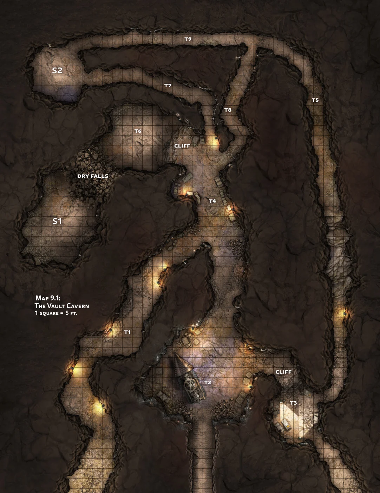
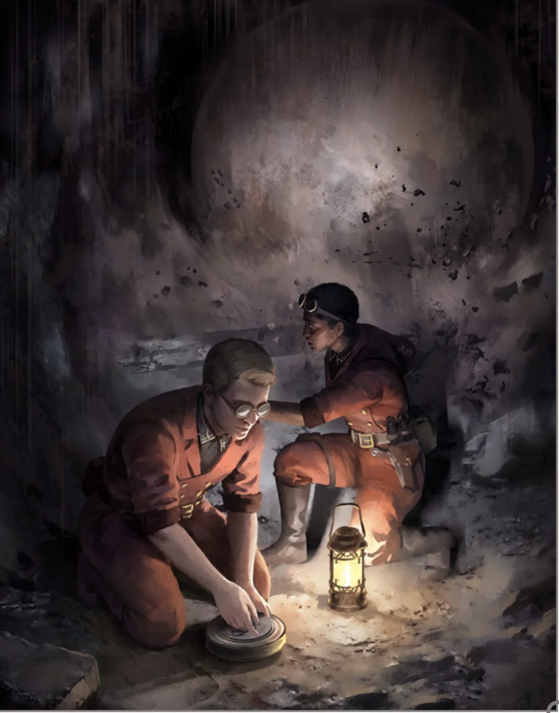
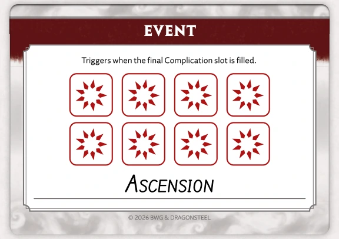
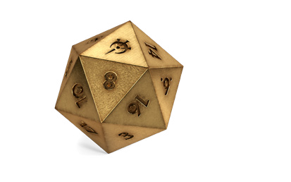

### 與永恆競速

隊伍在隧道中找路時，鍍金三人組（Gilded Trio）已帶著一支受雇的挖掘隊進入永恆寶庫，開始昇華儀式。這座寶庫地城由你和玩家共同設計，既包括第一時代 PC 選擇的防禦設施，能為隊伍提供幫助，也有三人組的部隊阻擋去路。如果你還沒準備好寶庫地城，請先暫停遊戲，完成「準備寶庫地城」的步驟。這時也可以處理「角色升級」。準備好後，接著進行「帶領地城冒險」。

### 角色升級

第二時代角色一進入寶庫地城，就升到第 9 級。告訴玩家，這是第二時代戰役最後一次升級，並和他們一起完成第二時代 PC 的最後調整。故事跨越了兩個時代，如今，與 Gilded Few 和永恆尖刺（Eternity Spike）的最終對決就在眼前。

> 譯註：此處稱第 9 級為最後一次升級。原書本章總覽與〈愚人的自由〉另寫明，角色擊敗血金術怪物後升至第 10 級。

### 準備寶庫地城

主持人需要事先做好以下準備：

- **放置鍍金三人組。** 鍍金三人組正在最後一個房間準備昇華。第一時代 PC 把尖刺匣放在 S1 或 S2 洞窟的哪一處，就把三人組放在那裡。

- **決定天選之人。** 決定三人組中哪一名反派獲選昇華。三人渴望成神的理由各不相同。想想誰最能讓你的隊伍期待這場對決，再做決定。

- **檢視地城流程。** 仔細閱讀「特殊規則：處理陷阱」，並瀏覽地圖 9.1 和「探索洞穴」，完成最後的準備。情況適用時，記得向玩家描述「隧道地形」。

### 帶領地城冒險

準備好帶領寶庫地城時，依照下列步驟進行：

1. **說明事件。** 前往「事件：昇華」，向玩家完整揭露這項負面事件，並依該節指示確認已填了幾格。

2. **選擇地城入口。** 南面的入口是新挖的隧道。地上深深的履帶痕顯示它才剛完工（見下方「T2：鑽掘作業」）。若 PC 擁有完整的鍍金地圖（Gilded Map），可以選擇從西南（T1）、南面（T2）或東南（T3）任一入口進入。否則，PC 只能循著鑽掘機的履帶痕走，把他們放在南面入口。3. **帶領地城冒險。** 使用地圖 9.1 和「探索洞穴」各區域的說明。第二時代 PC 每次進入第一時代 PC 設有陷阱的房間，都要查看該房間的陷阱配置。接著查閱「特殊規則：處理陷阱」，判定陷阱發揮得如何。陷阱的傷害骰由玩家擲骰，並邀請他們描述觸發的陷阱如何影響房間裡的人。最後，第二時代 PC 進入該房間，應付任何倖存的鍍金部隊。4. **到此為止。** PC 抵達三人組所在處（見「昇華遭中斷」），或昇華事件觸發（見「事件：昇華」）時，地城冒險便告結束。

### 特殊規則：變故不斷

角色正在分秒必爭地拯救司卡德利亞，再沒有比這更重大的關頭。戰鬥以外，PC 凡是為了直接與三人組部隊互動而進行的關鍵檢定，都要提高賭注，並加上一個劣勢。每個變故（Complication）都會自動推進昇華事件。

囚犯傳承時刻

建立一項名為「總還有一個祕密」的正面事件。機遇格數等於 5 減去囚犯在第 4 章留下的記號數。PC 可以花費 [機遇]，將事件推進 1 格。說書人（Storyteller）以這種方式花費

[機遇] 時，將事件推進 2 格。若事件觸發，請囚犯的玩家從陷坑、擺盪斧刃或牆面飛鏢中選一項，並由說書人把陷阱加到寶庫洞窟地圖上。陷阱立即觸發。

跨時代連結

多虧第一時代的 PC，第二時代的隊伍已經知道陷阱的位置。一般地城的陷阱通常會讓玩家措手不及，這裡的陷阱則是他們細心規劃換來的回報。著重描述第一時代隊伍的準備如何重創鍍金三人組的部隊，並鼓勵玩家想出活用陷阱的方法。

第 9 章：一切終於陸沙德 177

### 特殊規則：處理陷阱

只要陷阱位置沒有移動（見「不可靠的陷阱」表），PC 就知道它的確切位置，自願穿越陷阱所占空間時也不會觸發它。強制移動仍可能觸發陷阱，例如敵人把 PC 推撞（Shove）進陷阱時。規則指示你觸發陷阱時，依下列步驟處理：

1. 陷阱若沒有加裝「加固」改裝，就可能無法正常運作。擲骰查閱「不可靠的陷阱」表。2. 陷阱觸發時，依照「寶庫陷阱效果」與房間的陷阱配置，對房間內的角色套用效果。陷阱的傷害骰由玩家擲骰。

### 不可靠的陷阱

| d4 | 結果 |
| --- | --- |
| 1–2 | 陷阱照常運作。 |
| 3 | PC 進入房間時，陷阱尚未觸發。 場景中每當有角色本應觸發陷阱， 就擲劇情骰（Plot Die）。只有擲出 [變故] 時才觸發。 |
| 4 | 多年來，自然環境已有變化， PC 進入房間時，陷阱尚未觸發。 選擇一項：陷阱淹在水中、 位置移動了最多 15 呎，或裡面住了 四條暴躁的蛇（見《迷霧之子手冊》 的「動物夥伴」附錄）。 |

### 探索洞穴

鍍金三人組的部隊已在洞窟中等著迎戰 PC。若第一時代 PC 曾在房間設置陷阱，請在 PC 進入時查看該房間的陷阱配置。PC 要趕在昇華事件觸發前抵達 S1 或 S2 洞窟，視第一時代 PC 將尖刺放在哪一處而定。

### T1：亡命徒哨兵

此區與 T4 相連。如果 PC 在第 7 章說服鐵砧倒戈對抗 Bayron，這座洞窟空無一人。否則，這裡有三名 Ironbrands（自由鬥士）和鐵砧。若鐵砧已死，由一名克羅司氏族守護者代替。如果隊伍曾在第 7 章和鐵砧交戰，Ironbrands 一看到 PC 就會攻擊。否則，他們早就受夠了三人組，願意談判。鐵砧會花費專注抵抗 PC 在第 7 章已經用過的說詞，但願意聽取新證據。若 PC 能提出更好的條件，她也願意停手或出手相助。

**陷阱配置。** 照常觸發陷阱。陷阱觸發後，

倖存的 Ironbrands 心生畏懼。PC 與他們談判的檢定獲得一個優勢。

### T2：鑽掘作業

此區與 T3 和 T4 相連。兩名 Conrad 特勤人員守著南面入口，PC 從該方向接近時，隱匿檢定獲得一個劣勢。洞窟中央有一台改裝過的太齊爾蒸汽引擎，長 25 呎、寬 10 呎，裝有巨大的鑽頭。它剛鑽出一條通往寶庫的新隧道。啟動時，燃煤鍋爐必須先加熱一輪，機器才可移動，以每輪最多 5 呎的速度鑽穿岩石。鑽掘機的實體防禦為 18，生命值為 50，偏轉值（Deflect）為 3。擁有工程學實用專長的 PC，或通過 DC 18 推理檢定的 PC，可以弄懂如何操作鑽掘機。若曾看過第 8 章的藍圖，這項檢定獲得一個優勢。

**陷阱配置。** 觸發的陷阱只影響鑽掘機。

如果鑽掘機受到 10 點或更多傷害，就會卡住，必須通過 DC 16 工藝檢定才能恢復運作。

### T3：工程師

此區與 T2 和 T5 相連。三名 Conrad 工程師在隧道內勘查、記錄並測量。其中一名工程師帶著一枚鎔金手榴彈，目前已注入鐵鎔金術（3 點授予）。

**陷阱配置。** 照常觸發陷阱。陷阱觸發後，

倖存的工程師會分心。PC 對這些工程師進行檢定時，例如進行隱匿檢定，獲得一個優勢。

### T4：爆破專家

此區與 T1、T2、T6、T7 和 T8 相連。兩名 Conrad 工程師正在布設三枚地雷（見附錄 B）。另外兩名 Conrad 特勤人員在 10 呎外看守補給品，其中還有兩枚地雷、兩枚震盪手榴彈和一把霰彈槍。

**陷阱配置。** 照常觸發陷阱。如果任一名 Conrad

工程師死亡，三枚地雷也會引爆，使 T4 區域的隧道局部坍塌。除了地雷和陷阱造成的傷害，坍塌還會造成 2d6 衝擊傷害。陷阱觸發後，倖存的特勤人員會心驚膽戰地看守補給品。

第 9 章：一切終於陸沙德 178

HEROIC MAPS

地圖 9.1：

### 寶庫洞窟

每格 = 5 呎

### t9

### t7

### t8

### t4

### t6

### t1

### t2

### 乾涸瀑布

### 峭壁

### 峭壁

### t5

### t3

### S2

### S1

### 設置陷阱數百年後，

### 陷阱觸發了！

第 9 章：一切終於陸沙德 180

JOSHUA CHIA

### T5、T7 與 T9：精銳狙擊手

各隧道連接數處區域：

- T5 與 T3、T8 和 T9 相連。

- T7 與 T4 和 S2 相連。

- T9 與 T5、T8 和 S2 相連。

這些隧道各有一名狙擊手（Conrad 精銳特勤人員）埋伏。每名 PC 第一次進入隧道時，狙擊手以該 PC 的靈魂防禦為難度進行隱匿檢定。若成功，狙擊手對該 PC 保持隱藏。直到狙擊手出手攻擊或以其他方式暴露位置前，該 PC 都無法感知他。

**陷阱配置。** 照常觸發陷阱。

### T6：Morgenthax 的伏擊

此區與 T4 和 S1 相連。一支精銳小隊在狹窄通道設伏，留意隊伍的動靜與鎔金術的跡象。小隊有兩名 Morgenthax 刺客（殺霧者）、兩名打手，以及一名領隊（精銳殺霧者）。領隊穿著木製半身板甲。

**陷阱配置。** 照常觸發陷阱。

### T8：被迫拆除陷阱

此區與 T4、T5 和 T9 相連。K.T. Quiven（線人）假扮 Conrad 工程師，已混入三人組的部隊。三名 Conrad 特勤人員命令喬裝的 K.T. 檢查有無陷阱，然而她並不具備這方面的能力。若 PC 幫她，她會給他們一根炸藥。

**陷阱配置。** 這裡的陷阱還沒觸發。

K.T. 差一點就要觸發它了。

### 寶庫陷阱效果

第一時代 PC 打造的陷阱具有以下特性：

**規避。** 這項 DC 適用於尋找陷阱的感知檢定，

也適用於解除陷阱的工藝或竊術檢定。如果 PC 即將觸發陷阱，可以使用閃避危險（Avoid Danger）反應，以相同 DC 進行敏捷檢定，避免觸發陷阱。**效果。** 陷阱在規則上的效果。

陷阱可能包括「寶庫陷阱效果」表所列的種類。

### 陷阱改裝

改裝過的陷阱獲得下列額外效果：

**酸液塗層。** 此陷阱額外造成 4d4 命力

傷害。**巧妙隱藏。** 即使陷阱已經觸發，NPC 仍不知道觸發裝置的位置，有可能再次觸發它。感知這個陷阱的檢定獲得一個劣勢。**加固。** 這個陷阱無須查「不可靠的陷阱」表擲骰（見本章前面的「特殊規則：處理陷阱」）。

### 隧道地形

隧道中有一處顯眼的乾涸瀑布岩床，以及幾面陡峭的峭壁。

### 乾涸瀑布

地圖標出了一道早已乾涸的舊瀑布。經過多年侵蝕，瀑布後方隱密洞窟（S1 區域）的入口已經坍塌。通過 DC 14 求生檢定，就能在岩石間找出安全路線。若失敗，PC 會花時間找路，推進昇華事件。

### 斜坡與峭壁

地圖標示的這幾面陡峭岩壁高 20 呎，位於 T3 北側和 T6 東側。要安全通過，須通過 DC 14 運動檢定。若失敗，角色會墜落並受到 1d6 衝擊傷害。若角色在通過峭壁時觸發陷阱，這項運動檢定獲得一個劣勢。

### 寶庫陷阱效果

| 種類 | 規避 | 效果 |
| --- | --- | --- |
| 酸池 | DC 19 | 角色掉入酸液時，受到 9d4 命力傷害， 並陷入折磨 [1d4 命力]，直到有人用水沖洗。 若 PC 未加以阻攔，受陷阱影響的 NPC 可在 2 輪內找到水。 |
| 假尖刺匣 | DC 16 | 這個陷阱只影響附近的鍍金三人組部隊。 他們忙著想打開匣子，因而分心， 感知檢定獲得一個劣勢。 |
| 陷坑 | DC 17 | 角色掉入這個 20 呎深的坑時， 因墜落受到 1d6 衝擊傷害， 並因尖刺受到 5d6 銳利傷害。 要爬出陷坑，須通過 DC 12 運動檢定。 |
| 巨石陷阱 | DC 16 | 一顆直徑 10 呎的巨石墜落。 下一輪開始時，巨石滾動 20 呎。 此後每輪開始時滾動 40 呎，撞牆時停止。 被巨石碾過的角色受到 8d6 衝擊傷害。 |
| 尖刺陷阱 | DC 15 | 陷阱觸發時，尖刺從地面竄出或從天花板落下， 造成 4d6 銳利傷害。 |
| 擺盪斧刃 | DC 18 | 觸發後，金屬斧刃在房間兩端之間來回擺盪 1 分鐘。 角色進入陷阱或在其中開始回合時， 必須通過 DC 18 敏捷檢定，否則受到 6d8 銳利傷害。 |
| 牆面飛鏢 | DC 15 | 觸發時，飛鏢從牆中射出， 造成 7d4 銳利傷害。 |

第 9 章：一切終於陸沙德 181

### 事件：昇華

昇華是一項有八格的負面事件，代表鍍金三人組完成昇華儀式的進度（見《迷霧之子手冊》第 9 章的「事件」）。昇華事件進行期間，一名獲選的三人組成員正接受尖刺陣列的植入，其中包括 Vadilek 最初的尖刺，為最後植入永恆尖刺做好準備。這項事件會先在「前往廢墟」向玩家透露一部分，到「與永恆競速」才完整揭露。到了那時，事件可能已經推進過幾次，原因可能是缺少鍍金地圖碎片，或在「前往廢墟」試煉中失敗。

「與永恆競速」開始時，說明這項事件追蹤三人組完成昇華儀式的進度。下列條件每符合一項，就清除 1 格已填的進度：

- 第一時代 PC 將尖刺放在 S1 洞窟的瀑布後方。

- 第一時代 PC 在 S1 或 S2 洞窟放了假尖刺匣。

- 第二時代 PC 在 NeBaal 的幫助下穿越隧道。

### 推進事件

每當 PC 在寶庫中獲得一個變故，就把事件推進 1 格，以推進昇華取代立即發生的變故。請告訴玩家，每當 PC 參與一場超過一輪的戰鬥，這項事件也會推進。事件每推進一次，就有一枚尖刺打入獲選的鍍金三人組成員體內，使其更接近昇華。那人也叫得一次比一次痛苦，駭人的慘叫在洞穴隧道間迴盪。

### 觸發事件

如果隊伍抵達永恆尖刺所在處前填滿八格，事件觸發，接著進行「昇華降臨」。如果 PC 在事件完成前就抵達最後一間房間，則進行「昇華遭中斷」。

事件

### 昇華

### 昇華

### 命運的絲線

### 昇華降臨

昇華事件觸發時，朗讀：

有什麼改變了。彷彿有人扳下開關，光線一下變得濃稠而不真實。空氣微微震動，讓皮膚發癢。接著你們聽到了驚恐的喊叫和奔跑聲。一股情緒像看不見的黑浪湧來，沉重得令人喘不過氣。是恐懼。其他感受全被淹沒，只剩一片瘋狂蠕動的黑暗。你們打從心底知道，有件事出了極其可怕的差錯。逃跑的聲音逐漸被另一種聲響蓋過。那是從喉嚨深處擠出來的尖叫，根本不像人聲。

昇華已經開始，釋放出一股巨大的情緒煽動（Rioting）浪潮。浪潮一到，鍍金三人組的部隊便嚇得落荒而逃。他們本能地知道，留下只會全軍覆沒。每名 PC 和友方 NPC 都必須進行 DC 20 紀律檢定。失敗時，NPC 會逃走。PC 必須花費 3 點專注，或在戰鬥第一輪同時陷入減損（Diminished）[智力 −2] 與減損 [意志 −2]。PC 抵達鍍金三人組所在處時，朗讀：

儀式室裡空無一人，只剩滿地鮮血和碎石。

一條隧道向上延伸，微弱的日光從那裡透進一座大洞窟。怪物沉重的喘息聲從上方傳來。

獲選的鍍金三人組成員已變成血金術怪物，衝破洞窟頂部，闖進另一座更大的洞室。其餘三人組成員也跟著爬了上去。PC 若通過 DC 14 推理或感知檢定，就能找到怪物變身時撕破的衣服，查明三人組之中是誰變成了怪物。跟著三人組進入下一座洞窟無須檢定。

### 昇華遭中斷

如果 PC 在昇華事件觸發前抵達最後一個房間，描述活著的鍍金三人組成員跪在「天選之人」身邊。接著朗讀或轉述下文，依獻祭者的身分調整：

［Bayron Conrad／Kwylliam Elariel／Lysarra Tekiel］癱在地上，頭無力地垂向一邊，胸口滿是鮮血淋漓的傷口與銀亮的尖刺頭。尖刺陣列才植入到一半，就被硬生生打斷。天選之人看見你們，猛然抽搐，塞著尖刺的眼窩轉向你們。「現在就動手！」

如果鍍金三人組只剩天選之人活著，一名嚇壞的 Conrad 特勤人員會植入永恆尖刺。否則，由一名倖存的三人組成員協助：

**Bayron 出手。**「有膽量才有明天！」Bayron 顫抖著吸了一口氣，

將永恆尖刺刺進［Kwylliam／Lysarra］體內。**Lysarra 出手。**「該把歷史導回正軌了。」Lysarra

當機立斷，把永恆尖刺猛力扎進［Bayron／Kwylliam］體內。**Kwylliam 出手。**「好，這下可有意思了。」

Kwylliam 二話不說，把永恆尖刺猛力扎進［Bayron／Lysarra］體內。

接著朗讀：

天選之人痛得扭動身體。骨頭劈啪作響，皮膚繃緊、裂開。

天選之人開始尖叫。整座洞窟突然震動。石塊砸向地面，驚慌的叫喊聲四起。天選之人周圍的空氣開始模糊，泛起速度圈特有的微光。

彎管合金（Bendalloy）的速度圈持續一輪。這一輪內，血金術怪物會衝破洞窟頂部，闖進下一座洞室，其餘三人組成員也會跟著爬上去。PC 若跨進速度圈，必須花費 2 點專注，否則陷入震懾（Stunned）。跟著三人組進入下一座洞窟無須檢定。

### 傳承就在前方

三人組的天選之人變身了。原本企盼成為下一位統御主，如今卻成了扭曲的怪物。力量和痛楚灌滿全身，血金術怪物踉蹌地朝地面走去。其餘三人組成員驚駭不已，別無選擇，只能跟上。戰鬥將從「愚人的自由」開始。先進行「命運的絲線」，讓 PC 的傳承在最終決戰中發揮作用。

《迷霧之子傳承》即將落幕，第一時代和第二時代 PC 各自譜寫的故事最後一次交會。請備妥玩家在第 4 章填寫的「我的傳承」講義。先讓玩家找出各自的傳承連結。舉例來說，如果某位玩家在第一時代選了貴族傳承，與其相連的就是第二時代的繼承人 PC。在即將到來的戰鬥中，第一時代 PC 的玩家可以幫助與自己傳承相連的第二時代角色。

第 9 章：一切終於陸沙德 182

### 命運與傳承骰

接著查閱「命運與傳承骰」表，決定每位玩家可擲多少顆傳承骰（d20）。

### 命運與傳承骰

| 第一時代的選擇或結果 | 擲出的傳承骰 |
| --- | --- |
| 玩家的第一時代 PC 沒有參加「陸沙德的血色黎明」。 | 1d20 |
| 玩家的第一時代 PC 參加了「陸沙德的血色黎明」，並且存活。 | 2d20 |
| 玩家的第一時代 PC 參加了「陸沙德的血色黎明」， 並使用「英勇犧牲」特殊規則。 | 3d20 |

請每位玩家擲出分配給自己的傳承骰，並在「我的傳承」講義上記錄每一顆骰子的結果。戰鬥中，每位玩家都可以使用這些結果發動一次「傳承介入」能力。

特殊規則：

### 傳承介入

PC 在這場戰鬥中獲得下列能力：

**傳承介入。** 最終決戰中有一次機會，

當與你傳承相連的第二時代 PC 進行檢定，或成為敵方檢定的目標時，你可以借助彼此相連的傳承，以你記錄的一個傳承骰結果取代該檢定的 d20 結果，讓第二時代 PC 有可能成功，或讓對手有可能失敗。你可以先看擲骰結果，等所有優勢或劣勢都套用後再做決定，但必須趕在結算檢定效果前使用能力。

任何玩家都可以提議使用這項能力，但最終由第一時代 PC 的玩家決定何時發動，以幫助與自己相連的第二時代角色。

第 9 章：一切終於陸沙德 183

玩家使用傳承介入後，彼此相連的兩名玩家依照下列方式合作：

1. 將第一時代 PC 的玩家填寫的「我的傳承」講義交給第二時代 PC 的玩家。2. 請第二時代 PC 的玩家讀出講義上的答案，提醒大家第一時代 PC 最終留下了什麼長存的傳承。舉例來說，繼承人的玩家會讀出貴族的玩家留下的答案。3. 請第一時代 PC 的玩家解釋這份傳承如何一路影響後世，引發一連串事件，在此時此刻直接或間接影響第二時代 PC。4. 邀請兩位玩家合作，把這段故事串在一起。

鼓勵玩家發揮創意。玩家可以解釋第一時代 PC 的某個選擇如何引發連鎖反應，最終促成這一刻。也許是他曾幫過的人、他曾倡導的理念，或他親手打造的物件。適合的話，第一時代 PC 的玩家也可以提議加入一小段回憶。舉例來說，官員推行非暴力領導所留下的傳承，可能促成一條限制執法人員使用某些武器的規定。多年後，執法者在受訓時因此只能從少數武器中選擇，被迫練熟自己挑的冷門武器。如今，執法者就用那把武器，以近乎不可思議的準頭打出原以為不可能的一槍。這就是命運的一個決定如何一路影響後世。傳承連結也可以說得更簡潔。也許老兵用心打造的盔甲代代相傳，為新手擋下了致命一擊。第二時代 PC 也可以只是想起第一時代 PC 曾說過的一句話，或對那人的一生有了新的領悟，因而重新振作。玩家說明完畢，傳承介入即告完成。第二時代 PC 換上第一時代 PC 的傳承骰結果。如果拿到了多顆傳承骰，就從中選一個結果。

編年史家傳承時刻

如果探索者曾在冒險中運用編年史家的著作，或編年史家曾記下與這場最終決戰有關的具體建議，編年史家的玩家額外擲一顆傳承骰。

