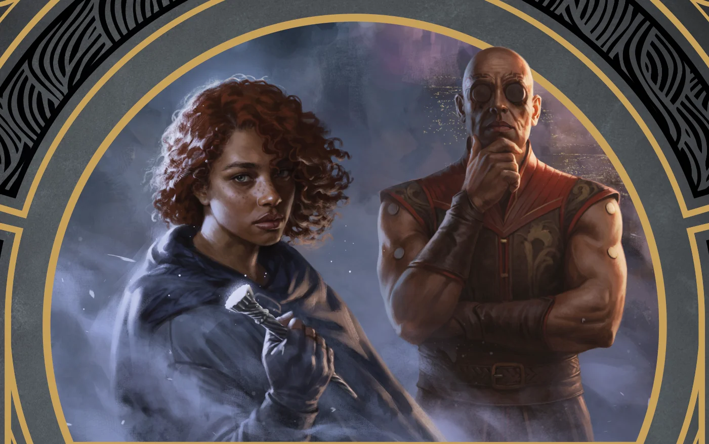

角色扮演遊戲

cosmererpg.com

生產批號：LongPack.XXXXXX 9 781966 528081

54999> ISBN 978-1-966528-08-1

$49.9

### 你會留下怎樣的傳承？

最後帝國覆亡之際，Gilded Few 趁勢崛起。他們尋找永恆尖刺（Eternity Spike），一件為了賦予新統御主力量而造的神器。這些事件揭開了

寰宇® 角色扮演遊戲中一場史詩般的《迷霧之子®》冒險，

故事橫跨兩個時代，由兩支隊伍接力演出！

第一時代（第 1–6 級）的角色將周旋於舞會陰謀、駭人祕密與陸沙德圍城之中。他們的選擇在數百年後仍有回響。

到了第二時代，一支新隊伍（第 3–9 級）必須完成一場驚險的尋寶之旅，

挫敗心懷不軌的貴族！

遊玩此冒險需要《迷霧之子玩家手冊》。

