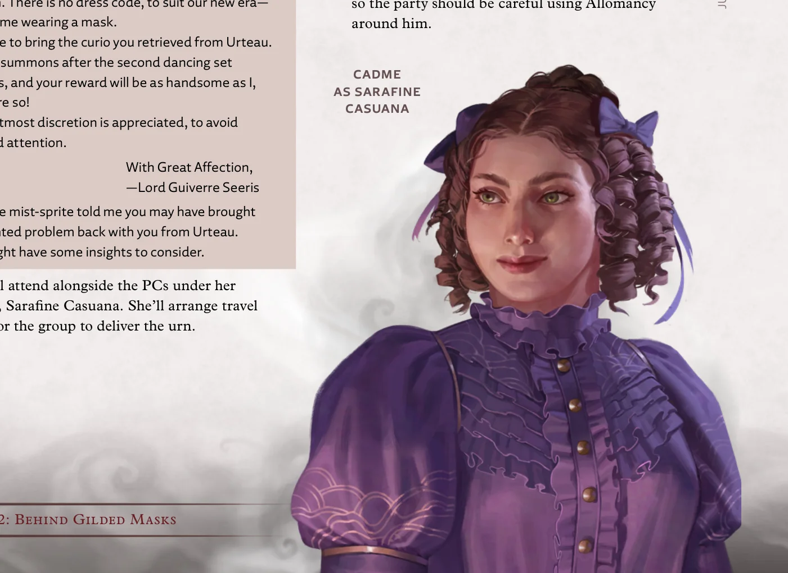
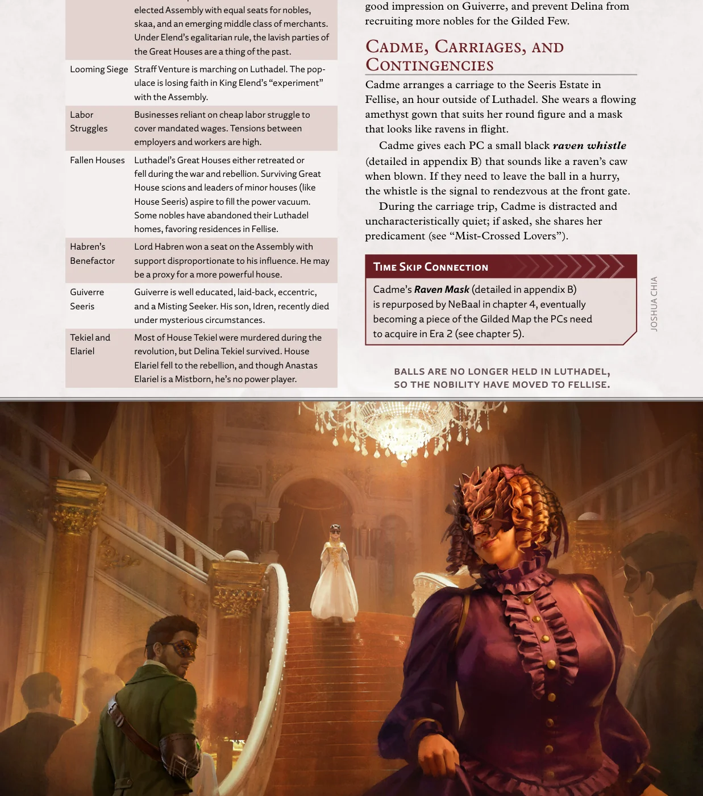
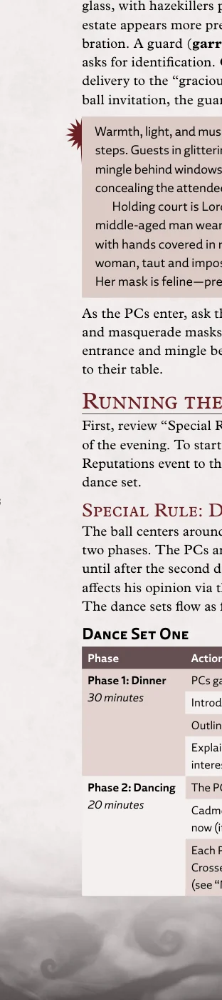
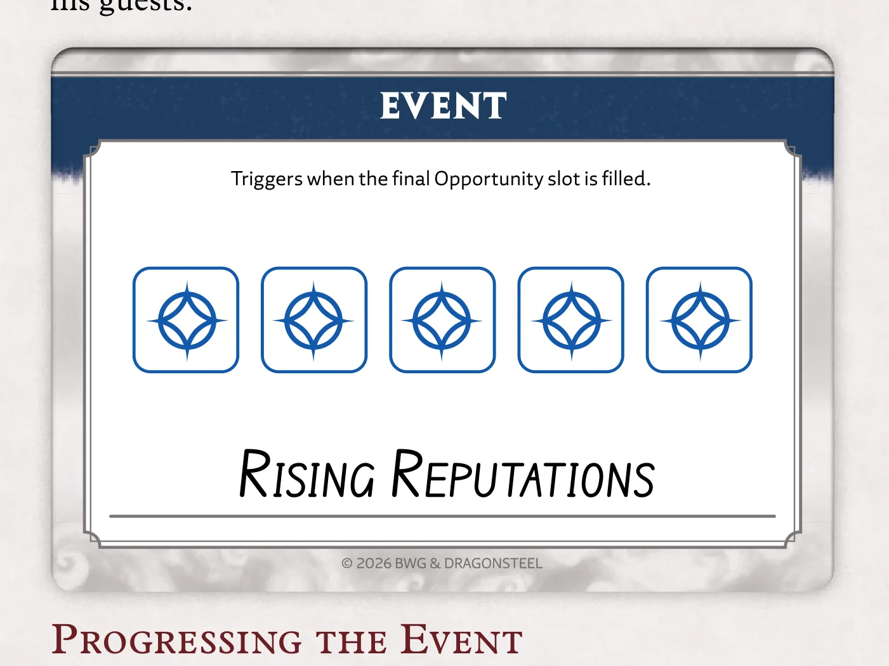
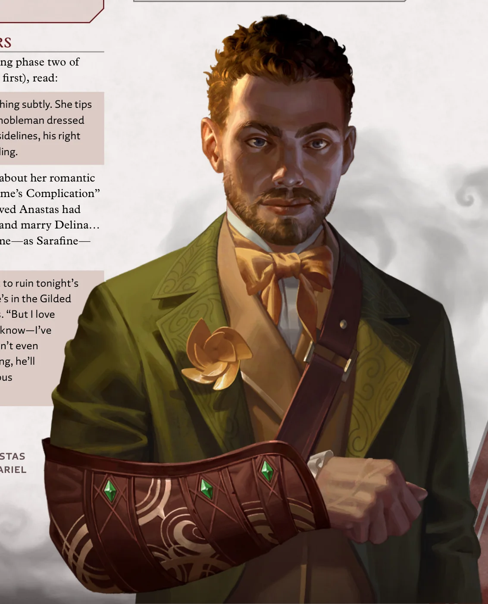
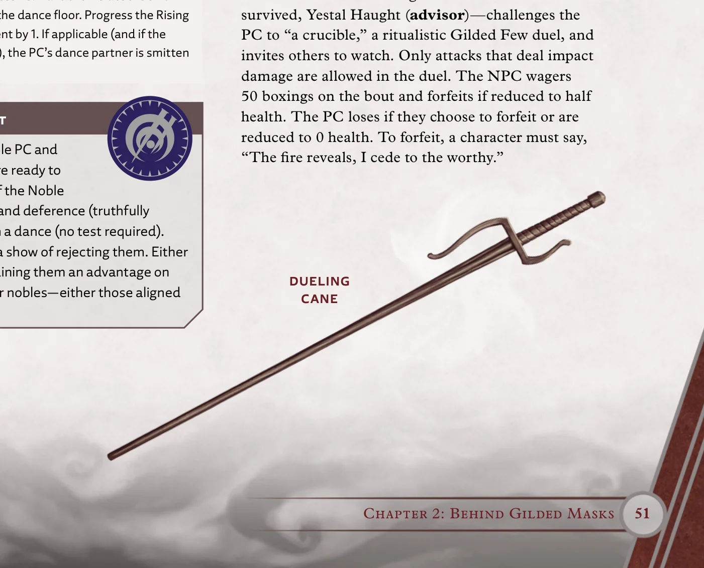
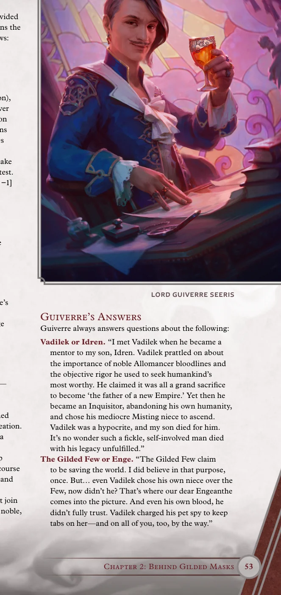
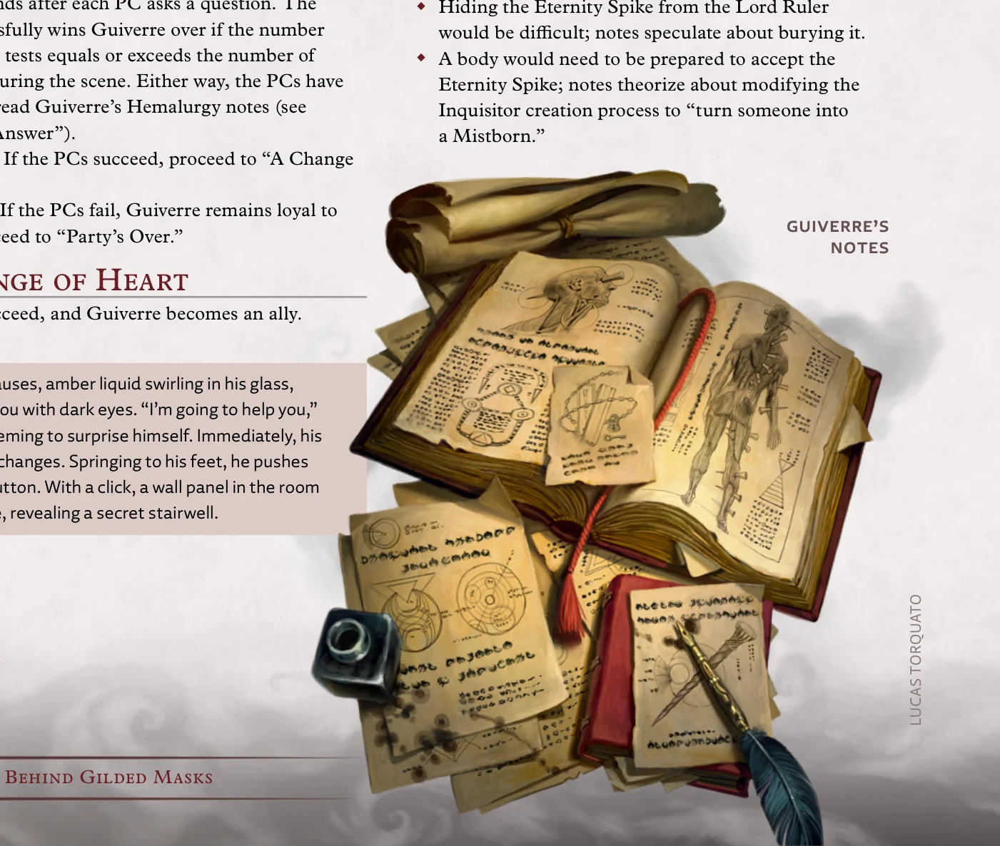
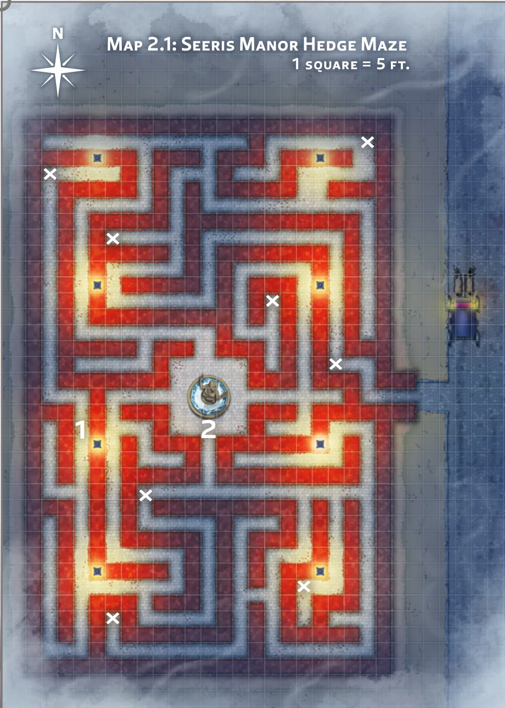
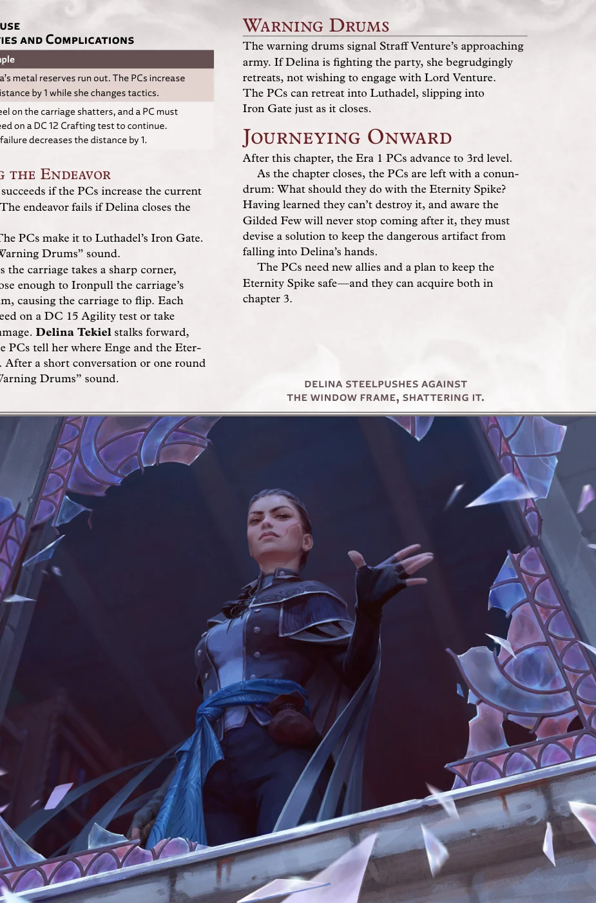

### 運河上的休整

從鎢都沿運河到陸沙德的 21 天旅程平安無事。PC 可以從事休整期活動（見《迷霧之子玩家手冊》第 9 章「休整」）。如果隊伍取回了 Vadilek 的血金術文獻，可以趁這段時間研讀（見導論「處理血金術」）。PC 也可以檢視永恆尖刺（見「永恆的重量」），或與船上的 NPC 互動，當中可能有 Cynwise 和其他來自鎢都的難民。Enge 有消息要告訴隊伍（見「致命的畢業典禮」），也樂意與 PC 作伴，但在第二章會婉拒任何離船邀約（見導論「如何扮演 NeBaal」）。休整期間，Enge 大多忙於她的祕密計畫，製作一件獨一無二、色澤鮮明的藍色迷霧披風。

#### 永恆的重量

旅途中，迷霧碰到永恆尖刺便出現異常反應。霧有時猛然散開，久久不再聚攏，讓船突兀地暴露在一團無霧的空氣中。PC 若花幾小時檢視尖刺，就會發現它具有排斥迷霧和觸碰反應兩項特性（見附錄 C「永恆尖刺」）。

#### 致命的畢業典禮

Enge 想談談。如果 PC 主動找她交談，或旅程到了最後一晚，以較早發生者為準，Enge 會向隊伍說明以下事項。

- Enge 為向團員隱瞞自己的貴族出身道歉。她原本希望忘掉這段過去。
- Enge 的叔父 Vadilek 信奉貴族至上，想栽培「下一任統御主」。為此，他讓暗中收為學生的一群貴族鎔金術師 Gilded Few 彼此競爭，接受名為「午夜試煉」的考驗。
- Enge 身為煙陣，負責掩護試煉，不讓外人察覺。後來 Vadilek 相信鋼鐵教廷藏有冶金知識，便命令 Enge 潛入教廷，希望她成為審判者。她拒絕命令，放棄頭銜後離開。
- Enge 為把 Gilded Few 引向隊伍而道歉，並警告 PC 從此一定會遭到追捕。
- Enge 原本不知道 Vadilek 後來親自成為審判者，也不知道他計畫折磨並殺死一千人。Vadilek 選她為繼承人時，她大吃一驚。他原先最看重珊．埃拉瑞爾，直到珊死去。Delina Tekiel 是他原先的第二人選。

### 還是那座老城

運河船抵達陸沙德時，讀出下文。

> 陸沙德聳立在地平線上。這座城市處處對立，司卡與貴族、受盡壓迫的人與享有特權的人、希望與絕望，全都聚在這裡。你們的走私船滑進港口，世間一切照常運轉，沒人知道你們帶著什麼祕密。人人都以為統御主永遠消失了，但有了永恆尖刺，就可能出現一位新的統御主。

PC 可以讓運河船靠岸並妥善繫牢。如果隊伍將囚犯帶到陸沙德，Cynwise 會在附近找到一座空倉庫，讓這些司卡人暫住。PC 可在「舞會前的休整」期間再去探望他們。準備好進城後，進入「一封熱情的邀請函」。

### 一封熱情的邀請函

PC 抵達陸沙德後不久，Cadme（騙術高手）便會現身。她是 Enge 的好友，也是人脈廣闊的掮客。第一章開頭那樁從鎢都走私銀甕的差事，就是她安排的。

#### 扮演 Cadme

**特質。** 光彩照人、閒不住、愛調情。  
**目標。** 保住自由，賺錢。  
**外貌。** Cadme（讀作 CAD-may，代名詞為她）個子嬌小、身材豐腴、膚色紅潤。精心打理的蓬鬆鬈髮襯著親切的笑容，以及一雙睜得大大的無辜眼睛。

Cadme 迷人又有活力，懂得贏取信任，也擅長讓人放鬆。她雖然身手不凡，卻曾短暫入獄。只要自由可能受到威脅，她就會立刻逃走。她真心相信浪漫，平常說起自己起伏不定的感情生活，軼事一樁比一樁離奇。她曾在一局 shelldry 中拿自己的婚約當賭注，贏走前情人最寶貝的小馬。

第 2 章：鍍金面具之後 43

#### 領取報酬：Guiverre 的舞會邀請函

Cadme 很高興看到 PC 從鎢都走私出來的銀色甕。她向隊伍說明下一步。

- 買家是一名叫 Guiverre Seeris（他）的貴族。他請隊伍兩週後參加他舉辦的祕密舞會，親手交付甕。他會付清說好的 600 盒金。
- 家族戰爭期間，例行舞會停辦，依藍德．泛圖爾掌權後也一直沒有恢復，因此這場舞會對外保密。地點在陸沙德城外一小時路程的上流住宅區 Fellise。
- 這場祕密晚宴是為了慶祝傳聞中 Delina Tekiel 與 Anastas Elariel（他）的婚約。Cadme 說到這裡，臉色頓時難看（見「Cadme 的難題」）。

將附錄 D 的「舞會邀請函」講義交給玩家，或讀出下文。

> 親愛的 Engeanthe（和各位朋友）：
>
> 誠摯邀請各位蒞臨 Fellise 的 Seeris 莊園，參加祕密化裝舞會（詳情隨函附上）。這是本季最私密、也最神祕的一場盛會，期待有幸與各位共度良宵。
>
> 請出示本函入場。無論階級或身分，諸位同伴一概歡迎。為順應新時代，我們不拘服裝，但務必戴上面具。
>
> 別忘了帶上各位從鎢都取回的珍奇之物。請在第二輪舞結束後等候我傳喚。各位所得的報酬必定如我本人一般體面，說不定還更勝一籌！
>
> 敬請務必保密，以免惹來不必要的注意。
>
> 謹致深情問候  
> Guiverre Seeris 大人
>
> 附言：有個迷霧小精靈悄悄告訴我，各位或許從鎢都帶回了一件不想招惹的麻煩。若真有此事，我或許有些見解值得各位考慮。

Cadme 會以貴族化名 Sarafine Casuana 和 PC 一起出席。她會安排隊伍前往 Fellise 交付銀甕。

#### Guiverre 與 Idren：熟悉的名字

PC 可能想起，在鎢都的 Velstane 店裡，裁縫的帳簿上圈出了 Guiverre Seeris 的名字。他們也可能在別處見過 Seeris 這個姓。Gilded Few 據點的一具屍體身上，有封父親寫給 Idren Seeris 大人的信，懇求他回家（見第一章 C13 區域）。若隊伍提起寫給 Idren 的信，Cadme 會證實 Guiverre 的兒子 Idren Seeris 近期去世。她不知道確切經過，因為悲痛的 Seeris 大人不願談論此事。

#### Enge 的見解

PC 看完邀請函後，Enge 重重嘆了口氣，說這封邀請函另有用意。她說明以下事項。

- 如果隊伍同意，Enge 會把 Vadilek、Gilded Few 與永恆尖刺的事告訴 Cadme，並要她發誓保密。
- Enge 懷疑 Delina 會利用舞會鞏固陸沙德貴族對 Gilded Few 的支持。
- Enge 猜測 Delina 的未婚夫 Anastas Elariel 已是 Gilded Few 成員，或很快就會受到 Delina 影響而加入。
- Enge 不確定 Guiverre Seeris 是否與 Gilded Few 有關，但他是搜尋者，隊伍在他身邊使用鎔金術時應多加小心。

#### 化名 Sarafine Casuana 的 Cadme

第 2 章：鍍金面具之後 44

JUST HIEU

#### Cadme 的難題

Cadme 聽了 Enge 的消息，顯然大為震驚。PC 若開口問起，她會坦承自己正與 Anastas 交往，而 Anastas 只知道她的化名 Sarafine。她知道 Anastas 是出於政治考量才訂婚，也知道他曾跟隨 Vadilek 學習，卻全然不曉得 Vadilek 的險惡野心。

**囚犯的傳承時刻。** 多年前，囚犯與 Cadme 一同入獄時認識了她。Cadme 逃獄後，兩人便失去聯絡。請囚犯描述兩人的關係，以及他們是否曾有過一段戀情。Cadme 信任囚犯，但希望忘掉入獄的那段日子。休整期間，Cadme 找囚犯私下談話，透露 Anastas 只知道她的貴族化名，她擔心 Anastas 無法接受她的真實身分。離開前，Cadme 提醒囚犯小心，她聽說 Vadilek 曾派線人監視 Enge 和走私團。

#### 黑板上的計畫

Cadme 離開後，Enge 拿出一塊黑板，請 PC 一起擬訂計畫。她說：

> 「該領錢啦！我看那位出了名博學的 Seeris 大人是想拿情報跟我們談。他懂那一堆玄乎的學問，搞不好真能解決尖刺的問題。不過 Guiverre 精明得很，要是他覺得我們沒救了，就不會為我們冒險。只要我們在舞會上給他留下好印象，談起條件就更有底氣。
>
> 「Delina 和 Gilded Few 肯定會興風作浪。他們不能在舞池裡殺了我們，但毫無準備就走進舞廳，跟赤手空拳走進埋伏沒兩樣。我們有兩週可以準備，來擬計畫吧。」

如果 PC 沒有提出下列目標，Enge 會提出，並把它們寫在黑板上。

- **領到報酬。** 這點沒得商量。少了 600 盒金，團員無法維生，也養不起這艘船。
- **留下好印象。** PC 得跳舞、交際，表現得有能力、有實力，否則 Guiverre 和他的客人多半會站到 Delina 那邊。
- **打聽 Guiverre 知道什麼。** Enge 強調，PC 私下與 Guiverre 會面並領取銀甕的報酬時，正好可以和他談永恆尖刺。

PC 和 Cadme 搭馬車去 Fellise 時，Enge 打算留在陸沙德的運河船上守著永恆尖刺。她指出 Delina 已經試著殺她一次了。（若 PC 繼續追問，見導論「如何扮演 NeBaal」。）Enge 熱心地提出在休整期間幫忙準備，例如改善藏身處、製作衣裝或教大家跳舞。

#### 舞會前的休整

詢問玩家想如何準備化裝舞會，以及舞會前 14 天的休整期想怎麼過。除了通常的休整期活動（見《迷霧之子玩家手冊》第 9 章「休整」），《傳承冒險》也提供冒險期間可體驗的獨有休整選項。以下活動可在舞會前進行，對 PC 可能特別有幫助。

- **置裝。** PC 取得適合舞會的衣服。
- **舞蹈課。** Enge 教 PC 跳舞。
- **安置難民。** PC 協助從鎢都帶出的囚犯。
- **調查（傳聞）。** PC 上街打聽與故事有關的本地傳聞（見「傳聞」表）。

第一時代 PC 可用的完整休整選項，見附錄 E「在陸沙德休整」。

**老兵的傳承時刻。** 休整期間，從前受過老兵訓練並崇拜老兵的 Saphee（駐軍士兵，她）想招攬老兵為 Seeris 家族效力。請老兵描述自己過去的英勇行為如何影響了她的一生。老兵可以憑 Saphee 的敬仰，在舞會前或舞會期間進行一次適用的技能檢定（DC 10），請她幫一個忙。成功時，Saphee 會依照老兵的指示幫忙，老兵在涉及 Seeris 家族守衛的社交檢定中也獲得一次優勢。失敗時，她覺得老兵不該這樣逼她，從此對老兵失望，後來會被 Gilded Few 招募。下一次戰鬥場景出現駐軍士兵時，那名士兵就是 Saphee。

第 2 章：鍍金面具之後 45

### 祕密晚宴

#### 傳聞

| 傳聞 | 據說…… |
| --- | --- |
| 舞會停辦 | 依藍德解放司卡人，建立民選議會。貴族、司卡與新興商人階層各占相同席次。在依藍德平等治下，大家族的奢華宴會已成往事。 |
| 圍城在即 | 史特拉夫．泛圖爾正揮軍前往陸沙德。民眾對依藍德國王的議會「實驗」逐漸失去信心。 |
| 勞資紛爭 | 仰賴低廉勞力的商家難以支付法定工資，勞資關係緊張。 |
| 沒落的家族 | 陸沙德的大家族在戰爭和起義期間不是撤走，就是垮臺。倖存的大家族子弟與小家族領袖（如 Seeris 家族）都想填補權力真空。有些貴族已放棄陸沙德的宅邸，改住 Fellise。 |
| Habren 的靠山 | Habren 大人當選議員時，得到遠超自身影響力的支持。他可能代表某個更有權勢的家族。 |
| Guiverre Seeris | Guiverre 學識淵博、隨和又古怪，是迷霧人搜尋者。他的兒子 Idren 最近離奇死亡。 |
| 太齊爾與埃拉瑞爾 | 太齊爾家族大多數人在革命中被殺，Delina Tekiel 卻活了下來。埃拉瑞爾家族在起義中覆滅。Anastas Elariel 雖是迷霧之子，卻無足輕重。 |

舞會當天，PC 得在 Fellise 的化裝舞會撐過兩輪舞，給 Guiverre 留下好印象，並阻止 Delina 為 Gilded Few 招攬更多貴族。

#### Cadme、馬車與備案

Cadme 安排馬車前往 Fellise 的 Seeris 莊園，距離陸沙德一小時車程。她穿著與豐腴身形相襯的飄逸紫晶色禮服，戴著形似群鴉飛翔的面具。Cadme 給每名 PC 一枚黑色渡鴉哨（詳見附錄 B），吹起來像渡鴉啼叫。若必須匆忙離席，就吹哨通知大家到正門會合。乘車途中，Cadme 心不在焉，異常安靜。若有人問起，她會說出自己的困境（見「迷霧中的苦命戀人」）。

**時代跳躍的連結。** 第四章中，NeBaal 會把 Cadme 的渡鴉面具（詳見附錄 B）改作他用。它最後成為第二時代 PC 必須取得的一塊鍍金地圖碎片（見第五章）。

陸沙德已不再舉辦舞會，於是貴族把舞會搬到 Fellise。

JOSHUA CHIA

#### 抵達舞會

PC 抵達時，莊園一片漆黑，臨時搭建的圍牆頂上嵌有碎玻璃，殺霧者正在外圍巡邏。莊園看起來像在備戰。守衛（駐軍士兵）向 PC 打招呼並要求查驗身分。Cadme 交出銀甕，請守衛轉交給「慷慨的主人」。守衛瞥了一眼邀請函，便打開大門。讀出下文。

> 暖意、燈光和樂聲一起湧上迷霧籠罩的階梯。賓客穿著閃亮的華服，戴著奢華的面具，在掛著彩色掛毯的窗戶後談笑。掛毯遮住這片歡愉，免得旁人窺見。席間的焦點是戴狐狸面具的 Seeris 大人。他是個衣著講究的中年男子，一雙戴滿戒指的手不時比畫。附近站著一位黑髮女子，金白相間的禮服襯出她緊繃而懾人的姿態。她戴著一張貓科面具，像蓄勢待發的掠食者。

PC 入場時，請他們描述衣著和面具。他們可以風光登場並四處交際，之後侍者會帶隊伍入座。

#### 帶領舞會

先閱讀「特殊規則：舞會輪次」掌握當晚流程。向玩家介紹「聲望提升」事件後，開始第一輪舞。

#### 特殊規則：舞會輪次

舞會分為兩輪，每輪有兩個階段。PC 須等第二輪結束才與 Guiverre 會面，但他們在舞會上的表現會透過「聲望提升」影響 Guiverre 對他們的看法。流程如下。

##### 第一輪舞

| 階段 | 行動 |
| --- | --- |
| 階段 1：晚餐（30 分鐘） | PC 回到桌邊用餐。 |
|  | 介紹「Seeris 莊園」。 |
|  | 說明「賓客名單」。 |
|  | 為想要「交際」的 PC 說明可參加的額外活動。 |
| 階段 2：跳舞（20 分鐘） | PC 分頭跳舞與交際。 |
|  | Cadme 在此時開啟「迷霧中的苦命戀人」（若先前尚未開啟）。 |
|  | 每名 PC 可為「迷霧中的苦命戀人」進行 2–3 次檢定，或參加一項額外活動（見「交際」）。 |

##### 第二輪舞

| 階段 | 行動 |
| --- | --- |
| 階段 1：甜點（20 分鐘） | PC 回到桌邊吃甜點。 |
| 階段 2：跳舞（20 分鐘） | PC 分頭跳舞與交際。 |
|  | 每名 PC 可為「迷霧中的苦命戀人」進行 2–3 次檢定，或參加一項額外活動（見「交際」）。 |
|  | Duvall 在此時前來辯論（若先前還沒來）。 |
|  | 「迷霧中的苦命戀人」最遲須在此時完成。 |

第二輪舞結束後，進入「宣布訂婚」。

#### Seeris 莊園

- **庭園。** 花園裡有深紅色樹籬迷宮，還有葉片呈黃橙兩色、未沾灰燼的異國植物。馬車房和馬廄就在正門附近。
- **一樓與舞廳。** 賓客聚在大舞廳。弦樂團演奏時，舞伴成雙成對地滑過華麗的水晶吊燈下方。北牆畫有奇異動物的壁畫。餐桌圍在舞池四周，供賓客用餐飲酒。
- **二樓。** 有空置的客房、一間不大的圖書室和能俯瞰舞廳的陽臺。
- **三樓。** 有臥室、Seeris 的私人圖書室及書房。這層禁止進入，由四名殺霧者看守。

#### 賓客名單

下列重要賓客會出席舞會。

##### 莊園主人：Guiverre Seeris

Guiverre Seeris 是 Gilded Few 的盟友，但自兒子 Idren 成為祭品後，他的忠誠便開始動搖（見本章稍後「扮演 Guiverre Seeris」）。兩輪舞期間，Guiverre 都忙於交際與招待賓客。直到第二輪舞結束後的私下會面，他才會向 PC 透露自己所知的事。

##### 貴賓：Delina Tekiel

Delina Tekiel 不會主動找 PC，但可能答應共舞。這場舞會是為她而辦的，她身邊一直圍著其他熱切的貴族。Delina 大膽直率，卻不會透露自己或 Gilded Few 的消息，必要時會消耗專注點抵抗影響。Delina 想查明 Enge 還活著的傳聞、奪回永恆尖刺，並藉由確立婚約拉 Anastas 加入 Gilded Few。更多扮演指引見導論「重要人物」。

第 2 章：鍍金面具之後 47

#### 事件：聲望提升

PC 抵達舞會時，向玩家介紹「聲望提升」事件（見《迷霧之子玩家手冊》第 9 章「事件」）。這個正面事件有五格，用來記錄 PC 贏得 Guiverre Seeris 和賓客尊重的進度。

##### 推進事件

PC 在舞會上獲得機遇時，可以消耗該機遇讓事件推進 1 格，但須說明如何提升自己的社會地位或打擊敵人的地位。此外，下列情況各能推進 1 格。

- 全體 PC 成功以衣著留下好印象（見附錄 E「置裝」）。
- 在「迷霧中的苦命戀人」中讓 Cadme 和 Anastas 復合。
- 每次有 PC 跳出令人驚豔的舞步（見「跳舞」）。
- 在「與 Duvall 辯論」中獲勝。
- 在「決鬥」中獲勝。

**官員的傳承時刻。** 介紹「聲望提升」時，告訴官員可以運用從前頭銜的聲望，將一次變故轉為機遇，再用來推進事件。官員這麼做時，請玩家描述角色如何利用職業聲譽，或請鋼鐵教廷的舊識幫忙掩蓋醜聞。這是讓官員面對最後帝國滅亡後，自己對昔日教廷工作所懷矛盾心情的機會。

##### Gilded Few

多名 Gilded Few 的年輕貴族都在賓客之列。

- Duvall Haught（他），精通血金術，想成為 Delina 的副手。他也是第三章的主要反派。
- Yestal Haught（顧問，他），Idren 的朋友、Duvall 的兄弟。
- Triss Urbain（社交名流，她），已故 Idren Seeris 的朋友。
- Silla Buvidas（她）和 Caridus Buvidas（他），如果他們在第一章活了下來。

Delina 嚴令所有人至少在宣布婚約前保持禮貌，但 Gilded Few 仍巴不得讓 PC 當眾出糗（見「交際」）。

##### 其他賓客

舞廳裡還有其他上流人士，包括 Cadme、Anastas Elariel（見「迷霧中的苦命戀人」），以及愛傳宮廷八卦的克禮絲（線人，她）。她身材嬌小，留著金髮，在舞會中穿梭散播傳聞（見前面的「傳聞」表）。深受 Gilded Few 操控的議員 Haltier Habren 大人（社交名流，他）也一直在 Delina 身邊打轉。

##### 侍者與守衛

莊園僕役（平民）大多是司卡人。依新近頒布的勞動法，他們如今領著微薄的薪水。大批 Seeris 家族的守衛（駐軍士兵）在莊園與庭園巡邏，由精銳的殺霧者領隊。

**街童的傳承時刻。** 舞會開始不久，克禮絲會來找街童，街童知道她是情報掮客。與克禮絲交談，是散播某位賓客傳聞的好機會。和玩家一起編出他們想傳的消息。若街童之後利用這則傳聞，相關檢定獲得一次優勢。

第 2 章：鍍金面具之後 48

##### 觸發事件

五格都填滿時，事件觸發，會場氣氛為之一變。貴族開始帶著興趣和妒意打量隊伍。賓客主動邀請 PC 跳舞。在「祕密晚宴」餘下期間，PC 的所有風采檢定獲得一次優勢。Guiverre 再忙也會抽空過來說：「你們真是出盡風頭！我很期待待會兒那場小小的商談。」克禮絲會來稱讚 PC 的衣著，問他們靈感從何而來，又是在哪裡弄到的。

**時代跳躍的連結。** 若 PC 觸發了「聲望提升」，記下他們如何向克禮絲形容自己的衣著。第八章的時裝秀會呈現一股由隊伍衣著啟發的復古潮流。

#### 迷霧中的苦命戀人

PC 主動找 Cadme，或第一輪舞進入第二階段時，以較早發生者為準，讀出下文。

> 「Anastas 在那裡。」Cadme 說，臉上微微一紅。她略一偏頭，示意一位身穿綠金兩色衣裝的年輕貴族。他站在場邊，右臂擱在一條鑲著祖母綠的吊帶上。

若 Cadme 還沒說過，此時她會坦承自己與 Anastas 的戀情（見前文「Cadme 的難題」）。她原以為 Anastas 已決定依照家族的意願和 Delina 結婚，直到昨晚他向以 Sarafine 身分出現的 Cadme 提議私奔。Cadme 接著說：

> 「我一慌，就拒絕了！我不想搞砸今晚的差事，而且我還不確定他是不是 Gilded Few 的人。」Cadme 望著 Anastas，嘆了口氣。「可是我愛他。或者……我想我是愛他的！但我又懂什麼呢？我騙了他整整一年，他連我的真名都不知道。可我要是什麼都不做，他最後就會娶 Delina，一個殺人不眨眼的邪教頭子！」

##### Anastas Elariel

**扮演 Anastas Elariel。**  
**特質。** 優柔寡斷、真誠、浪漫。  
**目標。** 決定要與愛人私奔，還是正式與未婚妻訂婚。  
**外貌。** Anastas Elariel（讀作 an-AHS-tus eh-LAIR-ee-al，代名詞為他）是位衣著時髦的貴族男子，膚色如琥珀，留著緊密捲曲的赤褐髮，有一雙濃眉和水汪汪的灰眼睛。

Anastas 是強大的埃拉瑞爾家族中數名迷霧之子之一。他始終對訓練提不起興趣，寧可寫詩也不願見血。Anastas 善良而敏感，在貴族圈中總是被人忽略。他不認同 Gilded Few 的極端理念，始終沒有加入。私下裡，他看重自己的原則和內心的滿足，勝過財富與權力，但需要有人幫他抵抗社會壓力，才能不再任由別人要求他當個「像樣的」迷霧之子。

JUST HIEU

##### 帶領試煉

若 PC 同意幫忙，將促成 Cadme 和 Anastas 復合的過程視為一項橫跨兩輪舞的試煉（見「判定試煉結果」）。在每輪舞的第二階段（見「帶領舞會」），每名參與的 PC 可對這項試煉作出兩到三次貢獻。第二輪舞結束前，PC 必須完成以下三項目標，每項至少取得 2 次成功。

- **確認 Anastas 效忠誰。** 要說服 Anastas 開口，得提出有說服力的論點（DC 15 說服）。PC 也可從舞會上的其他人打聽，例如與出了名愛傳八卦的克禮絲交換傳聞，或花 25 盒金向她買一則傳聞。取得兩次成功後，PC 得知完整真相（見「Anastas 的立場」）。
- **化解 Anastas 的疑慮。** 若 PC 沒有透露 Cadme 的真實身分，Anastas 會大受打擊，想知道 Sarafine 是不是因為他當不好迷霧之子才拒絕他。若 PC 說出真相，Anastas 則會動搖，懷疑整段戀情只是在演戲。隊伍必須用某種方式回應他的疑慮，並進行適用的檢定。PC 可以幫 Cadme 保守祕密（DC 14 欺騙）、解釋無論她叫什麼名字，對他的愛都是真心的（DC 14 說服），或試著同理 Anastas 的感受（DC 14 洞察）。打動 Anastas 浪漫情懷的說法（DC 13 洞察或學識）獲得一次優勢。讓 Anastas 覺得受到威脅，或覺得別人因傷勢而可憐他的說法，則自動失敗。這裡適合提高風險。
- **Cadme 的祕密求婚。** PC 必須找到最適合浪漫求婚的地點。他們可以在莊園勘查（DC 12 洞察或 DC 11 求生），或四處詢問（DC 14 領導）。前文「Seeris 莊園」列有可選地點。選定後，PC 可以幫 Cadme 安排求婚，例如協助她悄悄溜出舞會（DC 13 隱匿或欺騙），或讓求婚有特別的安排（DC 12 領導、學識或工藝）。PC 也可給 Cadme 建議，或幫她保持冷靜（DC 13 洞察）。

##### Anastas 的立場

一年前，Anastas 原本該在一次刺殺依藍德．泛圖爾的行動中加入 Gilded Few。行動導致 Anastas 的堂表親珊遇害。這次丟臉的失敗和手臂永久性的神經損傷，使 Anastas 沒有再與 Gilded Few 加深往來。

**貴族的傳承時刻。** 貴族自幼認識 Anastas，可在這項試煉期間與他重新來往。請貴族說明兩人從前的關係，並談一段自己與家族之間、類似 Anastas 遭遇的掙扎。如果貴族向 Anastas 說起這件事，為「迷霧中的苦命戀人」試煉作出貢獻的檢定獲得一次優勢。

##### 鍍金變故

出現變故時，Gilded Few 的貴族會插手。他們可能來找 PC，硬把一名 PC 拉去參加「交際」活動，讓該角色在這一輪剩下的時間都抽不開身。Delina 也可能邀 Anastas 跳舞或一直待在附近，藉此干擾他。這一輪餘下期間，PC 為影響 Anastas 所做的檢定承受一次劣勢。

##### 判定試煉結果

PC 必須在累積 5 次失敗之前取得至少 6 次成功（每項目標 2 次），或用其他方式完成三項目標，才能通過試煉。若第二輪舞結束前還未完成試煉，便自動失敗。

- **成功。** Cadme 坦承真實身分，Anastas 選擇愛情，放下對家族的義務，兩人同意私奔。他們都向 PC 道謝，並會在後續章節以盟友身分登場。
- **失敗。** 若 PC 沒有說服 Anastas，他會心碎地拒絕與 Cadme 見面，照原訂計畫和 Delina 訂婚。若 PC 沒能安排 Cadme 的求婚或確認 Anastas 的立場，Cadme 會臨陣退縮，逃回馬車。無論何種結果，都會影響「宣布訂婚」。

**時代跳躍的連結。** 第六章中，第二時代的 PC 會遇見 Anastas 的後代 Marthis。依「迷霧中的苦命戀人」的結果，Marthis 會和 Cadme 或 Delina 有血緣關係。

第 2 章：鍍金面具之後 50

#### 交際

未參與「迷霧中的苦命戀人」的 PC，在每輪舞期間可進行以下任一活動。

##### 跳舞

PC 可通過 DC 13 說服檢定邀到舞伴。失敗時，NPC 拒絕邀請，PC 失去 1 專注點。若「聲望提升」已觸發，NPC 都會接受邀請，還會主動找 PC 跳舞。

Gilded Few 成員可能帶著嘲弄的態度邀請 PC 跳舞，想讓對方害怕或出糗。若 PC 答應，其敏捷檢定承受一次劣勢，並提高該檢定的風險。PC 若拒絕，失去 1 專注點。請每名跳舞的 PC 進行敏捷檢定，再依「舞技」表決定其表現。PC 如果沒有上流社會專長，也沒有在休整期練過跳舞，這項檢定承受一次劣勢。

##### 舞技

| DC | 結果 |
| --- | --- |
| 10 或以下 | 糟得讓人難堪。PC 失去 1 專注點。 |
| 10 | 還過得去。PC 沒給人留下什麼印象。 |
| 15 | 優雅又迷人。PC 下次對舞伴進行的風采檢定獲得一次優勢。 |
| 20+ | 令人驚豔。請 PC 描述自己如何成為舞池焦點。「聲望提升」事件推進 1 格。若情況適合且玩家同意，PC 的舞伴會為其傾心。 |

**貴族的傳承時刻。** Delina 認出貴族 PC，主動上前問對方是否準備好重回體面的社交圈。若貴族以悔意和恭敬作答，無論是否出自真心，Delina 都會邀其跳舞（無須檢定）。否則，Delina 會當眾大張旗鼓地拒絕對方。兩種結果都會讓其他人注意到貴族。貴族與其他貴族互動的檢定獲得一次優勢，對象依情況為支持或反對 Delina 的貴族。

##### 與 Duvall 辯論

PC 若參與學理討論，或獨自留在桌邊，便會引起 Duvall Haught 的注意。他想就貴族優越論與 PC 公開辯論（關於 Duvall，見第三章「扮演 Duvall Haught」）。他提出以下問題。

- **PC 是否認為貴族理當領導人民？** Duvall 相信貴族天生就該領導，也相信與生俱來的鎔金術使他們比別人優越。他若無其事地炫耀自己的射幣能力。
- **PC 是否覺得革命讓陸沙德變得更好？** Duvall 主張陸沙德如今充斥暴力、破壞與動盪。他提到自己正開辦一所慈善醫院，幫忙收拾殘局。
- **PC 是否相信議會能有效治理？** Duvall 指出議會內部爭吵不休，依藍德的領導也太天真。他會挑釁任何不同意的人，拿 50 盒金打賭，說這位年輕國王幾個月內就會被廢黜。

PC 若回應某個議題，便進行領導或學識對抗檢定，對抗 Duvall 的領導（+4）。隊伍若在三個議題中的兩項檢定成功，「聲望提升」事件推進 1 格。PC 每次檢定失敗，失去 1 專注點。

##### 決鬥

一名布維達手足會向 PC 發起「坩堝」挑戰，那是 Gilded Few 帶有儀式性質的決鬥，並邀其他人觀戰。若雙胞胎都沒活下來，則由 Yestal Haught（顧問）發起挑戰。決鬥只允許造成衝擊傷害的攻擊。NPC 在這一場押 50 盒金，生命值降到一半就會認輸。PC 選擇認輸或生命值降到 0 時落敗。角色若要認輸，必須說：「烈火驗明真章，我向配得上勝利的人認輸。」

決鬥杖

第 2 章：鍍金面具之後 51

ANNA VERHOOG

### 絲綢陷阱

#### 宣布訂婚

第二輪舞結束後，Guiverre 會鄭重宣布一件事。「迷霧中的苦命戀人」試煉的結果會影響這個場景。如果試煉還沒完成，此時以失敗告終。舞曲結束時，讀出下文。

> 第二輪舞結束，小提琴的最後一個音符仍在空中迴盪。兩名衣著一絲不苟的侍者捧出一個熟悉的銀甕。Guiverre 站在舞廳前方，讓 Delina 挽著他的手臂。「哎呀，這一年真不容易，是吧？今晚少了許多熟面孔。」Guiverre 的黑眼睛映著吊燈的光。「但今晚證明了，貴族仍能屹立不搖。我們總能在灰燼裡找到美，跳舞跳到雙腳流血也不停。讓泛圖爾見鬼去吧！趁我們的心還在，腦袋也還在，來慶祝吧！就從送這對璧人一份訂婚禮開始……啊，Anastas 人呢？」

如果 PC 沒能讓 Cadme 和 Anastas 復合，讀出下文。

> 片刻過後，人群讓出一條路，所有目光都落在 Anastas Elariel 身上。他神情沉重地走上前。「讓我們舉杯，祝這對新人幸福！」Guiverre 高聲說。Delina 向 Anastas 伸出手，說：「我們會一起建立更強盛的帝國。」Anastas 無力地點點頭，兩人僵硬地親了一下。

如果 PC 成功讓兩人復合，讀出下文。

> 全場一片死寂。Delina 僵在原地，目光灼灼地掃視人群。又過了難熬的好一會兒，Guiverre 才插話：「偏偏挑這時候上廁所，真會選時機！我們去把準新郎帶回來，待會兒再繼續。各位先喝酒，接著跳舞！」小提琴再度響起，全場頓時議論紛紛。Delina 穿著華麗的舞會禮服，威嚴地獨自站在那裡。

人群散開時，一名僕人現身來接 PC。

PC 依約與 Guiverre 會面。這場各懷心思的談話將決定 Guiverre 會站在哪一邊。

#### 私下會面

僕人領著隊伍上樓，來到 Guiverre 的私人書房時，讀出下文。

> Guiverre 的書房擺著文物和裱框地圖，紀念他走遍帝國各地的旅程。外牆排著五扇巨大的彩繪玻璃窗，每扇都以彩色玻璃描繪不同統御區的風景。巨窗前，Guiverre 倚著堆滿文件的書桌，舉杯招呼你們。「歡迎！我的祕密晚宴還合各位的意嗎？」

Guiverre Seeris 看似若無其事，心裡卻仍為兒子和陸沙德那場血腥革命哀悼。他拿出 600 盒金，作為 PC 從鎢都取回銀甕的報酬。銀甕是送給 Delina 的訂婚禮。若銀甕在第一章撞凹了，他會給 PC 一個責備的眼神，並扣掉 50 盒金。無論如何，他都會倒酒請 PC 慶祝。

##### 扮演 Guiverre Seeris

**特質。** 自利、親切、學識淵博。  
**目標。** 確保 Seeris 家族繼續興盛。  
**外貌。** Guiverre Seeris（讀作 gwee-VAIR SEER-iss，代名詞為他）是膚色白皙的中年貴族男子，有一頭光亮的黑色長髮、一撇細鬍鬚和一雙難以看透的黑眼睛。他的手指上閃著寶石光芒。

Guiverre 刻意給人隨和古怪的印象，但他表面隨性，心底早已打定主意，要在舒適奢華中活下去。Delina 是 Gilded Few 目前實際上的領袖，命他打聽 Enge 與永恆尖刺的消息。Guiverre 原本對 Vadilek 的貴族烏托邦有些興趣。自從容易受人影響的兒子 Idren 自願為 Vadilek 的計畫獻身，他便對此失去興趣。Guiverre 心中既憤怒又悲痛，正在找理由與 Gilded Few 斷絕關係。

**編年史家的傳承時刻。** 編年史家認出 Guiverre 書架上有一部自己的作品。問編年史家這部作品談什麼，以及為何受到讀者注意。若編年史家利用 Guiverre 對其作品的興趣來拉攏他，編年史家在此場景的所有檢定獲得一次優勢。

第 2 章：鍍金面具之後 52

#### Guiverre Seeris 大人

##### 交換消息：一盒換一盒

Guiverre 提議玩一種老派的宴會遊戲「一盒換一盒」，邀請每名 PC 問一個問題，條件是先回答他的一個問題。他說明規則。每名 PC 各輪一次，步驟如下。

1. PC 提問。
2. Guiverre 提問。
3. PC 選擇回答或喝酒。
4. Guiverre 選擇回答或喝酒。

PC 可以向 Guiverre 說謊或誤導他（DC 15 欺騙），也可以如實作答，試著爭取他的支持（DC 13 說服）。若隊伍觸發了「聲望提升」，每名 PC 的這項檢定獲得一次優勢。PC 試圖欺騙 Guiverre 時，適合提高風險。PC 若選擇喝酒，可以通過 DC 12 紀律檢定抵銷酒精的影響。失敗時，在接下來一小時陷入減損［察覺 −1］。

##### 對 Guiverre 使用鎔金術

Guiverre 是搜尋者。他在這場景花費 1 授予「燃燒青銅」（[1 action]）。若有 PC 試圖用鎔金術操控他，他會表示感知得到對方在做什麼，對此不以為然。觸發此反應的檢定自動失敗。

##### 提起 Idren 的遺體

若 PC 提到在鎢都找到 Idren 的遺體，或拿出在他身上找到的信，Guiverre 再也維持不了鎮定。他哭了起來，問兒子看起來是否安詳。若隊伍帶著同理心應對，接下來第一個由 PC 進行的檢定獲得一次優勢。

##### Guiverre 的提問

- 「別浪費彼此的時間了。我知道永恆尖刺在你們手上。真正的問題是，你們打算怎麼處理它？」
- 「你們知道永恆尖刺永遠無法摧毀吧？它蘊含的力量太大了。當初耗費一千個飽受折磨的靈魂才造出它。你們真的準備好扛起這個一定比我們所有人都活得更久的重擔嗎……？」
- 「你們明白，只要尖刺還在手上，Vadilek 的門徒就永遠不會停止追捕你們吧？你們當然明白。那打算怎麼對付 Delina 和其他人呢？」
- 「我們親愛的 Engeanthe 還好嗎？真可惜她今晚沒來。她在這裡再適合不過了。我想她已經告訴你們，她其實是貴族吧？那麼……她今晚究竟在哪裡？」

##### Guiverre 的回答

Guiverre 一定會回答關於以下主題的問題。

**Vadilek 或 Idren。**「我是在 Vadilek 成為我兒子 Idren 的導師時認識他的。他老是喋喋不休，說貴族鎔金術師的血統有多重要，還說自己用多麼客觀嚴謹的方式尋找人類中最有資格的人。他聲稱這一切都是偉大的犧牲，好讓他成為『新帝國之父』。結果呢，他拋下自己的人性，當上了審判者，還選了他那個平庸的迷霧人姪女來昇華。Vadilek 是個偽君子，我兒子卻為他死了。這麼一個反覆無常、滿腦子只有自己的人，死了也沒能留下他想要的傳承，一點都不奇怪。」

**Gilded Few 或 Enge。**「Gilded Few 自稱要拯救世界。我也曾相信這個宗旨。可是……連 Vadilek 都捨棄 Gilded Few，選了自己的姪女，不是嗎？這就是我們親愛的 Engeanthe 牽涉其中的原因。可就算是自己的血親，他也沒能完全信任。Vadilek 命令他那個親信密探盯著她。順帶一提，你們也都被盯上了。」

第 2 章：鍍金面具之後 53

ALEXANDR LESKINEN

**Delina。**「自從海斯丁家族殺了她大多數親人，她的心情就沒好過。壓力讓她變得有點……暴躁。克羅司都比她仁慈。不過，我倒覺得她和我可以合作得很好，只要我能相信她在拿到想要的東西後，不會把我打得粉碎……」

**永恆尖刺。**「Vadilek 和我推想，這種物品一旦製成，就很難藏起來，也更難使用。人類的身體得經過某些……改造，才能承受那樣的力量。唉，那都是過去的事了。」他看了你們好一會兒，神色難辨。「不過……我還留著那些談話的筆記。白費了那些心血，我會很遺憾。」

若隊伍進一步追問 Vadilek 的密探，或問 Guiverre 的情報從哪裡來，Guiverre 會會意一笑，喝酒代替回答。他每喝一杯，欺騙或說服他的 DC 降低 2。其他問題只要如實回答不會威脅到他本人，他大多會照實回答。

##### 判定場景結果

每名 PC 都問過一個問題後，場景結束。此場景的檢定成功次數至少與失敗次數相同時，隊伍便成功爭取到 Guiverre 的支持。無論結果如何，PC 都有機會閱讀 Guiverre 的血金術筆記（見「永恆的答案」）。

- **成功。** PC 成功時，進入「回心轉意」。
- **失敗。** PC 失敗時，Guiverre 仍效忠 Delina。進入「散場了」。

##### 回心轉意

PC 成功，Guiverre 成為盟友。讀出下文。

> Guiverre 頓了頓，杯裡的琥珀色酒液打著轉。他用那雙黑眼睛打量你們。「我會幫你們。」這句話似乎連他自己都沒料到。他的神態立刻變了，猛然站起身，按下一個藏起來的按鈕。喀噠一聲，一塊牆板滑開，露出一座祕密樓梯。
>
> 「Delina 和二十個殺霧者正在過來。」他語速飛快，把一本皮面筆記本往你們手裡一塞。「拿去，我的筆記。永恆尖刺的事，我知道的全在裡面。下樓就到樹籬迷宮，大門在另一頭。」他笑得狂放又凌厲。這是他今晚第一個真心的笑容。他舉杯向你們道別。「要是被她逮到，你們就完了……不過她逮不到，對吧？」

Guiverre 的筆記內容見「永恆的答案」。Guiverre 會在第四章再度登場。進入「樹籬迷宮中的殺霧者」。

##### 永恆的答案

無論隊伍是否改變 Guiverre 的立場，他都會把血金術筆記給隊伍看。PC 可以在休整期研究這些筆記，推進「了解血金術」短期目標（見導論「處理血金術」）。筆記還包含以下資訊。

- 永恆尖刺以一種能吸收力量的金屬製成（鎳鉻）。
- 永恆尖刺幾乎不可能摧毀。
- 要把永恆尖刺藏起來而不被統御主發現並不容易。筆記推測或許可以埋起來。
- 身體需要事先準備，才能承受永恆尖刺。筆記推想可以修改創造審判者的程序，藉此「把人變成迷霧之子」。

Guiverre 的筆記

第 2 章：鍍金面具之後 54

LUCAS TORQUATO

##### 散場了

若 PC 沒能說服 Guiverre，他表面上不露聲色。讀出下文。

> 「看得出來，各位都很聰明。」Guiverre 說。「那就告訴我，你們怎麼看這個？」他把一本皮面筆記本放到桌上，推向你們。

若有 PC 花大約五分鐘略讀筆記，或與態度輕佻、語焉不詳的 Guiverre 交談，便會得知前一節「永恆的答案」的資訊。若 PC 起疑，通過 DC 12 洞察檢定就能發現 Guiverre 在拖延時間。PC 若質問 Guiverre 或試圖離開，他會回答：

> 「這點小把戲，我確實得說聲抱歉。不過你們在玩貓捉老鼠，碰上的又偏偏是隻格外危險的貓。太齊爾女士隨時會到。」Guiverre 聳聳肩，巨幅昂貴的彩繪玻璃窗襯得他那副自得的身影格外渺小。「我從來不押老鼠贏。」窗外傳來一聲刺耳的渡鴉啼叫，劃破夜空。那是 Cadme 的危險信號。

否則，等五分鐘過去，或談話開始陷入僵局時，讀出下文。

> 窗外傳來一聲刺耳的渡鴉啼叫，像是在發出警告。透過巨大彩繪玻璃窗脆弱的窗格，你們看見下方黑漆漆的樹籬迷宮，馬車就在迷宮另一頭的大門旁等候。渡鴉又叫了一聲。那是 Cadme 的危險信號。

無論如何，進入「逃生路線」。

##### 逃生路線

PC 得找出路，時間所剩無幾。二十名殺霧者正接近書房，沉重的腳步聲迅速逼近。從書房門口出去顯然是送死。窗戶是一條明顯的逃生路線。跳窗落入下方花園的角色各受到 2d6 衝擊傷害，第一個跳窗的人額外受到 1d4 銳利傷害。PC 也可以通過 DC 17 推理檢定，或對 Guiverre 通過 DC 20 威嚇檢定，找出通往樹籬迷宮的祕密出口。若直接受到威脅，Guiverre 會試圖逃走。

**時代跳躍的連結。** 若第一時代 PC 沒有爭取到 Guiverre 的支持，他仍會在上流社會廣受歡迎。第二時代，依藍戴大學會有一尊學者 Guiverre 的雕像（見第六章）。

無論隊伍從哪裡逃走，都進入「樹籬迷宮中的殺霧者」。

MISKA FREDMAN

##### 樹籬迷宮中的殺霧者

PC 進入樹籬迷宮時，讀出下文。

> 火炬的光在 Seeris 莊園樹籬迷宮的血紅枝條間凌亂地閃動。四面八方都是喊叫聲、枝葉摩擦聲和奔跑的腳步聲。

八名殺霧者從地圖 2.1 上以「×」標記的位置出發。為求簡便，只有在 PC 能感知某名殺霧者，或該殺霧者看見或聽見 PC 時，才移動該殺霧者。也只有在某名殺霧者察覺 PC 時，才開始戰鬥。PC 從窗戶跳下就由 1 號點出發，走祕密通道則由 2 號點出發。隊伍的馬車在東側出口等候。

**地圖 2.1：Seeris 莊園樹籬迷宮。** 每格 5 呎。圖中「×」是殺霧者的起始位置，N 指北。

##### 戰場效果

這場戰鬥有以下效果。

- **樹籬。** 濃密的血紅色樹籬高 10 呎，形成天然牆壁。角色可對樹籬的實體防禦（10）發動攻擊，試圖破壞一段 5 呎長的樹籬。若該段受到至少 5 點銳利、衝擊或能量傷害，角色便可透過樹籬看見另一側並發動攻擊。若該段受到至少 10 點傷害，就會被摧毀，角色可以通過。殺霧者會避免破壞樹籬，出現 [Complication] 時除外。
- **躲藏。** 樹籬、迷霧和黑暗讓躲藏變得容易。戰鬥中試圖躲藏時，獲得一次優勢。
- **巡走的殺霧者。** PC 可以「使用技能」（[1 action]）進行 DC 12 感知檢定。成功時，PC 得知感知範圍內每名殺霧者的位置，即使對方躲在樹籬後也一樣。
- **離開迷宮。** 若 PC 從東側出口以外的路線離開迷宮，會遭到四名在迷宮外巡邏的殺霧者攻擊。擊敗巡邏隊後，PC 便可一路暢通地抵達馬車。
- **噴泉。** 樹籬迷宮中央有一座可用作掩體的噴泉。噴泉雕像是一名身穿薄紗洋裝的女子，站在灰燼上，向天舉起雙手祈求。

##### 樹籬迷宮中的殺霧者：機遇與變故

| 結果 | 範例 |
| --- | --- |
| [Opportunity] | PC 偶然遇到一對捲入混亂的年輕戀人（使用平民數值卡）。通過 DC 9 威嚇或領導檢定後，PC 可說服他們往指定方向逃跑。感知到這對戀人跑過的殺霧者會花費 [1 action] 攔下他們盤問。 |
| [Complication] | 附近一名殺霧者猛衝過一段 5 呎長的樹籬，將其摧毀。 |

##### 戰鬥結束

PC 擊敗六名殺霧者或抵達馬車時，戰鬥結束。

#### 貓捉老鼠

PC 接近馬車時，讀出下文。

> Cadme 一把拉開車門。「我們得走了！老天，統御主在上，快走！」

若 PC 沒有跳窗，也讀出下文。

> 莊園裡，Seeris 的書房窗後出現一道黑影。窗戶猛然爆開。

無論如何，最後讀出下文。

> 舞會的小提琴拉出一個刺耳的音符，隨即戛然而止。叫喊聲四起。Delina Tekiel 就站在 Seeris 那扇巨大彩繪玻璃窗的斑斕碎片間，手裡那把斧頭分明是審判者的黑曜石斧，金色光線勾出她的輪廓。Delina 擲下一個金屬高腳杯，酒液在空中劃出一道深紅弧線。她以舞者般的優雅施展完美的鋼推，穿過迷霧，直奔你們的馬車而來。

##### 特殊規則：拉近距離

PC、Cadme 和可能同行的 Anastas 搭馬車逃離時，Delina 在後追趕。將此段視為追逐試煉（見《迷霧之子玩家手冊》第 12 章「追逐試煉」）。此處記錄追趕者與目標的距離。這場追逐的起始距離為 3，逃脫距離為 6。PC 每成功通過一次檢定，距離增加 1。Delina 每成功通過一次檢定，距離減少 1。當前距離達 6 時，隊伍逃脫。距離降到 0 時，Delina 追上他們（見「判定追逐結果」）。

##### 甩開追兵

PC 試著搭馬車逃回陸沙德時，Delina 憑藉高明的追蹤技巧以及純熟的鋼鎔金術與鐵鎔金術追趕他們。PC 必須克服以下障礙，才能甩掉 Delina。

- **大門。** PC 可以和守衛爭辯或威脅他們（威嚇對抗 Delina 的領導 +7），也可以混入離開的其他馬車（竊術對抗她的洞察 +6）。
- **Fellise 郊區。** 過了大門，馬車駛過 Fellise 靜悄悄的石板街。PC 可以巧妙選路（求生對抗 Delina 的感知 +6），或說服一位認識的貴族暫時藏匿他們（說服對抗她的威嚇 +6）。
- **通往陸沙德的道路。** 隊伍的馬車沿漆黑的道路奔向陸沙德，Delina 借助附近的鎔金術道路飛在後方。PC 可以盡可能加速（敏捷對抗她的鎔金術 +7），或孤注一擲地製造干擾（欺騙對抗她的洞察 +6）。這裡適合提高風險。

第 2 章：鍍金面具之後 56

##### 貓捉老鼠：機遇與變故

| 結果 | 範例 |
| --- | --- |
| [Opportunity] | Delina 的金屬儲量耗盡。她改變戰術時，PC 與她之間的距離增加 1。 |
| [Complication] | 馬車的一個車輪碎裂。一名 PC 必須通過 DC 12 工藝檢定才能繼續前進。每次失敗使距離減少 1。 |

##### 判定追逐結果

PC 將當前距離拉到 6 時，試煉成功。Delina 將距離縮短到 0 時，試煉失敗。

- **成功。** PC 抵達陸沙德的鐵門。此時「示警鼓聲」響起。
- **失敗。** 馬車急轉彎時，Delina 追到足夠近的地方，用鐵拉扯動金屬輪圈，使馬車翻覆。每名 PC 都必須通過 DC 15 敏捷檢定，否則受到 2d6 衝擊傷害。Delina Tekiel 大步上前，逼問 PC Enge 與永恆尖刺的下落。短暫交談或戰鬥一回合後，「示警鼓聲」響起。

##### 示警鼓聲

鼓聲示警，史特拉夫．泛圖爾的大軍即將抵達。若 Delina 正與隊伍交戰，她會不情願地撤退，以免和泛圖爾大人交手。PC 可趁鐵門關上前溜進去，撤回陸沙德。

### 繼續旅程

本章結束後，第一時代的 PC 升至第 3 級。他們也面臨一個難題：該拿永恆尖刺怎麼辦？如今他們知道尖刺無法摧毀，Gilded Few 也永遠不會放棄追尋。他們必須設法讓這件危險神器不落入 Delina 手中。PC 需要新的盟友，也需要一個保護永恆尖刺的計畫。兩者都能在第三章找到。

Delina 對窗框施展鋼推，把窗框震碎。

ALEXANDR LESKINEN

