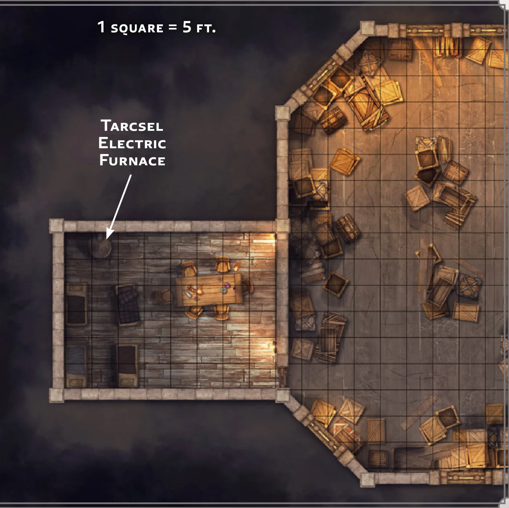
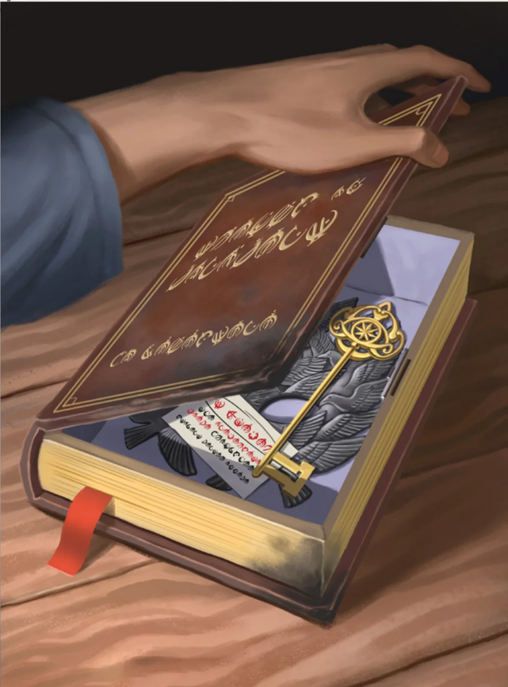
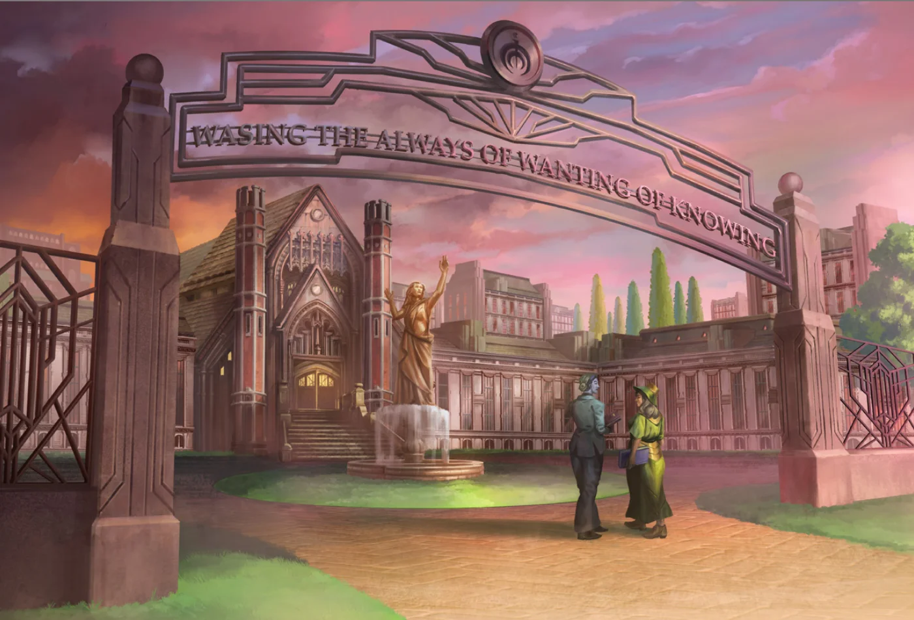
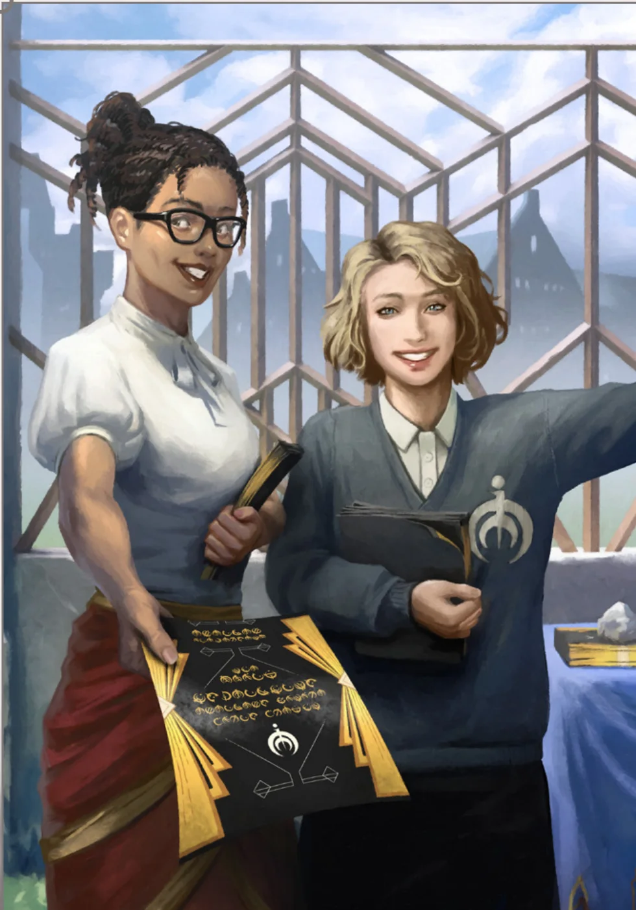
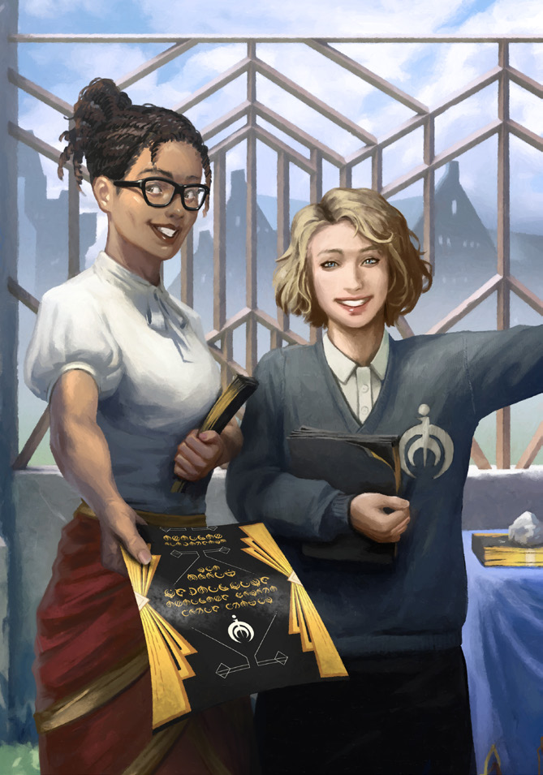
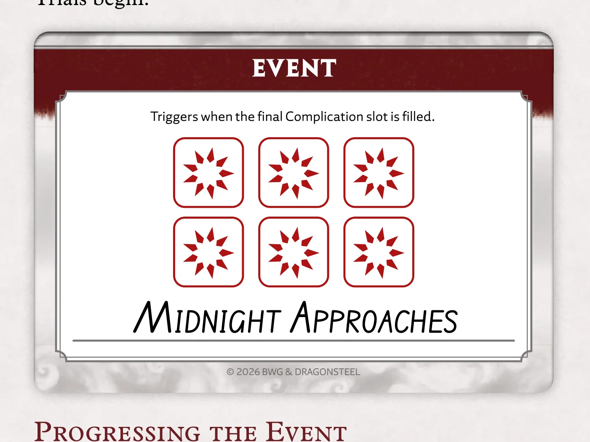
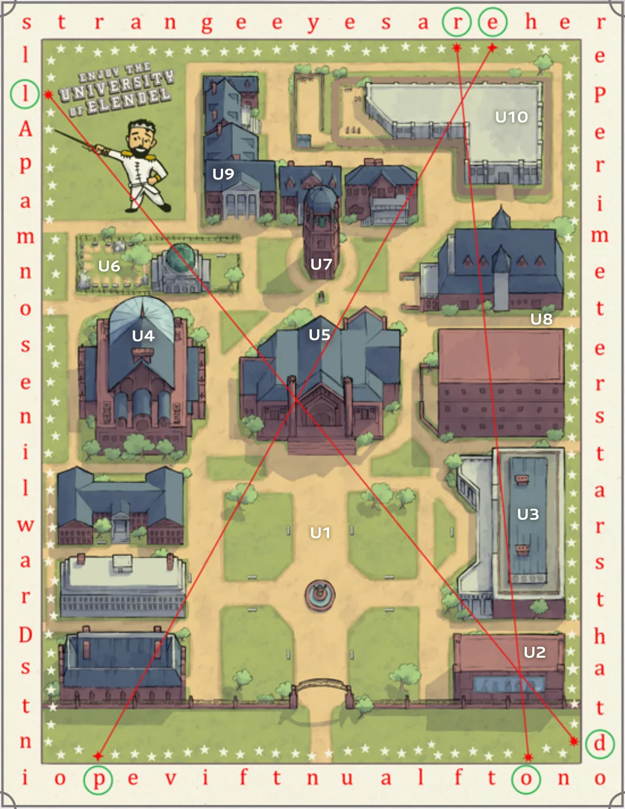

### 清算舊帳

#### 時間緊迫

本章開始時，鍍金三人組已得知，PC 破壞了 Kwylliam 的賄賂計畫，使他無法把箱子從 Wilko 教授手中轉走。三人組為取得鑰匙與面具不惜一切，正在依藍戴搜尋隊伍，準備以爆炸展開反擊。

#### 安全屋

Wilko 為隊伍成功行竊而欣喜若狂。她打算立刻研究鑰匙與面具，希望很快能查出更多資訊。隊伍逃走時引人注目，Wilko 提醒 PC 保持低調，安排他們住進碼頭區的一座倉庫。這座安全屋其實屬於守護者組織（見附錄 F）。若有人追問，Wilko 會脫口說出這件事，隨即找機會離開。視守護者組織的重心而定，倉庫裡堆滿下列物品。

- **智慧。** 玻璃儀器。
- **產業。** Soonie 幼犬（狼犬填充玩具）。
- **勞工。** 冷凍魚。

PC 可使用一間沒有窗戶的私人後房。房內有一扇門、一張桌子，並為每人備了一張行軍床。

#### 避避風頭：在依藍戴休整

PC 在依藍戴有一週休整期。除了《迷霧之子玩家手冊》第 9 章「休整期」所述的一般活動，《迷霧之子傳承》也提供本冒險特有的活動。第二時代 PC 可用的完整清單見附錄 E 的「在依藍戴休整」。若隊伍取回第一時代隊伍的血金術筆記，可以在休整期研讀，見本書導論「處理血金術」。

告知玩家，Wilko 建議隊伍保持低調，因為三人組一定在找他們。若 PC 無視這項建議，到公開場所進行休整活動，例如去圖書館研究或去醫院休養，請他擲劇情骰。擲出變故時，PC 感覺有人在監視自己，接下來的「趕去找 Wilko」試煉自動累積一次失敗。

Wilko 送來一封沒有署名的信，休整就此結束。這段令人不安的平靜即將被打破。隊伍的藏身處（見地圖 6.1）遭到襲擊，暖爐裡藏著炸彈，突擊小隊就在門口。事後，隊伍必須找出線索，趕往依藍戴大學的辦公室，保護 Wilko 免受第二次爆炸襲擊。開場時讀出下列內容。

> 這天晚上，倉庫安全屋漏風的後房裡，有一封沒有署名的信等著你們。信旁的桌上放著一瓶你們最愛喝的酒，一看就知道是 Wilko 送的。

將附錄 D 的「Wilko 的便條」講義交給玩家，或讀出下列內容。

> 好消息，我查到了一些箱中物品的線索。我相信我們手上有一把「創始者之鑰」。
>
> 傳說大學早期的一名教師造了三把這樣的鑰匙，還在校園地下藏了一件珍寶。他把鑰匙傳給貴族學生保管。我相信那件珍寶是「鍍金地圖」……詳情最好當面再談。
>
> 眼下我有個更急的麻煩。我以前的一名學生一直追著我問鑰匙的事，只有和諧知道她是怎麼打聽到的。她是《學生之聲》的記者，要是繼續追查，我怕她會發現我們最近做的事。
>
> 她說自己有關於鑰匙的重要消息。你們能跟她談談嗎？開這個口有點傻，可我實在不會說謊。
>
> 敬上  
> A. Wilko
>
> 附註。說到犯傻，可能只是我太緊張，但我一直覺得有人在監視我。如果我出了什麼事，面具和鑰匙藏在我那本《Monument 的試煉》裡。
>
> 還有，請把這張便條銷毀！

第 6 章：飢渴靈魂的渴望 112

#### Conrad 突擊小隊

隊伍討論完便條後，或有 PC 開始離開或準備就寢時，讓每名 PC 進行感知檢定。向結果最高的角色讀出下列內容。

> 你注意到房間西北角傳來古怪而尖細的滴答聲。那裡的 Tarcsel Electric 暖爐正在喀喀作響。

調查會發現暖爐的控制盒裡放著一個滴答作響的裝置。每名上前調查的 PC 進行 DC 12 推理檢定。成功時，PC 知道炸彈即將爆炸，有一瞬間可以警告全隊在戰鬥開始前立刻架防（[1行動]）。不論 PC 有沒有調查，炸彈都會爆炸，戰鬥就此開始，刺客發動攻擊。

##### 爆炸開場

炸彈在該輪開始時爆炸，在半徑 25 呎內造成 2d6 能量傷害，該區域也充滿濃煙。採取架防行動的角色只受到一半傷害。除非成功通過辨認炸彈的推理檢定，否則每名 PC 在戰鬥開始時都措手不及。

三名便衣 Conrad 特工堵住安全屋出口。他們採取慢速輪次，在炸彈爆炸後進入，毫髮無傷。

##### 戰場效果

- **倒數。** 從第三輪開始，每輪一開始，隊伍就在「趕去找 Wilko」試煉中累積一次失敗。
- **濃煙。** 炸彈爆炸的區域布滿濃煙，遮蔽視線。

##### 後續

特工會打四輪，或打到其中一人死亡為止，然後撤退，說「東西不在他們手上。撤往第二個地點。」

#### 趕去找 Wilko

此時分秒必爭。PC 可以查看被擊敗的特工，或搜尋殘骸找線索。PC 不論何時決定去保護 Wilko，都接著進行「主持試煉」。若隊伍沒有嘗試救援，跳到「漫長的一夜」。

若隊伍在現場逗留五分鐘，「趕去找 Wilko」試煉自動累積一次失敗。警笛聲正往這裡靠近。若 PC 不逃走，四名警員會抵達。警員一時認不出 PC 是國家檔案館竊案的涉案人，但他們受 Bayron 收買，對 PC 抱持懷疑，也不會提供協助。

##### 特工身上的線索

被制伏的特工希望被交給警方。若有 PC 成功通過 DC 13 威嚇或說服檢定，一名特工會惡狠狠地說「你們無關緊要。我們要的東西會從你們那位教授朋友手上拿到。」特工的火器裝有 Conrad Industries 製造的消音器。其中一名特工的外套口袋有張字條，寫著「141 辦公室」。成功通過 DC 12 推理檢定的 PC 立刻想起這是 Wilko 的辦公室號碼。

##### 搜索殘骸

成功通過 DC 12 工藝或感知檢定可發現炸彈殘骸。破片幾乎看不出原屬爆炸裝置，卻清楚刻著 Conrad Industries 的標誌。

**地圖 6.1：隊伍藏身處。** 每格 5 呎。圖上標示 Tarcsel Electric 暖爐。

第 6 章：飢渴靈魂的渴望 113

ELEDRYLL

##### 主持試煉

若 PC 意識到 Wilko 有危險，以試煉處理趕去找她的過程，見「結算試煉」。依先前戰鬥持續多久、PC 事後是否逗留，以及休整期是否擲出變故，試煉開始時最多已累積 4 次失敗。提高下列所有檢定的賭注，依序處理這些阻礙。

- **穿越依藍戴。** 為及時趕到，PC 可拔腿跑在前面（DC 15 運動）、尋找捷徑（DC 14 求生），或弄到更快的交通工具（DC 13 竊盜）。
- **大學校門。** 最後一次試煉檢定時，PC 抵達大學校門。他們必須翻過圍牆（DC 17 運動）、找到能穿過大門的縫隙（DC 18 感知），或騙過夜間門衛（DC 17 欺瞞）。

**探索者傳承時刻。** 請探索者描述有一次不得不急忙穿越依藍戴大學校園，或偷偷溜進去，因而找到捷徑的經過。建立一個只有一格的正面事件「探索者證明自己」。PC 花費一個機遇觸發事件時，探索者的經驗派上用場，從「趕去找 Wilko」試煉移除 1 次失敗。若 Wilko 在爆炸後仍清醒，她很感激探索者，願意成為其贊助者（見《迷霧之子玩家手冊》第 8 章）。她提供的贊助者好處是讓探索者更方便使用大學圖書館，休整期研究所需時間減半。

##### 結算試煉

隊伍累積 3 次成功或 5 次失敗，或以其他方式完成目標時，試煉結束。結果依累積的失敗次數而定。

- **至多一次失敗。** PC 抵達 141 辦公室，看見 Azmine Wilko 坐在柔軟的椅子上安靜研究，專注得沒聽見一旁暖爐發出的滴答聲。若未成功通過 DC 14 工藝或竊盜檢定來解除裝置，一枚相似的炸彈會在三輪後爆炸。即使炸彈爆炸，Wilko 也已知道有危險，只受輕傷且保持清醒。
- **兩次或三次失敗。** PC 抵達時炸彈正好爆炸。Wilko 還清醒，但必須在兩輪內獲得醫療照護，例如成功通過 DC 10 醫療檢定，否則會失去意識。不論是否得到照護，她都受到一處傷勢，依《迷霧之子玩家手冊》第 9 章進行傷勢擲骰。
- **四次以上失敗。** 爆炸時，PC 還在大學校門口。混亂中，他們可以輕鬆地不動聲色地離開，或趕往 Wilko 已被炸毀的辦公室。Wilko 失去意識，傷勢嚴重，進行一次帶有 −5 調整值的傷勢擲骰。

##### Wilko 的上鎖箱：《Monument 的試煉》

若 Wilko 辦公室的炸彈爆炸，搜尋她那本《Monument 的試煉》的 PC 會在瓦礫堆裡找到完好無損的書。這本書其實是偽裝的上鎖箱，裡面有創始者之鑰、烏鴉面具和一張 K.T. Quiven 的名片。她在學生活動中心的《大學之聲》傳紙辦公室工作。搜尋殘骸也會發現另一塊印有 Conrad Industries 標誌的炸彈碎片。PC 準備好後，接著進行「漫長的一夜」。

Wilko 的上鎖箱偽裝成一本書。

第 6 章：飢渴靈魂的渴望 114

SAMI RYTKÖNEN

#### 深入採訪

##### 漫長的一夜

隊伍的藏身處已被摧毀，Wilko 可能仍清醒，也可能失去意識。若她清醒，便會在 Tekiel 塔的家族宅邸與家人一起招待 PC，見本書導論「重要角色」。Wilko 健談的家人會聊到穿著時髦的 Lysarra Tekiel 帶著衣著考究的商界人士四處參觀，為第 8 章的埃拉瑞爾春季沙龍埋下伏筆。他們也談起 Tekiel 家族的財務困難，以及塔樓可能靠犯罪門路才得以完工的傳聞。若 PC 出示或描述任一爆炸留下的炸彈殘骸，Wilko 會沮喪地推測，Bayron Conrad 收買了執法單位來逃避後果。

若 Wilko 失去意識，家人會將她帶往家族宅邸，不讓 PC 探視。PC 必須另尋臨時住處。

##### 重建藏身處

PC 想建立新的藏身處時，可以請認識的人幫忙尋找合適地點。依傳承查閱「新安全屋」表。

| 傳承 | 聯絡人與地點 |
| --- | --- |
| 企業家 | Legin（商人，她）是 Legin 木材行的老闆，經營木材場及小型營造公司。 |
| 探索者 | Dindrop（顧問，他）是銀色航行者的初階冒險者，那是一間高級的紳士淑女冒險俱樂部。 |
| 繼承人 | 家族在 Madion Ways 有一間空著的季節性公寓。 |
| 執法者 | M 夫人（線人，她）是紫藤之家的接待人，店裡滿是花卉，提供安撫服務。 |
| 新手 | Boots（反抗者，他）是醉馬刺的酒保，那是一間俗艷的蠻橫區主題餐廳。 |
| 說書人 | Reshyn（平民，使用中性代名詞）在新近崛起的 Clarvonne 劇院擔任戲劇顧問。該劇院以輕歌劇聞名。 |

聯絡人會在該地點提供安全的住宿。繼承人則由一名家族成員提供。若 PC 有意回報，讓他開始一個適當的目標，完成後就能把該地點當作永久藏身處，見《迷霧之子玩家手冊》第 8 章「藏身處」。

##### 媒體說法

隔天，傳紙刊出報導，聲稱爆炸起因是 Tarcsel Electric 暖爐的製造瑕疵，其中尤其包括 Kwylliam 的報紙《依藍戴真相報》。當局相信這項說法。若 PC 當時沒發現 Wilko 有危險，可以從報導中得知第二次爆炸。若角色在第 5 章見到 Kwylliam 時說了會讓自己惹上麻煩的往事，傳紙也會提到這些事。文章都沒有提及檔案館竊案。

隔天，PC 要依原定安排與 Wilko 在依藍戴大學碰面。Wilko 若清醒，就會來會合並介紹 K.T. Quiven（線人，她）。若 Wilko 失去意識，K.T. 就會自己找上隊伍。

**扮演 K.T. Quiven**

- **性格** 活潑大膽、機靈、不屈不撓。
- **目標** 發掘千眼會的祕密。
- **外貌** K.T. Quiven（讀作「KAY-TEE KWI-ven」，她）皮膚白皙，披著棕色波浪髮，神情專注。她斜戴帽子，穿著吊帶和昂貴的鞋。

K.T. 是依藍戴本地人，從小就夢想成為傳紙記者。她曾是街頭幫派 Cobblers 的街童，如今靠 Young Ascendants 的獎學金就讀依藍戴大學。K.T. 追問起來毫不放鬆，也很容易被激得為城市的事爭辯，從參議院政治到哪家肉派最好吃都能吵上一場。

第 6 章：飢渴靈魂的渴望 115

##### 校園會面

隔天 PC 進入校園時，讀出下列內容。

> 「Wasing the Always of Wanting of Knowing.」迷霧之子大人的這句話沿著依藍戴大學宏偉的大門上方排成拱形。入口兩側站著兩名黑衣警衛，也就是學生口中的校園警衛。其中一人嚴厲地說「校園只開放給大學的學生、教職員和訪客。」

兩名黑衣警衛（警員）把守大門。若 Wilko 在場，她會出示大學別針，守衛便放隊伍通過，PC 也可攜帶具有隱蔽特性的武器入內。否則，PC 必須成功通過 DC 14 竊盜檢定將武器藏好，或把武器留在校外。

**執法者傳承時刻。** 其中一名黑衣警衛是重視原則的 Junkson 隊長（她），曾在警署與執法者共事。請玩家說明，兩人是因為官員法律理念中的哪一項共同道德觀而迅速成為好友。Junkson 告訴執法者，有需要就「儘管開口」。只要請求未牴觸雙方既有的道德原則，Junkson 就會幫執法者一次，例如替他打掩護，避免「午夜將至」事件推進，或准許進入某棟建築。這不需檢定。若請求與雙方的道德原則牴觸，PC 必須先以相關技能成功通過 DC 18 檢定。失敗時，Junkson 不會幫忙，兩人的友誼也就此結束。

隊伍一進校園，K.T. 便朝他們走來。讀出下列內容。

> 一名棕髮年輕女子斜戴帽子、穿著吊帶，大步上前迎接你們。她燦爛地笑著，伸出手來。「K.T. Quiven，《大學之聲》的總編輯。」

自我介紹後，K.T. 邀請隊伍回到學生活動中心內的《大學之聲》辦公室。

**說書人傳承時刻。** 午夜以前，K.T. 會找上說書人，表示聽過對方的名聲。請玩家說明 K.T. 知道說書人的哪部作品。她很想聽說書人對說故事的看法，尤其是它如何與新聞報導交會，於是詢問說書人是否願意指導她。若說書人同意，就開始「指導 K.T.」目標。完成後，說書人可以使用《大學之聲》的資源。這是一個規模 1 的社交俱樂部組織，傳播的是新聞報導。若探索者與「灰侯之友」有連結，且兩位玩家都同意，說書人也可安排 K.T. 在那裡發表作品，使該組織的規模增加 1。

第 6 章：飢渴靈魂的渴望 116

##### 校園記者

《大學之聲》辦公室最醒目的是 K.T. 的軟木板，上頭釘滿剪報和筆記，仔細用細繩連在一起。K.T. 招呼隊伍在一疊疊舊傳紙之間坐下。讀出下列內容。

> 「來談談你們為什麼被襲擊吧。我一直在調查千眼會，那是校園裡一個只招收年輕貴族的菁英兄弟會。巧的是，千眼會每年的入會儀式『午夜試煉』都會用到一把創始者之鑰，和你們與 Wilko『弄到手』的那把一模一樣。據說這些鑰匙能打開千眼會藏在大學地下的寶藏，名字叫鍍金地圖。現在我們知道，無論鍍金地圖是什麼，千眼會都肯殺人來保密。」K.T. 微笑，眼神閃著期待。「他們想炸死你們？那我們就把他們的祕密全抖出來。」

K.T. 確信襲擊隊伍的人與千眼會有關，想奪回創始者之鑰。她希望招募 PC 協助調查，並分享下列資訊。

- **絕佳機會。** K.T. 提供一個難得的臥底機會。每年一度的午夜試煉就在今晚，前來爭取入會的候補成員會戴上儀式面具，隱藏貴族身分。
- **千眼會的邀請。** K.T. 手上有千眼會的邀請函，列出學生候補成員若要挑戰試煉就必須遵守的指示。將附錄 D 的「午夜試煉邀請函」和「依藍戴大學校園地圖」兩份講義交給玩家。也可以直接朗讀邀請函。
- **內應。** K.T. 有一名「內應」，是同校學生兼千眼會候補成員 Marthis（他）。他欠 K.T. 一個人情，可以協助隊伍假扮候補成員。

> 血統最高貴的孩子：
>
> 午夜試煉將在 Cladence 月第 16 日最後一響鐘聲時舉行。經裁定有資格者，將繼承我們的傳承。請作以下準備：
>
> - 自豪地戴上千眼會的面具。
> - 攜帶卡西人的祭品前來。
>
> 有資格者必須找到試煉的起點。在地圖上繪出 Nelazan 路線，連起成對的奇異之眼。讀出鋼鐵字母，你們尋找的指引就藏在交點。
>
> 火焰能驗出礦石的純度。

依信上所述，試煉將於幾小時後在祕密地點開始，見「事件：午夜將至」。PC 必須遵循信上指示才能潛入，見「為試煉做準備」。若 PC 不帶 K.T.，她也會自行調查並潛入。接下來的謎題會隨 PC 探索校園逐步展開，並無固定的解題順序。先總覽「依藍戴大學地點」。帶領這段劇情前，請讀完「為試煉做準備」。該節末尾的「地圖謎題」會說明在部分地點遇到的線索。

#### 依藍戴大學地點

下列地點標示於「依藍戴大學校園地圖」（見地圖 6.2）。PC 進行「為試煉做準備」時，請參考本節。

##### U1：校門與校地

一道 15 呎高的磚牆圍著大學。宏偉的大門上方刻著「Wasing the Always of Wanting of Knowing」。兩名黑衣警衛把守入口。門內，學生在修剪整齊的草坪上休息，周圍是有數百年歷史的磚造建築和彩繪玻璃。中央的古老噴泉塑著一名穿薄紗長裙的女子，站在灰燼上向天空祈求。

大門是校地唯一明顯的入口。兩名黑衣警衛（警員）會檢查武器並登記訪客。西邊有一排教室，名為電金館。若 Wilko 辦公室的炸彈爆炸，歷史系所在的六號館牆面會留下 5 呎寬的洞，另有四名黑衣警衛把守。

EREL MATITA

踏入依藍戴大學莊嚴的校地。

**地圖 6.2：依藍戴大學校園地圖。** 圖上標示 U1 校門與校地、電金館、U10 體育館與運動場、U5 圖書館、U4 進階科學與冶金實驗室、U6 小教堂與墓地、U7 鐘樓、U9 社團街、U3 學生活動中心、U2 銅廳、U8 Pashadon 宿舍和 Lastrum 宿舍。

##### U2：銅廳

大學的兩層樓行政建築銅廳兩旁種著楓樹。正面的彩繪玻璃描繪一場未必真有其事的辯論，人物是尤門、廷朵、Dilisteni、迷霧之子大人等歷史上的學者。一名無聊的守衛看著大門。

銅廳是大學的行政大樓，裡面有各院長的辦公室、財務室和一間昏暗狹窄的檔案室。

**謎題線索。** 「LORD」指彩繪玻璃上的迷霧之子大人，玻璃上有人用粉筆寫了「Gaze（凝視）」。

##### U3：學生活動中心

學生活動中心是一座兩層樓的磚造建築，二樓寬闊的陽台由柱子支撐。室內各房間由學生組織使用，包括年鑑社、模擬議會、Young Ascendants、美術社和學生傳紙《大學之聲》。這裡也有校園商店與小劇場，劇場正在排練。Young Ascendants 辦公室裡擠滿興奮的學生。

Young Ascendants 是 Lysarra 創辦、旨在培力青少年的組織。若 PC 走近辦公室，會看到 Lysarra Tekiel 向一群崇拜她的學生介紹即將在埃拉瑞爾春季沙龍舉行的「鍍金與華彩」慈善拍賣，見第 8 章。她提到還有拍賣實習名額。校園商店販售文具和大學周邊商品。

##### U4：進階科學與冶金實驗室

招牌寫明這棟大型磚造建築設有進階科學與冶金實驗室。裡面的開放式大廳展示解剖模型和學術獎項。醫學翼的盡頭是手術劇場。這棟建築另有三層科學教室與實驗室。

教授們在整點下課，課程包括生物學、化學和冶金科學。說話單調的 Zhine 教授（顧問，他）教授解剖學和金屬之子生物學，可能正在手術劇場示範解剖。

**謎題線索。** 循著「Scholar Statue Gaze」的線索（見 U7）前往手術劇場的 PC，會發現牆上一塊鬆動的磚。磚上寫著「午夜在此集合」。這正是試煉預定的起點。若 PC 尚未目睹本章後述的「鍍金爭執」，該場景此時便會在原本空無一人的手術劇場發生。接著 Tiphiny 會走上前來，見「地圖謎題」。

##### U5：圖書館

大理石階梯通往龐大的大學圖書館。到處都聽得見筆尖沙沙聲、低聲交談與書車吱嘎聲。一名圖書館員立刻上前詢問，隔著厚厚的鏡片朝你們眨眼。「要我幫忙找什麼嗎？我們有內容詳盡的《創始之書》Pledfellow 版公開展覽。或者，你們想查閱我們收藏的大量傳紙？」

依藍戴大學圖書館是司卡德利亞藏書最豐富的圖書館。Trudine（顧問，她）會向訪客介紹各項服務。公開展出的《創始之書》Pledfellow 版每卷各置於一座台座上，由光線柔和的電燈照亮。

**謎題線索。** 「PLED」指這場展覽。《創始之書》第一卷夾著一條書籤帶，上面寫著「Scholar（學者）」。

##### U6：小教堂與墓地

大學的跨宗教小教堂有玻璃穹頂，柱上雕著以落灰之終為靈感的浮雕。主廳旁有一間道途教的冥想室，只有兩把椅子。教堂四周是小墓地，散布風化的墓碑和霧魅雕像。

身為道徒的神祕園丁 Fan（顧問，使用中性代名詞）身上常沾著草漬，早就被來盜墓的學生弄得不勝其煩。

**新手傳承時刻。** 老兵就葬在這片墓地。問新手，老兵的哪項事蹟讓歷史學者決定將遺骨移葬於此。再問老兵的玩家，那則故事有多少是真的。老兵的遺骨可在「為試煉做準備」中用作卡西人的祭品。

第 6 章：飢渴靈魂的渴望 119

RYAN SMITH

##### U7：鐘樓

磚造鐘樓前有一座校園裡稱作「學者」的雕像，神態沉思。鐘樓是校園最高的建築，鐘室有八口不同金屬製成的鐘，會敲響報時。

鐘室的視野無可比擬，能將整座校園盡收眼底。

**謎題線索。** 若 PC 解出「Scholar Statue Gaze（學者雕像的視線）」，便會注意到學者雕像正凝視著實驗室（U4）的手術劇場。

**時代跳躍的連結。** 若 Guiverre Seeris 在第一時代仍與 Delina 站在同一邊，鐘樓雕像上的銘牌就會寫著他的名字。否則，雕像紀念的是 Duvall Haught。

##### U8：Lastrum 與 Pashadon 宿舍

兩座巨大的三層樓磚造建築分別是 Lastrum 與 Pashadon 學生宿舍。兩棟樓都有令人望而生畏的石造裝飾、鐵柵與極小的窗戶。

住校學生有兩間主要宿舍。Lastrum 是男生宿舍，Pashadon 是女生宿舍。底下兩層設有雙層床，頂樓是設備講究的單人房，供較富有的學生居住，其中有些就是千眼會的貴族候補成員。宿舍只開放給學生及家屬，但隊伍進入 Lastrum 並不困難。Marthis 就在這附近，見本章後面的「Marthis 與面具」。Pashadon 較難進入，舍監 Penfor 女士（保鑣，她）會在櫃檯攔下訪客。

##### U9：社團街

校園北端有一排錯落的高級社團會館，外牆爬滿常春藤。這裡的共居社團包括冶金學家協會、全體運動員俱樂部、千眼會與跨文化村。

只有社團成員才能進入會館。成功通過 DC 13 運動檢定的 PC，可以攀著千眼會會館外牆的常春藤，抵達樓上開著的窗戶。

**探索千眼會會館。** 會館有鍍金餐廳、shelldry 遊戲室、私人圖書室與成員臥室，地下室還有一座巨大的酒窖。PC 進入會館時，若隊伍還沒看到本章稍後的「鍍金爭執」，該場景就在此時發生。

學生分發宣傳 Young Ascendants 的小冊子。

第 6 章：飢渴靈魂的渴望 120

SIRAJ FAKHRI

PC 探索會館時，會找到一把價值 100 盒金的玫瑰木吉他（樂器）。成功通過 DC 12 感知檢定時，還會發現本章稍後午夜試煉「大混戰」所用的金屬腰帶與眼罩。失敗時，「午夜將至」事件推進 2 格，同時 Ylvwa（平民，她）發現隊伍。這名忙得焦頭爛額的泰瑞司女管家欠千眼會錢，無法脫身。若 PC 願意同情地聽完她漫長而悲慘的人生故事，她就不會叫校園警衛。

##### U10：體育館與運動場

現代化的混凝土體育館外圍是跑道和運動場。一小群人正在靶場練習。館內有攀爬繩、鞍馬與划船機。其中一角從地板到天花板都鋪了軟墊，讓射幣與扯手練習鎔金術。

女子射擊社正在聚會。精力充沛卻忙不過來的學生教練 Olivora（平民，她）正拿六把獵槍，指導一年級學生正確的射擊姿勢。

**謎題線索。** 「ROPE」提示 PC 成功通過 DC 10 運動檢定爬上繩子，便會看到天花板上刻著「Statue（雕像）」。

#### 為試煉做準備

PC 開始準備時，向玩家介紹「午夜將至」事件。留意「鍍金爭執」，這個場景可在不同地點觸發。隊伍現在有三項任務。

- **取得面具。** Marthis 能幫忙。PC 很容易在 Lastrum 宿舍（U8）找到他。見「Marthis 與面具」。
- **準備「卡西人的祭品」。** 在場的 Wilko、有宗教專長的 PC，或成功通過 DC 18 學識檢定，都能說明這個詞指的是卡西人的宗教傳統，也就是獻上一副骨骸，講述其主人的故事。到圖書館查資料也能得知同樣的資訊，但事件會推進 1 格。見「卡西人的祭品」。
- **找出起點。** PC 必須解開謎題才能找到地點。見「地圖謎題」。

PC 在校園各處完成這些任務時，可參照地圖 6.2 和「依藍戴大學地點」描述場景。

##### 事件：午夜將至

宣布開始一個事件，見《迷霧之子玩家手冊》第 9 章「事件」。「午夜將至」是個有六格的負面事件，用來大致表示午夜試煉開始前的剩餘時間。

**推進事件。** 當 PC 在校園場景中遭遇變故，你可以把事件推進 1 格，以縮短準備時間取代立即發生的變故。PC 做出可疑舉動時，就提高賭注。引起校園警衛的注意一定會招來盤問，白白耗掉時間。告訴玩家，下列特殊情形也會推進事件。

- **多花些時間。** PC 檢定失敗時，玩家可以描述角色若有充裕時間會如何解決問題，將失敗改為成功。這條規則也可用來跳過「地圖謎題」的一個步驟。每用一次，事件推進 1 格。
- **離開校園。** 前往城市其他地方再返回需要時間。PC 每次離開校園，事件推進 1 格。

**觸發事件。** 填滿六格時，鐘樓敲響午夜鐘聲。PC 知道時間到了，試煉就要開始。若已在午夜前取得面具並找到起點，即使沒有骨骸可以獻上，PC 也能在事件觸發後立刻加入試煉，及時抵達。否則，PC 得匆忙完成最低限度的準備，並會遲到，見本章稍後的「準備不足」。兩種情形都接著進行「午夜試煉」。

| 事件 | 追蹤 |
| --- | --- |
| 午夜將至 | [Complication] [Complication] [Complication] [Complication] [Complication] [Complication] |
| 午夜將至 | [Complication] [Complication] [Complication] [Complication] [Complication] [Complication] |

第 6 章：飢渴靈魂的渴望 121

**扮演 Marthis Elariel／Tekiel**

- **性格** 輕信、笨拙、愛裝男子漢。
- **目標** 通過午夜試煉，讓父母為自己驕傲。
- **外貌** Marthis（讀作「MAR-this」，他）是一名身材健壯的年輕男子，皮膚古銅，有一個鷹鉤鼻，黑髮修剪整齊。

Marthis 從小養尊處優，鮮少因自己的平庸吃苦。他的雙親都曾是千眼會的「眼」，他害怕讓他們失望。這種恐懼使他容易受人利用。Marthis 說話時虛張聲勢，把 Kwylliam 當成偶像。緊張時，他會來回踱步，用拳頭捶自己的手掌。

##### 鍍金爭執

PC 可在社團街（U9）的千眼會會館，或解開地圖謎題後在實驗室（U4）的手術劇場，偷聽到鍍金三人組爭吵。每名參與偷聽的 PC 進行 DC 18 隱匿檢定，並獲得一項優勢。成功時，PC 偷聽而未被發現。只要有任何 PC 失敗，隊伍仍會目睹爭執，但 Lysarra 會起疑，事後叫黑衣警衛來查看。「午夜將至」事件推進 1 格。爭執發生時，讀出下列內容。

> 第一個聲音是 Lysarra 的。「面具早就該到手了。兩位先生，你們辦事真草率。」三人組走進視野，顯然還在爭吵。
>
> Bayron 氣得正要反駁，Kwylliam 卻先若無其事地插話。「你反應過度了，Lysarra。事情有點危險才有趣。」
>
> Lysarra 面無表情，平靜地反擊。「你從沒遇過真正的危險，Kwylliam。反正你媽媽總能替你收拾爛攤子。」
>
> Kwylliam 終於惱了，說道：「無聊。我去準備試煉了。」
>
> 其他人把 Bayron 留在原地。他氣得驟燒白鑞，一拳揍上牆，疼得眼裡泛淚，隨即跟著兩人出去。

Marthis，千眼會候補成員。

第 6 章：飢渴靈魂的渴望 122

JUSTI HIEU

##### Marthis 與面具

Marthis（候補成員，他）是貴族學生，也是今年的千眼會候補成員之一。在 Lastrum 宿舍（U8）外很容易找到他。他不惜任何代價也想通過試煉。若 PC 提到 K.T.，Marthis 就會熱切地與他們交談，並透露下列資訊。

- 他若沒能成為「眼」，爸爸會非常不高興。
- 千眼會只接受「好人家」。
- 今天有幾位知名的「眼」在校園裡。Marthis 滔滔不絕地稱讚 Kwylliam 的傳奇事蹟，說他曾騎馬穿過圖書館。

若 PC 同意幫忙，或始終善待 Marthis，他還會透露下列資訊。

- 試煉需要了解大學歷史。研究校園各地可能有幫助。
- 通過試煉的人必須摘下面具，參加最後的慶祝會。

只要 PC 提出任何稍微可行、能幫他通過試煉的辦法，無論是憑真本事還是作弊，Marthis 就會提供面具。他也還不知道試煉起點，樂意用面具交換情報。這些骷髏面具以星形審判者尖刺充當眼睛。

##### 不靠 Marthis 取得面具

若 PC 沒有與 Marthis 談成交易，可以用類似「卡西人的祭品」的試煉來偷取或製作面具。隊伍要在累積 3 次失敗前達成 4 次成功，才算成功。不論結果如何，隊伍都能取得面具。若試煉失敗，「午夜將至」事件也推進 2 格。

**企業家傳承時刻。** Marthis 看出企業家與街童有親屬關係，詢問企業家的姓氏來確認。他解釋，數百年前，他的家族曾因街童投入社區基金而受益，靠那筆錢在落灰之終後重建。若 PC 幫助 Marthis，他會安排 Call and Son and Daughters Accounting and Estate 的 Garisel Daring（顧問，他）在下次休整期與企業家會面，作為回報。Daring 會提供為街童後裔保留的種子基金，金額為街童在第 4 章投入的盒金數（最多以 200 計）乘以 4d4。

**時代跳躍的連結。** 若第一時代的 PC 沒有在第 2 章撮合 Cadme 和 Anastas，Marthis 就是 Marthis Tekiel，性格加上「自恃特權」。他是 Delina 的後代，也是 Lysarra 的表親，時常提起她。若兩人當時走到一起，Marthis 就是 Marthis Elariel，是 Cadme 與 Anastas 的後代，出身家族中地位不高、人卻和善的旁支，性格加上「真誠」。他的表親 Kwylliam 會打趣說 Marthis 只是想攀附名氣，算不上「真正的」埃拉瑞爾。Marthis 非常渴望得到他的認可。若 PC 關心 Marthis，可以開始一個目標，例如「幫 Marthis Tekiel 找到更好的方式讓父母為他驕傲」，或「幫 Marthis Elariel 找到自己的歸屬」。完成後，PC 可讓 Marthis 成為同伴，或讓他所屬的埃拉瑞爾家族旁支成為贊助自己的司卡德利亞貴族家族，見《迷霧之子玩家手冊》第 8 章「贊助者」。

##### 卡西人的祭品

PC 必須找到適合在試煉中獻上的骨骸。以試煉處理搜尋過程，見「結算祭品試煉」。隊伍可考慮下列作法。

- **小教堂（U6）。** 園丁 Fan（使用中性代名詞）盯得很緊，很難在教堂的小墓地盜墓。PC 可騙過 Fan，引開其注意（DC 15 欺瞞），挑選有故事可講的墓（DC 14 學識），迅速挖掘（DC 16 運動），並收集隊伍需要的骨骸（DC 16 醫療）。這是提高賭注的好時機。
- **實驗室（U4）。** 實驗室有教學用骨骸，但放在容易被看見的地方。PC 可以假扮客座教師（DC 16 欺瞞），溜進後方房間（DC 14 隱匿），找到合適的標本（DC 10 醫療），並將骨骸偷偷帶出大樓（DC 16 竊盜）。
- **學生活動中心（U3）。** 小劇場有一副假骨架，但正在排演。PC 可以試鏡（DC 14 說服）、展現戲劇知識讓學生刮目相看（DC 13 學識），或編出可信的解釋（DC 13 欺瞞）。

**結算祭品試煉。** 隊伍在累積 3 次失敗前達成 4 次成功，或以其他方式完成目標，試煉即成功。

- **成功。** 隊伍取得骨骸。
- **失敗。** 隊伍仍取得骨骸，卻引起校園警衛的注意。「午夜將至」事件推進 2 格。

K.T. Quiven，學生記者。

123

JUSTI HIEU

##### 地圖謎題

要解開遍及校園的謎題，玩家必須依邀請函中的線索，在「依藍戴大學校園地圖」講義上繪圖，最後找到實驗室的手術劇場。參閱「地圖謎題解答」表和圖示，掌握各步驟的細節。若玩家卡關，表中每個步驟都有可提供的提示。若還是解不開，PC 可以用「多花些時間」規則取得進入下一步所需的資訊，見「事件：午夜將至」。解開謎題不久，勢利的候補成員 Tiphiny（她）會走上前來。她注意到 PC 已解開謎題，便暗示願意付 200 盒金買下他們的校園地圖。

###### 地圖謎題解答

| 步驟 | 線索 | 提示 | 得到的資訊 |
| --- | --- | --- | --- |
| 1 | 「在地圖上繪出 Nelazan 路線……」 | 提醒玩家查看校園地圖。圖書館（U5）一定有「Nelazan 路線」等用語的資料。 | 「Nelazan 路線」指依星辰指引方向。PC 可以問 Wilko、運用宗教專長、到圖書館（U5）查資料，或成功通過 DC 14 學識檢定，得知這指的是古代信奉 Trelagism 的 Nelazan 人。他們繪製夜空星圖，稱群星為 Trell 的千眼。 |
| 2 | 「……連起成對的奇異之眼。」 | PC 注意到其中一顆奇異的星星，請指出位置。隊伍看見另一群候補成員在地圖上連接兩顆星。 | 地圖邊緣的「奇異之眼」是四芒、七芒與八芒星。「連起成對的」指在地圖上用直線連接每對星星，見解答圖。線條在三處相交（U2、U5、U10）。 |
| 3 | 「讀出鋼鐵字母。……藏在交點。」 | 每個交點連著四個特定的字母。 | 每個交點的兩條線通往地圖邊緣四個符號。PC 認出鋼鐵字母。將《迷霧之子玩家手冊》書末的鋼鐵字母表交給玩家。譯出符號後，重新排列四個字母，得到 LORD、PLED、ROPE。 |
| 4 | 「你們尋找的指引就藏在交點。」 | 各處 NPC 都提到在三個答案附近見過候補成員。NPC 分別是銅廳（U2）的守衛、圖書館（U5）的 Trudine，以及體育館（U10）不耐煩的運動員。 | 前往地圖上三個交點，找出最後的線索。U2 銅廳／LORD，彩繪玻璃上的「LORD」Mistborn（迷霧之子大人）給出「Gaze」。U5 圖書館／PLED，「PLED」fellow 博士的《創始之書》版本給出「Scholar」。U10 體育館／ROPE，爬到「ROPE」（繩子）頂端能看到「Statue」。 |
| 5 | 將線索組合成「Scholar Statue Gaze」。 | PC 看見兩名候補成員在鐘樓（U7）爭論雕像到底在「凝視」哪裡。 | 鐘樓（U7）的學者雕像凝視著實驗室手術劇場的盡頭（U4）。這裡就是試煉起點，也是地圖謎題的答案。 |

第 6 章：飢渴靈魂的渴望 124

**地圖謎題解答圖。** 圖上標示 U1、U10、U5、U4、U6、U7、U9、U3、U2、U8。

RYAN SMITH

