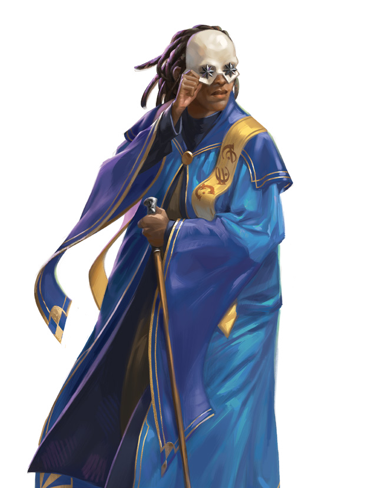
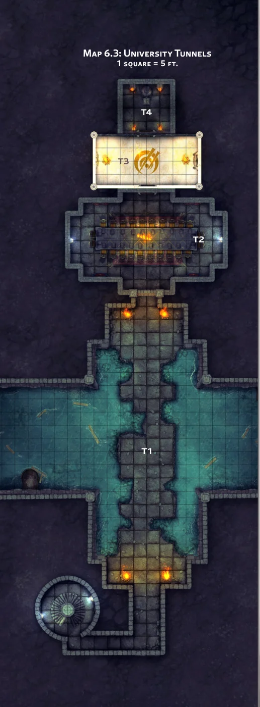
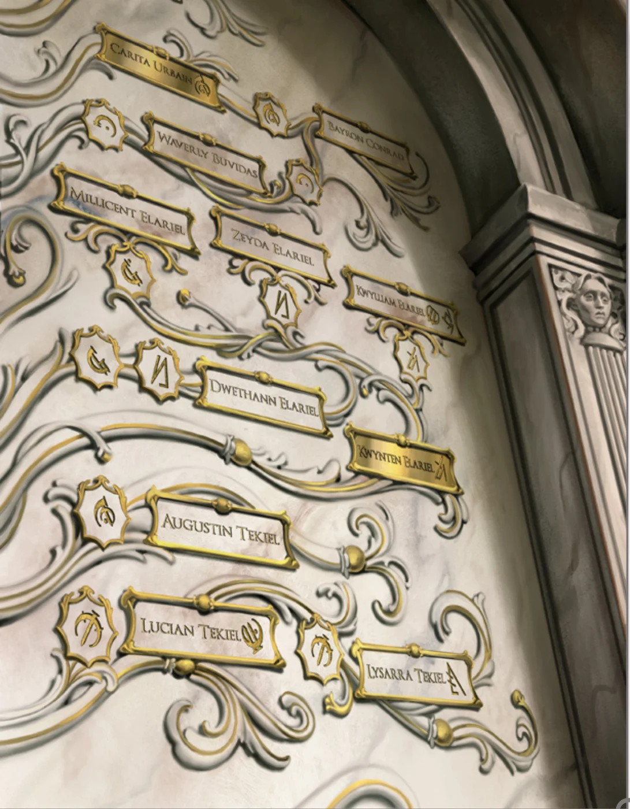
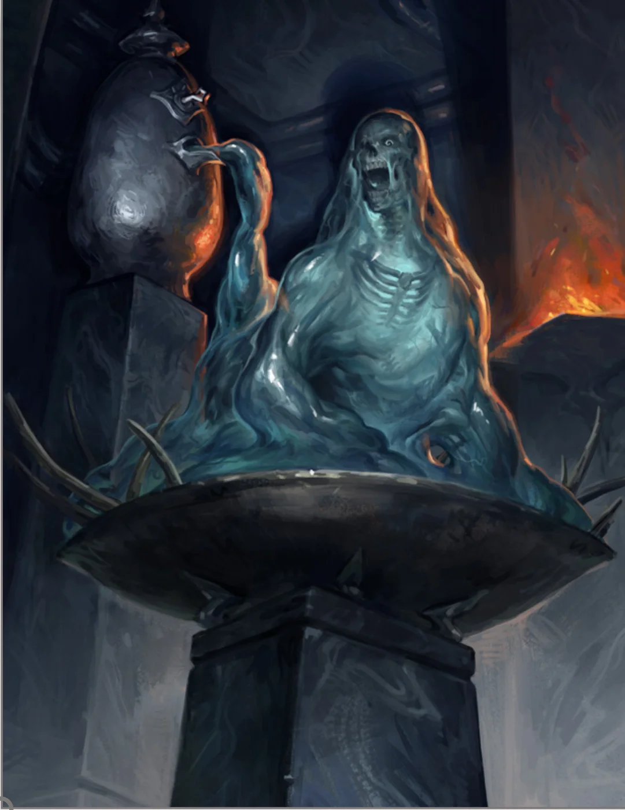

### 午夜試煉

準備完成後，或「午夜將至」事件觸發時，PC 只有一次機會潛入午夜試煉。創始者之鑰的答案，以及千眼會最黑暗的祕密，都在依藍戴大學下方的隧道裡等著他們。

#### 準備不足

若試煉開始時 PC 缺少面具或不知道起點，午夜剛過，兩名正式成員便會前來，把隊伍當成迷路的候補成員。他們竊笑著提出條件，只要一名 PC 接受挑戰，先喝完一整瓶甜蘭姆酒與氣泡通寧水的混合酒，再對一名黑衣警衛露屁股，就會提供面具和試煉起點。接受的 PC 必須先喝酒，再進行 DC 18 紀律檢定。失敗時，在對校園警衛露屁股前陷入精疲力竭［−1］。黑衣警衛只會不以為然地翻白眼，但事情最後會傳到 Kwylliam 耳裡，成為他使用「無情勒索」行動的把柄。

若 PC 拒絕，也可以用 500 盒金賄賂兩名正式成員。他們會花費專注點抵抗威嚇檢定，受到攻擊時也會反擊。不過，只要其中一人耗盡專注點或生命值降到一半，兩人就會交出 PC 所需的東西，嚇得拔腿就跑。Kwylliam 最終也會聽到此事，用這些消息施展「無情勒索」，還會散播 PC「欺負手無寸鐵的小孩」的惡毒謠言。PC 取得面具與試煉起點後，接著進行「主持試煉」。此時他們會遲到。

#### 主持試煉

Kwylliam Elariel 樂於主持午夜試煉，由八名四年級的正式成員協助。要參加，PC 必須戴上面具，假扮正式成員。兩名正式成員把守入口，拒絕任何未戴面具的角色進入。隊伍進門後共有三場試煉。為了簡化流程，PC 以全隊為單位通過或未通過每場試煉。記下通過的場數，稍後在「裁決」中使用。

##### K.T. 和 Marthis

若 K.T. 與隊伍一起潛入，她的自信會鼓舞眾人，每名 PC 在第一場試煉的第一次檢定中獲得一項優勢。否則，她會獨自潛入，隊伍會在第一場試煉結束時發現她。除非 PC 干預，K.T. 會通過試煉。若 PC 擲出機遇，K.T. 可能從容地引開注意，讓一名 PC 改用另一種技能重擲失敗的檢定。

除非 PC 幫助 Marthis，否則他三場試煉都會失敗，無法在「入會」中獲選。除非 PC 直接背叛他，否則他不會找隊伍的麻煩。若擲出變故，一名候補成員可能把 PC 誤認成 Marthis，上前攀談。

**搗亂。** PC 擾亂試煉或作弊被抓時，會收到一名正式成員的警告。PC 第三次搗亂時，對方會要求他們交出面具並離開，接著進行「退出試煉」。

千眼會候補成員。千眼會的蠟封。

第 6 章：飢渴靈魂的渴望 125

PIERRE IGNASZEWSKI；MATT DEMINO

#### 手術劇場的開場

戴上面具的 PC 進入實驗室的觀摩劇場（U4）時，讀出下列內容，開始午夜試煉。

> 手術劇場半圓形的階梯看台沒入陰影。一排排人影站在那裡，每人都戴著骷髏面具，以星形審判者尖刺充當眼睛。劇場中央，Kwylliam 身穿深紅長袍，站在蒼白的星光下。即使戴著面具，仍認得出他。

室內有二十名候補成員。若 PC 準時抵達，讀出下列內容。

> Kwylliam 的聲音打破沉默。「歡迎參加午夜試煉。我是你們不具名的主持人。今晚，就由死神親自評斷各位是否夠格。我們先以 卡西人的獻祭揭開今晚神聖傳統的序幕。」

若 PC 遲到，則讀出下列內容。

> 「入會準備了好幾個月，結果還是遲到了。」Kwylliam 打趣地責備你們。「我大發慈悲，給你們一次補救的機會。你們先來，呈上祭品。」他揮手要你們到前面來。

#### 第一場試煉：獻上骨骸

第一場試煉中，PC 必須走到手術台前，鼓起勇氣，以最令人印象深刻的方式獻上骨骸。其他團體獻上家族遺骨，或從危險地點「借來」的骸骨，甚至有一組帶了獅子的骨頭。

##### 強作鎮定

隊伍在戴面具的候補成員令人不安的注視下走上前時，讓每名 PC 進行 DC 10 紀律檢定。若隊伍遲到，改為 DC 16。失敗時，PC 失去 1 專注點，並因在場眾人而心神不寧，在接下來呈獻骨骸的檢定中獲得一項劣勢。

##### 大膽講述

接著，Kwylliam 要隊伍講述骨骸的故事。請每名 PC 說明如何作出貢獻，並進行相關的 DC 15 技能檢定，協助呈獻骨骸。依隊伍帶來的骨骸，PC 可獲得下列一項或多項效果。

- 稀有骨骸或貴族遺骨可帶來優勢。
- 假骨、動物骨頭或不完整的骨架會帶來劣勢。

##### 完成第一場試煉

若至少半數 PC（無條件進位）成功通過呈獻骨骸的檢定，Kwylliam 莊重地說「這份祭品合格」，收下骨骸，PC 通過第一場試煉。否則他會退回骨骸，說「這份祭品不夠格」，PC 未通過試煉。若 PC 沒帶骨骸，自動失敗，招來 Kwylliam 惡意的笑聲和其他候補成員的噓聲。

**新手傳承時刻。** 若隊伍呈獻老兵的骨骸，Kwylliam 特別點名新手第一個講述故事。請新手講一則關於老兵的其他傳說，並說說這個故事讓角色感到驕傲，還是備感壓力。若新手成功呈獻骨骸，每名 PC 在第二場試煉開始時獲得堅定狀態。

#### 第二場試煉：智力與體力

候補成員一面回答校園歷史問題，一面證明自己的耐力。這場試煉共有三輪。Kwylliam 誇張地提問，PC 則背靠牆壁、屈膝蹲低，維持靠牆深蹲。

##### 體力競賽

每輪開始時，每名 PC 進行運動檢定，以維持靠牆深蹲。第一、第二、第三輪的 DC 分別為 10、12、14。提高這次檢定的賭注，並依「智力與體力的機遇與變故」表結算。

##### 知識問答

運動檢定後，依「Kwylliam 的問題」表向每名 PC 提問。若玩家在擲骰前知道答案，PC 就答對問題。否則，PC 必須成功通過 DC 15 學識檢定才能想起答案。若準備期間造訪過相關校園地點，該檢定獲得一項優勢。失敗時，PC 出局。每名 PC 都作答後，開始新的一輪。

##### 智力與體力的機遇與變故

| 結果 | 範例 |
| --- | --- |
| [Opportunity] | 在進行學識檢定前，玩家可以花費運動檢定擲出的 [Opportunity]，要求換一道題目。 |
| [Complication] | 兩名 PC 在這一輪互相比試。最後答出的人（在學識對抗檢定中失敗的 PC）出局。 |

第 6 章：飢渴靈魂的渴望 126

##### Kwylliam 的問題

| 問題 | 答案 | 校園地點 |
| --- | --- | --- |
| 我們顯赫結社的全名是什麼？ | 千眼會。 | U9：社團街 |
| 卡西人傳授什麼？ | 他們的解剖學知識（以及骨骼知識）。 | U5：圖書館 |
| 大學校門上寫著什麼？ | 「Wasing the Always of Wanting of Knowing.」 | U1：校門與校地 |
| 說出銅廳彩繪玻璃上兩名學者的名字。 | 尤門、廷朵、Lestibournes 或 Dilisteni，任選兩名。 | U2：銅廳 |
| 那座學者雕像刻的是誰？ | Guiverre Seeris 或 Duvall Haught，兩者皆可。 | U7：鐘樓 |
| 我們結社氣派的會館位於校園何處？ | 社團街。 | U9：社團街 |
| Nelazan 為何受到尊崇？ | 因為他們繪製星圖。 | U5：圖書館 |
| 圖書館裡是哪個版本的《創始之書》？ | Pledfellow 版。 | U5：圖書館 |
| 鐘樓裡有幾口鐘？ | 八口。 | U7：鐘樓 |
| 噴泉裡的女子腳下有什麼？ | 灰燼。 | U1：校門與校地 |
| 結社的格言是什麼？ | 「火焰能驗出礦石的純度。」 | — |
| 什麼東西守著墓地？ | 園丁 Fan 或一座霧魅雕像。 | U6：小教堂與墓地 |
| 身為「眼」的 Lysarra 創立了哪個組織？ | Young Ascendants。 | U3：學生活動中心 |

##### 完成第二場試煉

三輪過後，若至少一名 PC 仍未出局，隊伍通過第二場試煉。

#### 第三場試煉：大混戰

八名正式成員分發金屬腰帶和眼罩。Kwylliam 要候補成員戴上，並說明自行取下即告失敗。正式成員移開手術台、打開上鎖的地板暗門，露出通往黑暗中的階梯。正式成員高舉火把，帶著候補成員走下螺旋階梯，進入大學下方的隧道（見地圖 6.3），沿著破碎的石造步道走到舊引水道（T1）。

##### T1：舊引水道

此處連通石室（T2）。一座不平整的石橋橫跨在古老的地下引水道上。候補成員（包括隊伍）抵達石橋、準備進行第三場試煉時，讀出下列內容。

> 候補成員的腳步聲在古老石壁間迴盪。潮濕的空氣中充斥著水流聲和一股泥土的麝香味。Kwylliam 的話音在空曠的房間裡迴響。「你們有迷霧之子大人那麼敏捷嗎？規則很簡單，腳必須一直踩在石頭上。腰帶掉了，或碰到水，就出局。不准見血，不准偷看。開始後也不准喝金屬液，要喝就趁現在。最後還站著的六人通過試煉。十、九、八……」

試煉開始前，PC 可飲用金屬液（[1行動]），或採取一個類似的行動做準備。競逐者共有二十名，但在 PC 附近積極交戰的候補成員只有八名。其中一名是使用鐵鎔金術的扯手，另一名是使用鋼鎔金術的射幣。兩者的數值見候補成員資料區塊旁的「候補成員變體」。其他非迷霧人的候補成員用「倚仗身分」迫使 PC 攻擊他們的對手，也不排斥聯手對付 PC。戰鬥一開始，Kwylliam 和正式成員便興致勃勃地觀望。

##### 特殊規則：戰爭迷霧

參與者若以視覺為主要感官，眼罩會遮蔽視覺，使他陷入迷惑。若玩家的角色感官受到遮蔽，就先別給玩家看地圖，除非 PC 偷看成功，見「戰場效果」。

##### 戰場效果

此場戰鬥有下列效果。

- **失去資格。** 落水、摘下腰帶或眼罩、作弊被抓、造成銳利傷害或讓人流血、嘗試飲用金屬液（[1行動]），或一整輪未碰到步道的角色，均失去資格。
- **躲藏。** 角色可以使用技能（[1行動]）進行隱匿檢定，對抗每名感官遭遮蔽參與者的靈性防禦。若對某名參與者成功，對方就無法感知該角色，直到角色用攻擊或其他響亮的行動暴露位置。

第 6 章：飢渴靈魂的渴望 127

- **偷看。** 角色可以進行 DC 13 竊盜檢定來偷看（[自由行動]）。失敗時，角色作弊被抓，見本章前述的「搗亂」側欄。成功時，向該 PC 的玩家展示戰鬥地圖，直到 PC 的輪次結束。地圖如此公開期間，PC 無視迷惑狀態。每當該 PC 偷看成功一次，往後他的偷看檢定 DC 就增加 3。
- **陷害。** 若要用破壞手段栽贓其他參與者作弊，例如摘掉對方的眼罩或偽造血跡，角色可使用技能（[1行動]）進行相關檢定，對抗旁觀正式成員的靈性防禦（15）。成功時，目標失去資格。失敗時，執行陷害的角色失去資格。
- **最後機會。** 即將落水的角色可用反應閃避危險（[反應]），即使他陷入迷惑，原本無法使用反應也可以。角色進行敏捷檢定，DC 等於觸發檢定的結果，若沒有觸發檢定則為 15。成功時，角色倒在橋邊。

##### 完成第三場試煉

只剩六名參與者時，試煉結束。若至少半數 PC 名列最後六人，全隊通過。否則，全隊失敗。兩種情況都接著進行「裁決」。

#### 裁決

第三場試煉結束後，正式成員召集所有候補成員及 PC，讓他們繼續戴著眼罩，帶去隔壁房間接受裁決，見地圖 6.3 的 T2。

##### T2：石室

此處連通舊引水道（T1）和內殿（T3）。若 PC 進入石室接受裁決，正式成員會引導他們與其他候補成員一起落座，圍著一張長石桌坐下。讀出下列內容。

> Kwylliam 宣告：「現在，熔爐將揭示真相。你們之中有資格的人將成為一隻『眼』，從此得以窺見祕密，成為我們不朽的手足。準備接受裁決。」

請玩家閉上眼睛，讓角色跟著 Kwylliam 逐句念出下列話語。

> 「讓烈火揭示真相。」
>
> 「願千眼會裁定我有資格。」
>
> 「讓我知曉鍍金的真相。」
>
> 「鍛造我永恆的傳承。」

**地圖 6.3：大學隧道。** 每格 5 呎。圖上標示 T4、T2、T1、T3。

ELEDRYLL

#### 入會

午夜試煉的結果取決於隊伍通過幾場試煉。

- **通過 3 場。** 只有 PC 證明自己有資格。一名正式成員取下他們的眼罩，領他們繼續往裡走，接著進行入會。
- **通過 1–2 場。** PC 和另外四名候補成員證明自己有資格，接著進行入會。
- **通過 0 場。** PC 證明自己不夠格。他們與其他落選候補成員留在桌旁，一片羞愧的沉默中，聽見另外八名候補成員獲選。接著進行「退出試煉」。

無論隊伍的結果如何，K.T. 都會通過試煉。Marthis 則總是失敗，除非 PC 有效介入。

若隊伍證明自己有資格，入會便開始。一名正式成員陪同 PC 和其他通過試煉的 NPC 前往內殿，見地圖 6.3 的 T3。PC 終於能接觸千眼會最深的祕密，其中包括 NeBaal。

##### T3：內殿

此處連通石室（T2）與甕室（T4）。PC 進入時，讀出下列內容。

> 房間三面是白色大理石牆，布滿鑲金雕刻。其中一幅是死神的肖像，一幅是繁複的解剖圖，另一幅是枝節繁多的家譜。遠端的牆由光滑的黑色大理石砌成，正中央只有一扇關著的大門。

###### 判定合格

若隊伍通過試煉，在正式成員陪同下進入內殿，也讀出下列內容。

> 正式成員語氣莊嚴。「創始者鍛造了三把鑰匙來保護我們的傳承。一把毀於落灰之終的大火，第二把被人用詭計偷走。這是第三把，也是最後一把尚存的創始者之鑰。如今，你們就是它的守護者。」正式成員拿出一把金鑰匙，和你們從檔案館取走的那把一模一樣。

問玩家由哪名 PC 從正式成員手中接過鑰匙。若沒有 PC 想要，K.T. 會迫不及待地接下。

> 戴著面具的正式成員指向上方。「這所大學是為了訓練我們而存在。我們就是有資格的人。」她示意牆上的雕刻。「我們的力量來自血脈。」她指向門扉。「門後就是你們的傳承。今晚，你們將以『眼』的身分加入我們，尋找鍍金寶藏、尋找永恆傳承。」她交出一卷小卷軸。「進入最後一間房，用鑰匙。接著念出這些話。」

交出卷軸與鑰匙後，正式成員回到石室（T2）。PC 可以自由檢視雕刻，繼承人在場時尤其重要。準備好後，他們就能走向甕室的門。

###### 卷軸

卷軸上寫著：「我們承襲司卡德利亞最高貴的血脈，已獲裁定有資格繼承祖先的遺產。我們的傳承在何處？請向我們揭示鍍金地圖。」

###### 雕刻

三幅雕刻裝飾著牆面。

- **審判者。** 一名審判者坐在金色城市上方的王座上。雖然他貌似死神，但成功通過 DC 12 學識檢定，可以從眼部刺青和埃拉瑞爾家族的徽章別針認出，雕刻描繪的是 Vadilek Elariel。

Gilded Few 家譜的一部分。

第 6 章：飢渴靈魂的渴望 129

LUCAS TORQUATO

- **解剖圖。** 解剖圖畫出植入各個血金術結合點的尖刺。成功通過 DC 15 學識或醫療檢定，並花至少 5 分鐘檢視解剖圖的 PC，可為「了解血金術」目標標記一個里程碑，見本書導論的「處理血金術」。
- **家譜。** 家譜以花體字題為「Gilded Few」，列出 Seeris、Haught、Buvidas 和 Tekiel 等家族，最上方是 Vadilek Elariel。圖上記錄了家族血金尖刺的創造和世代傳承，包括 Vadilek 最初的尖刺格架。八芒星代表傳家的尖刺，金色姓名代表曾犧牲自己以打造尖刺的人。Idren Seeris 的姓名是金色的。Bayron、Lysarra 和 Kwylliam 都在家譜上，各自有代表尖刺的星號。成功通過 DC 12 推理檢定的 PC 會明白星號是繼承而來，而金色姓名會「創造」一顆新星。

**時代跳躍的連結。** 第 2 章中第一時代的 Gilded Few 貴族全都列在家譜上，但只有 Anastas 和 Delina 結婚，家譜上才會有 Anastas。

第 6 章：飢渴靈魂的渴望 130

**繼承人傳承時刻。** 繼承人注意到自己的姓氏列在家譜上，旁有一顆星，因而察覺自己或一名近親出生不久後就遭人暗中植入尖刺，獲得鎔金術或藏金術。請玩家決定是誰被植入尖刺，並描述該角色身上一處恰好與血金術結合點吻合的痕跡。

##### T4：甕室

此處連通內殿（T3）。PC 進入時，讀出下列內容。

> 大理石房間四角的火盆都燃著，薰香卻蓋不住底下那股麝香氣味。室內有兩座台座，較高的一座擱著一只獨特的銀色甕，上頭有一把醒目的鎖。陶管從甕接入後牆。較矮的一座擱著一只黑色大理石碗，碗中裝滿骨頭。

若 PC 通過第一場試煉，這些就是他們獻上的骨骸。否則，骨骸是另一名候補成員獻上的。

管線連接到噴泉和宿舍餐廳，把飲水和食物送給甕裡的坎得拉。成功通過 DC 12 工藝或推理檢定的 PC，可以推知管線的用途。

###### 一只獨特的甕

麝香氣味來自一只獨特的銀色甕，高 3 呎，飾有植物圖案，因年代久遠、屢經觸碰而磨得光滑。對甕成功通過 DC 10 工藝檢定，便知道甕由鋁製成，價值 1,000 盒金。甕上有一把明顯的鎖。若使用創始者之鑰，讀出下列內容。

> 鑰匙轉動，甕側一個出水口隨即打開。一團東西發出咕嚕聲，淌到骨頭中間，像扭動的半透明蛞蝓，血管規律地搏動。它起初緩慢移動，隨後像是餓極了一般裹住骨頭。骨頭抽搐起來，有幾根猛地豎起。那團東西鼓起，彷彿在吸氣，接著一收縮，肌腱和器官便迅速長出。血肉在顎骨之間織成網，漸漸形成一張臉。最後，兩顆眼球發出濕答答的一聲，在骷髏的眼窩裡鼓起，轉過來看著你們，眼神滿是恨意。

這是 NeBaal。其形體沒有毛髮，以祭碗裡的骨骸為基礎。描述這具身體的樣貌，再讀出下列內容。

> **無面不朽者。** 那個沒有毛髮的生物用乾啞的聲音低語：「已經一年了？你們這群自以為是的渣滓，來找你們的『寶藏』？快把你們那毫無意義的盤問問完吧。」

**時代跳躍的連結。** 這只甕是第 2 章 Delina 訂婚時的甕。若第一時代的 PC 在第 1 章的行動中將甕撞凹，描述甕上有一處明顯的凹痕。

###### 遇見 NeBaal

NeBaal（使用中性代名詞）已被 Gilded Few 囚禁數百年。只有在每年舉行的午夜試煉中，這名坎得拉才獲准重新塑形，並接受儀式性的盤問。問題圍繞鍍金地圖，最終是為了查出永恆尖刺的下落。

###### NeBaal 的態度

NeBaal 起初以為 PC 是候補成員，回話時既鄙夷又憤怒。一旦 PC 表明與千眼會無關，NeBaal 的態度就會改變，懇求隊伍幫忙逃脫。

###### NeBaal 坦承真相

成功通過 DC 10 洞察檢定，可確認 NeBaal 所言屬實。囚禁的處境極不人道，而 NeBaal 不會傷害提供援助的人。若 K.T. 與隊伍同行，她會大力支持釋放 NeBaal。

###### 與 NeBaal 交談

在 NeBaal 明白 PC 並非候補成員之前，只會反覆強調兩件事。他們不夠格，而且應該與囚禁 NeBaal 的貴族家族斷絕關係。依下列內容與本書導論「重要角色」中的 NeBaal 檔案帶領對話。

- **我們承襲司卡德利亞最高貴的血脈……請向我們揭示鍍金地圖。** 「你們這些懦夫年年跑來，乞求你們所謂的『傳承』。我對你們的父母和祖父母怎麼說，就對你們怎麼說。我認定你們不夠格，Vadilek 也會這麼認定。別再折磨我，放我走吧。」
- **鍍金地圖或寶藏在哪裡？** 「藏在不夠格的人看不見的地方，只有我記得。我就是鍍金地圖。」
- **你想要什麼？** 「自由。尊嚴。我被關在這裡幾百年了。我雖然不是人類，卻也和你們一樣是個人。」
- **是誰把你關在這裡的？** 「Gilded Few 和他們的後代。不過我想，具體做法是 Delina Tekiel 的主意。」
- **我們為什麼該相信你？** 「我是坎得拉。你們知道我們嗎？我不能傷害人類，我們許下的承諾，也就是我們的契約，不能違背。若你們與囚禁我的人為敵，放我走對你們有利，對他們不利。我保證。所以現在該問的是，我為什麼該相信你們？」

###### 協助 NeBaal 逃脫

NeBaal 非常想逃出去。除了極度虛弱之外，沒有任何東西限制 NeBaal 的行動，但 NeBaal 陷入精疲力竭［−8］，幾乎走不動。NeBaal 會配合 PC 的援救計畫，但始終拒絕傷害人類。若 NeBaal 處於無骨形體，隊伍可以把 NeBaal 藏在長袍或類似衣物下帶出去。PC 準備好帶 NeBaal 冒險逃離時，接著進行「退出試煉」。

#### 退出試煉

無論午夜試煉中發生什麼，PC 都必須能抵達「T4：甕室」救出 NeBaal。實際流程取決於隊伍何時暴露身分。

- **通過試煉。** 若 PC 通過午夜試煉，正式加入千眼會，最終走出甕室時，會發現 Kwylliam Elariel 和八名已摘下面具的正式成員帶著一瓶昂貴的酒，在石室（T2）等候。描述 NPC 堅持要 PC 摘下面具慶祝的情形。若隊伍拒絕，Kwylliam 最終會失去耐性，走上前扯掉他們的面具。PC 身分一旦暴露，就進行「失竊的祕密」。
- **提早暴露。** 若 PC 提早被識破或未通過午夜試煉，確保他們仍能前往甕室（T4）救出 NeBaal。順利的話，身分會在「入會」時暴露，此時 PC 已在 T4。若試煉一開始就被識破，他們可能與二十名候補成員、八名正式成員及 Kwylliam Elariel 同處一室。描述 PC 被識破時的混亂，給隊伍機會跑向甕室（T4）。隊伍抵達後，讓 Kwylliam 和正式成員、候補成員退去堵住出口，給 PC 時間救出 NeBaal。PC 發動攻擊或試圖離開時，接著進行「失竊的祕密」。

**找到 NeBaal 前就被抓了？** 萬一 PC 始終沒能找到 NeBaal，K.T. 就會趁試煉混亂時潛入甕室，找到 NeBaal 並協助其逃離。

第 6 章：飢渴靈魂的渴望 131

ANA GRIGORIEVA

