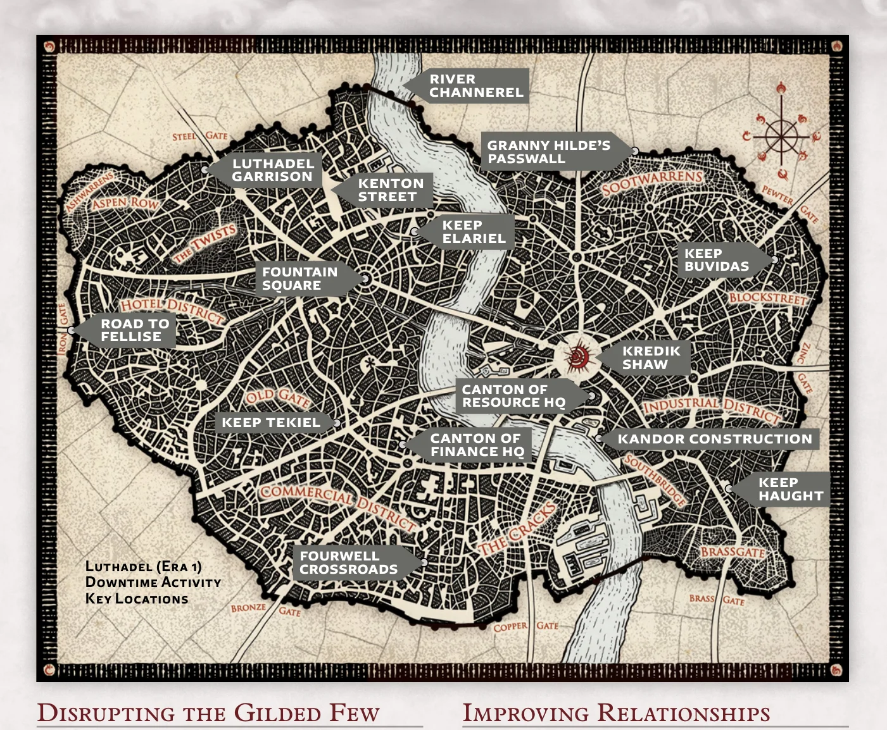
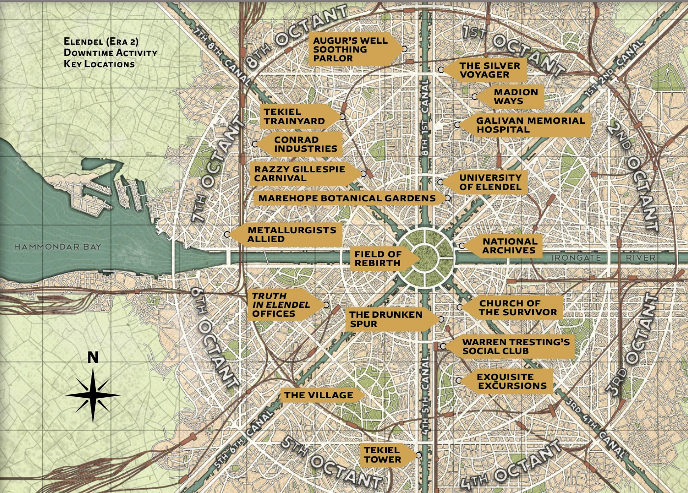

### 在陸沙德休整（第一時代）

《迷霧之子傳承》冒險期間，PC 可以在場景之間休整。第一時代在陸沙德，第二時代在依藍戴。休整期中，每名 PC 可以處理自己的目標、計畫和興趣，詳見《迷霧之子玩家手冊》第 9 章「休整期」。本附錄提供能配合《迷霧之子傳承》故事的休整活動指引。有些活動可以推進 PC 的個人目標，另一些則能提供同伴、贊助者、藏身處或組織地位等獎勵。這些獎勵詳見《迷霧之子玩家手冊》第 8 章「獎勵」。

### 在陸沙德休整（第一時代）

以下提供第一時代在陸沙德休整時可選的額外活動。部分章節沒有休整期，有些選項也只在冒險的特定階段開放。若想深入了解本節提到的地點，可以參考《迷霧之子世界指南》第 6 章「陸沙德」。第一時代休整時間見下表。

### 第一時代休整時間

| 章節 | 休整期 | 長度 |
| --- | --- | --- |
| 2 | 在運河上休整 | 21 天 |
| 2 | 舞會前休整 | 14 天 |
| 3 | 低調休整 | 21 天 |
| 4 | 在陸沙德休整 | 14 天 |

角色在休整期獲得機遇或變故時，可以參考「在陸沙德休整的機遇與變故」表。

### 工藝

主要地點：旅館區、Kenton街、PC 的運河船藏身處與Southbridge

革命之後，司卡較容易使用過去無法取得的工坊與資源，不過圍城使材料變得稀缺。在陸沙德從事工藝可以包括下列活動。

維護運河船。隊伍的運河船

算作一處藏身處，PC 可以升級、修理、重新設計或改良。金屬意識庫指導。藏金術師可以照常

推進「製作你的金屬意識庫」目標。若他們尋找導師，可能會遇到第 3 章的 Bezryl。

### 舞蹈課

主要地點：PC 的運河船藏身處

這項特殊休整活動在第 2 章的「舞會前休整」最有用。若 PC 沒有上流社會專長，他們很可能不會跳舞。Enge 會提議教他們。

### 在陸沙德休整

### 機遇與變故

| 結果 | 範例 |
| --- | --- |
| [機遇] | PC 的行動極為順利，因此有 額外時間放鬆，並照顧一名隊員。 請該玩家指定另一名玩家，兩人一起 描述角色在哪裡、如何放鬆和增進感情。 休整結束時，兩名 PC 都獲得 堅定狀態。 |
| [機遇] | 倖存者教會的一名祭司注意到 這名 PC。PC 可以開始「取得倖存者教會 作為贊助者」目標，並已標記 1 個 里程碑。 |
| [機遇] | PC 意外得到 50 盒金（若原本 會領到報酬，則多領 50%）。 |
| [變故] | Gilded Few 的幹員破壞了 PC 的工作。 讓玩家選擇一項：失去這項休整活動的 所有進度、受到一項傷勢（進行 傷勢擲骰，見《迷霧之子玩家手冊》第 9 章）， 或有一項目標需要多完成一個 里程碑。 |
| [變故] | Gilded Few 的幹員快要找到運河船。 PC 可以描述如何找到一處新碼頭， 並進行相關的 DC 15 技能檢定。失敗時， 下一章無法使用藏身處，因為 Enge 和 PC 必須設法向 Gilded Few 隱瞞 藏身處的位置。 |
| [變故] | Gilded Few 的貴族栽贓 PC 犯罪。 另一名 PC 必須花一週休整期 洗清對方的罪名，否則被栽贓的 PC 會遭城衛通緝。 |

### 附錄 E

### 休整期

256

### 打擊 Gilded Few

主要地點：Fellise、Haught 堡、Buvidas 堡與旅館區

鎢都事件後，Gilded Few 開始追捕隊伍。PC 可以趁休整期布下假線索，或干擾 Gilded Few 的資源。這很適合提高賭注。打擊 Gilded Few 可以包括下列活動。

建立凶名。PC 可以推進

「威嚇 Gilded Few 的勢力」目標。完成後，每當 PC 試圖說服 Gilded Few 的勁敵或嘍囉在戰鬥或談話中退讓，他們便獲得一個優勢。攔截資源。破壞貿易

談判、攪黃貴族家族之間的交易，或劫走物資，都可能打擊 Gilded Few 的成員及其資金流。PC 可能從這些活動獲得盒金或敘事獎勵。

### 改善關係

主要地點：黃銅門區、Kenton街與 PC 的運河船藏身處

陸沙德正有新面孔與新派系崛起。PC 可以利用休整期提升自己在組織中的地位，或與 NPC 培養關係。改善關係可以包括下列活動。

傳播信仰。PC 可以加入日益壯大的

倖存者教會，在組織中晉升，也可以參加禮拜以獲得同伴。PC 甚至可以向教會的重要成員（例如德穆）尋求贊助。修復關係。想和某名 NPC 改善關係的 PC

可以花時間陪伴對方，或替對方幫忙，例如鎢都難民、Cynwise、Cadme、Anastas、Bezryl、Kandor 或 Enge。這可以推進化解嫌隙、改善關係的目標，也可以解鎖同伴或贊助者的好處。

ISAAC STEWART

### Fourwell

### 十字路口

### 資源廷

### 總部

### Hilde 婆婆的

### 暗門

### Buvidas

### 堡

### 通往

### Fellise 的道路

### Haught

### 堡

### 香奈瑞

### 河

### 克雷迪克．

### 霄

### 財務廷

### 總部

### Kandor 營造公司

### Kenton

### 街

### Elariel

### 堡

陸沙德（第一時代）休整活動主要地點

### 陸沙德

### 駐軍營

### 太齊爾堡

### 噴泉

### 廣場

附錄 E：休整期 257

### 休養

主要地點：資源廷總部、Kenton街、陸沙德駐軍營與 Haught 堡（見第 3 章）

陸沙德缺乏有組織的醫療服務，圍城期間情況更嚴重。

### 研究

主要地點：財務廷總部、Kenton街、Fourwell 十字路口與舊城門區

革命期間，圖書館和貴族堡壘一起被燒毀，但仍有許多保存知識的地方。在陸沙德研究可以包括下列活動。

隱藏的知識。取得一本罕見的典籍，

可以讓 PC 在學習血金術的檢定中獲得一個優勢（見本書導言的「處理血金術」）。法律文書。交叉查閱法律紀錄可能揭露

Gilded Few 的人脈與資源，使日後的「打擊 Gilded Few」行動獲得優勢，也可能預示後續章節的事件。傳聞。PC 可以到街上打聽時事，

並進行 DC 12 推理、洞察、感知或說服檢定。不論成功或失敗，都至少會得知一條關於後續章節的事件、NPC 或圍城的傳聞。（第 2 章期間，請參考「傳聞」表。）成功時會得知兩條傳聞。

### 安置難民

主要地點：Kandor 營造公司（見第 3 章）與黃銅門區

如果隊伍護送 Cynwise 與囚犯抵達陸沙德，PC 可以利用在陸沙德的休整期協助這些難民安頓下來。Cynwise 自己找到了工作，在 Kandor 營造公司任職（見第 3 章）。但其他難民（Aime、Roben、Tuss 和 Pella）可能需要有人幫忙找工作，或讓 Cynwise 找到的空倉庫更適合居住。倖存者教會與 Kandor 營造公司這兩個本地團體，可能提供工作或讓難民融入社群。問 PC 如何幫忙，再讓他進行一項相關的 DC 12 技能檢定。成功時，他的努力確實幫上忙，難民也會永遠感激。視 PC 的選擇而定，難民可能會想回報他們，提供司卡社群的傳聞，在休整期出力，或在後續章節提供協助。

無論結果如何，難民之一 Roben（平民，he/him）都會提出以同伴身分留守 PC 的運河船。

### 自我反省

主要地點：噴泉廣場與克雷迪克．霄

革命推翻了千年統治，陸沙德正在尋找新的認同。城市在改變，PC 也可以重新認識自己。近期歷史留下的場所，可能讓 PC 有機會沉澱和反思。

### 正裝打扮

主要地點：旅館區、商業區及 Kenton街

PC 可以利用休整期尋找合適的正裝（見《迷霧之子玩家手冊》第 7 章「護甲」和「物品」）。

購物。裁縫店與服裝店販售精緻服裝

（100 盒金）和易脫服裝（150 盒金）。陸沙德物價偏高，但 PC 若成功通過 DC 15 說服檢定與裁縫議價，就能少付 25 盒金。工藝。PC 可以製作

衣服、改良買來的衣服，或讓護甲具有得體特性。見《迷霧之子玩家手冊》第 7 章的工藝規則。若 Enge 出手幫忙，PC 的工藝檢定獲得一個優勢。製衣原料要花 20 盒金。

成功取得精緻服裝的 PC，在派對或與貴族會面時進行的首次社交檢定獲得一個優勢，例如第 2 章的「祕密晚宴」。若所有 PC 都有精緻服裝，第 2 章的聲望攀升事件開始時已有一格填滿。

### 訓練

主要地點：Kenton街、陸沙德駐軍營與Southbridge

城裡找得到技藝精湛的導師，但革命的動盪與大家族的瓦解使他們分身乏術。也可以在友善的 NPC 或 PC 中尋找專家。在陸沙德訓練可以包括下列活動。

拓展見識。PC 可以參與

過去進不去的社交場合，藉此取得地下社會、上流社會或其他感興趣的文化專長。

附錄 E：休整期 258

### 在依藍戴休整（第二時代）

新招式。當你跟著導師訓練

一項你已具備的武器專長，你在下一個使用該武器的戰鬥場景中獲得集中狀態。

### 從事職業

主要地點：商業區、工業區與香奈瑞河

無論是清理被燒毀的貴族堡壘，或在街道、運河和工廠做體力活，陸沙德都有不少賺錢的機會。在陸沙德從事職業可以包括下列活動。

正當工作。從事正當工作的 PC

每五天賺取 4d6 盒金。如果工作與一項相關專長有關，或 PC 在多個休整期回去做同一份工作，可以多賺 1d6 盒金。走私。走私的報酬較高，但至少要有兩名

PC 參與，每名參與者都必須進行一項相關的 DC 12 檢定並提高賭注。成功時，該 PC 每五天賺取 5d10 盒金。失敗的 PC 會被逮到，賺不到盒金，還要花 1d4 天處理後果。

### 在依藍戴休整（第二時代）

以下提供第二時代在依藍戴休整時可選的額外活動。部分章節沒有休整期，有些選項也只在冒險的特定階段開放。若想深入了解本節提到的地點，可以參考《迷霧之子世界指南》第 7 章「依藍戴」。第二時代休整時間見下表。

### 第二時代休整時間

| 章節 | 休整期 | 長度 |
| --- | --- | --- |
| 6 | 避風頭：在依藍戴休整 | 7 天 |
| 7 | 休整期間研究 | 10 天 |
| 8 | 沙龍前休整 | 最多 10 天* |

*見第 8 章「沙龍前休整」。

角色在休整期獲得機遇或變故時，可以參考「在依藍戴休整的機遇與變故」表。

### 工藝

主要地點：泰瑞司村（第五區）、獨立工匠（第三區）與依藍戴大學（第一區）

依藍戴到處都有實驗室與發明家，電力、化學和工業領域每天都有新進展。在依藍戴從事工藝可以包括下列活動。

獵殺金屬之子。PC 可以取得或製作

特製的武器與彈藥來對付金屬之子敵人。逆向工程。如果 PC 取得了

Bayron 的部分發明，並成功研究它們，日後在解除同類裝置的檢定中可以獲得一個優勢。升級安全屋。隊伍可以修理、重新設計或

改良藏身處。他們可能會在第 6 章重建藏身處（見《迷霧之子玩家手冊》第 8 章「藏身處」）。

### 在依藍戴休整

### 機遇與變故

| 結果 | 範例 |
| --- | --- |
| [機遇] | PC 發現與自己第一時代傳承連結有關的事物， 例如一則故事、一件物品或一段歷史記載。 若之後在一個場景中運用這項發現， 就獲得集中狀態，直到場景結束。 |
| [機遇] | 一名貴族家族成員注意到 PC，例如拉德利安、 Entrone 或 Tresting 家族的成員。PC 可以開始 取得該家族作為贊助者的目標，並已標記 1 個 里程碑。 |
| [機遇] | Wilko 或 NeBaal 知道相關而有用的資訊， 使 PC 能把這件事做得更好或更快。 |
| [變故] | Conrad 幹員破壞 PC 的工作。 PC 日後再次進行這項休整活動的檢定時， 承受一個劣勢，且開始下一個場景時 少 2 專注點。 |
| [變故] | Kwylliam Elariel 旗下的一份報紙刊出了 抹黑 PC 的報導，揭露了 PC 想繼續隱瞞的 祕密。 |
| [變故] | Lysarra 在 Morgenthax 的人脈綁走一名盟友。 一名 PC 必須花 1d4 天休整期救出盟友， 否則直到本章結束前， 都無法請該盟友提供協助。 |

附錄 E：休整期 259

### 打擊鍍金三人組

主要地點：Conrad Industries 辦公室（第七區）、太齊爾調車場（第八區）和《依藍戴真相報》

辦公室（太齊爾塔與第六區）

國家檔案館劫案後，鍍金三人組正在尋找隊伍。PC 可以趁休整期布下假線索，或干擾三人組的資源。這很適合提高賭注。打擊鍍金三人組可以包括下列活動。

專業諜報。PC 可以取得 Conrad

Industries 的設計圖，預先了解幹員的裝備（見第 8 章）或裝甲車（見第 7 章），趕在這些東西於後續章節登場前做好準備。挖掘醜聞。調查青年昇華者

或到太齊爾調車場打探，可能找到 Lysarra 與 Morgenthax 犯罪家族有關的證據。重新定義真相。PC 可以以牙還牙，

在 Kwylliam 的競爭對手所辦的報紙上買廣告。對公開挺身對抗 Kwylliam 的 PC 表示欣賞的貴族家族，可能成為他們的贊助者。

### 改善關係

主要地點：醉馬刺酒館（第四區）、Marehope 植物園（第一區）、Razzy Gillespie 嘉年華（第八區）以及 Warren Tresting 社交俱樂部（The Trustwarren，第四區）

依藍戴是個大城市，各行各業的人都住在這裡。PC 可以利用休整期提升自己在組織中的地位，或改善、修復與 NPC 的關係。改善關係可以包括下列活動。

完成目標。PC 可能有幫助

Marthis 或其他與自己傳承有關的 NPC 的目標。休整期正適合培養這些關係。修復關係。想和某名 NPC 改善關係的 PC，

例如想和 Wilko 教授、K.T.、NeBaal、Marthis 或 Merid 更親近，可以幫對方的忙，或花時間與對方相處。這可能化解嫌隙、改善關係，也可能解鎖同伴或贊助者的好處。帶 NeBaal 到處走走。PC 可以帶

NeBaal 認識落灰之終後的世界，讓其見識新科技、新料理，或以其他方式適應第二時代。坎得拉 PC 可能知道 The Trustwarren 是一間坎得拉的地下酒吧。

### 休養

主要地點：Galivan 紀念醫院（第一區）與泰瑞司村（第五區）

依藍戴的醫療服務先進又普及，每一區都有醫療院所。

### 研究

主要地點：Exquisite Excursions（第四區）、依藍戴大學（第一區）與國家檔案館（第二區）

依藍戴把高等學問看得極為神聖。城裡有博物館、圖書館，各個領域也都有專家。研究資料也可以到書本以外的地方找。走上街頭，造訪依藍戴各處，也是蒐集八卦的好方法。在依藍戴研究可以包括下列活動。

申訴與官僚程序。透過法律

制度申訴，可以讓 PC 免於承受依藍戴警署、國家檔案館或依藍戴大學黑衣警衛帶來的後果。隱藏的歷史。研讀歷史紀錄，

可以推進進一步了解 Gilded Few 歷史的目標。如果 PC 是守護者組織成員（見第 7 章），檔案管理員 Wynn 可以協助他們進入國家檔案館並進行研究。傳聞。PC 可以到街上

打聽時事，並進行 DC 12 推理、洞察、感知或說服檢定。不論成功或失敗，都至少會得知一條關於後續章節的事件或 NPC 的傳聞。成功時會得知兩條傳聞。Trellis Draam 的巧克力咖啡館 Exquisite Excursions 很適合打聽上流社會的八卦。

### 自我反省

主要地點：Augur’s Well 安撫館（第八區）、倖存者教會（第四區）、重生之野與泰瑞司村（第五區）

依藍戴是整個盆地的文化與歷史中心，也是一座充滿矛盾的城市。居民必須在傳統與進步的拉扯之間找到自己的位置。在依藍戴反省可以包括下列活動。

神聖場所。重生之野和

依藍戴各地的宗教機構都很適合捫心自問。前世。與 PC 第一時代傳承

連結有關的地點，可以藉由第一時代玩家講述故事或倒敘，讓 PC 對自己有新的認識。迷信的 PC 可以前往 Augur’s Well。這間安撫館裡有個自稱能讓人與前世連結的算命師。

附錄 E：休整期 260

### 從事職業

主要地點：世界級餐廳（第五區）、依藍戴工廠（第七區）、Metallurgists Allied（第七區）和辦公大樓（第一或第二區）

在這座人口數百萬的城市，永遠有工作可做。在依藍戴從事職業可以包括下列活動。

正當工作。從事正當工作的 PC

每五天賺取 4d6 × 2 盒金。如果工作與一項相關專長有關，或 PC 在多個休整期回去做同一份工作，可以多賺 2d6 盒金。「解放」物品。沒那麼正當的工作報酬較高，

但至少要有兩名 PC 參與，需要花 1d6 天，且每名參與的 PC 都必須進行一項相關的 DC 12 檢定並提高賭注。成功時，該 PC 每五天可以銷贓或留下價值 6d10 × 2 盒金的第一時代文物。失敗的 PC 會被逮到，賺不到盒金，還要花 1d4 天處理後果。

### 訓練

主要地點：銀色旅人（第一區）與依藍戴大學（第一區）

企業、公會和貴族家族會提供各自領域的訓練，但要付費。在依藍戴訓練可以包括下列活動。

新招式。當你跟著導師訓練

一項你已具備的武器專長，你在下一個使用該武器的戰鬥場景中獲得集中狀態。高等教育。如果 PC 沒有得罪

校園警備人員（見第 6 章），依藍戴大學在許多科目都有世界級的師資。在 Wilko 幫忙下，PC 可以旁聽課程，或與依藍戴最優秀的學者會面。訓練所需時間因此縮短至 7 天，但費用提高到每天 25 盒金。守護者組織資源。如果 PC 正式加入

守護者組織（見第 7 章），可以找到教授組織相關專長的導師，並透過組織免費接受訓練。

ISAAC STEWART

依藍戴（第二時代）休整活動主要地點

### 地圖標示

- Augur’s Well 安撫館、銀色旅人、Madion 商區、Galivan 紀念醫院
- 太齊爾調車場、Conrad Industries、Razzy Gillespie 嘉年華、Marehope 植物園
- 依藍戴大學、Metallurgists Allied、重生原野（Field of Rebirth）、國家檔案館
- 《依藍戴真相報》辦公室、醉馬刺酒館、倖存者教會
- Warren Tresting 社交俱樂部、Exquisite Excursions、泰瑞司村、太齊爾塔
- Hammondar Bay、Irongate River、第一至第八分區及各分區間的運河。N 為北方。

