## 第 1 章：逝者的回聲

### 章節背景

統御主的殞落震撼了司卡德利亞。最後帝國瓦解，鋼鐵教廷四散。Vadilek Elariel 早已預見這一刻，並做好準備。他一心想建立更好的帝國，於是轉向血金術，收割一千多個受創的靈魂，打造出永恆尖刺。這件神器的力量足以造就一位新的不朽統治者。為了選出配得上這件神器的宿主，他建立了名為 Gilded Few 的祕密結社。這個陰險組織留下的血腥陰影橫跨兩個時代。第一時代的故事開始時，Vadilek 已選定繼承人，也就是與他疏遠的姪女 Engeanthe Elariel。玩家角色是 Enge 的走私隊員，Vadilek 血腥的遺產和隨之而來的沉重責任，如今全落在隊伍肩上。

Vadilek 已在 Gilded Few 位於鎢都的祕密基地準備好一場駭人的儀式。他幾個月前才造出永恆尖刺（見附錄 C），現在就要將它用在自己選定的繼承人 Enge 身上。冒險從鎢都開始，玩家角色正與 Enge 完成一趟走私任務。這是隊伍最後一晚見到活著的 Enge。

### 帶領本章

本章發生於第一時代。帶領本章前，請先讀本書導論，熟悉 Vadilek 和 Enge 這兩位第一時代的重要 NPC，並依導論的「創造角色」一節，讓玩家建立各自與 Enge 的連結。

#### 第一個場景之後

在「寧靜的夜晚」中，Enge 的走私隊伍正逐漸闖出名聲。隊員也就是玩家角色，正在慶祝任務完成。同時，Vadilek 在暗中傳訊，引誘 Enge 前往 Gilded Few 的基地。他出乎 Gilded Few 的意料，選擇讓不情願的 Enge 昇華，致使昇華儀式釀成致命災難。他犧牲自己，強行將自己的尖刺格架「贈予」她。格架由支撐永恆尖刺所需的其他血金尖刺組成。Vadilek 死去時，他另一名得意門生 Delina Tekiel 出於嫉妒殺死 Enge，企圖將永恆尖刺據為己有。

Gilded Few 開始自相殘殺。混亂中，Vadilek 最後的備案開始生效。受僱於他的坎得拉 NeBaal 奪走尖刺，帶走 Enge 的遺體並躲起來。Delina 認定 Enge 已死，又為尖刺失蹤而震怒，便和其餘倖存的 Gilded Few 成員收走 Vadilek 的尖刺格架，氣沖沖地離開，開始尋找永恆尖刺。NeBaal 要履行契約，為永恆尖刺找到合適的宿主，於是決定化作 Enge 的模樣。

#### 章節流程

遊戲開始前，準備附錄 D 中第 1 章的五份玩家講義。本章開場時，隊伍正與 Enge 完成一趟走私任務。他們必須取回一件價值不菲的銀色甕，並將它走私出鎢都。委託來自 Enge 的朋友兼中間人 Cadme，對方會在第 2 章登場。

工作完成後，Enge 遭 Vadilek 引走，下落不明。玩家角色循線找到 Velstane 裁縫店。店鋪掩護著 Gilded Few 的基地「祕密熔爐」。玩家角色將探索錯綜的走廊，在其中有機會了解 Vadilek 與 Gilded Few。請先熟悉祕密熔爐的地城配置，見地圖 1.1 和 1.2。玩家角色可以與 Gilded Few 成員 Silla Buvidas 交涉，也可能遇到曾協助 Vadilek 進行駭人血金術實驗的前聖務官 Murn。

在熔爐深處，隊伍與失控的血金術野獸交戰，接著救出藏身的「Enge」，由她向玩家角色展示永恆尖刺。玩家角色也可以救出一群司卡囚犯，其中包括憤世嫉俗的青少年 Cynwise，但這會讓撤離基地更加艱難。章末，隊伍必須設法帶著危險的新貨物通過檢查哨，在 Gilded Few 倖存成員的眼皮底下走私永恆尖刺。

第 1 章：逝者的回聲 26

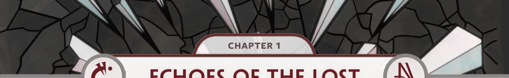

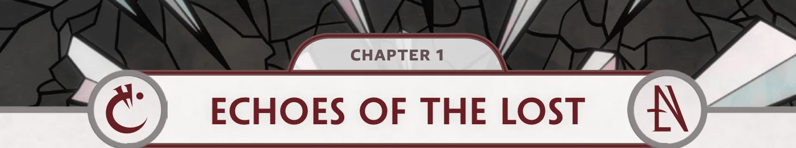

### 這就是我們的工作

#### 角色升級

第一時代角色從 1 級開始冒險，通過運河檢查哨後升至 2 級。玩家角色在 Gilded Few 基地找到 Vadilek 的祕密筆記後，可以開始「了解血金術」目標，見本書導論的「處理血金術」。

冒險開始時，讀出下列內容。

> 籌備了一個月，今晚終於要在鎢都動手。你們停好走私船，徒步抵達城郊。城市沒入迷霧，乾涸見底的運河化為深溝，像一道道疤痕穿過各個街區。你們的船長兼隊伍老大 Enge 躡手躡腳地走下最近一條街槽旁的窄階，在底部蹲低身子。「交貨點就在這附近，」她低聲說。「在某塊石板後面。幫我找找，好在那該死的巡邏隊再繞回來前離開。」

Enge（她）是隊伍的老大。請玩家介紹自己的角色，說說如何認識 Enge，以及各自在隊伍裡負責什麼。

#### 拿了就走

角色介紹完畢後，讀出下列內容。

> 上方的霧中忽然亮起提燈的光，隨即傳來夜間巡邏隊的聲響。他們就在附近，還沒發現你們。至少目前如此。

隊伍可以嘗試在不被發現的情況下完成走私任務。這是一項試煉，玩家角色主要靠成功運用技能、專長與天賦克服阻礙，見「解決試煉」。玩家角色可能遇到下列阻礙。

- **找到藏貨處。** 要在黑暗中辨認不平整的石板，得有一雙利眼（DC 12 感知）。玩家角色可以掃開灰燼（DC 11 敏捷）或移開石板（DC 10 運動），露出「一只獨特的甕」。
- **避開燈光。** 提燈的光照進街槽。玩家角色可以貼著陰影移動（DC 11 隱匿），或用煤灰偽裝（DC 13 求生）。
- **巡邏兵靠近。** 一名駐軍士兵走近查看。玩家角色可以製造動靜引開對方（DC 12 說服），或編個故事拖住巡邏隊（DC 13 欺瞞）。這是提高賭注的好時機。

#### 特殊規則：霧裡沒看見

Enge 總會替隊員打掩護。這項試煉中，第一次有玩家角色檢定失敗時，她使出招牌走私伎倆「霧裡沒看見」，引開駐軍士兵的注意。和玩家一起描述 Enge 如何耍得他們團團轉，接著玩家角色可以重擲該次檢定，並必須採用新的結果。

#### 解決試煉

隊伍在累積 3 次失敗前累積 4 次成功，或以其他方式完成目標，即成功完成試煉。

- **成功。** 隊伍取回甕，未被察覺。
- **失敗。** 隊伍取回甕，但途中將甕撞凹，委託人會不高興。此外，接下來的運河檢查哨也會更難通過，見「運河檢查哨」。

Enge 在鎢都的街槽裡翻找灰燼。

**Enge 的資料區塊。** 若需要 Enge 的資料區塊，可將《世界指南》的紅銅鎔金術模組套用到反抗者資料區塊，也可直接使用反抗者資料區塊。

第 1 章：逝者的回聲 27

VALERIA CASALE

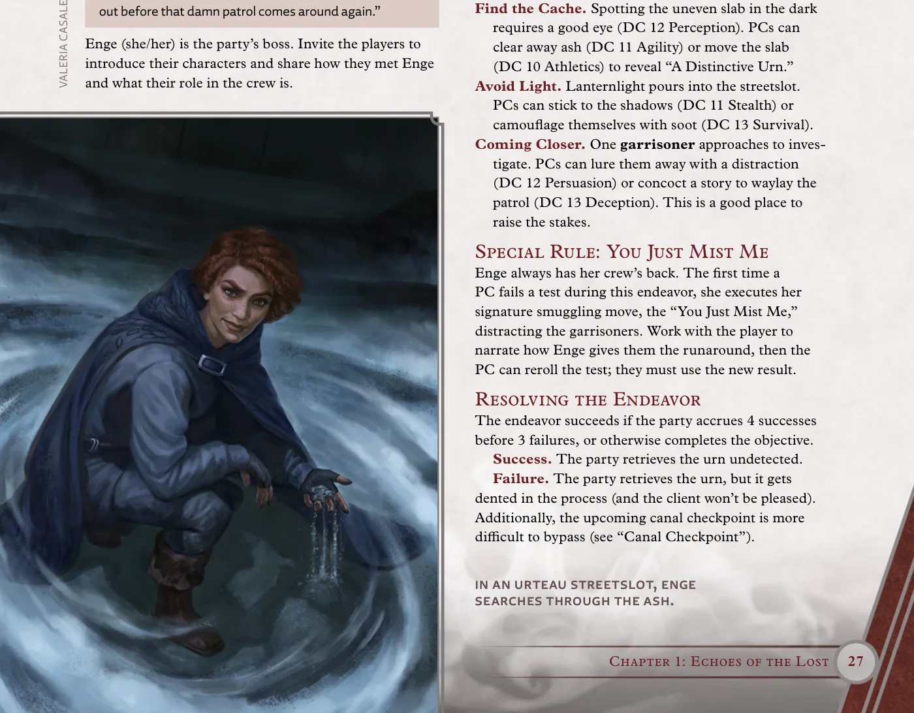

### 寧靜的夜晚

#### 一只獨特的甕

玩家角色取回一只高 3 呎的獨特銀色甕，甕上飾有植物圖案。具備歷史專長的玩家角色認得這是 Larsta 信仰的文物，也認得圖案描繪的是名為「花」的已滅絕植物。目標完成後，Enge 建議回船上喝酒慶祝。

**時代跳躍連結。** 這只鋁甕正是玩家角色在第 6 章找到 NeBaal 的那一只，見「T4：甕室」。

Enge 是個友善、特立獨行的領袖。她嗓門大，叛逆心重，也真心疼愛自己的隊員。關於如何扮演 Enge，見本書導論的「重要角色」。

#### 運河船

這艘運河船也兼作隊伍的藏身處，見《玩家手冊》第 8 章的「藏身處」。駁船以優質硬木造就，船身狹長，船艙寬敞，下垂的帆布底下堆滿木桶和板條箱。它原本是貴族的遊船，Enge 一年前取得後，就把它改成走私船。兩匹沾滿灰燼的棕馬 Willy 和 Bollocks 沿著纖道拖船。請每位玩家角色描述加入 Enge 的隊伍以來，自己為船加上的一處小裝飾或改造。章末附近的地圖 1.3 繪有運河船內部，可以在上面標記這些改造。

#### Enge 的禮物

Enge 拿出一大瓶葡萄酒，也準備了一個小驚喜。每名隊員都有一件她親手做的新衣物。她很關心每名隊員，會依各人的個性製作禮物，例如實用的外套或裝飾性帽子。分完禮物後，她拿起一塊醒目的藍布縫了起來，開始今晚的新作品。

**時代跳躍連結。** 這塊醒目的藍布是獨特藍色迷霧披風的雛形。Enge 動手製作，由 NeBaal 完成，最終成為附錄 B 的午夜迷霧披風，並在第 8 章扮演關鍵角色。

#### Enge 分享的事

Enge 一直保守自己出身埃拉瑞爾家族的祕密，其他話題則願意公開談論，例如下列幾項。

- **這趟工作。** Enge 對任務的成果很滿意，表示明晚就會啟程前往陸沙德。回去後，她會聯絡中間人 Cadme（她）安排交貨。Enge 問玩家角色，打算怎麼用從約定報酬 600 盒金中分到的錢。
- **革命之後。** 一年前，司卡叛軍克服重重困難，取得勝利。Enge 詢問玩家角色對未來有什麼希望，覺得自己在新王國中有什麼位置。革命如何改變了他們的夢想？
- **家人。** Enge 問玩家角色家裡的情形。她感嘆，要是家人也能像隊員一樣自己挑就好了。
- **戰爭傳聞。** 史特拉夫．泛圖爾的軍隊正準備向某個敵人進軍。玩家角色會擔心鄉間爆發戰爭嗎？
- **手上的作品。** 若有人問起那塊正在縫的醒目藍布，Enge 會眨眨眼說「到時你就知道了」，再問玩家角色平時有什麼嗜好。

#### 「很快回來」

黎明時，玩家角色找到 Enge 留下的字條。她收到 Vadilek 的消息後便離開了，見「老大在哪裡？」。將附錄 D 的「Enge 的信」講義交給玩家，或讀出下列內容。

> 我有點私事要辦，很快就好，天黑前會帶著路上喝的烈酒回來！今天就好好放鬆、歇一歇，這是你們應得的。敬以後無數趟工作，也敬我這輩子能找到最棒的隊員！
>
> ——Enge

隊伍為這趟工作籌備了一個多月。工作就快完成了，請每位玩家描述自己的角色會怎麼在運河船上放鬆。他們會打牌、交換往事、做點自己的事，還是單純補眠？

#### 老大在哪裡？

天快黑了，Enge 還沒回來。玩家角色知道，她通常不會打亂自己的安排，尤其是跟計畫和烈酒有關的安排。若玩家角色搜尋，會在她的桌上找到一封以高級紙張寫成的信。

第 1 章：逝者的回聲 28

將附錄 D 的「Vadilek 的信 1」講義交給玩家，或讀出下列內容。

> Engeanthe：
>
> 上次分別前說的那些話，我深感後悔。我以為自己提出的是必要的要求，卻不知道自己究竟要你承擔什麼。如今我已明白全部代價。
>
> 我欠你一個道歉，也欠你一個解釋。請讓我彌補過錯，回 Velstane 裁縫店吧。你值得這一切，這裡也永遠有你的位置。
>
> ——V.

Enge 到了鎢都附近的 Velstane 裁縫店。這間店暗中掩護著 Gilded Few 的祕密基地。

### 祕密熔爐地點

夜晚街道昏暗、人煙稀少，此時在鎢都調查較容易。玩家角色只知道 Velstane 是鎢都權貴愛光顧的高級裁縫店。他們抵達時，店已打烊，前門卻可疑地半開著。搜查店內即可找到通往地下基地的路。

#### Velstane 裁縫店

一樓有光亮的展示間、私人試衣區、工作間與倉庫。地圖 1.1 繪有這幾個房間和隔一條街的倉庫，見「C13：倉庫」。店內各處的線索暗示陸沙德即將舉辦一場舞會，見第 2 章。地下的隱密基地稱為祕密熔爐，見地圖 1.2。Velstane 裁縫店的正門通往展示間（C1）。

#### C1：展示間

展示間漆黑且空無一人。東門通往試衣區（C3），南門通往工作間（C2）。

> 展示間的鏡面與深色木地板擦得光亮。一排排穿著飄逸晚裝的人台立在陳列櫃旁，櫃內擺著蕾絲手套和鑲寶石的胸針。東邊和南邊各有一扇門。

這些晚裝屬於高級服飾。玩家角色成功通過 DC 10 的竊盜檢定，即可撬開一座陳列櫃，取得價值 25 盒金的蕾絲手套和價值 75 盒金的鑲寶石胸針。

**地圖 1.1：Velstane 裁縫店。** 每格 5 呎。圖示標記為北方（N）、C1、C2、C3、C13、往 C4、棺木、通往 C11 的升降梯。

第 1 章：逝者的回聲 29

EDUARDO NONATO

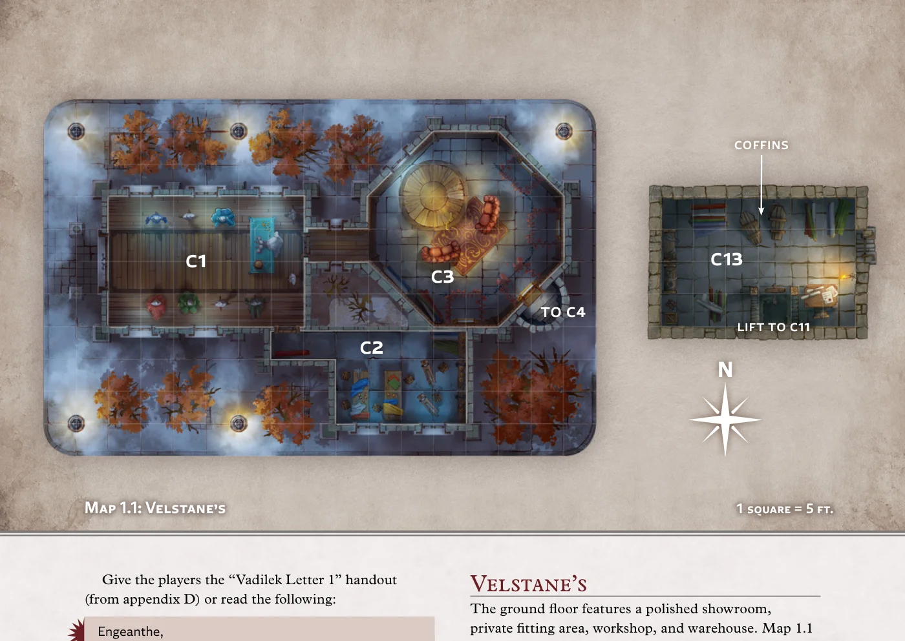

#### C2：工作間

工作間連通展示間（C1），裡頭堆滿做到一半的禮服。桌上擱著未完成的化裝舞會面具，上面嵌著細緻的金線。調查可以發現下列物件。

- **裁縫的帳簿。** 皮面帳簿記載埃拉瑞爾、Tekiel 與 Buvidas 家族的訂製單。有一個名字被劃線多次，也就是「Guiverre Seeris」，第 2 章舞會的主人。
- **急件。** 一疊急件委託要求製作化裝舞會面具、染色手套與披風。成功通過 DC 8 感知檢定的玩家角色會找到一張便條，上面寫著「裙子的開衩務必夠寬。她可能要伸手取刀。——V.」

#### C3：試衣區

試衣區連通展示間（C1）。一條祕密通道向下通往守衛室（C4）及基地的其餘區域。

> 一盞提燈將木板牆映成橘色。中央平台兩側各有一張壓紋天鵝絨沙發。沿牆並排四間有簾子的試衣間，其中一面簾子半開，布料撕破了。

半開的簾子後方是一間寬敞的試衣間，牆上掛著一面高鏡。鏡旁地上有一隻露指針織手套，在滿室華服中格格不入，顯然是 Enge 的。調查的角色會發現這面鏡子可以向外打開，露出通往地下的暗梯。下方有微光閃爍。

#### 下到熔爐

若玩家角色試著悄聲下樓，每人進行 DC 12 的隱匿檢定。這是提高賭注的好時機。若至少半數成功，守衛室（C4）的駐軍士兵陷入措手不及。否則，守衛已做好迎接隊伍的準備。

#### C4：守衛室

這是一間長方形的粗石房間，兩支插在鐵製壁架上的火把提供微弱光線。一道階梯通回試衣區（C3）。兩名駐軍士兵守著另一道通往基地深處走廊（C5）的階梯。守衛若措手不及，便會慌忙拿起武器，大喊「你們不該在這裡！」否則，他們會提高警戒，長弓搭箭，直指隊伍。

**地圖 1.2：祕密熔爐下層。** 每格 5 呎。圖示標記為北方（N）、C4 至 C12、通往 C13 的升降梯、隱藏保險箱、往 C3 的階梯、落柵門及牢房。

第 1 章：逝者的回聲 30

EDUARDO NONATO

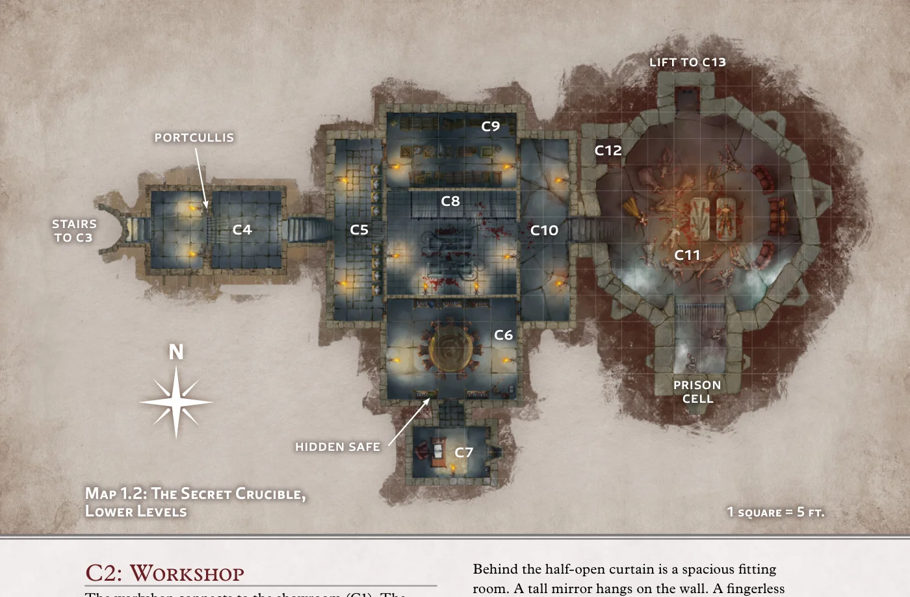

##### 戰場效果

- **落柵門。** 駐軍士兵可以在房間中央放下生鏽的鋼製落柵門，可能把隊伍分隔兩邊。角色可使用技能（[1行動]）進行 DC 12 的運動檢定，把門抬起，或對柵門造成 5 衝擊傷害，把它彎出一道能鑽過去的縫。

##### 守衛室的機遇與變故

| 結果 | 範例 |
| --- | --- |
| [Opportunity] | 一名駐軍士兵的腳被落柵門夾住，受到 1d4 衝擊傷害。 |
| [Complication] | 一名駐軍士兵看準破綻，花費 2 專注點立刻使用「齊射」反應。 |

##### 後續

一名駐軍士兵遭制伏後，另一名會投降。若隊伍放過他們，他們會回答問題，但知道的事不多。

- 他們受僱於 Vadilek Elariel（他），但從未親自見過他，也沒去過基地更深處。
- 今天有許多穿著格外華麗的貴族進入基地。
- 最後一人獨自抵達，是一名符合 Enge 外貌描述的女子。

#### C5：走廊

玩家角色穿過守衛室，繼續往下時，讀出下列內容。

> 階梯底下是一條有岔路的石造走廊，兩側共有三扇門。一張張嚴厲的面孔瞪著你們。那是沿牆擺在台座上的大理石半身像，雙眼空洞。

每座半身像都描繪一名 Gilded Few 成員。具備陸沙德專長或成功通過 DC 13 學識檢定的玩家角色，認得他們是貴族，並能說出其中最顯赫的幾人，也就是珊．埃拉瑞爾、Delina Tekiel 和 Duvall Haught。檢視半身像的人也會發現其中一座是 Enge。

**貴族傳承時刻。** 貴族能認出每座半身像，分別是珊．埃拉瑞爾、Delina Tekiel、Yestal Haught、Idren Seeris、Triss Urbain、Duvall Haught、Silla Buvidas 與 Caridus Buvidas。其中 Delina Tekiel 是貴族家族的朋友。請貴族的玩家描述，當角色被逐出家族時，Delina 有過什麼令人印象深刻的負面反應。

##### 三扇門

- **南門。** 通往集會室（C6）。在門邊聽的人能聽到悶響。
- **中央鋼門。** 通往實驗室（C8）。透過加固的狹長玻璃窗，可以看見一名年長男子在裡頭踱步。
- **北門。** 通往儲藏室（C9）。

#### C6：集會室

Gilded Few 在集會室策劃行動。這間房連通走廊（C5）、書房（C7）和通道（C10）。玩家角色進入時，讀出下列內容。

> 一張圓木桌占據房間中央，沿牆高聳著一排書櫃。一名身形瘦削的金髮女子站在其中一座書櫃旁。她穿著鈷藍色禮服，上頭沾著深色血跡。她抓起一本書粗暴地翻了翻，煩躁地低吼一聲，將書往地上一摔。旁邊桌上擱著一只無人看管的女士手提包。南牆的書櫃間藏著一扇門，東邊也有一扇。

Silla Buvidas（她）是 Gilded Few 成員。她知道 Vadilek 把罕見的血金術文獻藏在房間某處。

試衣間有一道暗梯通往下方的祕密熔爐。

第 1 章：逝者的回聲 31

EREL MATITA

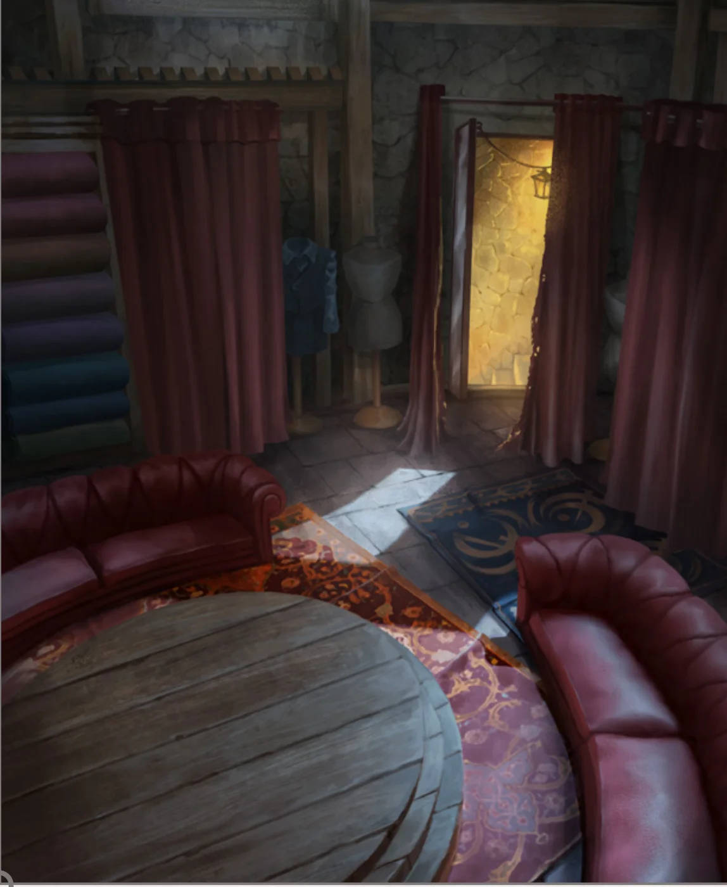

##### 手提包

Silla 忙著找書。玩家角色成功通過 DC 14 隱匿檢定即可拿走她的手提包。失敗時，Silla 會發現對方，見「Silla」。包裡有 25 盒金、常見金屬液瓶和一張便條。將附錄 D 的「Vadilek 的信 2」講義交給玩家，或讀出下列內容。

> 永恆在等著我們。昇華儀式將在天黑時開始。只有真正配得上的人才能挺過接下來的考驗。火焰能驗出礦石的純度。
>
> ——V.

##### Silla

若 Silla 發現玩家角色，她會嚇一跳，質問他們是誰、怎麼進來的。她透露的消息不多，只會挖苦一句，今晚已經亂得不能再亂了。若遭到質問或威脅，Silla 就逃往試衣區（C3），並在有幫助時使用鐵拉（[1行動]）。若成功逃脫，她會在身後鎖上鏡子暗門，封住出口。

##### 書櫃與隱藏保險箱

南牆書櫃上幾本不起眼的書後面藏有一座保險箱，成功通過 DC 12 感知檢定即可找到。密碼刻在 C7 的 Vadilek 日誌上，也可成功通過 DC 15 竊盜檢定破解。箱裡有兩本以密碼寫成的皮面巨著，是 Vadilek 從鋼鐵教廷偷來的禁忌血金術典籍。書上有 Vadilek 以金屬墨水寫下的批註，玩家角色可以在休整期研究，見本書導論的「處理血金術」。

#### C7：書房

這間側室有一張寬大的書桌、一塊羊毛地毯和一座未生火的壁爐。桌子上方掛著肖像，下方擺著上鎖的青銅箱。這裡是 Vadilek 的私人書房，所有往來書信都以金屬墨水寫成。書房連通集會室（C6）。

##### 書桌與箱子

上鎖的青銅箱裡有 C6 保險箱的密碼。角色調查時可以發現下列物件。

- **青銅箱。** 成功通過 DC 10 竊盜或 DC 12 運動檢定即可開啟。裡面有 Vadilek 的日誌與一幅人物素描。
- **日誌。** Vadilek 的日誌記滿訓練紀錄，比較他最器重的 Gilded Few 門生，每筆紀錄都會為成員評分。珊．埃拉瑞爾的名字被劃掉了。Delina Tekiel 的成績凌駕其他人。最後一頁遭撕去，可在 C10 的 Vadilek 遺體上找到。日誌封面內側刻著保險箱密碼：16–50–36。
- **素描。** 潦草的素描畫著玩家角色與 Enge。Enge 的身影被深色墨水反覆圈了起來。背面註記追蹤了好幾個月的隊伍動向，記下他們往返陸沙德與鎢都的行程。筆跡顯然與 Vadilek 不同。這些註記其實出自 NeBaal。Vadilek 曾派這名坎得拉監視 Enge。

##### 肖像：Vadilek 和 Enge

書桌上方的畫描繪一名光頭男子，黑紅相間的刺青表明他是審判廷成員。他身旁站著一名有一頭赤褐色頭髮、眉毛濃密的年輕女子，也就是 Enge。成功通過 DC 14 學識檢定的玩家角色認得男子是 Vadilek，出身埃拉瑞爾家族一個較小的旁支。

**編年史家傳承時刻。** 編年史家注意到 Vadilek 書房裡所有字跡都用摻有金屬微粒的墨水寫成，並察覺這種漂亮的字跡極耐歲月。若玩家角色打開箱子，編年史家會找到整瓶這種金屬墨水，價值 25 盒金。記下編年史家用墨水寫的任何內容，尤其是第 4 章玩家角色籌備寶庫時所寫的東西。第二時代的玩家角色將在第 9 章的寶庫裡找到原件。若文字格外有用或動人，編年史家會在「命運之線」中額外獲得一顆傳承骰。

第 1 章：逝者的回聲 32

#### C8：實驗室

這間實驗室曾用於血金術實驗，包括昇華儀式的嘗試，以及永恆尖刺本身的製造。這裡連通儲藏室（C9）、走廊（C5）與通道（C10）。玩家角色初次進入時，讀出下列內容。

> 鋼製牆壁和地板在火光下閃著刀刃般的光。你們面前有兩張鋼桌，粗重的鎖鏈從桌邊垂下。北牆整排都是空蕩蕩的鋼柵牢房。最遠那間牢房的門被整扇扯下，扭曲的金屬殘骸掉在地上。一名年長男子坐在附近，聖務官的刺青環繞雙眼。他目光空洞，舉起扁酒瓶大口喝著。

前聖務官 Murn（顧問，他）沒親眼看到儀式失敗，卻聽見了騷動。他最危險的實驗體在混亂中逃脫，如今在通道（C10）遊蕩。

##### 與 Murn 交談

Murn 以為玩家角色是司卡叛軍，認命地接受他們的裁決。出於罪惡感，他願意回答問題，唯獨避談血金術野獸，見「Murn 的過失」。若玩家角色想替他開脫，他會花費專注點抵抗，因為他相信自己不值得寬恕。他也會花費專注點抵抗暴力威脅，因為他不在乎自己會不會死。Murn 會回答問題並透露以下資訊。

- **這裡發生了什麼？** 「我和 Vadilek 都是傻瓜，以為能造出更好的帝國。我們為這個夢流過血，別人流的血更多。我們說這是為了更大的福祉，可是……統御主在上，我到現在還聽得見他們尖叫。到頭來又是為了什麼？昇華儀式失敗了。我沒親眼看見，卻聽見了騷動。我們失敗了。」
- **昇華儀式是什麼？** 「一種造神的方式……而造神可不是溫柔的事。」若玩家角色追問細節，請讓他進行 DC 13 的說服或威嚇檢定。成功時，Murn 解釋，他們曾在這間實驗室採用類似製造審判者的方式，造出 Vadilek 稱為「永恆尖刺」的物件。只有 Vadilek 知道製作它的完整禁忌程序，Murn 則曾拿 Vadilek 做出的其他尖刺進行實驗。Vadilek 的筆記在這棟建物某處，見 C6 的「書櫃與隱藏保險箱」。Murn 的筆記本也有這些資訊，見「Murn 的隨身物品」。
- **你見過 Enge 嗎？** 「Vadilek 以為她就是答案。他要她接受永恆尖刺。她拒絕了，當然會拒絕。他只好把她拖到熔爐裡。就在通道對面，不過……出了點問題。」

**扮演 Murn。** 他認命、膽怯而古怪，想為以往的罪行贖罪。Murn（讀作「MERN」，他）是年近六十的貴族，長年伏案使他背部佝僂。他剃了光頭，皮膚棕褐，眼睛周圍有簡單的刺青。

Murn 曾是審判廷研究員，多年來與 Vadilek 共事，進行殘忍的血金術實驗。兩人都懷有大逆不道的恐懼，擔心最後帝國無法永存，遂暗中謀劃，想讓司卡德利亞的未來仍由貴族領導。Murn 曾告訴自己，這個目標值得他們為打造永恆尖刺而施展暴行。如今昇華儀式失敗，他飽受罪惡感折磨，一口接一口地灌酒。

##### Murn 的過失

Murn 不願談論自己最近犯下的過失。若玩家角色追問，並成功通過 DC 12 的說服或領導檢定，Murn 就會多透露一些。

- 那個生物是失敗的實驗體。那人沒有獲得力量，反而變成可怕的模樣。
- 儀式失敗時，熔爐（C11）傳來的聲音莫名激怒了那個生物，牠破門逃入通道（C10）。
- 若怪物尚未被擊敗，Murn 建議拔除植在野獸頸部的金屬尖刺，讓牠更容易被擊敗。Murn 也自願走到通道裡，協助玩家角色對付那個生物。

若玩家角色檢定失敗，Murn 會羞愧得說不下去，只警告通道（C10）裡有一頭「野獸」，建議他們離開。

##### Murn 的隨身物品

Murn 帶著熔爐（C11）牢房的鑰匙，以及一本記錄永恆尖刺相關實驗的筆記本。頁邊潦草寫著給「Duvall」的註解，解釋複雜的血金術概念。Duvall 會在第 3 章登場。若玩家角色索取鑰匙，Murn 會直接交給他們。

第 1 章：逝者的回聲 33

**官員傳承時刻。** Murn 把官員視為同僚，也可能把對方視為同樣因犯過錯而心頭沉重的人。請官員描述曾在鋼鐵教廷或其他機構遇過的一名 NPC，此人對人命的漠視讓官員想起 Murn。請玩家也說說，那名 NPC 最後落得什麼符合其所作所為的下場。受害者後來有討回公道嗎？這如何影響官員與最後帝國的關係？Murn 很看重官員的建議，因此官員與他互動的所有檢定都獲得一項優勢。談話結束時，Murn 請官員協助他向新政府自首，接受裁決。

第 1 章：逝者的回聲 34

#### C9：儲藏室

這間寬大的儲藏室昏暗無人。板條箱堆成整齊的三排，高 5 呎、橫跨 20 呎。這裡連通實驗室（C8）、走廊（C5）和通道（C10）。

##### 箱內物品

調查板條箱的角色會發現下列物品。

- **尖刺。** 幾箱裝著數十枚無效的尖刺，有不同長度和合金，有些乾淨無損，有些沾滿乾血。
- **器械。** 許多箱子裡有手術器械，包括鎚子、骨鋸、夾鉗和鋼製束具，另外還有數瓶透明液體、繃帶和未使用的針筒。成功通過 DC 8 醫療檢定可辨認瓶中是低效力的防腐藥劑，共 5 劑。
- **空箱。** 有幾個空箱散發淡淡硫磺味。仔細查看會發現細微痕跡，包括一抹乾血和幾根頭髮。

#### C10：通道

這條長通道把集會室（C6）、實驗室（C8）、儲藏室（C9）和熔爐（C11）連在一起。

##### 逃脫的實驗體

從 Murn 手中逃脫的實驗體，也就是血金術野獸，正在這裡徘徊。玩家角色初次進入通道時，讀出下列內容。

> 黑暗中傳來低沉的吼聲。轉眼間，一個生物衝出陰影。透明皮膚緊緊繃在隆起的紅色肌肉上，一枚極細的銀灰色尖刺刺穿牠的頸部，在裂開的傷口中搖晃。牠的臉幾乎像人，只有雙眼漆黑，直盯著你們，裡頭只剩怒火。牠用長爪舉起一根粗大的鋼條，露出參差的牙齒吼叫，朝你們衝過來。

先前不知道血金術野獸存在的每名角色都陷入措手不及。

##### 血金術野獸的行動

若角色關上通道的門撤退，血金術野獸第一次會失去興趣。若再發生一次，牠就會攻擊關起的門，造成 5 衝擊傷害即可摧毀它。處理掉門後，野獸會追逐剛才看見的角色。牠只要看見 Murn，就會優先攻擊他。戰鬥第 2 輪，牠猛地轉頭望向熔爐（C11）。牠用快速輪次移動（[1行動]）到鋼門前，並互動（[1行動]）將門從鉸鏈上扯下，再進入熔爐。

#### C11：熔爐

熔爐原是 Gilded Few 的訓練場，也是永恆尖刺誕生的地方。今晚這裡散落著昇華儀式失敗後留下的血腥殘骸。假扮 Enge 的 NeBaal 躲在隔壁的儲物間（C12）。這裡連通通道（C10），也可經升降梯通往倉庫（C13）。玩家角色進入時，讀出下列內容。

> 階梯通往一間寬闊的八角形房間。石板地面沾滿濕滑的血。房間中央立著兩張鋼桌，地上四處倒著屍體。一盞氣派的鍛鐵吊燈懸在生鏽的鎖鏈上，照著一張張灰白的臉。

若玩家角色跟著血金術野獸進入房間，接著讀「暴走」。若野獸已被擊敗，前往「失控的儀式」。

##### 暴走

若血金術野獸在場，繼續讀出下列內容。

> 那頭令人不安的怪物正在這裡，逐步逼近一群無助地縮在上鎖牢房柵欄後的司卡囚犯。你們一進門，牠就猛地轉頭。畸形肌肉在透明皮膚下起伏，頸部的尖刺一閃，牠發出帶著濕濁肉音的咆哮，朝你們撲來。

戰鬥中，角色可以與下列要素互動。

- **吊燈。** 以遠程攻擊瞄準生鏽的鎖鏈（DC 13），即可讓吊燈墜落。吊燈對下方一名角色造成 3d6 衝擊傷害，並使該角色分心，在下一次檢定中獲得一項劣勢。
- **桌子。** 玩家角色可以用「架防」（[1行動]）躲到鋼桌底下，這一輪就不會成為野獸的目標。若野獸在自己的輪次看不見任何目標，就會尋找最後被自己命中的目標。
- **尖刺。** 玩家角色可以試著拔除野獸頸部的尖刺，扭轉戰局。詳見血金術野獸的資料區塊。

##### 後續

野獸會戰到死為止。擊敗牠之後，便能輕易取出牠的鎳鉻尖刺，但尖刺已經失效。

**老兵傳承時刻。** 囚犯之一 Tuss（平民，他）認出老兵是戰爭英雄，點名向他求救，無意間引起野獸注意。老兵的下個輪次，請提醒他出手干預，否則無辜的人可能喪命。若老兵冒險援救囚犯，他會引開野獸注意，並必須進行 DC 11 的紀律檢定。成功時，他的勇氣振奮了眾人，老兵和盟友可各自在下一次檢定中，為一顆擲出的骰加上 1d4（劇情骰除外）。即使檢定失敗，他的英勇事蹟仍會流傳。若老兵決定完全不干預，他在影響 Cynwise 的所有檢定上都獲得一項劣勢，見「Cynwise 的說法」。

熔爐深處有一幕駭人的景象等著隊伍。

KEVIN O’NEILL

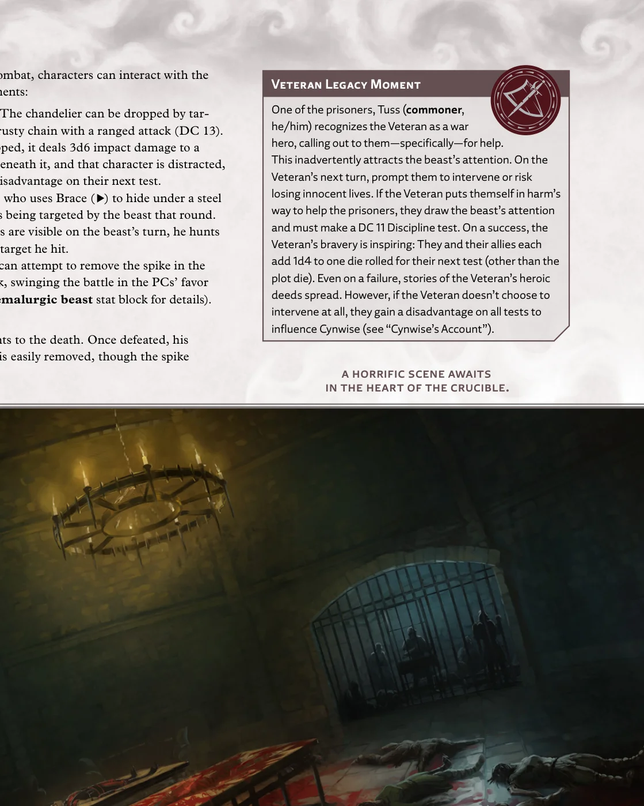

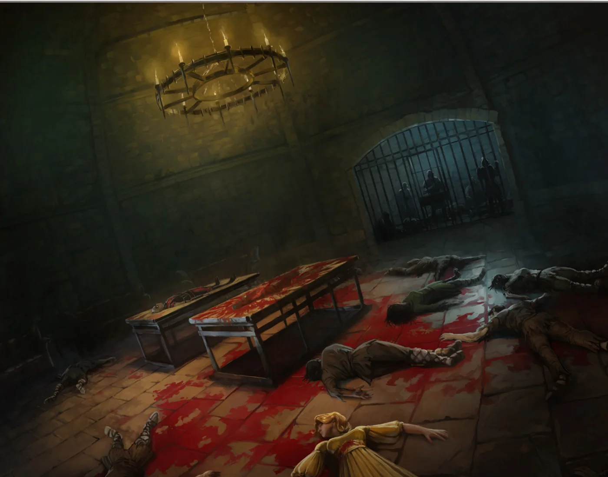

##### 失控的儀式

房間只剩下隊伍時，讀出下列內容。

> 房間中央立著兩張鋼桌。其中一張躺著一名中年男子的遺體，兩枚鋼尖刺貫穿雙眼。另一張桌子空著，卻染成紅色。驚恐的司卡囚犯擠在南牆上鎖的牢房裡。血腳印與扭打的痕跡一路向北，消失在空蕩的升降梯井。梯井上方的鋼板刻著「火焰能驗出礦石的純度」。西北牆上另有一扇門，仍然關著。

角色可以調查下列線索。

- **牢房。** 五名囚犯擠在牢房裡，帶著戒心與希望望向玩家角色。若隊伍靠近，見「Cynwise 的說法」。囚犯厭惡 Murn。如果任何玩家角色公開與他站在一起，囚犯就不會幫忙。
- **鋼桌。** 中央桌上躺著鋼鐵審判者 Vadilek 的遺體。他的軀幹塌陷，原本器官所在之處只剩空腔。成功通過 DC 12 醫療檢定，可發現他身上不久前拔掉了幾枚尖刺，致命傷是他自己造成的。Vadilek 日誌裡撕下的一頁折好放在口袋中，見「Vadilek 的日誌頁」。第二張桌子是空的，但玩家角色會在一片乾血上找到幾根黏住的赤褐色頭髮。
- **地上的遺體。** 死者包括十二名司卡和一名貴族。衣著考究的年輕女子心臟被俐落地刺穿。成功通過 DC 10 醫療檢定，可確認沒有掙扎的跡象。司卡遺體則有瘀傷和指甲撕裂等反抗痕跡。
- **扭打痕跡與腳印。** 一串血腳印通往西牆上一扇關著的門，見「西北門」。成功通過 DC 12 推理檢定，還可發現至少九人爭相從升降梯離開。成功通過 DC 12 感知檢定，或使用鐵鎔金術或鋼鎔金術的初萌能力，即可注意到鋼桌上的凹痕及嵌在牆裡的硬幣，這些是鎔金術交戰的跡象。
- **升降梯井。** 梯井向上延伸四層樓，通往倉庫（C13）。木製升降平台目前停在倉庫。梯井旁的牆上伸出一根拉桿，扳動即可叫來平台。
- **西北門。** 門後是儲物間（C12），假扮 Enge 的 NeBaal 躲在裡面。門打開時，見「C12：儲物間」。

##### Vadilek 的日誌頁

若玩家角色閱讀這篇日誌，將附錄 D 的「Vadilek 的日誌」講義交給玩家，或讀出下列內容。

> 第 47 篇
>
> 尖刺的歌聲越來越響，我仍守住自己的立場。反省、犧牲與高尚，這些都是統御主所欠缺的，而我將使它們臻於完美。
>
> Gilded Few 還沒準備好，午夜試煉證明了這一點。Delina 用忠誠掩飾野心，但我看得見她眼裡的渴望。Engeanthe 拒絕了我……也許這正是她的力量。無論她願不願意，她都是我們向前的路。
>
> 我的犧牲將促成我們偉大的未來。我選定的繼承人將會昇華。若我在最後關頭退縮，也已安排好備案，確保帝國能有一位配得上的繼承人昇華。
>
> 傳承將永存。

##### Cynwise 的說法

玩家角色走近牢房時，讀出下列內容。

> 狹窄的牢房充斥著汗水與血腥味。除了赤著腳的一名青少年，多數司卡都縮在後牆旁。青少年纖細的雙手抓緊柵欄，指節發白，眼神卻毫不服輸。「你們跟 Gilded Few 是一夥的？」青少年側著頭，臉色蒼白，明顯又怕又累，還硬撐著逞強。「回來把沒做完的事做完？」

隊伍與囚犯交談時，由 Cynwise（線人，使用中性代名詞）代表大家說話。Cynwise 和其他囚犯目睹了失敗的儀式。Cynwise 最健談，其餘四名司卡平民的說法相近，分別是 Aime（她）、Roben（他）、Tuss（他）和 Pella（她），年齡從十幾歲到五十歲出頭。Cynwise 希望安全離開鎢都，前往自由城市陸沙德。如果 Murn 在場，Cynwise 會立刻認出他，警告玩家角色這人是個「噁心的變態」。

第 1 章：逝者的回聲 36

##### Cynwise 想要什麼

若隊伍想請 Cynwise 說出所見，將本場景作為對話進行，見「解決對話」。一開始，Cynwise 會提出三項要求。

- **打開牢房。** 可以用 Murn 的鑰匙開門，也可成功通過 DC 13 的竊盜或運動檢定破門。若 Murn 在場，他會羞愧地交出鑰匙，避開玩家角色的目光。
- **送囚犯去陸沙德。** Cynwise 起初開口要 100 盒金，讓大家能安全回到陸沙德。若得知隊伍有船，便改為請求搭船。若隊伍答應，船上多了囚犯，逃出城會更難，見「運河檢查哨」。
- **處理 Murn。** Cynwise 要求隊伍保證，今後再也不用見到 Murn。

玩家角色可以真心答應履行 Cynwise 的一項要求，以取代進行相關檢定來為對話做出貢獻。他們可以想出有創意的提議，只要能滿足 Cynwise 的要求，就無須檢定。每當玩家角色成功做出一項貢獻，Cynwise 就會分享一則知道的事。

##### Cynwise 知道什麼

- **你怎麼會在這裡？** 「街槽那頭有個施粥處，是一家想扮救世主的貴族開的，好像叫 Buvidas 之類的。有熱食、乾淨衣服，每週還開會談要怎麼改變現狀。我可不信那一套，但我餓了。後來一醒來，人就在這裡。」
- **這裡發生了什麼？** 「喔，這個啊？就一場普通的貴族晚宴兼大屠殺。」Cynwise 語氣輕佻，描述時眼裡卻浮現揮之不去的恐懼。「鋼鐵審判者把一個紅髮女人綁在那張鋼桌上。接著一群年輕貴族出現，戴著嚇人的審判者骷髏面具。鋼鐵審判者講了一番犧牲的大道理，稱紅髮女人為『繼承人』，然後……刺穿自己的心臟。真會演。」
- **哪裡出了岔子？** 「一個臉上有疤、看起來很不好惹的女孩站了起來，射出一枚硬幣，說『想當繼承人，就得先殺了我！』接著就全亂了，大家打成一團。疤臉女孩搶了審判者的斧頭。一下子就血流成河。那個紅髮女人好像傷得很重，但我沒看見她的屍體。屍體好多……」Cynwise 說到這裡突然停住，顯然又想起那一幕。Cynwise 用力搖了搖頭，才恢復故作輕鬆的語氣。「反正打完之後，大家好像都在找什麼。誰都沒找到，後來就匆匆走了。」

**扮演 Cynwise。** Cynwise 嘴上尖刻、觀察敏銳，也很勇敢，目標是逃離鎢都、回到陸沙德。Cynwise（讀作「SIN-wise」，使用中性代名詞）是司卡青少年，曬成棕褐的皮膚沾著灰燼，瀏海參差不齊，破舊外套縫有許多暗袋，眼神靈活而精明。

Cynwise 出生於陸沙德的巷弄，加入街童人脈網，靠替肯付錢的人打零工勉強度日。Cynwise 往往用帶刺的話和試探性的問題摸清陌生人的底細。平時話不多，有利可圖時才會一口氣說個不停。信任對 Cynwise 很陌生，被綁架並目睹 Vadilek 殺人的儀式後，更不願對人卸下戒心。被關起來從來不在計畫之內，但 Cynwise 總能找到出路。

**街童傳承時刻。** 街童聽過 Cynwise 的名聲，也知道一件 Cynwise 想隱瞞的事。和玩家一起決定那是什麼情報。若加以利用，Cynwise 會直接透露一項儀式細節，但再追問可能惹惱對方。Cynwise 看出這名玩家角色也懂得把握機會，便邀請對方加入一群「消息靈通」的街頭人士所組成的人脈網。若角色同意，就開始「加入 Cynwise 的人脈網」目標。完成後，街童成為這個規模 1 犯罪集團的成員，見《玩家手冊》第 8 章。

Cynwise，司卡街童。

37

JUST HIEU

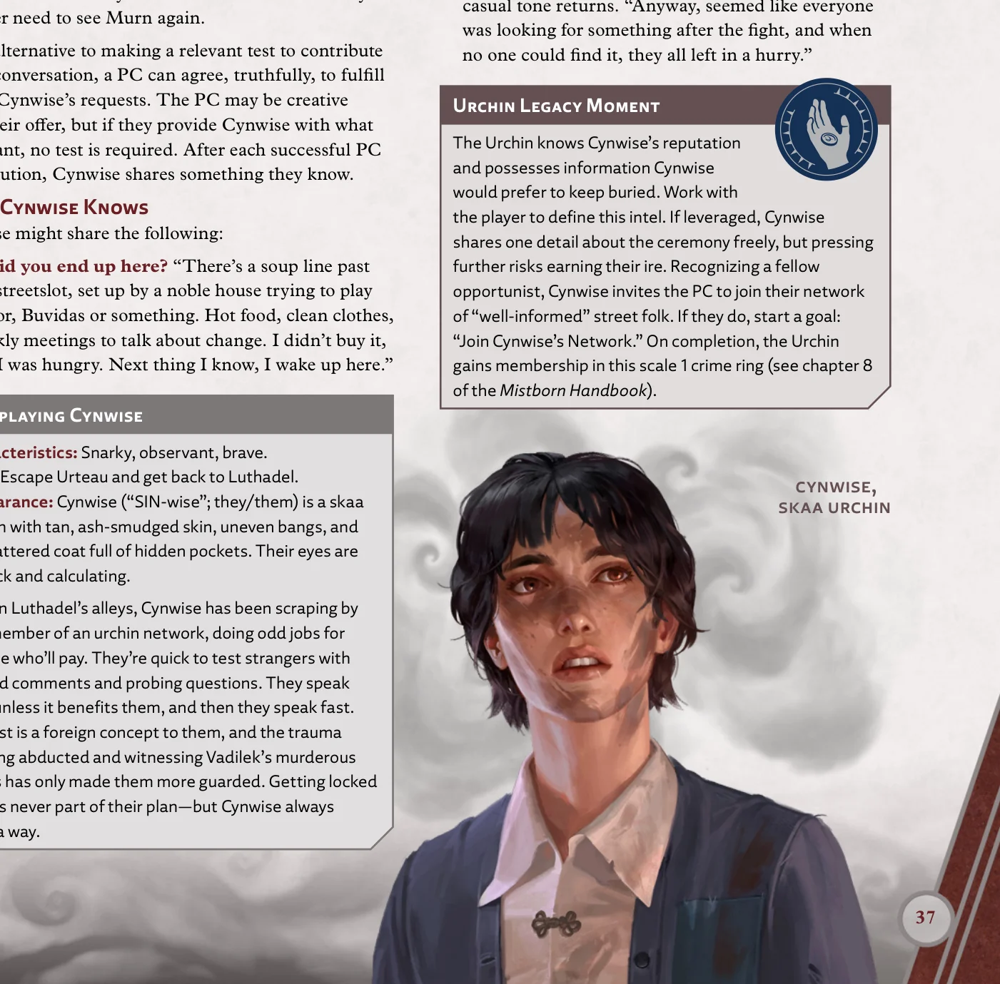

##### 抵抗影響

Cynwise 的認知防禦為 14，靈性防禦為 13，專注點為 4。Cynwise 疑心很重，對其進行欺瞞檢定時獲得一項劣勢。Cynwise 會花費專注點，抵抗威嚇或任何要求其盲目信任玩家角色的提議。

##### 解決對話

若隊伍以真誠的提議或有說服力的謊言處理「Cynwise 想要什麼」中的要求，對話便成功。若 Cynwise 的專注點已不足以抵抗影響，對話立即以失敗告終。

- **成功。** Cynwise 對玩家角色留下很好的印象，帶著戒心向他們道謝，並說出所有知道的事，盡力提供協助。
- **失敗。** Cynwise 撐不住了，既害怕又疲倦，無力再談條件。Cynwise 心灰意冷地說出知道的事，便轉開身子說「你們自己逃命去吧。我們會自己想辦法回陸沙德。我們總會找到辦法的。」Cynwise 和其他囚犯拒絕進一步交易或援助。

#### C12：儲物間

隊伍打開門時，讀出下列內容。

> Enge 抬起頭，乾血覆滿那張橢圓臉，臉上的恐懼一下子化為欣喜和寬慰。她鬆開手裡的小刀，帶著哭腔長出一口氣。「統御主那兩顆下垂的蛋啊，見到你們真好！」

儲物間裡有木杖、木盾、皮甲、常見金屬液瓶，以及假扮 Enge 的 NeBaal（使用中性代名詞）。

##### NeBaal 的偽裝

真正的 Enge 已在儀式中死去。NeBaal 奪走永恆尖刺，把 Enge 的遺體拖進儲物間藏起來，吞下她的骨頭。此後，NeBaal 在第一時代冒險的大部分時間都會完全扮作 Enge，直到身分遭到識破，見本書導論的「處理 NeBaal」。NeBaal 演得逼真得令人毛骨悚然，也清楚隊伍最近做過什麼。Vadilek 命其密切監視 Enge，因此 NeBaal 經常觀察隊伍，熟知 Enge 所知道的許多玩家角色相關資訊。第一時代此後提及的 Enge 都是 NeBaal。

第 1 章：逝者的回聲 38

##### Enge 的說法

Enge 透露下列資訊。

- 她的叔叔 Vadilek 邀她到這裡。她以為叔叔要為過去的錯事道歉，卻被帶去參加叔叔私下栽培門徒的組織 Gilded Few 的聚會。
- Vadilek 想用一件強大的神器，也就是永恆尖刺，讓 Enge「昇華」成神。
- Vadilek 在儀式中犧牲自己。名叫 Delina Tekiel（她）的 Gilded Few 成員攻擊了 Enge，接著所有貴族開始互相交戰。
- Enge 遭尖刺刺傷，感覺暈眩。
- Enge 說她使出招牌伎倆「霧裡沒看見」，搶走永恆尖刺並躲起來。但 Gilded Few 很快會發現神器在她手上，開始追捕她。

若玩家角色開口詢問，或沒有其他問題了，Enge 會避開囚犯和 Murn，私下向隊伍展示永恆尖刺。直接觸碰會讓人陷入迷惑，因此她用外套裹了好幾層。讀出下列內容。

> Enge 小心翼翼地掀開外套，露出一枚銀灰色尖刺。它像刺穿血金術野獸頸部的那一枚，但大得多。Enge 壓低聲音說「永恆尖刺。」

Enge 不清楚尖刺的全部性質，只警告碰觸它會令人不適。若玩家角色碰觸，便會感受到附錄 C「永恆尖刺」描述的效果。討論結束時，讀出下列內容。

> 「聽 Vadilek 的意思，這東西太強大，不能留在這兒。我們會變成一個活靶子，好在我們就是做走私的。帶尖刺去陸沙德最安全。我們在那裡有朋友，貴族也不能為所欲為，對我們比較安全。」Enge 小心地用外套重新包好永恆尖刺，停頓一下。「多謝你們救我一命。真的。」她眨掉淚水，用笑容掩飾。「好啦，快離開這個鬼地方。」

Enge 指向通往倉庫（C13）的升降梯。

### 逃離鎢都

#### C13：倉庫

Velstane 裁縫店的倉庫用來存放進口貨物，也藏著 Gilded Few 見不得光的祕密，其中還真有遺骸。東牆有一扇門通往基地外的小巷，是個不顯眼的後門。這裡可搭升降梯通往熔爐（C11）。升降平台到達倉庫時，讀出下列內容。

> 平台卡入定位，眼前是一座寂靜的倉庫。一支火把在鐵製壁架上燃燒。一捆捆布匹與置物架在成疊的板條箱上投下扭曲的影子。靠近北牆處並排放著兩個長 6 呎的木箱，其中一個半開著。

##### 棺木

箱子裡各有一具遺體，分別是 Idren Seeris（他）和 Annite Urbain（她）。這兩名貴族迷霧人犧牲自己，成就尖刺格架。遺體經過保存，身穿華服，閉起的眼瞼上灑著金箔。男子僵脆的指間夾著一封寫給 Idren Seeris 爵爺的信。若有玩家角色拿起信，將附錄 D 的「給 Idren 的信」講義交給對方，或讀出下列內容。

> Idren：
>
> 你不必順從 Vadilek 的任性要求，也不必接受他那套該死的制度。他懂得很多，卻無法衡量或評判一個人的價值。你不必「重造世界」，也不必被「鍛造」。離開鎢都吧。選擇活下來，不會讓你成為恥辱或失敗者。回家吧。
>
> ——父親

玩家角色探索完倉庫及其物品後，Enge 催大家離開。

隊伍必須趕快穿過鎢都霧氣瀰漫的街道，也可能帶著 Murn、Cynwise 和其他囚犯一起走。登上運河船後，玩家角色要通過一處意料之外的檢查哨，或與 Silla 及其雙胞胎兄弟 Caridus Buvidas（他）交手，保住永恆尖刺。

Enge 戴著手套，一手握住永恆尖刺，帶領隊員前往運河船。

VALERIA CASALE

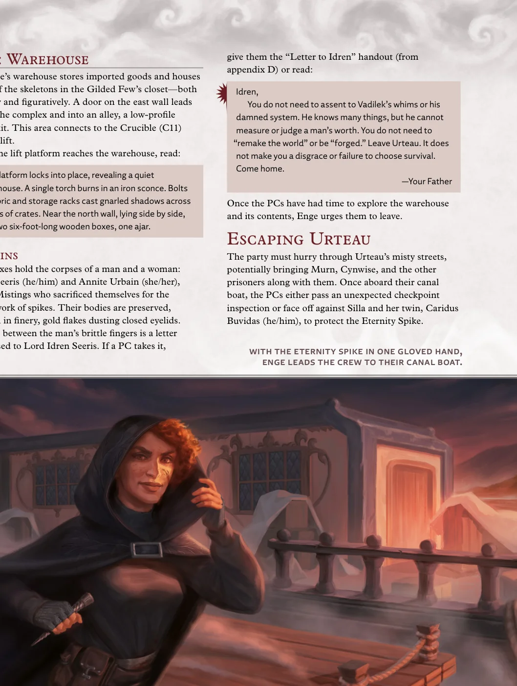

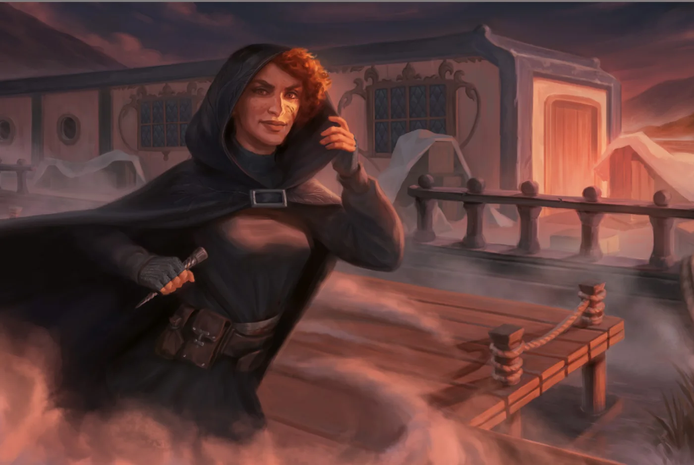

#### 再度登船

隊伍離開倉庫時，讀出下列內容。

> 黎明將要漫過鎢都帶著灰痕的屋頂和乾涸的船閘。你們穿過寂靜的街道，往走私船前進。霧仍未散，映著將要升起的朝陽，染上一抹粉紅。奇怪的是，迷霧在你們身旁猛地散開，打著旋退去，彷彿被一股力量排開。Enge 皺起眉頭，催你們加快腳步。

隊伍順利抵達船上。Enge 幾乎昏倒，說自己覺得莫名虛弱。船啟程前往陸沙德，馬匹忠實地沿纖道拖船。抵達檢查哨前，所有人都能安全完成一次短休。若獲救囚犯與玩家角色同行，可以藏在帆布或船艙的舖位底下。

#### 運河檢查哨

隊伍沿運河前進，很快被一處意外出現的檢查哨攔下。這處檢查哨是應 Silla 的要求設置的。讀出下列內容。

> 一根沉重的木樑橫跨運河，擋住去路。兩名鎢都士兵從北岸低矮的石造哨所走出，踏上碼頭。沾著灰的木板在靴底下吱嘎作響。其中一人架起長鉤，要鉤住你們的船。另一人舉起長弓指向你們，命令你們停在原地。「停船！說明來意，出示貨物清單。」

兩名駐軍士兵盤問隊伍，準備登船例行檢查。Enge 立刻帶著永恆尖刺藏起來，請玩家角色處理其餘事情。若玩家角色想和平通過檢查哨，見「進行試煉」。否則見「爭奪尖刺」。

**囚犯傳承時刻。** 其中一名駐軍士兵曾任獄卒，囚犯入獄時見過他。請囚犯描述當時注意到的這名駐軍士兵的一個弱點。若囚犯現在利用這項弱點，必須在相關檢定中提高賭注，但可以選擇自己、Enge 或永恆尖刺其中一個目標，讓目標在本場景剩餘時間保持隱藏，即使檢定失敗或出現變故也一樣。若駐軍士兵看見囚犯，且試煉失敗，Silla 和 Caridus 在「爭奪尖刺」開始時具有堅定狀態。

##### 進行試煉

將和平通過檢查哨的嘗試作為一項試煉，見「解決試煉」。Buvidas 兄妹賄賂了守衛，要他們扣下有可疑乘客或奇怪貨物的船。若玩家角色在本章開頭的「拿了就走」試煉中失敗，守衛顯然更緊張，這次試煉一開始便有 1 次失敗。可能遇到的阻礙如下。

- **請出示文件。** 士兵要求出示貨物清單。玩家角色可以出示偽造文件，證明自己「獲准」運貨進陸沙德（DC 14 工藝或竊盜）。不過士兵隨後仍會要求檢查貨物。
- **可疑乘客。** 若玩家角色帶上司卡囚犯，要藏好他們並不容易。玩家角色可以引開守衛的注意（DC 13 說服）、就乘客撒謊（DC 12 欺瞞），或掩飾藏身處（DC 13 求生）。這是提高賭注的好時機。
- **違禁貨物。** 駐軍士兵正留意異常貨物。玩家角色可以沉住氣以化解懷疑（DC 13 紀律），或確保走私的甕與永恆尖刺都藏得很好（DC 13 隱匿）。

##### 運河檢查哨的機遇與變故

| 結果 | 範例 |
| --- | --- |
| [Opportunity] | 一名駐軍士兵正要走近藏身處時，另一名駐軍士兵叫對方去檢查船上另一區。 |
| [Complication] | 永恆尖刺使迷霧翻湧著遠離船隻，嚇到了守衛。玩家角色必須成功通過 DC 14 的欺瞞檢定來解釋異狀，否則累積 1 次失敗。 |

##### 解決試煉

隊伍在累積 3 次失敗前累積 5 次成功，或以其他方式完成目標，即成功完成試煉。

- **成功。** 玩家角色可以操作絞盤，讓船通過並離開。船駛離時，他們看見一名穿鈷藍色舞會禮服的女子走出哨所，可能認出她是 Silla。接著見「繼續旅程」。
- **失敗。** 守衛呼叫援兵，召來 Silla 和 Caridus。接著見「爭奪尖刺」。

第 1 章：逝者的回聲 40

#### 爭奪尖刺

玩家角色可能在基地見過的 Silla Buvidas，與其兄弟 Caridus Buvidas 一起慢步走向運河船。讀出下列內容。

> 一對貴族雙胞胎從哨所慢步走上碼頭。走在前頭的年輕男子丟下一枚硬幣，從你們頭上飛過，落到南岸，手指間轉著另一枚硬幣。接著走出一名身穿染血鈷藍色舞會禮服的女子，趾高氣揚地俯視著你們。

若隊伍在基地見過 Silla，她立刻補上一句。

> 「你們還活著，真有本事！可惜你們現在得死了。我們需要那枚尖刺……恐怕你們知道得也太多了。」

Silla、Caridus 和兩名駐軍士兵在運河檢查哨攻擊玩家角色，見地圖 1.3。

##### 爭奪尖刺的機遇與變故

| 結果 | 範例 |
| --- | --- |
| [Opportunity] | Enge 仍在藏身，卻在混亂中設法拉起絞盤。 |
| [Complication] | Enge 的藏身處曝光，她踉蹌著走到外面。Silla 和 Caridus 異口同聲大喊「你應該已經死了！」 |

##### 後續

兩名駐軍士兵都被擊敗，或任一名雙胞胎被擊敗時，戰鬥結束。倖存的對手會撤退。成功通過 DC 8 的學識檢定，可辨認任一倒下的雙胞胎身上的 Buvidas 家族徽記。玩家角色可以手動操作絞盤，放船通過，從此一路前往陸沙德，途中再無阻礙。

#### 繼續旅程

通過檢查哨後，玩家角色升至 2 級。Enge 誓言要查找與尖刺有關的線索，同時保持低調，以防 Gilded Few 報復。

**地圖 1.3：運河檢查哨。** 每格 5 呎。圖上標示北方（N）、哨塔、絞盤及運河船內部。

RYAN SMITH

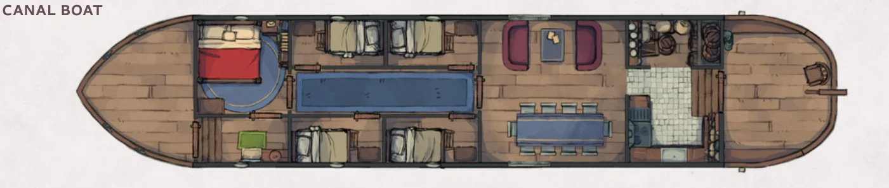

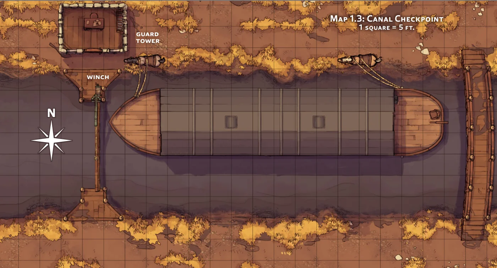
