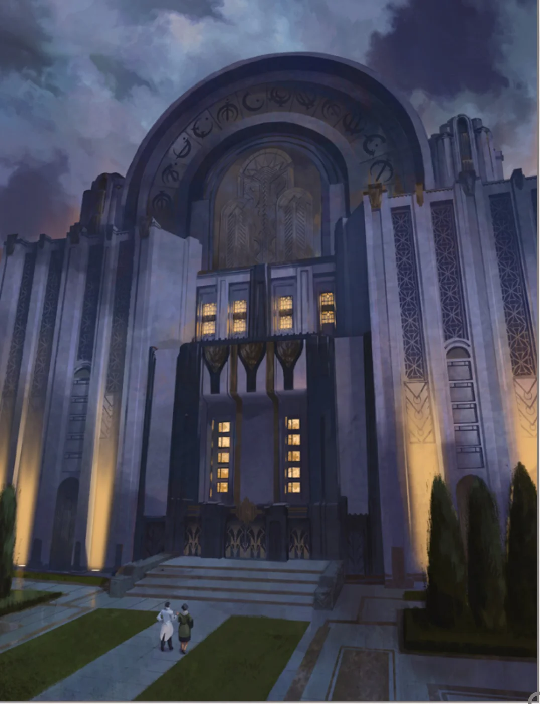
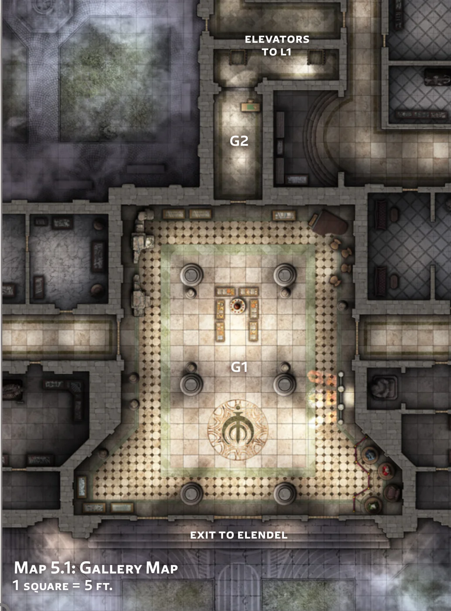
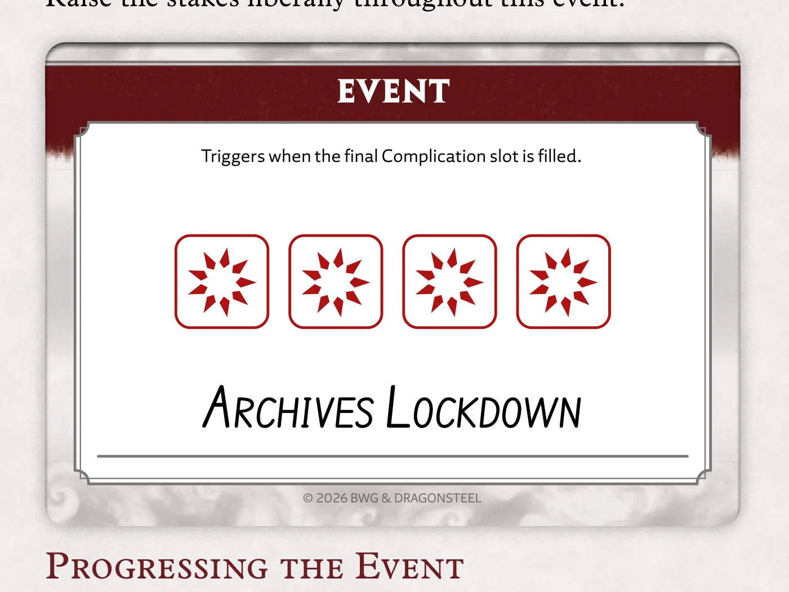
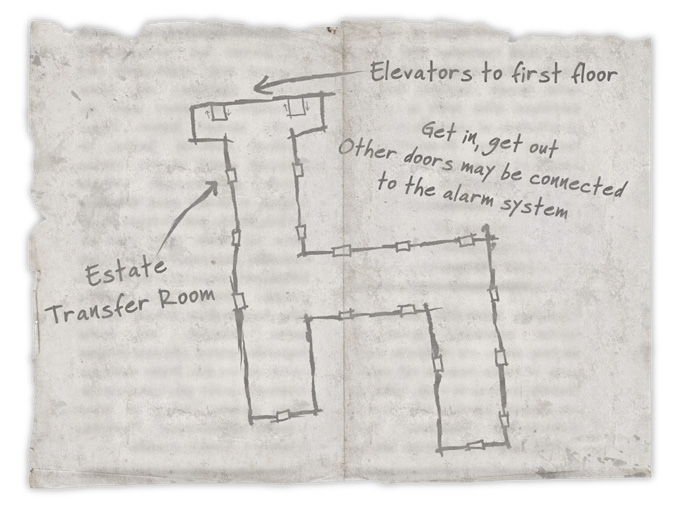
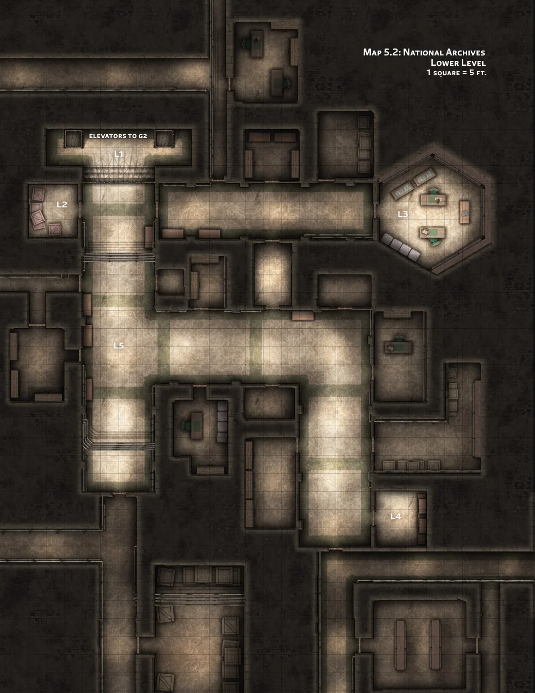
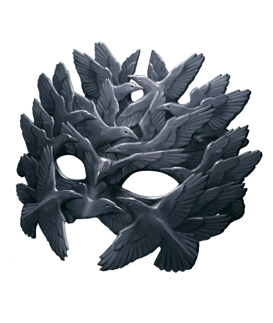
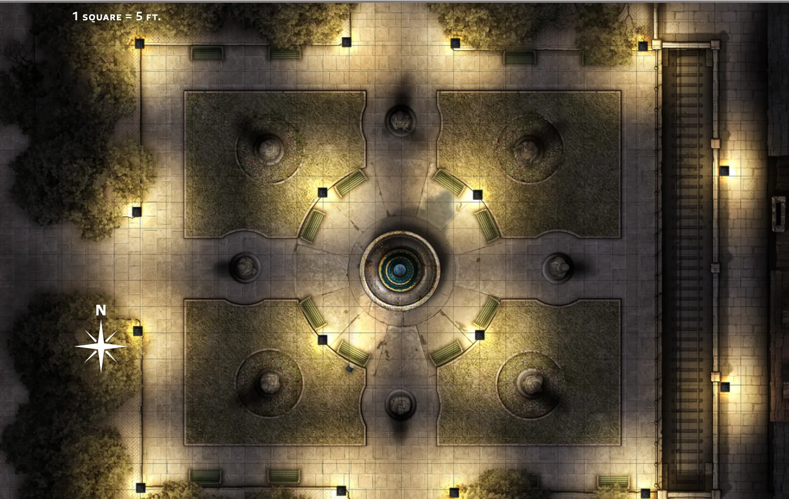
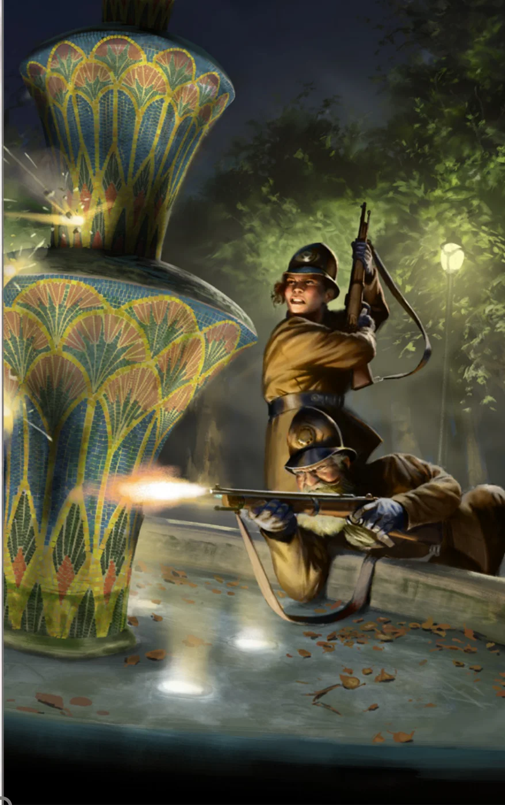

### 上流社會劫案

取得入場資格後，PC 必須潛入國家檔案館下層，找到 38.4B 號箱並逃離。偷走 Kwylliam 的徽章並非必要，但會讓劫案容易許多。檔案館一樓配置見地圖 5.1。動手之前，PC 有充足的時間在 G1 區與展廳賓客交談、參觀展品（見「開始劫案」）。隊伍入場時，請朗讀下文。

石柱高聳，直抵國家檔案館的天花板，弦樂四重奏在空曠的大廳裡迴盪。依藍戴的上流人士啜飲雞尾酒，欣賞為 Lysarra 的生日貴賓開放的當期展覽「圍城故事」。今晚的主角身穿綠色絲綢和毛皮，光彩照人，站在一排半身像旁。年輕貴族圍著她，聽得入神。旁邊擺著一座多層巧克力噴泉，由一名 Malwish 侍者照料。Bayron 獨自站在一旁，在筆記本上寫東西。另一頭傳來 Kwylliam 的笑聲，他正在一件展品上擺姿勢，惹得旁邊的檔案管理員一臉不悅。他翻領上的金色徽章閃閃發亮。

這場派對讓 PC 有機會與鍍金三人組見面，也能查看主展覽的文物。

攔查：

### 警備隊長 Vorn

檔案館陣容龐大的警備隊由 Eliane Vorn 隊長（she/her）率領。她身穿石板灰防塵長外套，散發不動聲色的威勢，始終跟在 Lysarra 身旁。若 PC 靠 Wynn 幫忙進入檔案館（見「無邀請函潛入」），或在可疑行動中檢定失敗，Vorn 會立刻注意到他們。她上前盤問隊伍的身分和來意。如果 PC 提到 Wynn 是檔案館正式員工，Vorn 就會接受這個說法。PC 也可以成功通過 DC 18 欺瞞檢定來搪塞過去。Vorn 急著回到 Lysarra 身邊，無論結果如何，最後都會警告幾句便放行。但如果她仍有疑慮，或 PC 提到 Wilko，她會吩咐守衛密切盯著隊伍。PC 在展廳（G1）進行隱匿與竊術檢定時承受一個劣勢。

|  |  |
| --- | --- |
| 執法者傳承時刻 |  |
| 執法者和 Vorn 立刻認出彼此。 問玩家，Vorn 是否曾害執法者 失去徽章，若有又是怎麼做的， 或是執法者曾逮到 Vorn 濫用職權。 在社交場合中，Vorn 對執法者 不屑一顧。 |  |
| 扮演 Eliane Vorn 隊長 |  |
| 特質：強悍、 威嚴、沉著堅定。 目標：保護 Lysarra 及國家檔案館。 外貌：Eliane Vorn（「eh-lee-AH-nah VOHRN」，she/her）是人類雙生師，膚色深棕， 頭髮提早斑白，緊緊往後束起。 她看起來傲慢而自信。 Vorn 出身 Morgenthax 犯罪家族，曾任 依藍戴警員，失去徽章後才接受國家檔案館 的警備隊長職位。 Lysarra 說服 Kwylliam 雇用 Vorn，此後她 一直與鍍金三人組共事。Vorn 負責替她的戀人 Lysarra 與依藍戴地下犯罪勢力 牽線。 |  |

第 5 章：引擎與諜報 100

LOGAN FELICIANO

### 地圖 5. 1：展廳地圖

1 格＝5 呎。

### G1：往昔展廳

本區通往 G2。貴族在無價文物之間走動，聚在巧克力噴泉旁喝酒聊天。隊伍可以自由參觀展品，也可以和 Kwylliam、Lysarra 或 Bayron 交談。扮演指引見本書導言的「重要角色」。

探索者傳承時刻

檔案管理員 Wynn Letrelle 在派對上找到探索者，說 Wilko 教授曾提起探索者的學術研究，而 Wynn 最近發現檔案館正要丟掉一件探索者可能感興趣的東西。Wynn 把包裹交給探索者，裡面是編年史家的部分加密筆記。探索者可以花五天休整期破解其中一部分，最多可做 3 次。每次破解時，請編年史家的玩家描述探索者讀到哪件第一時代的事件，探索者則獲得一項自選的第一時代文化專長。

### 展覽：圍城故事

檔案館當期展覽「圍城故事：悲劇與勝利」展出「落灰之終前短短數年間，一段充滿希望、悲劇和政治動盪的時期所留下的歷史文物和肖像」，包括下列展品。

- 鋼門的碎片。鋼門是陸沙德之戰中最後失守的城門。

- 印著手印的手工別針，據信來自司卡勞工運動。

- Shan Elariel、Delina Tekiel、Yestal

Haught、Idren Seeris、Triss Urbain、Duvall Haught、Silla Buvidas 與 Caridus Buvidas 有缺角的半身像。

- 陸沙德

議會早期的提案與文稿。

- 塞特大人用過的一把椅子。

- 陸沙德司卡「團隊」的展區，陳列非法冶金設備、冒充貴族用的服裝、褪色的假文件與逮捕令，以及第一時代 PC 的素描。Enge 被深色墨水圈了好幾圈。（這就是第 1 章祕密熔爐書房中的素描。）素描下方的說明牌寫著「Engeanthe Elariel 與她的團隊」，介紹她如何從貴族變成走私者，最後成了民間英雄。

- 一扇重建的五格彩繪玻璃窗，描繪最後帝國的各統御區，標題為「Fellise 貴族的窗」。

- 一把有好幾處缺角的黑曜石斧，主人不詳。

如果 PC 查看第一時代隊伍的素描，請玩家根據角色傳承與個人關係，描述各自的角色對這些歷史人物知道些什麼。

### 噴泉旁的閒話

Trellis Draam（平民，she/her）是 Exquisite Excursions 巧克力咖啡館的 Malwish 老闆，負責照料巧克力噴泉，也很樂意聊八卦。如果 PC 是受邀來的，她稱讚他們的車技。若他們沒受邀，她則覺得他們膽量過人。Trellis 說起北部蠻橫區的動盪（見第 7 章）、Conrad Industries 的新突破，以及太齊爾家族正把鐵路鋪向司卡德利亞更多地方。想到太齊爾家族最近財務走下坡，她很驚訝 Lysarra 還辦得起這麼奢華的派對。成功通過 DC 12 說服檢定時，她會私下透露 Lysarra 與檔案館警備隊長 Vorn 的關係比表面上更親密，Vorn 也可能與 Morgenthax 犯罪家族有牽連。

電梯

通往 L1

G1

通往依藍戴的出口

G2

第 5 章：引擎與諜報 101

HEROIC MAPS

### Lysarra Tekiel

Radiant, elegant, and surrounded by admirers, Lysarra charms and entertains, speaking about a bust labeled “Delina Tekiel.” She’s willing to discuss:

The Race. Lysarra graciously accepts birthday wishes

or sincere compliments. She presses the importance of precision and focus, likening it to the rail system expanding throughout Elendel and into the Roughs. Connections. If PCs ask about Bayron or Kwylliam,

her smile never wavers but her tone tightens. She resists divulging much, but talks about Bayron’s ambitious streak and Kwylliam’s fascination with the new and scandalous. Her Work. Lysarra says her charity, the Young

Ascendants, helps invest in and train the next generation of Scadrian leaders. She charmingly asks for a donation.

Storyteller Legacy Moment

Lysarra waves the Storyteller over to introduce herself and her Young Ascendants charity. She says she’s heard of the Storyteller, and she could use an opinion from an expert in narrative. She asks the Storyteller which piece in the gallery is their favorite (see “Exhibit: Stories From the Siege”), and what a Young Ascendant might learn from it. If the Storyteller impresses her (requiring a successful DC 12 Persuasion test), Lysarra offers them 100 boxings in advance to commission a story, public performance, or commemorative artwork about the Ascendant Warrior, promising another 100 boxings on completion.

Chapter 5: Engines and Espionage 102

### Bayron Conrad

Bayron stands alone under a painting of a gold-haloed Inquisitor surrounded by dead bodies, their arms outstretched in supplication. Bayron holds a leatherbound journal in his hand. A successful DC 13 Perception test reveals he’s sketching a medal before he snaps the book shut; this is the Unity Medal featured in chapter 7. Outside his motorcar, Bayron appears boyish and awkward. He’s willing to discuss:

The Race. Bayron cautiously accepts compliments

about his race performance, becoming more animated if his motorcar is discussed. He brightens at admira tion for its engineering.

Connections. He shows affection and loyalty to both

Kwylliam and Lysarra. If pressed, he might admit feeling intimidated by Lysarra’s visionary thinking and social savvy, and frustrated by Kwylliam’s short attention span. His Work. Bayron discusses innovations in private

security and communications made by his company, Conrad Industries, hinting at armored vehicles and weapons. He says he’s “just a guy trying to make things work better.”

Entrepreneur Legacy Moment

Bayron approaches the Entrepreneur, recognizing them as a fellow innovator. He enthusiastically discusses the engineering marvel of his motorcar, and challenges the Entrepreneur to pitch their own idea. He then proposes another “race” between the two: The first to sell 10,000 boxings worth of their next big invention wins, and the loser must join the winner’s company. Whether the Entrepreneur agrees or not, Bayron considers them a personal rival from this point on.

### 竊取徽章

為了偷走國家檔案館徽章（見附錄 B），隊伍可以用談話分散 Kwylliam 的注意（見「結算談話」）。隊伍若在比賽拿到前三名，Kwylliam 會對這些搶了朋友風頭的新人感到好奇，樂於和他們交談。否則，他對 PC 出現在派對上感到不解，立刻起疑。他可能隨口威脅要叫 Vorn 趕走他們，但只要這群不速之客還能引起他的興趣，他就願意繼續聊。這份關注讓偷徽章更難，所有分散他注意或偷徽章的檢定都承受一個劣勢。

### 抵抗影響

Kwylliam 的認知防禦為 16、靈性防禦為 19，並有 6 專注點。他會花費專注點抵抗無聊或可預料的互動。驚人、挑釁或荒唐的行為很容易逗樂他。PC 若製造混亂或騷動，他只顧著看熱鬧，不會抵抗影響。

### 談話方式

隊伍必須分散 Kwylliam 的注意力才能偷走徽章（見「特殊規則：嘗試行竊」）。他們可以談論下列話題。

唯恐天下不亂。Kwylliam 是報業大亨，

渴望陰謀、越矩與騷動，對八卦特別敏銳。成功說出一樁醜聞，或暗示手上有個驚人的傳聞，他就會聽得入迷。如果內容太平淡或一聽就知道是編的，他就會說自己聽膩了，立刻失去興趣。風險與報酬。Kwylliam 喜歡冒險的舉動，

尤其是能讓人大吃一驚、可能登上報紙的舉動。若 PC 成功做出莽撞的表演，或提出一場危險的遊戲，他立刻就會加入。這很適合提高賭注。人脈。若隊伍問起他的朋友，

他要等 PC 先爆料或讓他印象深刻，才肯說出自己的看法。他會說 Lysarra 很敢闖，才幾年前她的家族還陷入財務危機，淪為笑柄。他也說 Bayron 聰明過了頭，自己很喜歡故意惹他。

仔細留意 PC 對 Kwylliam 說了什麼。他們現在透露的任何把柄，都可能在第 6 章的報紙上再度出現。

### 竊取徽章

### 機遇與變故

| 結果 | 範例 |
| --- | --- |
| [機遇] | 房間另一頭發生了荒唐的事， 吸引 Kwylliam 的注意，也逗樂了他。 隊伍可以立刻嘗試偷走徽章。 |
| [變故] | Kwylliam 隨意煽動 PC 的情緒，進行說服檢定， 對抗該 PC 的靈性防禦。成功時， PC 必須花費 2 專注點，或採取一項魯莽的行動。 |

### 特殊規則：嘗試行竊

談話期間，PC 可以將貢獻用來嘗試偷走 Kwylliam 的徽章，並進行 DC 15 竊術檢定。這次嘗試是否有利，以及失敗時會發生什麼，取決於 Kwylliam 有沒有被逗樂。

Kwylliam 被逗樂時，或已經沒有足夠的

專注點抵抗時，每次嘗試偷徽章都獲得一個優勢，他也不會發現頭兩次失敗。每次 PC 失敗後，都必須再度逗樂他。Kwylliam 沒被逗樂時，每次嘗試

偷徽章都承受一個劣勢，他會立刻發現第一次失敗。

檢定成功時，PC 偷走 Kwylliam 的徽章而未被發現。若 Kwylliam 察覺有一次失敗，談話就結束。

新手傳承時刻

Kwylliam 注意到新手是個難以預料的人，或許能招攬或利用。問玩家，新手過去做過什麼大膽又出人意料的事，引起 Kwylliam 的注意。Kwylliam 問新手，對於這項出人意料的舉動，他那位知名的祖先老兵會有什麼看法。如果新手回答 Kwylliam 的探問，就能讓盟友在偷取 Kwylliam 徽章的檢定上獲得一個優勢。不過請告訴新手的玩家，每次這樣做時，都必須用更進一步的手段逗樂 Kwylliam。

### 結算談話

PC 成功偷走國家檔案館徽章，或 Kwylliam 察覺一次失敗的嘗試時，談話結束。成功。PC 乾淨俐落地偷走徽章，Kwylliam 毫不知情。失敗。Kwylliam 抓住小偷的手，說他們還沒熟到可以這樣做。他嘲笑幾聲，隨意招呼 Vorn 過來（見前面的「攔查：警備隊長 Vorn」），然後離開，任由 Vorn 盤問隊伍好幾分鐘。PC 無法再嘗試偷徽章。無論結果如何，PC 都可繼續在派對上活動，或進行「開始劫案」以繼續任務。

### Kwylliam

### Elariel

103

DEANDRA SCICLUNA

### 官僚程序與風險

### 開始劫案

進入檔案館後，隊伍其實不一定需要 Kwylliam 的徽章，隨時都可以溜進展廳後方的行政區（見地圖 5.1）。不過，偷到徽章好處很大，唯有如此才能確保檔案館的警報在 PC 帶著箱子離開前不會響起（見「L4：1616 號保險庫」）。無論有沒有徽章，PC 準備好前往下層時，就進行「G2：通往核心的關口」。

### G2：通往核心的關口

本區通往 G1 和 L1。PC 抵達通往下層的 G2 區時，請朗讀下文。

黑色鋼拱門上刻著「保存記憶，鍛造未來」。門前的檢查站裡，一名身穿整潔灰制服的檔案館服務員正在打量排隊等著下樓的員工。隊伍裡有一名職員遲疑片刻，明顯冒著汗。服務員一打手勢，兩名守衛就把她帶走。服務員目光掃過你們，一股不自然的焦慮頓時竄上心頭。

通往下層的電梯就在檢查站後方。這名服務員是善於掩飾的情緒煽動者（使用煽動者資料區塊），會放大焦慮與罪惡感，以找出可能的闖入者。PC 可以成功通過 DC 13 紀律檢定，察覺情緒受到煽動，靠呼吸穩住自己，或成功通過 DC 14 欺瞞檢定，裝出自信。亮出國家檔案館徽章，可讓每名 PC 在這次檢定獲得一個優勢。成功的 PC 都不會引起注意。失敗時，一名守衛（警員）會上前盤問整支隊伍，但最後會警告幾句，讓 PC 通過。經過檢查站後，PC 可以搭電梯前往下層（L1）。

玩家準備好動手時，讓他們參考「國家檔案館竊案地圖」講義，本頁和附錄 D 都有這張圖。地圖顯示檔案館下層的一部分，並標出了宅邸貨物轉運室。繼續之前，先向玩家介紹檔案館封鎖事件。

### 事件：檔案館封鎖

檔案館封鎖是一項負面事件（見《迷霧之子玩家手冊》第 9 章的「事件」），共有四格，代表逐步升高的懷疑。事件持續到觸發為止，或到隊伍離開檔案館為止。事件期間，可以多次提高賭注。

事件

進度

### [變故]

### [機遇]

軌

### 檔案館

### 封鎖。圖上有四顆變故骰，並標示「最後一個變故格填滿時觸發」。

### 推進事件

下列情況每發生一項，檔案館封鎖事件就立即推進 1 格。

- 隊伍在未贏得比賽的情況下進入國家檔案館。

- 隊伍在與 Kwylliam 的「竊取徽章」談話中失敗，或以其他方式觸發「攔查：警備隊長 Vorn」。

- 隊伍在檢查站（G2）收到警備人員的警告。

劫案期間，若有 PC 獲得變故，你可以花費它來推進事件 1 格。這會把眼前的變故換成日後可能發生的封鎖。

### 國家檔案館

### 竊案地圖

第 5 章：引擎與諜報 104

HEROIC MAPS

### 觸發事件

當四格事件進度全部填滿，事件即告觸發，國家檔案館立刻進入高度警戒。請朗讀下文。

刺耳的警鈴響起。你們聽見附近有人大喊：「警戒已啟動。非必要人員一律

留在原地。檔案館警備隊正在確認情況。」

下層所有門都會上鎖，檔案館每一層的警報都會響起。與檔案管理員進行的社交檢定自動失敗，所有隱匿檢定都承受一個劣勢。此外，四名檔案館守衛（使用警員資料區塊）會在一名執法者隊長帶領下攔住隊伍，試圖逮捕他們。生命值降到一半時，他們會撤退。

### 檔案館下層

國家檔案館下層有數不清的房間與走廊。地圖 5.2 只標出值得留意的房間。若 PC 隨意打開一扇門，就描述積灰的箱子和堆滿文件的櫃子，裡面沒有值錢或有用的東西。第三次進入任意房間時，一名守衛（警員）會發現他們，詢問隊伍在做什麼。成功通過 DC 15 欺瞞檢定時，守衛願意幫忙，會在隊伍開口詢問時指路。失敗時，他會通報此事，檔案館封鎖事件推進 1 格。

### 打開檔案館的門

Kwylliam 的國家檔案館徽章能當作鑰匙，開啟館內所有門鎖。若沒有徽章，可以撬鎖（DC 12 竊術）或強行開門（DC 14 運動）。PC 也可以叫住一名檔案管理員，說服對方開門（DC 12 欺瞞）。失敗時，隊伍仍能通過，但會引起懷疑，檔案館封鎖事件推進 1 格。

### L1：電梯平台

本區通往 G2 和 L5。PC 搭電梯下到 L1 區時，請朗讀下文。

電梯嘎吱作響，降入檔案館深處。前方是一條狹長的

走廊，兩側的門都關著。氣動管線像血管一樣沿著天花板延伸，一筒筒檔案呼嘯而過。檔案管理員和守衛快步穿梭於各個房間。

隊伍的手繪地圖上標示的宅邸貨物轉運室（L2）就在附近。

### L2：宅邸貨物轉運室

本區通往 L5。PC 打開宅邸貨物轉運室的門時（見「打開檔案館的門」），請朗讀下文。

狹窄的宅邸貨物轉運室裡有五個木箱，搬得動卻藏不住，就放在遠端牆上掛著的文件夾板下方。木箱清楚標著 38.4A 至 38.4E。

文件夾板上有一筆紀錄：「宅邸轉運貨物，文件批號 38.4。捐贈人：Anton Elariel 大人。備註：木箱似乎與 38.4 的舊文件不符？宅邸封印破損，重量不對。」接下來有一行潦草的批註：「那本該死的登記簿不對，這批貨就不能處理。木箱留在這裡。移運登記簿在紀錄室，讓他們去處理！」

### 掉包：誘餌木箱

若 PC 對木箱起疑或查看標籤，讓他們進行 DC 13 推理檢定。若也查看過文件夾板，檢定獲得一個優勢。成功時，他們會發現木箱標籤曾被更換，Elariel 家族的封印也是偽造的。這些木箱是誘餌。

### 木箱的內容

PC 打開誘餌木箱時，會發現一張沒有署名的便條：「依約付款，酬謝你的服務，還有你的沉默。」成功通過 DC 10 工藝檢定，可認出這種紙常用來印報紙。唯一還有價值的是一幅描繪 Anastas Elariel 與獅子摔角的畫，價值 200 盒金。木箱裡其餘都是不值錢的包裝材料。

### 誘餌岔路

如果 PC 搬走任何誘餌木箱，請朗讀下文。

一名檔案管理員從走廊經過，瞥了一眼木箱，說：「太好了，我就知道那些標籤貼錯了！你們有去問紀錄室是怎麼弄錯的嗎？」

讓 PC 進行推理檢定。檢定結果最高的角色發現，標錯的木箱是誘餌。檔案館封鎖事件推進 1 格，檔案管理員也會指引隊伍前往紀錄室。

第 5 章：引擎與諜報 105

### 地圖 5. 2：國家檔案館

### 下層

1 格＝5 呎。

L3

L4

L1

L2

L5

通往 G2 的電梯

### L3：紀錄室

本區通往 L5。天花板上的氣動管線全都通往紀錄室，位置在離開電梯後的另一條走廊上。加固門上釘著一塊失去光澤的黃銅牌，寫著「紀錄」（見「打開檔案館的門」）。請朗讀下文。

這間六角形紀錄室放滿了檔案櫃

和小書桌。中央的大桌上放著一本沉甸甸的移運登記簿，列出最近的轉運紀錄。

登記簿裡有相關資訊。「文件批號 38.4，Elariel 宅邸轉運貨物。改送至 1616 號保險庫。董事會核准人：K.E.。」

繼承人傳承時刻

繼承人在登記簿上看見自己的姓氏，旁邊寫著 1599 號保險庫。保險庫很好找，只要繼承人證明身分，檔案管理員就會開門。裡頭放著一整櫃第一時代的時髦衣裳和一件特別的傳家寶。問貴族的玩家，貴族死後會希望留存什麼傳家寶。和玩家一起設計一件合適的物品，在第二時代的價值不得超過 250 盒金。

### L4：1616 號保險庫

本區通往 L5。1616 號保險庫的厚重大門又帶來一道難關。Wilko 沒料到木箱會被改送兩次，因此來不及提醒 PC。保險庫門上藏有警報裝置。

### 進入保險庫

如果 PC 持有 Kwylliam 的國家檔案館徽章，當他們插入徽章開始開門時，讓每名 PC 進行感知檢定。結果最高的 PC 及時發現警報裝置。PC 成功通過 DC 18 竊術或工藝檢定，即可解除裝置。失敗時，警報響起，立即觸發檔案館封鎖事件。成功時，PC 不觸發門上的警報就進入保險庫，這可不是件容易的事。如果 PC 沒有徽章，就無法悄悄繞過警備。若有 PC 試圖偷偷打開門，讓他進行 DC 18 竊術或工藝檢定。成功時，他發現門上有警報，沒有徽章就無法解除。失敗時，或 PC 強行開門時（無須檢定），保險庫的門會打開，並立即觸發事件。

### 保險庫內部

1616 號保險庫深處靠牆堆放著五個木箱，搬得動卻藏不住。每個箱子都有大型金屬掛鎖，並蓋著 Elariel 家族的紅色蠟封。要打開一箱，必須成功通過 DC 14 運動或竊術檢定。

### 木箱的內容

木箱裡存著幾件文物。一張褪色的舞會邀請函寫著第一時代角色的名字，另一張褪色的舞會邀請函署名「懷著深深的情意，Guiverre Seeris 大人」。另外還有一件大致完好的舞會禮服（價值 50 盒金），以及一套象牙梳子（價值 100 盒金）。38.4B 號箱最上面有兩件物品。一把大金鑰匙以眼睛為飾，虹膜呈星形（創始者之鑰），另有一面形似飛翔渡鴉的面具（渡鴉面具，詳見附錄 B）。木箱裡還有第一時代 PC 的血金術筆記，第二時代 PC 可以選擇研讀（見本書導言的「處理血金術」）。

### 離開檔案館

若隊伍取出 38.4B 號箱或其內容物時沒有觸發檔案館封鎖事件，PC 可以原路搭電梯離開檔案館，直接進行「窮追不捨」。否則，隊伍必須在警報聲中帶著箱子逃走，接著進行「L5：走廊」。

### 渡鴉面具

第 5 章：引擎與諜報 107

HEROIC MAPS; ANNA VERHOOG

### 窮追不捨

### L5：走廊

這條走廊通往 L1、L2、L3 與 L4。如果檔案館封鎖事件已觸發，PC 正帶著箱子逃跑，接著進行「走廊衝刺」。

### 走廊衝刺

將逃脫過程當作一場試煉來主持（見「結算試煉」）。PC 必須克服三道障礙，每道障礙需要兩次檢定成功。如果試煉失敗，PC 就得一路打出去。本場景的守衛使用警員資料區塊。隊伍依序面對下列障礙。

離開 L4：持棍守衛。兩名守衛追趕

PC，另有六名守衛趕來支援。PC 可以把推車推到守衛面前拖住他們（DC 13 運動），溜進辦公室甩開他們（DC 14 隱匿），或高喊假警報誤導他們（DC 15 欺瞞）。走廊中段：驚慌的檔案管理員。一群戴著眼鏡的

檔案管理員驚慌地四處亂竄，堵住走廊。PC 可以不停步地擠過去（DC 14 運動），大聲命令他們讓路（DC 15 威嚇），或在受驚的學者之間穿梭（DC 15 敏捷）。這很適合提高賭注。接近 L1：警備閘門。隔在 PC 和出口之間的閘門

正在降下。PC 可以趕在閘門關上之前翻滾過去（DC 14 敏捷），拿東西卡住閘門幾秒（DC 13 工藝），或迅速撲過去（DC 14 運動）。

### 走廊衝刺

### 機遇與變故

| 結果 | 範例 |
| --- | --- |
| [機遇] | 一名逃跑的檔案管理員擋住追趕的守衛， 替隊伍爭取時間。試煉增加一次成功。 |
| [變故] | PC 摔落木箱，箱子裂開， 裝飾梳子散落一地。若 PC 要撿回梳子， 就必須再累積一次成功。 |

### 結算試煉

隊伍在累積 4 次失敗前取得 6 次成功，試煉即告成功。成功。隊伍及時抵達電梯，警備閘門在他們身後鏗然關上。接著進行「搭電梯脫逃」。失敗。隊伍不得不打出去，必須打敗兩名守衛（警員），才能進行「搭電梯脫逃」。

### 搭電梯脫逃

試煉結算後，請朗讀下文。

你們滑步衝進電梯門，一個身穿石板灰防塵長外套的身影從身後轉過街角，瞇起眼瞪著你們。她抬起手，周遭空氣泛起奇異的光澤。正要關閉的電梯門慢了下來，緊繃的一秒後才恢復原速。她對守衛大喊：「走後面的樓梯，快！」門終於關上時，她怒道：「儘管跑吧。我會抓到你們。」門合緊，電梯開始上升。

成功通過 DC 10 學識檢定，就會發現電梯和隊伍差一點被警備隊長 Vorn 建立的鎘泡困住。接著進行「窮追不捨」。

隊伍離開時，檔案館封鎖事件結束。如果 PC 沒有觸發事件，請朗讀下文。

你們逃離時，展廳裡一片安靜。眼見

出口就在前方，身後傳來大喊：「有人闖進保險庫了！封鎖檔案館！」警報響起，檔案館警備隊長衝進展廳。她大喊「站住！」並抬起一隻手，她周圍彷彿罩著一個泡，裡頭的世界都慢了下來。幸好效果止於離你們幾吋的地方。你們及時衝出大門。

接著，無論隊伍是否觸發事件，都請朗讀下文。

依藍戴平靜的春夜，被後方的警報

與前方刺耳的哨聲打破。警備人員緊追在後，警員也沿著街道朝你們跑來。他們正迅速包圍過來。

檔案館警備人員追趕隊伍，大批警員湧上街頭，堵住大多數出路。唯一還能通行的是往東北前往貝爾黛廣場的道路。

### 貝爾黛廣場之戰

PC 進入貝爾黛廣場時（見地圖 5.3），請朗讀下文。

貝爾黛廣場就在前面。這片寬敞的廣場上，最顯眼的是龜裂的雕像和乾涸的噴泉。燈籠照出從北、西、南三面湧入的警員，他們紛紛在掩體後就位。廣場東側盡頭有一道欄杆，底下是鐵軌，從這個高度摔下去足以致命。空氣中傳來列車駛近的微弱隆隆聲。

第 5 章：引擎與諜報 108

告訴玩家，他們已安排好脫身計畫，但必須撐過 4 回合。每符合下列一項，就減少 1 回合。

- 沒有觸發檔案館封鎖事件。

- 在宅邸貨物轉運室就發現木箱是誘餌。

### 開始戰鬥

戰鬥開始時，Eliane Vorn 隊長在兩名執法者陪同下進入廣場，採取一個慢速輪次。戰鬥第二回合開始時，兩名警員從北方或南方接近（由 GM 選擇），直接與 PC 交戰。

### 戰場效果

本場戰鬥中，下列效果會生效。

執法者齊射。包圍廣場的

警員多到無法正面迎戰，他們從掩體後協同開火。每個戰鬥回合開始時，每名 PC 都必須成功通過敏捷檢定，否則受到槍火傷害（見「執法者齊射」表）。檢定 DC 與可能受到的傷害每回合都會增加。

### 執法者齊射

| 回合 | 敏捷檢定 DC | 傷害 |
| --- | --- | --- |
| 1 | DC 10 | 1d4 銳利傷害 |
| 2 | DC 11 | 1d6 銳利傷害 |
| 3 | DC 12 | 1d8 銳利傷害 |
| 4 | DC 13 | 1d10 銳利傷害 |

### 貝爾黛廣場之戰

### 機遇與變故

| 結果 | 範例 |
| --- | --- |
| [機遇] | 一發子彈打碎瓦斯燈， 煙霧籠罩廣場。PC 進行對抗執法者齊射 戰場效果的敏捷檢定時獲得一個優勢， 直到下一回合結束。 |
| [變故] | 一發子彈打裂雕像，碎片四濺。 雕像 10 呎內的每名 PC 都必須成功通過 DC 13 敏捷檢定，否則受到 1d4 衝擊傷害。 |

執法者傳承時刻

與 Vorn 戰鬥期間，執法者可以有一次利用兩人的共同經歷，使 Vorn 陷入措手不及狀態。她可能是毫無防備，也可能是被回憶擾亂了心緒。

### 地圖 5. 3：貝爾黛廣場

1 格＝5 呎。

### N

HEROIC MAPS

### 繼續旅程

### 後續

PC 撐過所需回合後，接著進行「計畫本來就是這樣」。

逃犯

若所有 PC 都失去意識，警員會逼近並逮捕隊伍，把他們的樣貌看得清清楚楚。仍接著進行「計畫本來就是這樣」，但隊伍逃脫後，PC 會成為依藍戴警署懷疑的對象，往後與警員進行社交互動時承受一個劣勢。

### 計畫本來就是這樣

下方轟隆作響的列車即將穿過運河，駛入第一區。請朗讀下文。

槍戰的混亂與喧囂漸漸模糊。叫喊聲、

警員的哨聲與駛近列車的隆隆聲漸漸遠去，轉為 Wilko 教授的聲音。「想悄無聲息地脫身是不可能的。事情一旦出岔子，而且肯定會出岔子，你們就會被困在那座廣場，四面都是警員。抓準時機，豁出去一跳，就有機會跳上火車。只剩一個問題。他們如果追上來，你們要怎麼辦？」

請玩家解釋完整的逃脫計畫，每人補上一個細節。鼓勵他們靈活運用能力和周遭環境，想出一個如電影般精彩刺激的結局。玩家說完各自的行動後，將場景切回貝爾黛廣場，讓玩家親自敘述如何逃脫。

### 交付木箱

甩開追兵後，PC 可以回去找 Wilko。請朗讀下文。

回到依藍戴大學 141 室，Wilko 滿懷感激地迎接你們。「和諧在上，你們做到了！而且就在 Kwylliam 他們眼皮底下！你們和三人組正面交鋒，還贏了！來吧，讓我們

看看他藏起了什麼歷史。」

Wilko 翻查取回的木箱，拿出一把飾有眼睛與星星圖案的華麗金鑰匙，以及一面描繪飛翔渡鴉的化裝舞會面具，把它們放在一旁。到了第 6 和第 7 章，Wilko 和隊伍就會知道，這兩件物品其實是創始者之鑰和渡鴉面具（兩者都詳見附錄 B）。

### 警員開火！

Wilko 給了 PC 300 盒金，說等他們休息夠了，很想把他們的冒險完整而匿名地記錄在自己的「紅銅意識」裡，那是一本按顏色分類的巨型日誌。等她有機會研究箱中物品後，就會再聯絡他們。

本章結束時，第二時代的 PC 升至 4 級。隊伍替 Wilko 完成了劫案，挫敗 Kwylliam 偷走木箱及其中面具與鑰匙的企圖，卻也因此引起鍍金三人組的注意。隊伍回到藏身處進入休整期，Wilko 則答應研究偷來的鑰匙、面具和尋寶線索。

第 5 章：引擎與諜報 110

ROMAIN KURDI

