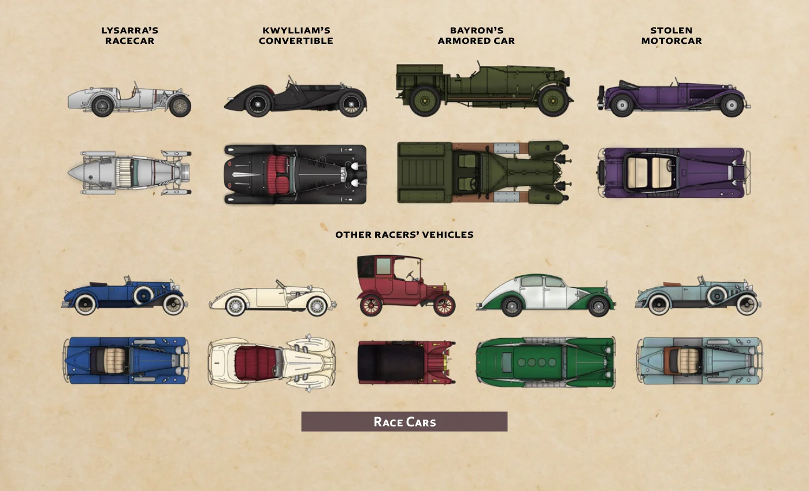
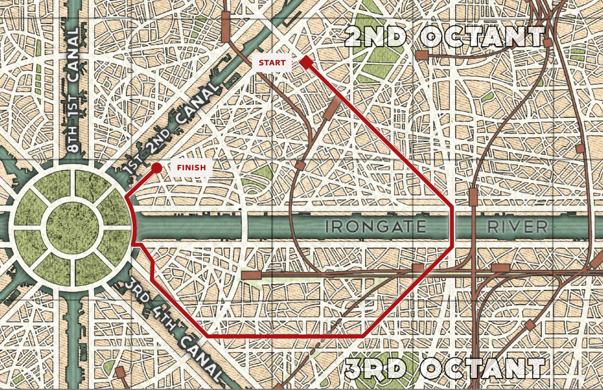

### 汽車競速大混戰

準備就緒後，焦點回到現在，來到比賽的後半段。PC 爭取前三名時，Bayron 與 Lysarra 會主動試圖淘汰他們，一向過度自信的 Kwylliam 則得意地穩居第一。依照本節所述，把這場街頭競速當作特殊試煉主持（見〈主持比賽〉）。

### 起跑名次

準備〈競速名次追蹤表〉和〈賽車〉，或找來 9 枚指示物。用名次軌記錄車手從第 9 名（最後）到第 1 名（領先）的相對位置。比賽中，車手向前移到新名次時，原先占據該名次的車手後退一名，兩者互換位置。隊伍的起跑名次取決於他們在〈油門踩到底〉累積了幾次失敗。

### 競速起跑名次

| 〈油門踩到底〉 失敗次數 | 隊伍的起跑名次 |
| --- | --- |
| 0 | 第 6 名 |
| 1 | 第 7 名 |
| 2 | 第 8 名 |
| 3 | 第 9 名 |

Bayron 從第 4 名起跑，Lysarra 從第 2 名起跑，Kwylliam 從第 1 名起跑。其餘名次由 NPC 車手補上。

### 特殊規則：其他車手

除了鍍金三人組與隊伍外，賽道上還有五名車手。他們沒有獨立的輪次，而是依隊伍車輛的位置，在追蹤表上前進或後退。所有車手都放上追蹤表後，請朗讀：

陽光下的回憶逐漸淡去，引擎的轟鳴和橡膠燒焦的氣味再度襲來。遠遠在前頭的 Kwylliam 把領先差距愈拉愈大，誰也追不上。但眼前有更迫切的麻煩。左邊，Bayron 那輛寬達兩倍的裝甲怪車貼得太近，正猛衝向前。右前方，Lysarra 那輛流線型銀色賽車正以毫不留情的精準手法穿梭。

### 特殊規則：勁敵行動

每回合開始時，Bayron Conrad 和 Lysarra Tekiel 各採取一項勁敵行動，詳見本節。若一項勁敵行動使 PC 後退 1 名，駕駛可以花費 2 專注點，把效果轉到最近的 NPC 車手身上，使其退出比賽。這不占用該 PC 本回合的貢獻。

Lysarra 的賽車、Kwylliam 的敞篷車、Bayron 的裝甲車

其他車手的車輛

偷來的汽車

賽車

CTHULHU ARCHITECT

PC 的行動將影響 Bayron 或 Lysarra 時，兩人也能各自花費 2 專注點抵銷效果，改讓最近的 NPC 車手退出比賽。

### Bayron 的勁敵行動

Bayron 的意識防禦為 17、靈魂防禦為 16，擁有 5 專注點，並可採取下列勁敵行動：

**增援路障。** Bayron 打出手勢，一名未具名的 NPC 車手便表明自己是他安插的人。將該車手移到 Bayron 正後方的名次。Bayron 可以免費把任何行動的效果轉到此人身上。

**小心爆炸。** Bayron 從車上發射一枚閃光彈。每名 PC 都必須進行 DC 13 的紀律檢定。駕駛若失敗，PC 後退 1 名。其他檢定失敗的 PC 陷入迷惑，直到各自的下一個輪次結束。

**鋼推。** Bayron 對著隊伍方向盤上的金屬握把施展鋼推。駕駛若未通過 DC 15 的運動檢定，PC 就後退 1 名。

### Lysarra 的勁敵行動

Lysarra 的意識防禦為 18、靈魂防禦為 18，擁有 6 專注點，並可採取下列勁敵行動：

**鋅助射擊。** Lysarra 靠鋅強化計算能力，調整後照鏡角度，以手槍打出一發看似不可能命中的子彈。駕駛若未通過 DC 15 的敏捷檢定，車輛就會受損，使駕駛的檢定獲得一個劣勢，直到有人通過 DC 13 的工藝檢定修好車輛。

**完美甩尾。** 她以無懈可擊的甩尾通過急彎，迫使其他車手減速、改道，或冒著撞車的風險。駕駛若未通過 DC 14 的推理檢定，PC 就後退 1 名。

**抄近路。** Lysarra 一頭鑽進窄巷，突然又在前方出現。駕駛若未通過 DC 15 的感知檢定，PC 就後退 1 名。Lysarra 可以選擇占據隊伍原先的名次。

### 主持比賽

比賽持續三個回合。每回合 Bayron 和 Lysarra 各採取一項新的勁敵行動，接著每名 PC 各作一次貢獻，試著提升隊伍的名次。每次成功讓隊伍前進 1 名（已是第一名時除外），每次失敗則後退 1 名。第三回合結束後，接續〈越過終點線〉。PC 可能遇到下列障礙：

**車流壅塞。** 擁擠的車流讓超車十分困難。駕駛的 PC 可以在兩輛車之間急轉穿過（DC 15 敏捷）、汲取鋅來瞬間算準位置，或觀察前方可鑽的空檔（DC 15 感知）。

**老練對手。** 一名好鬥的車手試圖從側面撞上隊伍的車。PC 可以把鬆脫的物品扔上道路（DC 14 運動）、射擊輪胎或其他脆弱部位（DC 14 輕型武器），或用嘲諷激得對方犯下關鍵錯誤（DC 15 威嚇）。

**車輛受損。** 其他車手或隊伍自己冒險駕駛，導致車輛受損。PC 可以鎖緊轉向連桿（DC 14 工藝）、補好漏液的管線（DC 15 竊術），或用蠻力將故障零件固定住（DC 15 運動）。

### 汽車競速大混戰

### 機遇與變故

| 結果 | 範例 |
| --- | --- |
| [機遇] | 另一名車手的引擎冒著黑煙爆開， 對方直接退出比賽。 |
| [機遇] | PC 拉開與其他車手的距離， 抵銷下一回合的一項勁敵行動。 |
| [變故] | 附近工地的碎屑卡住車輪。 隊伍必須通過 DC 13 的竊術檢定清除碎屑， 才能提升名次。 |
| [變故] | 前方車輛擠得太緊，難以各個擊破。 選擇 Bayron 或 Lysarra。本回合， 所選對象無法成為目標。 |
| [變故] | 旁觀者衝上道路。任何需要視線或瞄準的行動 都獲得一個劣勢，持續 1 回合。 |
| [變故] | 車胎在油漬上打滑， 車身打轉。後退 1 名。 |

第 5 章：引擎與諜報 98

### 越過終點線

三個回合後，比賽結束。結果取決於 PC 在追蹤表上的最終名次：

**第一至第三名，獲勝。** Kwylliam 笑著邀請 PC 參加賽後派對。「晚點派對見吧？你們這群人挺有意思。如果你們對待古物也跟開車一樣，檔案館可熬不過今晚。」接續〈上流社會劫案〉。

**第四至第九名，落敗。** 隊伍若未進前三名，就不會受邀參加派對，必須另想辦法進入國家檔案館。接續〈無請柬潛入〉。

### 無請柬潛入

PC 沒有請柬，必須想個別出心裁的辦法混進派對，偷取勳章也會變得更困難。他們可以嘗試下列方式：

**正門。** 正門有保全把守。PC 必須通過困難的 DC 22 隱匿檢定才能進去。失敗便會被直接請出門外。

**員工入口。** PC 若通過 DC 18 的隱匿或欺騙檢定，可從側門進入，但還得打扮成侍者，穿過擁擠的員工區才能抵達主展廳。只要 PC 仍穿著員工服裝，在〈上流社會劫案〉中進行的每項社交檢定都獲得一個劣勢，直到有機會換上適合派對的服裝。

**Wilko 的備案。** 若所有辦法都失敗，一名穿綠袍的檔案管理員會現身相助。此人是 Wilko 教授的聯絡人，檔案管理員 Wynn Letrelle（顧問，使用 they/them 代名詞）。Wynn 最終會讓 PC 進去，但隊伍會遲到，引起檔案館保全隊長的注意（見〈攔截：保全隊長 Vorn〉）。

進入會場後，接續〈上流社會劫案〉。

### 汽車競速大混戰路線

### 終點

### 起點

### 第三分區

### 第三分區

### 第二分區

### 第二分區

第 5 章：引擎與諜報 99

ISAAC STEWART

