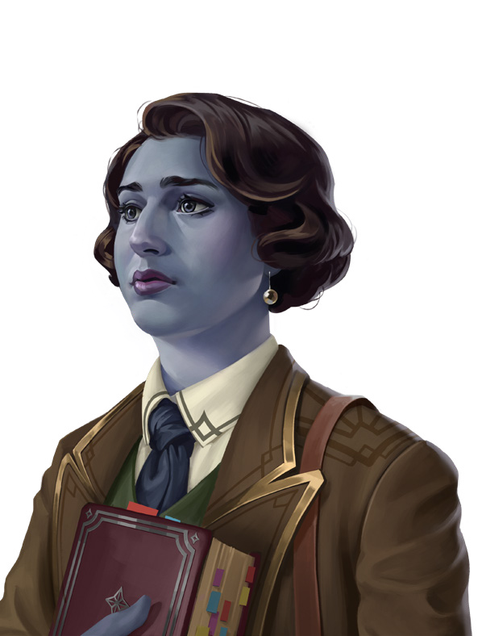
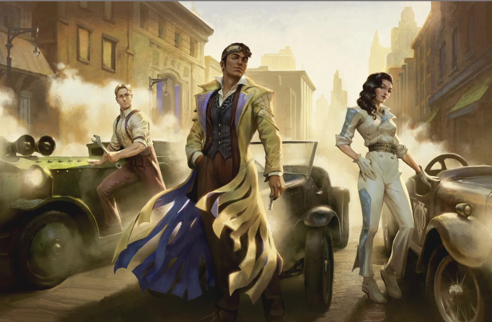
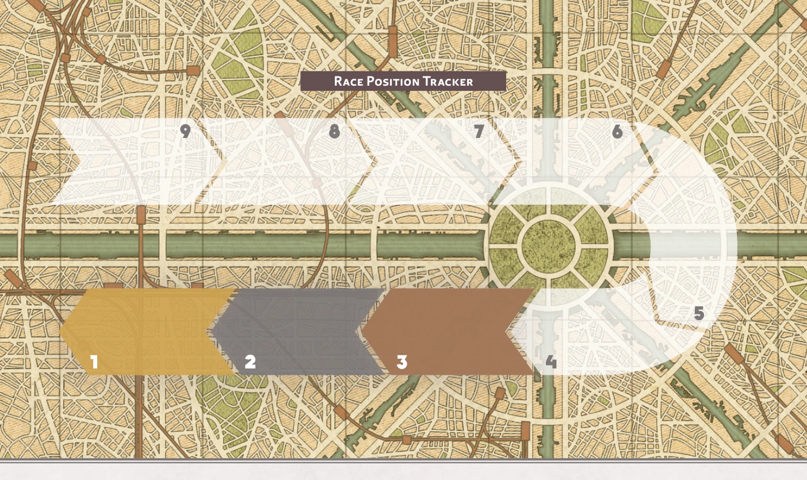

### 主持本章

### 第 5 章

### 引擎與諜報

統御主倒台三個世紀後，《迷霧之子傳承》的第二時代篇章揭幕。司卡德利亞曾經灰燼與迷霧瀰漫，如今靠著引擎和火藥的力量，成了令人驚嘆的工業世界。時代變了，登場的角色也換了。Vadilek 沾滿鮮血的傳承一路影響後世，第二時代也迎來一支新的英雄隊伍，以及鍍金三人組帶來的新威脅。

如果玩家還沒建立第二時代角色，請依本書導言「建立角色」一節的指示完成。這些角色以 3 級開始。三個世紀以來，司卡德利亞的社會、科技和經濟都發生了巨大變化，貴族卻依然過著揮霍無度的生活。在本章，第二時代的新隊伍將伴著輪胎的尖嘯，在眾目睽睽下從貴族手中偷回一點特權。

### 本章流程

開始前，請印出或備妥「國家檔案館竊案地圖」講義（見附錄 D）。印出並剪下本章稍後的「賽車」，或準備九枚指示物，再印出或備妥「競速名次追蹤表」。故事開始時，PC 正參加一場慶祝 Lysarra Tekiel 生日的非法汽車競速。這場比賽由野心勃勃的年輕實業家 Bayron Conrad 主辦，Kwylliam Elariel 是奪冠熱門。這三名 NPC 組成鍍金三人組，是第二時代的主要反派，請先閱讀本書導言「重要角色」中他們各自的條目。比賽中途會倒敘到前一天，PC 在這一幕會見長期與他們合作的 Azmine Wilko 教授，她也有條目收錄在「重要角色」。Kwylliam 賄賂了國家檔案館，讓原本要交給 Wilko 的一箱古物改送他處。Wilko 因此請 PC 在 Kwylliam 取走箱子之前先把它偷出來。

汽車競速是竊案的第一階段。前三名車手能獲邀參加 Lysarra 的私人生日續攤派對，地點就在國家檔案館。PC 會在那裡設法偷走 Kwylliam 的檔案館徽章。接著，PC 潛入檔案館下層取回箱子。一項負面事件會追蹤 PC 是躲過檔案館的警備，還是觸發封鎖。PC 發現箱子已被轉送到一間有嚴密警報的保險庫，讓隊伍的計畫再添一道難關。搶到箱子後，PC 在守衛的追趕下逃出檔案館，最後與鍥而不捨的雙生師警備隊長 Eliane Vorn 交戰。PC 在檔案館竊案中取得的成功次數，決定他們必須抵擋警員多久。最後一幕倒敘中，PC 會敘述他們如同電影情節般的脫身計畫，然後把箱子交給 Wilko，為本章畫下句點。箱子裡有「創始者之鑰」和一面化裝舞會面具。面具是所謂鍍金地圖的第一塊碎片，後續會揭曉鍍金地圖就是第 4 章中 NeBaal 的地圖。

### Azmine Wilko

### 教授

92

TRISTAN BIDEAU

### 發動引擎

### Wilko 的祕密

PC 並不知道，Wilko 剛加入守護者組織。這個跨越時代的祕密結社肩負保護永恆尖刺的任務（見附錄 F）。Wilko 知道的事並沒有比 PC 多多少，原因很簡單。她是出色的學者，卻一點也不擅長說謊。Wilko 受命取得面具和鑰匙，但她一承認這兩件物品的存在，就已經向 PC 透露了超出分寸的資訊（見接下來的「我們怎麼來到這裡？」）。如果 PC 在本章追問她，Wilko 很快就會招架不住，說出面具和鑰匙與鍍金地圖有關。她相信那是一場古老的祕密尋寶活動。她知道，絕不能讓面具和鑰匙落到 Kwylliam 這類人手裡。不過，有幾件事她堅持不透露。雖然看得出她瞞得很辛苦，但她堅決不說出守護者組織的名字，也不承認自己加入過任何祕密組織，至少在第 5 章如此。

跨時代連結

在「我們怎麼來到這裡？」場景中，Wilko 招募隊伍去取得一箱古物。Wilko 並不知道，箱內有鍍金地圖的第一塊碎片，也就是第 2 章 Cadme 的面具，以及一把能打開 NeBaal 銀色甕上鎖頭的鑰匙（見第 6 章）。後續將揭曉鍍金地圖就是第 4 章中 NeBaal 的地圖。

第 5 章：引擎與諜報 93

### 角色升級

第二時代的角色以 3 級開始本冒險，竊案結束後抵達 Wilko 的辦公室時升至 4 級。PC 在 38.4B 號箱裡找到第一時代隊伍的血金術筆記後，可以開始「學習血金術」目標（見本書導言的「處理血金術」）。他們可在第 6 章的休整期推進這項目標，也可能完成它。

本章一開始就切入行動。PC 已坐進自己的汽車，和另外八名車手一起等候發令槍響。在依藍戴街頭進行汽車競速並不合法，但今晚 Bayron 已經買通警員。

### 起跑線

冒險開始時，請朗讀下文。

春夜清涼，空氣裡全是機油和汽油的氣味，還有按捺不住的期待。依藍戴這座鋼鐵大城的某處，鐘樓敲了十一下，鐘聲淹沒在四周汽車的低吼聲中。你們右邊，Kwylliam Elariel 悠閒地靠在一輛擦得發亮的黑色賽車裡，打量其他對手。這位奪冠熱門嘴角掛著一抹輕蔑的笑，嘲弄的眼神藏在反光護目鏡後。他的翻領上有東西閃著金光，那是件重要的東西。三……你們的汽車迫不及待地轟鳴……二……盯緊目標，別忘了你們為什麼來這裡……一……

請玩家決定由哪名 PC 駕駛，以及其他人一開始坐在車內哪個位置。比賽中，駕駛進行技能檢定來操控汽車，乘客則採取行動支援駕駛。PC 可以幫忙指路、射破對手的輪胎、運用金屬之子的能力妨礙對手，甚至選準時機出言嘲諷。

### 駕駛

每回合，駕駛都必須以一項和駕駛直接相關的檢定作出貢獻。每回合開始時，問玩家是否想更換駕駛。若要更換，駕駛花費 1 專注點，和另一名 PC 交換位置。新駕駛在該回合進行的檢定都要提高賭注。如果汽車沒有駕駛，每名 PC 在該回合的檢定都承受一個劣勢。

### 油門踩到底

這一幕涵蓋比賽的前半段，隊伍會依序與三名勁敵車手交鋒，先是 Bayron Conrad（he/him），接著是 Lysarra Tekiel（she/her），最後是 Kwylliam Elariel（he/him）。請將本場景當作一場試煉來主持（見「結算試煉」）。每名勁敵都是一道障礙。PC 必須取得兩次檢定成功才能克服障礙，保住名次。檢定失敗時，描述這名勁敵如何揚長而去，然後接著應付下一名勁敵。

### Bayron 的猛攻

比賽開始時，請朗讀下文。

發令槍一響，輪胎尖嘯，煙霧四起。你們左邊，實業家、發明家兼比賽主辦人 Bayron Conrad 駕著一輛裝有鋼板、車身鉚著深綠色外殼的汽車，轟然向前。他的聲音從鎖在引擎蓋上的擴音器傳來，夾雜著雜音。「你們就開這輛？那款車有個丟臉的設計缺陷。希望你們有加固車軸！」Bayron 的重型汽車猛然朝你們切過來。他大喊：「敢闖才有明天！」

隊伍必須躲開或扛住 Bayron 的猛攻。他們可以大聲指揮駕駛，靠操控甩開 Bayron（DC 12 領導），準備承受撞擊（DC 14 運動），或找出 Bayron 的大車轉不過去的髮夾彎（DC 15 推理）。取得 2 次成功或 1 次失敗後，進行「Lysarra 搶越平交道」。

### Lysarra 搶越平交道

PC 克服 Bayron 的障礙後，就會遇上 Lysarra。請朗讀下文。

Lysarra Tekiel 的流線型銀色汽車直切車陣前方。這場比賽是為她舉辦的，而她駕車既狡猾又精準。這位太齊爾家族的繼承人以慈善事業、機智和野心聞名，坐在方向盤後也一樣難以對付。前方的街道逐漸收窄，兩側的多層樓房愈靠愈近。一處鐵路平交道橫越筆直的路面，駛近的列車轟隆作響。就在最後一刻，Lysarra 猛踩油門。列車汽笛大作，印有太齊爾家族標記的柵欄也開始降下，時間算得恰到好處，正好在 Lysarra 身後、你們面前關上。

Lysarra 的這一手把隊伍困在鐵軌另一側。PC 可以尋找替代路線（DC 14 求生），趕在柵欄落下前加速通過（DC 16 敏捷），或拿太齊爾家族每況愈下的生意嘲諷 Lysarra，分散她的注意力，好超越她（DC 16 學識）。取得 2 次成功或 1 次失敗後，進行「Kwylliam 的煽動」。

### Bayron、Kwylliam 和 Lysarra

準備參賽。

JORDAN KERBOW

### 我們怎麼來到這裡？

### Kwylliam 的煽動

PC 克服 Lysarra 的障礙後，接著遇上 Kwylliam。請朗讀下文。

Kwylliam Elariel 把這場比賽當作表演。他不慌不忙地開在第一，彷彿早已獲勝，只等其他人也明白這一點。在一處人群擁擠的路口，Kwylliam 回頭瞥了一眼，懶洋洋地啜了一口銀色扁酒瓶裡的飲料。下一瞬間，場面大亂。觀眾和路人在 Kwylliam 的煽動下湧上街頭，互相推擠，尖叫聲此起彼落。

為了穿過驚慌的行人，PC 可以用自己的情緒鎔金術反制、憑直覺掌握人群流向以找出安全路線（DC 15 洞察），或大聲喝令眾人讓路（DC 16 領導）。取得 2 次成功或 1 次失敗後，進行「結算試煉」。

### 油門踩到底的機遇與變故

| 結果 | 範例 |
| --- | --- |
| [機遇] | PC 讓對手亂了陣腳。玩家可以描述 如何趁對手措手不及，用一項相關技能 與目前的對手進行對抗檢定。成功時， 隊伍立刻超越對手。若對手成功， 這次檢定不計為 試煉中的一次失敗。 |
| [變故] | 一團塵土揚起，撲了駕駛滿臉。 駕駛的檢定承受一個劣勢， 直到換另一名 PC 駕駛。 |

### 結算試煉

這場試煉只記錄 PC 累積的失敗次數。這個數字決定隊伍在比賽後半段的起跑名次（見「汽車競速大混戰」）。

### 嘲諷的敬禮

試煉結束時，請朗讀下文。

街上的人群散開片刻，正好讓你們瞧見 Kwylliam 那輛閃亮的黑色汽車甩出一道弧線，精準地繞過噴水池。他一手握著方向盤，探身出窗，嘲弄地行了個禮。汽車向前疾馳，回憶也湧上心頭。回到一切的開端，回到比賽之前，甚至計畫之前。一路回到依藍戴大學歷史系的 141 室，Azmine Wilko 教授的辦公室。

這段倒敘發生在比賽前一天，地點是 Azmine Wilko 教授（she/her）的辦公室。扮演 Wilko 的提示見本書導言的「重要角色」。開始倒敘時，請朗讀下文。

陽光灑在 Wilko 教授的辦公桌上，地圖和貨物清單攤得到處都是。Wilko 穿著粗花呢西裝，皺著眉思索，翻閱一份蓋有 Elariel 家族印記的文件夾。「它現在本來該到了，但 Kwylliam Elariel 顯然『捐』了一筆大得荒唐的錢給檔案館董事會。我的聯絡人 Wynn 說，這個箱子已經被『改送』，編入兩天後要送往 Elariel 家族宅邸的貨物。現在就得阻止 Kwylliam。」Wilko 神情專注地望向你們，望向她的同事和朋友。「我需要你們幫忙。我知道你們擅長『解放』最後帝國的古物，現在這個箱子也需要你們解放。」

請每名玩家描述角色的外貌，以及這個角色在團體中以什麼聞名。大家說完後，請朗讀下文。

「你們得從國家檔案館偷出一個箱子，

編號 38.4B。有人託我保管它，我得在 Kwylliam 把它改送到自家門口前確保它的安全。」她遞給你們一張手繪地圖。

Wilko 憑記憶畫下國家檔案館下層的草圖。把附錄 D 的「國家檔案館竊案地圖」講義交給玩家，再朗讀下文。

「這是檔案館下層。箱子被改送到宅邸貨物轉運室。你們得先進入檔案館，再弄到一枚徽章，才能打開下層的門。這事平常可不容易。」教授露出心照不宣的微笑。「幸好，明天有一場非法的街頭汽車競速。

只要你們拿到前三名，就能獲邀參加檔案館的續攤派對，也有機會偷走 Kwylliam 的徽章。」

第 5 章：引擎與諜報 95

### 一

### 張

### 競

### 速

### 名

### 次

追蹤表，標有第 1 到第 9 名，前三名分別以金、銀、銅色標記。追蹤表疊在城市地圖上作為裝飾，繞著重生之野彎曲。

第 5 章：引擎與諜報 96

ISAAC STEWART

競速名次追蹤表

Wilko 邀請 PC 提問，例如以下問題。

箱子裡有什麼？「全部的東西嗎？我……呃，

我不完全確定。」她猶豫了一下，顯然有些掙扎，接著趕緊說：「但我知道有兩樣東西很重要，一面面具和一把鑰匙。等你們把箱子拿回來，我希望能再深入研究。」如果 PC 繼續追問，請參考本章前面的「Wilko 的祕密」。我們要怎麼進去？「董事會成員的徽章

可以打開檔案館上鎖的門，避免觸發警報。最容易到手的徽章就別在 Kwylliam Elariel 的翻領上。拿到它，你們就能進入下層的宅邸貨物轉運室。」比賽是怎麼進行的？「只有

前三名會受邀參加檔案館的續攤派對。主辦方鼓勵互相競爭，但當然不能動手殺人。報名費我出，汽車得由你們自己準備。」還有什麼我們該知道的？「Kwylliam 從來不會

獨自行動。他和 Bayron Conrad、Lysarra Tekiel 形影不離。相信我，我在大學時就認識他們。惹上一個，就得面對三個。」

PC 問完後，Wilko 用一句話結束討論：「你們打算怎麼做？」

### 做好準備

請每名 PC 描述自己為計畫做了哪一項貢獻，再進行一項相關技能檢定。可採取的做法包括以下幾種。

弄到車輛。用任何必要的手段取得

一輛汽車（DC 14 竊術）。勘查路線。研究比賽路線，找出捷徑

和危險地點（DC 13 推理或 DC 14 求生）。摸清目標。研究 Kwylliam 的習慣，或監視

Bayron 或 Lysarra（DC 15 洞察或 DC 16 隱匿）。準備驚喜。在汽車上裝一個

只能用一次的裝置（DC 14 工藝）。

每次成功時，提出一項 PC 可在「汽車競速大混戰」場景中使用一次的好處，例如下列效果。

改裝車輛。如果 PC 能解釋

汽車上的改裝如何幫得上忙，就將一次失敗的檢定視為成功。事先掌握情報。利用蒐集到的比賽路線情報，

忽略一次變故。請人幫忙。讓一名聯絡人干擾比賽，

阻止一名對手採取其中一項行動。駕駛訓練。前進 1 名後，以另一項技能

進行一次額外檢定，立刻試著再前進一名。

