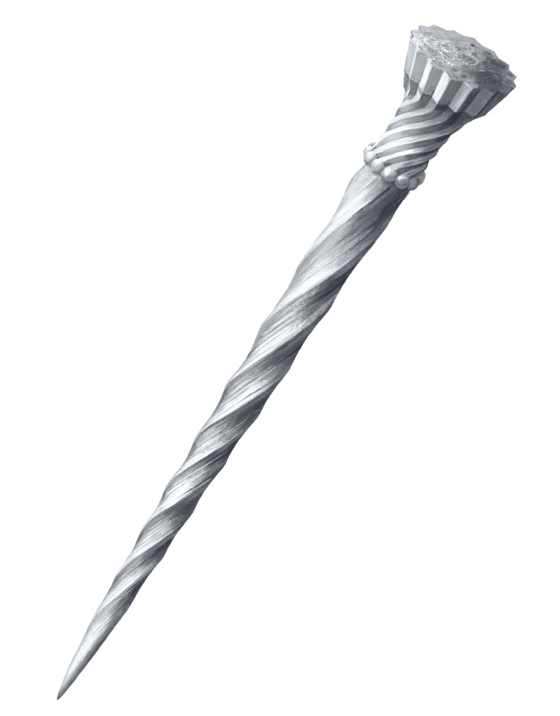

永恆尖刺（Eternity Spike）是《迷霧之子傳承》兩個時代的故事核心。它是一枚蘊含大量授予的鎳鉻血金術尖刺，製造過程中有超過一千人遭到折磨和殺害。Vadilek Elariel 希望用這枚尖刺賦予統御主的合適繼承人力量（見本書導言的「冒險背景」），留下由野心、權力與祕密交織而成的傳承，其影響將延續數個世紀。

### 造神

永恆尖刺原本要搭配由犧牲鎔金術師和藏金術師製成的輔助尖刺陣列使用。Vadilek 最初的陣列至少有八枚尖刺，其中有他自己的鋼鐵審判者尖刺，也有他祕密教導的學生團體 Gilded Few 所化成的尖刺。這些學生為了實現導師的願景，自願獻出生命。第二時代，最初那批 Gilded Few 的後代暗中帶著這些家傳尖刺，其中包括 Vadilek 的尖刺和後來製造的尖刺。

僅供主持人閱讀

發現永恆尖刺的特性與用法，是《迷霧之子傳承》的重要情節。以下說明僅供主持人閱讀。

### 永恆尖刺

特殊裝備，1 磅。

這枚銀灰色尖刺大約有成人手掌那麼長。刺身呈扭曲的條紋，尖刺頭部是有 16 個面的多面體。永恆尖刺以鎳鉻製成，注入了從一千多名受害者身上取得的大量授予。獨特特性。永恆尖刺有下列獨特特性：

堅不可摧。第一時代和第二時代都沒有已知的方法

能摧毀永恆尖刺。尖刺蘊含的龐大授予使它近乎無法破壞，無法彎折、刮傷、熔化或以其他方式損傷。蘊含大量授予。由於永恆尖刺內儲存了大量授予，

它的運作方式與一般血金術尖刺不同。離開儲存介質（例如血液）後，它也不會失去力量。排斥迷霧。司卡德利亞的迷霧會被

永恆尖刺排開。接觸反應。裸露的皮膚一碰到尖刺，

尖刺就會發出鎔金脈衝。持用者和每個相鄰角色都會感受到一陣明顯的能量波。80 呎內任何正在燃燒青銅的角色都能察覺這陣能量波，無須檢定。昇華儀式。要使用尖刺，承載者

必須已植入審判者所用的鎔金術與藏金術尖刺陣列。永恆尖刺植入後，會把宿主變成血金術怪物。

### 附錄 C

### 永恆尖刺

ANNA VERHOOG

242

