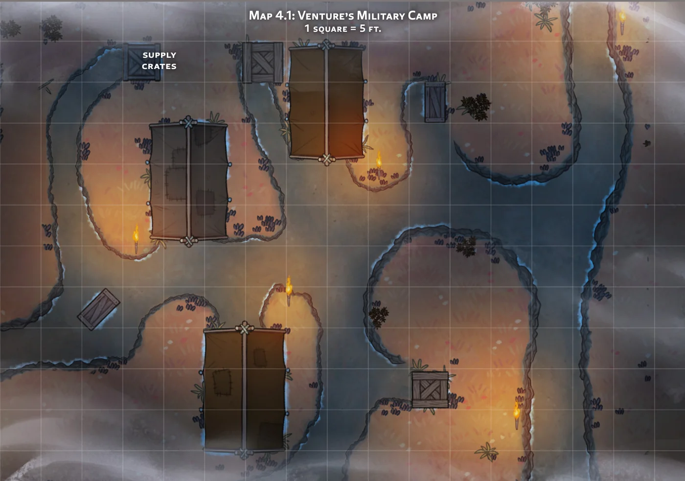
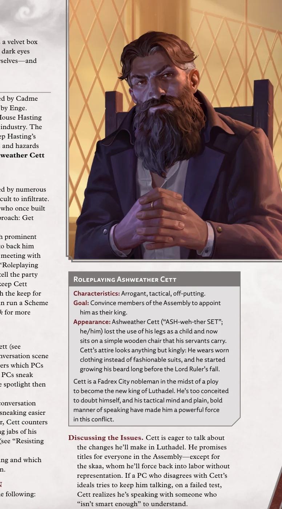
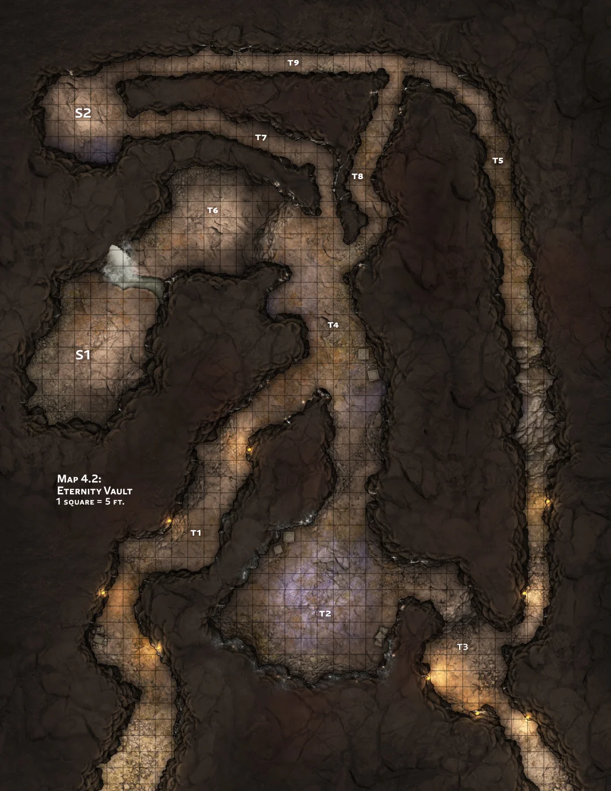
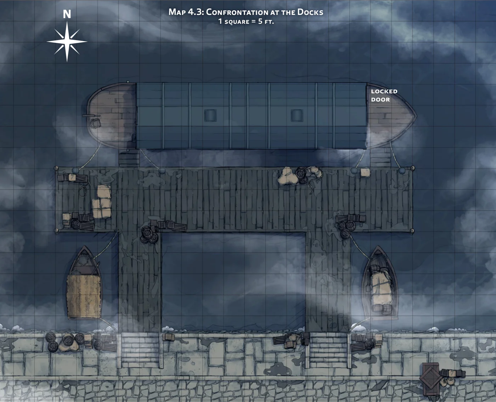
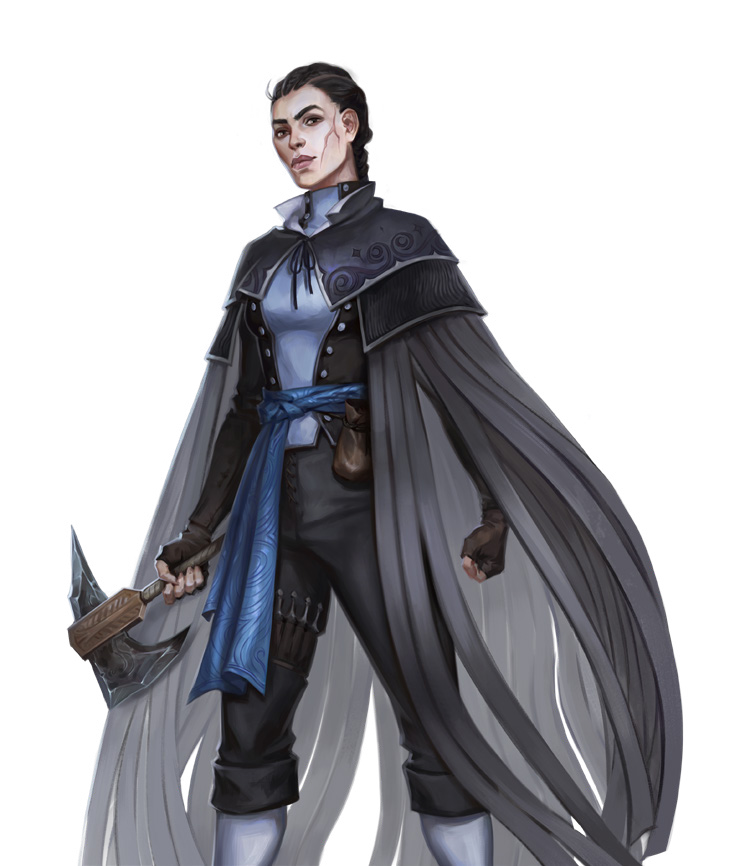
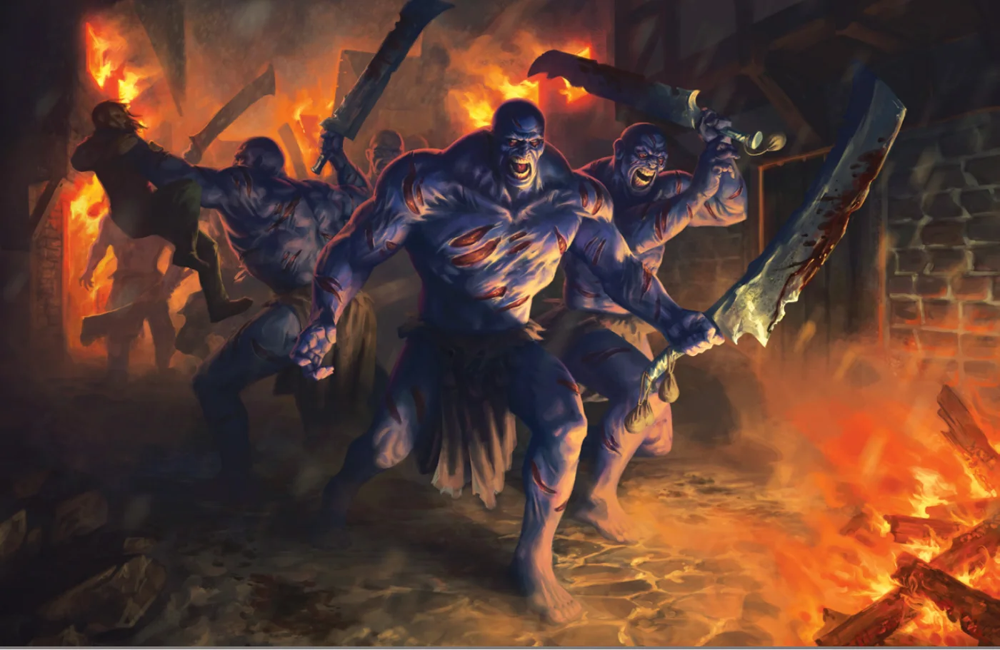

### 主持本章

### 蒐集資源

### 第 4 章

### 永恆寶庫

74

得知隧道位置後，PC 著手在陸沙德地下建造一座安全的寶庫。唯有如此，他們才有希望永遠不讓永恆尖刺落入 Gilded Few 手中。

本章中，隊伍先前做出的選擇會影響寶庫的建造過程。接下來就是第一時代冒險的最終決戰。Delina 找上 PC，NeBaal 長久隱藏的祕密也終於曝光。之後，若有 PC 勇於自告奮勇，還有最後一項令人膽寒的任務等著他們。NeBaal 懇求英雄協助保存寶庫位置的線索，為後世留下希望，待未來的人實現。

### 本章流程

開始前，請準備或印出「寶庫陷阱」和「NeBaal 的告白」講義，並為每名玩家準備一份附錄 D 的「我的傳承」講義，或一張白紙。另請準備一份地圖 4.2。本章中玩家需要在寶庫配置圖上繪製內容，使用數位版或紙本均可。兩週休整期結束後，PC 召集盟友，規劃如何建造寶庫。遊戲開始前，請先看過「規劃會議」與「建造寶庫」。會議之後，隊伍必須為寶庫工程做準備，透過試煉前往塞特占領的海斯丁堡和史特拉夫．泛圖爾的軍營竊取物資。行動之間穿插與 Guiverre 和 Enge 的角色扮演場景。PC 完成寶庫後不久，就會與 Delina 正面交鋒。請事先閱讀「正面交鋒」，並仔細讀過「犧牲之舉」和「NeBaal 的告白」，因為這些戲劇性場景會揭露 NeBaal 的真實身分。Delina 落敗後，「一夜沉思」讓 PC 有機會回顧自己的傳承，第 9 章會用到這些內容。

第一時代接近尾聲時，PC 會在「為明日而戰」中決定是否接受 NeBaal 的最後一項任務。這項任務既驚險又極其致命。主持本節之前，請先閱讀「呈現陸沙德之戰」與「英勇犧牲」特殊規則。NeBaal 的這項最終任務發生在陸沙德之戰期間，其結果會影響第一時代的故事如何延續到第二時代。

### Delina 的執念

Delina 自第 2 章的舞會以來，就從自己在 Fellise 的據點追蹤 PC。隊伍當時險險逃脫，讓她怒火難消。Delina 的執念既在永恆尖刺，也在「Enge」本人。嫉妒與野心讓 Delina 非要弄清這名自稱 Enge 的女子究竟是誰。她明知對方理應已死，Vadilek 最後卻為了袒護這名女子而拒絕了她。這一章中，Delina 非得到答案不可，哪怕賠上性命。

### 角色升級

第一時代的角色以 5 級開始本章。寶庫完成後，他們升至 6 級，這是第一時代戰役中最後一次升級。取得 Guiverre、Vadilek 或 Duvall 血金術筆記的 PC，可以在休整期推進「學習血金術」目標（見本書導言的「處理血金術」）。

要在陸沙德下方的隧道建造寶庫，PC 必須召集盟友、擬定計畫，並取得所需資源。

### 陸沙德的休整期

本章以十四天休整期開始。這段時間，Enge 仔細勘查陸沙德下方的祕密隧道，尋找合適的藏匿地點。請依附錄 E「陸沙德的休整期」一節的規則主持這段休整期。請告訴玩家，這是第一時代故事最後一次休整。你可以趁此機會與玩家一起完成 PC 尚未完成的目標。

### 規劃會議

休整期結束時，Enge 召集 PC 和所有盟友，到 Kandor 營造公司祕密開會。請朗讀下文。

Kandor 營造公司的倉庫裡，人人都像在密謀什麼。

倉庫在這幾週已修補過，殘留的灰燼與焦木臭味幾乎聞不到了。一張大桌子被拖到中央，上面擺滿筆記和地圖，四周圍著一張張熟悉的面孔。

### 共謀者

描述有哪些 NPC 出席這場會議。PC 在冒險中結交的盟友都可能在場，Guiverre 除外（見「Guiverre 的禮物」）。Cynwise、Cadme、Anastas、德穆，以及 Kandor 營造公司值得信賴的 NPC 都有可能出席。讓 PC 和盟友打聲招呼。幾名盟友如果在場，可能會帶來新消息。Cadme 和 Anastas 可能提起兩人的祕密婚禮，Kandor 則會抱怨圍城期間利潤有多薄。等大家安頓下來，Enge 就會說明計畫。

### 計畫

Enge 勘查陸沙德地下時，發現了建造寶庫的理想地點。洞穴內天然的金屬礦藏會妨礙任何單靠鎔金術尋找永恆尖刺的嘗試。通往洞穴的隧道又深又錯綜複雜，連整支軍隊都可能迷路。這裡正適合讓尖刺存放好幾個世代。為了保密，Enge 打算讓全體施工人員發誓守密，並蒙上他們的眼睛。接著，由她和 PC 護送他們進出隧道。這麼做很耗時間，但寶庫的位置必須嚴加保密。

### 寶庫資源

Enge 說明，PC 需要三種資源來建造寶庫並布置陷阱。

圖紙決定 PC 能打造多複雜的

陷阱。人力決定 PC 能多有效地打造

這些陷阱。材料決定 PC 能打造多少陷阱。

PC 召集盟友並做好準備後，資源總量就會增加。讓玩家看附錄 D 的「寶庫陷阱」講義。上面列出了可加進寶庫的陷阱，以及每種陷阱需要的資源。PC 蒐集的圖紙、人力與材料越多，完成的寶庫就越安全。陸沙德已被圍困一個半月有餘，這些資源很稀缺，但 Kandor 營造公司捐出了一些初始物資。隊伍因此獲得 5 材料，足以建造一座只有少量防禦的簡易寶庫。

### 盟友與加成

此時，盟友會說明自己能提供什麼。

德穆。如果 PC 在第 3 章讓德穆印象深刻，

他就會向初創的倖存者教會求助。人力增加 2。Cadme 和 Anastas。如果 PC 在第 2 章撮合了

這對戀人，兩人就會動用人脈尋找有用的情報與物資。圖紙和材料各增加 1。Bezryl。如果 Bezryl 領導 Kandor 營造公司，她會

不辭辛勞地替 PC 研究，仔細翻查她的金屬意識庫。圖紙增加 2。Kandor。如果 Kandor 領導 Kandor 營造公司，他會

延後自己的工程以支援隊伍。材料增加 2。Cynwise。如果 Cynwise 的工人集體領導 Kandor

營造公司，他們就能號召許多人前來幫忙。人力增加 2。難民。如果 PC 曾嘗試進行選用的

「安置難民」休整活動，Aime、

Roben、Tuss 和 Pella 都會出力。人力增加 1。

### 隊伍的運河船

第 4 章：永恆寶庫 75

RYAN SMITH

### 最後準備

PC 一路上可能還結交了其他盟友。你可以把適合的 NPC 加進名單，每加入一名角色或一個團體，人力就增加 1。

街童傳承時刻

告訴街童，他在陸沙德的社群可以出手相助，無論是 Kandor 的商人或 Cynwise 的人脈。主持一段支線場景，讓街童的熟人提出用各種人情湊出人力和材料，條件是街童捐出一些盒金，幫助他們長期撐過圍城。詢問街童是否同意，記下他願意投入社群的盒金數量。只要街童捐出任何盒金，社群便會加入，人力和材料各增加 1。到了第二時代，街童投入的資金可能透過其人脈回到企業家手中。

### 祕密永遠不會只有一個

規劃會議接近尾聲時，Enge 把話題轉向未來。這段討論主要是為了逐步揭露 NeBaal 打算製作鍍金地圖的計畫。鍍金地圖是第二時代冒險的關鍵物品。Enge 沉思道，永恆是一段很長的時間。她相信團隊和寶庫能在他們有生之年護住尖刺，但一百年後呢？人終有一死，寶庫也可能失守，珍貴而無可取代的東西或許就此永遠失落。因此 Enge 坦承自己一直在籌劃另一個計畫。她要保守祕密，也要留下能傳承這份知識的方法，確保尖刺有人看守、有人保護，或許有一天還能用來造福他人。其他盟友若在場，也會說出自己的想法。

- Bezryl 敦促團隊保存知識。她認為唯有從過去汲取教訓，才能防止悲劇重演。

- Cynwise 認識一些受害者，堅稱朋友的死不應只讓「某個貴族變得更強」。

- Cadme 想起在司卡反抗軍的日子，告誡大家，重要的祕密不該只託付給一個人。

Enge 邀請 PC 發表看法，但到了場景尾聲，她已下定決心。她打算找個方法保存寶庫位置的線索。NeBaal 其實早已著手進行這項計畫，可能正為瞞著大家而內疚（見本章稍後的「NeBaal 的告白」）。Enge 告訴團隊她會離開幾天，但會在工程完工前回來會合。

寶庫開工前，PC 只有幾天可以準備，期間有機會扮演角色並取得資源。本節包含《迷霧之子》小說的重要角色與派系。如果你需要 NPC 指引或主持靈感，可參考《迷霧之子世界指南》第 5 章的「塞特家族」與「泛圖爾家族」。以下四個場景都發生在「建造寶庫」之前，可以任意排序。

Enge 的小提議。如果 PC 或 Enge

拔除了 Duvall 的尖刺，Enge 會提議使用它。竊取物資。PC 潛入泛圖爾的

軍營尋找物資。Guiverre 的禮物。如果 PC 先前爭取到 Guiverre 的支持，

他會帶來一份珍貴的禮物。海斯丁堡的圖紙。PC 設下詭計，

從塞特占領的堡壘偷走圖紙。

### Enge 的小提議

只有 Duvall 被殺，且 PC 或 Enge 取得了他能賦予鋅鎔金術的青銅血金尖刺時，才會出現這段角色扮演場景。Enge 一直妥善保管那枚尖刺，現在她提議讓一名 PC 使用。請朗讀下文。

「我就直說吧，我覺得是時候以牙還牙了。

我也不想這麼做。」Enge 皺著臉，急忙補充。「但 Gilded Few 已經在這麼做了。如果我們不跟上，就又比他們落後一步。我們得用盡一切辦法，別讓永恆尖刺落到他們手裡。」她指向浸在血中的尖刺。「不過，還是由你們決定。怎麼說？」

如果一名 PC 接受 Enge 的提議，具有血金術師專長的角色可以替他植入尖刺。如果沒有 PC 具備這項專長，Enge 會自告奮勇。若 PC 詢問她在哪裡學會血金術，Enge 會說是 Vadilek 教她一些基礎。這是實話，NeBaal 與他共事時確實學了幾招。不過，PC 也可能合理地懷疑 Enge 怎麼會提議使用血金尖刺。成功通過 DC 15 的洞察檢定，便能發現 Enge 有所隱瞞。若 PC 追問，請參考本書導言的「處理 NeBaal」，了解 NeBaal 可能如何揭露真相。

第 4 章：永恆寶庫 76

### 竊取物資

由隊伍最信任的 Kandor 營造公司 NPC 引介這場竊取材料的試煉，可能是 Kandor、Bezryl 或 Cynwise。史特拉夫．泛圖爾的軍營就駐在陸沙德城門外，兵力龐大，組織嚴密。軍需品可以改作寶庫的建材，但要弄到手得執行一項分成數個階段的任務。可信任的 NPC 會介紹任務，並說明以下障礙。

- 兩支軍隊正圍困城市，又有人發現第三支軍隊正靠近，要自由進出可不容易。

- 泛圖爾的營地到處都是士兵和聖務官，連史特拉夫的迷霧之子兼私生子都在附近出沒。

- 物資肯定又重又難搬。

如果 PC 接受任務，請以試煉主持竊取物資的過程，詳見「出發行動」。本場景會用到兩名可能登場的 NPC 的特殊規則，分別是詹和愛瑪蘭塔。

### 特殊規則：詹

PC 在史特拉夫的營地首次累積兩次檢定失敗時，會遇上一名穿著一身黑衣的古怪青年。士兵看起來全都怕他。這人是詹（迷霧之子刺客，he/him），史特拉夫的迷霧之子兼私生子。詹知道 PC 在暗中動手腳，但除非試煉失敗，否則他不會出手。他會留在附近問東問西，配合 PC 編出的謊話，彷彿他也知道這場玩笑的內情。不過，他偶爾似乎會被看不見的東西分散注意。詹在場時，PC 在史特拉夫營地進行社交檢定可獲得 +2 加值，但若試煉失敗，他會讓接下來的戰鬥困難得多。

### 特殊規則：愛瑪蘭塔

隊伍第五次檢定成功後，會被史特拉夫．泛圖爾的祕密藥草師愛瑪蘭塔（平民，she/her）逮個正著。她急著破壞泛圖爾的計畫，便告訴 PC 哪裡還有幾箱物資。PC 必須做出選擇。若去拿額外的箱子，這場試煉取得的材料可以加倍，但必須再取得 2 次成功，總計 8 次。

### 地圖 4. 1：泛圖爾的軍營

1 格＝5 呎。

物資箱

ZACHARY CREPEAU

### 出發行動

PC 必須完成一場試煉才能偷走物資（見「結算試煉」）。他們可能遇到以下障礙。

出口戒備森嚴。隱密的出口很難找。

PC 可以四處打聽（DC 16 說服），或回想關於出城暗門的傳聞（DC 18 學識）。成功時，他們找到一名叫 Hilde 婆婆的女子（平民，she/her）。她掌管一處暗門，收取 20 盒金作為過路費，其他事一概不問。河畔巡邏。為了避開

塞特和泛圖爾兩軍的士兵，PC 可以沿河岸潛行（DC 17 隱匿），或製作呼吸裝置，從水中游過而不被發現（DC 16 工藝）。營地裡的聖務官。PC 可以製作偽裝

（DC 16 竊術），或讓聖務官相信他們本來就該在那裡（DC 18 欺瞞或領導）。具有鋼鐵教廷專長的 PC 在這次檢定獲得一個優勢。有人看守的物資帳篷。PC 可以試著悄悄偷走

物資（DC 16 隱匿或竊術），也可以搶在守衛弄清情況之前迅速把物資搬走（DC 18 運動或紀律）。

### 結算試煉

隊伍在累積 4 次失敗前取得 6 次成功（若採納愛瑪蘭塔的建議則為 8 次），或以其他方式完成目標，試煉即告成功。成功。PC 的材料增加 5（若採納愛瑪蘭塔的建議則增加 10）。PC 逃回陸沙德，史特拉夫毫不知情，試煉就此結束。失敗。PC 被發現。三名殺霧者上前，試煉以戰鬥告終。接著進行「物資爭奪戰」。

### 物資爭奪戰

如果試煉失敗，使用地圖 4.1 主持一場對抗三名殺霧者的戰鬥。戰鬥開始時，附近有五箱材料，每箱重 100 磅，位置標在地圖上。PC 可以帶著搬得動的箱子逃跑，也可以迎戰。若打贏，他們就能輕鬆帶走全部五箱，無論隊伍有多少名 PC。每帶走一箱，材料增加 1。如果 PC 引起詹的注意，他會和殺霧者並肩作戰。詹使用迷霧之子刺客的資料區塊，但由於天金稀缺，他不會使用燃燒天金行動。第二回合開始時，或所有殺霧者都死去時，詹會被腦中傳來的聲音分散注意力，離開戰場，消失在迷霧裡。

老兵傳承時刻

老兵在史特拉夫的士兵中認出以前共事的 Jedd（駐軍士兵，he/him）。問玩家，老兵當時做了什麼大膽的事救了他一命。即使只是一年前，為史特拉夫．泛圖爾效力的意義也和今天大不相同。史特拉夫現在正圍攻陸沙德，也就是老兵與 Jedd 曾並肩保衛的城市。老兵可以進行 DC 14 說服檢定，勸說這名守衛，作為對試煉的貢獻。成功時，Jedd 離開崗位，協助 PC。這計為試煉的一次成功，並使隊伍的人力增加 1。失敗時，PC 沒有任何收穫，但 Jedd 念在和老兵共事的情分上會睜一隻眼閉一隻眼，不計為試煉失敗。

第 4 章：永恆寶庫 78

### Guiverre 的禮物

如果隊伍在第 2 章爭取到 Guiverre 的效忠，就會出現這段角色扮演場景。準備期間的某個夜晚，Seeris 大人突然造訪。請朗讀下文。

寒冬的夜裡，你們看見一幕奇景。Guiverre Seeris 就站在船旁的碼頭上。他仍穿著講究的大衣，手上卻光禿禿的，沒了閃閃發亮的戒指。他看起來比上次交談時瘦小憔悴，眼眶也有一圈黑影。「好啦，外頭冷得刺骨。你們不請我進這個可愛的水上……屋子嗎？」

進屋後，他向 PC 道謝，並透露以下消息。

- Seeris 大人暗中削弱 Delina 在 Fellise 社交圈的影響力好幾週後，

她開始懷疑他的忠誠。他賄賂塞特的部隊以安全通過，逃到了陸沙德。

- 他本可以繼續逃，但 PC 的反抗給了他勇氣。他決定留在陸沙德，盡己所能為這座城市的存續而戰。

- 他來是為了警告隊伍。自從團隊讓 Delina 蒙羞，

她就對他們念念不忘。他懷疑她的執念可能深到不顧圍城，冒險跑來陸沙德襲擊他們。

- 如果 Enge 在場，善於觀察的 PC 會發現 Guiverre 談話時不斷瞥向她。成功通過 DC 14 洞察檢定，就能看出 Guiverre 既好奇又憂心。如果有 PC 私下找他追問，他會坦承 Delina 執著於隊伍的部分原因。她非常確定自己殺了 Enge……但 Enge 卻還活著。Guiverre 不知道該怎麼解釋。

臨走前，Guiverre 拿出一只天鵝絨盒子，裡面有一顆天金珠。他深色的雙眼閃著淚光，對 PC 說：「保護好自己。如果可以，也替我兒子討個公道。」

### 海斯丁堡的圖紙

如果 Cadme 和 Anastas 在場，就由他們引介這場竊取圖紙的試煉，否則由 Enge 引介。統御主死前，海斯丁家族是金屬加工業的翹楚。引介場景的 NPC 認為，海斯丁堡的辦公室可能仍保有陷阱與危害設施的藍圖，可用於寶庫。不過，目前灰侯．塞特大人（he/him）占領了這座堡壘。

### 籌畫詭計

海斯丁堡門窗稀少，每一處都有許多士兵把守，很難潛入。因此，Cadme（或曾在堡中建造寶庫的 Kandor 等 NPC）提出另一條路。讓塞特開口說話。塞特正和知名公眾人物會面，試圖說服他們支持自己當國王。Cadme 或 Enge 能安排會面，並提供「扮演灰侯．塞特」側欄中的資訊。Anastas 可以告訴隊伍，塞特曾是詩人。部分 PC 負責分散塞特的注意力，其他 PC 則在堡中搜尋藍圖。換句話說，隊伍可以執行一場詭計（詳見《迷霧之子玩家手冊》第 11 章）。

### 與塞特交談

以與塞特的談話來主持這個場景（見「結算談話」）。隊伍需要分頭行動。請玩家決定哪些 PC 負責分散塞特的注意力、爭取時間，哪些 PC 潛入堡壘竊取藍圖。接下來輪流讓兩組成為場景的焦點。談話中的成功貢獻會牢牢吸住塞特的注意力，讓另一組更容易潛行（見「特殊規則：潛行」）。如果 PC 的貢獻失敗，塞特則會以威嚇性的嘲諷回擊，可能使他們亂了陣腳（見「抵抗影響」）。決定哪些 PC 談話、哪些 PC 潛行後，就可以開始談話。

### 展開談話

PC 可以談論下列話題。

扮演灰侯．塞特

特質：傲慢、擅長謀略、令人反感。目標：說服議會成員推舉

他為國王。外貌：灰侯．塞特（「ASH-weh-ther SET」，

he/him）自幼無法使用雙腿，如今坐在一把由僕人抬著的簡單木椅上。塞特的穿著毫無王者風範。他穿的是舊衣，並非時髦的西裝，早在統御主倒台之前就開始留鬍子。

塞特是哈佛富雷克斯市的貴族，正謀求成為陸沙德的新王。他自負得從不懷疑自己。他善於謀略，說話直白大膽，使他成了這場衝突中一股不可忽視的勢力。

第 4 章：永恆寶庫 79

JUST HIEU & DARKO STOJANOVIC

討論政見。塞特很樂意談論

他要在陸沙德推動的變革。他承諾給所有議會成員頭銜，唯獨司卡除外。他要逼司卡回去做苦工，並取消他們的代表權。若不同意塞特理念的 PC 試圖讓他繼續說，檢定失敗時，塞特會認定對方「沒聰明到」能聽懂。

奉承。塞特深信自己生來就是要當

國王，也同意所有奉承他的人的說法。PC 前兩次奉承他時自動成功。如果隊伍繼續奉承，塞特就會花費專注點抵抗成功的檢定，並問隊伍究竟想從他那裡得到什麼。以詩詞轉移注意。若 PC 提起詩歌或

寫作，塞特就會抓住機會炫耀自己的作品，不會抵抗成功的檢定。不過，只要有 PC 檢定失敗，塞特便會對此後任何以詩詞打動他的嘗試不屑一顧，只花 1 專注點就能抵抗 PC 的「外行見解」。破壞泛圖爾的計畫。如果 PC 已完成

「竊取物資」試煉，可以利用他們對塞特政敵造成的損失，說服塞特相信他們是盟友。如果 PC 提供泛圖爾營地的具體情報，例如詹的存在或史特拉夫的兵力，他們在這次檢定獲得一個優勢。若檢定失敗，或塞特花費專注點抵抗成功的檢定，他就會回答：「敵人的敵人，當朋友也不怎麼樣。」

編年史家傳承時刻

塞特立刻看出編年史家是「同樣靠筆吃飯的人」，並詢問對方的作品。塞特試圖拿自己的作品打動編年史家時，編年史家在影響塞特的檢定上獲得一個優勢。塞特也會問編年史家能否寫些東西，讓議會的貴族與商人倒向他。（他不太看得起司卡。）若編年史家承諾傳閱能替塞特說好話的作品，就替潛行的 PC 贏得一次自動成功的隱匿檢定（見「特殊規則：潛行」）。

### 抵抗影響

灰侯．塞特的意識防禦為 16、靈魂防禦為 17，並有 5 專注點。塞特常以粗俗的行為讓別人不安，例如出言批評 PC 的外貌，或叫僕人端上點心，故意吃得很邋遢，讓客人倒胃口。PC 的貢獻失敗後，塞特會使用粗鄙言論讓他們亂了陣腳。

### 特殊規則：潛行

談話中的每次貢獻都會影響塞特對局勢的看法，也影響守衛的警戒程度。每次談話貢獻之後，把場景的焦點轉回潛行的 PC，讓每名潛行的 PC 進行一次隱匿檢定。DC 取決於上一項貢獻的結果，見「隱匿檢定 DC」表。

### 隱匿檢定 DC

| 貢獻結果 | 隱匿檢定 DC |
| --- | --- |
| 成功，塞特未花費專注點抵抗。 | 10 |
| 成功，塞特花費專注點抵抗。 | 12 |
| 失敗 | 14 |

失敗時，潛行的 PC 會被守衛發現並趕出去。如果所有潛行的 PC 都遭到發現，談話失敗（見「結算談話」）。成功時，PC 可以搜查堡中的一間房間。請讓該 PC 擲 1d6 決定結果。

擲出 6 時，PC 找到並取得所需的藍圖，

場景就此成功結束（見「結算談話」）。擲出 5 或更低時，PC 一無所獲，談話

必須繼續，以免塞特注意到潛行的 PC。不過，下一次任何 PC 擲骰搜查房間時，擲出 6 或 5 就能找到藍圖。再下一次，擲出 6、5 或 4 都算找到，依此類推，直到成功。

### 結算談話

談話持續到潛行的 PC 找到所需物品、所有潛行的 PC 都被發現、塞特用光專注點，或所有負責分散塞特注意力的 PC 都用光專注點為止。如果塞特用光專注點，他會變得好鬥，再也受不了與他談話的 PC 玩的把戲，將他們趕出去。如果負責分散塞特注意力的 PC 都用光專注點，他們會氣得談不下去或失去膽量，隊伍必須離開。無論是哪一種情況，每名仍在潛行的 PC 都可以立即擲 1d6 搜查最後一間房間，無須進行隱匿檢定。如果有一名潛行的 PC 在談話結束前找到藍圖，談話成功。成功。詭計成功，隊伍的圖紙增加 2。此外，如果找到藍圖時至少還有兩名 PC 在潛行，他們還會找到一套木製半身板甲。隊伍可以隨時結束談話並離開。

第 4 章：永恆寶庫 80

### 建造寶庫

失敗。如果詭計失敗，一名打手和三名駐軍士兵會把仍在潛行的 PC 拖進餐廳，塞特和其餘隊伍成員正在那裡交談。塞特的守衛襲擊隊伍，戰鬥就此爆發。已被趕出去的 PC 可以選擇在第一回合開始時衝進大廳。不過，PC 很快就會明白這場仗打不贏。第一回合過後，每回合開始時都會再出現三名駐軍士兵，直到隊伍逃走。

準備完成後，寶庫正式開工。英雄、Enge 和蒙著眼的施工人員帶著物資，深入教廷的祕密隧道。在隧道裡走了幾英里後，Enge 指出選定的地點。請朗讀下文。

陰暗曲折的隧道終於通向一片寬敞的洞窟。火炬的光照在洞頂，金屬礦藏閃閃發亮。越過下方的陡坡，一道奔騰的瀑布傾入滿是灰燼的混濁水池。

洞窟群如地圖 4.2 所示。先給玩家一份寶庫配置圖，並說明「洞窟特徵」，再進行「開始施工」。

跨時代連結

本冒險稍後會用到玩家在本章親手畫過的那份地圖，記得留下來。第一時代的 PC 現在正在繪製的寶庫配置圖，就是 Merid 在第 9 章交給第二時代 PC 的那份。工程監工和後代會世代傳承這份地圖，而守住寶庫的祕密，正是成立守護者組織的重要原因之一（見附錄 F）。

### 工程監工

第 3 章結尾獲選領導 Kandor 營造公司的可信任 NPC，會在施工期間擔任施工隊的工程監工。除了 PC 和 Enge，只有這名監工知道寶庫的完整配置，並誓言守住這項祕密。

官員傳承時刻

官員知道或能取得稀有的鋼鐵教廷技術，可用來打造一種特別致命的陷阱。問官員是怎麼得知這種可憎的工程技術的。如果官員選擇採用這項技術，從「寶庫陷阱」清單選出一項類似陷阱作為基礎，將其相關 DC 提高 2，並讓官員選擇一項額外效果：陷阱額外獲得 2 顆傷害骰、目標陷入束縛，或目標陷入迷惑。官員只能嘗試打造這個特殊陷阱一次，但這次檢定獲得一個優勢。成功時，陷阱就會建成。到了第 9 章，這個陷阱使用基礎陷阱的數值，並加上官員選擇的額外效果。如果官員不嘗試打造陷阱，問他此刻在想什麼。他會帶著堅定狀態進入「正面交鋒」場景。

### 工人正在永恆寶庫

架設巨石陷阱。

第 4 章：永恆寶庫 81

JOSHUA CHIA

地圖 4. 2：

### 永恆寶庫

1 格＝5 呎。

### t9

### t7

### t8

### t4

### t6

### t1

### t2

### t5

T3

### S2

### S1

### 洞窟特徵

隊伍是在現有的洞窟群中建造寶庫。洞窟本身的特徵可能有利於施工，也可能造成阻礙。洞窟具有以下特徵。

兩處入口。寶庫區域有兩處入口，

分別通往區域 T1 和 T3。流水。這裡有一道地下瀑布。

在區域 T6 建造陷阱相當困難，陷阱所需的材料增加 1，DC 提高 3。斜坡與峭壁。洞窟中有數處

20 呎高的陡峭岩壁，將洞窟分成兩個高度。區域 T3、T6 和 S1 位於較低處。在峭壁 5 呎內施工時，陷阱所需的材料增加 1，DC 提高 2。

### 放置尖刺

PC 開工時先做一個關鍵的選擇，決定將永恆尖刺的保護匣固定在哪面牆上。洞窟 S1 和 S2 有豐富的金屬礦脈，洞窟 S1 則在瀑布後方。PC 必須從這兩處選出一處。

### 建造陷阱

在這個場景中，PC 輪流在寶庫配置圖上放置盡可能多的寶庫陷阱及陷阱改裝（所有可用陷阱見附錄 D 的「寶庫陷阱」講義）。玩家可以一起討論計畫，但每輪請換一名玩家做最後決定。每次放置陷阱時，依照以下步驟。

1. 選擇陷阱。玩家從「寶庫陷阱」講義選擇要安裝的陷阱或陷阱改裝，並確認符合所有先決條件。2. 決定位置。玩家在寶庫配置圖上指出打算安裝陷阱的位置。3. 扣除材料費用。從隊伍的資源總量扣除這個陷阱所需的材料。4. 花費人力。玩家可選擇花費人力點數，每花費一點，就將陷阱的相關 DC 降低 2。玩家必須在擲骰前決定是否花費人力及要花多少，並從隊伍的資源總量扣除。

5. 嘗試建造。請玩家描述自己如何建造所選陷阱。用了哪些材料？若花費了人力，又找哪名 NPC 幫忙？要判定建造是否成功，請讓 PC 針對陷阱的相關 DC 進行工藝、運動、紀律、領導或求生檢定。若已花費人力，記得降低難度。如果陷阱的先決條件包括圖紙 2 或更多，就提高這次檢定的賭注。6. 在地圖上標記。建造檢定成功時，玩家將陷阱畫在寶庫配置圖上。若檢定失敗，玩家仍要把失敗的陷阱畫上去，但也要說明建造為何失敗，以及材料最後變成怎樣的一團亂。下次建造同一個陷阱的檢定獲得一個優勢。

不論建造檢定成功或失敗，材料和人力都會消耗。PC 應輪流建造寶庫陷阱並畫在地圖上，直到材料用完，施工便告結束。

### 建造陷阱

### 機遇與變故

| 結果 | 範例 |  |  |
| --- | --- | --- | --- |
| [機遇] | 隊伍發現一處容易開採的金屬礦藏， 材料增加 1。 |  |  |
| [機遇] | PC 靈光一閃， 可以自動為正在建造的陷阱免費加上一項改裝。 |  |  |
| [變故] | 某個零件的設計草率。若建造 失敗，材料再減少 1。若建造 成功，做出來的陷阱有一邊比預期短 5 呎（一格）。 |  |  |
| [變故] | 許多 NPC 開始納悶， 陸沙德都快撐不下去了，為什麼還在地下保護一塊金屬？ 士氣跌到谷底。接下來兩次建造陷阱時， 無法用人力降低檢定 DC。 |  |  |
|  |  |  |  |
|  |  |  |  |
| 囚犯傳承時刻 |  |  |  |
| 囚犯想起被關起來的滋味， 以及逃出去和闖進來其實差不了多少。 囚犯每次成功安裝陷阱時， 請他回想自己的監禁與逃脫經過， 並描述他留在寶庫中的個人記號。 記下他留下多少個記號， 他在本場景每擲出一次機遇， 就再加上一個記號。 三百年後的第 9 章， 囚犯的玩家可以在第二時代的關鍵時刻 額外觸發一個陷阱。 |  | g |  |

第 4 章：永恆寶庫 83

HEROIC MAPS

### 正面交鋒

### 完工

PC 耗盡所有材料或選擇停止施工時，寶庫即告完成。如果還有材料剩下，工程監工會提出以每 1 材料 50 盒金的價格賣給急需物資的陸沙德軍隊，並把收入交給 PC。總共需要兩週的辛勞才能完成寶庫。最後一天，Enge 和隊伍最後一次穿過曲折的隧道，將永恆尖刺安穩地放進寶庫的匣子。為了守住永恆尖刺，他們四處奔波、躲藏、辛勤工作了這麼久，Enge 感嘆，單是把尖刺放進匣子這個動作，就顯得意義重大。她明顯鬆了口氣，喜極而泣，提議大家回到運河船上慶祝。

### 角色升級

寶庫完工時，第一時代的角色升至 6 級。告訴玩家這是第一時代戰役中最後一次升級，並和他們一起完成第一時代 PC 的最終調整。接下來，PC 將直接迎來與 Delina 的最終對決。

PC 將永恆尖刺安置在寶庫後回到藏身處，第一時代戰役的最終決戰就此開始。Delina 想奪回永恆尖刺，又執著於抓住那個「自稱 Enge 的女人」，終於親自來到陸沙德。她正等著在碼頭伏擊 PC（見地圖 4.3）。

### 地圖 4. 3：碼頭對決

1 格＝5 呎。

上鎖的門

### N

RYAN SMITH; OKSANNA KERRO

### Delina

### Tekiel

隊伍回到運河船時，請朗讀下文。

Enge 在運河船門口笨拙地摸索鑰匙。鑰匙的叮噹聲劃破寂靜的夜。她笑道：「可惡，我的手指凍得跟香腸一樣。」迷霧籠罩著

香奈瑞河畔鋪著鵝卵石的纖道，你們的船在旁輕輕起伏。街上很安靜，靜得不對勁。霧中浮現一道身影，起初模糊不清，轉眼間就變得分明。深色迷霧披風的布條環繞著 Delina Tekiel，她手持黑曜石斧，大步走向 Enge。「別插手。」Delina 命令道，「這是我和她之間的事。」Enge 睜大雙眼。「聽我說，Delina，事情已經辦完了。拜託！沒有人非得受傷。」

Delina Tekiel 從東南方抵達。PC 可以讓開，讓 Delina 過去。如果他們這麼做，略過戰鬥，直接進行「後續」。如果 PC 出面干預，請朗讀下文。

Delina 轉身面對你們，眼裡滿是殺意。「我苦練、戰鬥、流血，只為證明我的價值。我的家族也流過血。你們呢？你們根本不知道自己做了什麼。你們知道她究竟是誰嗎？我一定要抓到那個冒牌貨！」

Delina 隨即發動攻擊。

### Enge 的角色

Enge（NeBaal）在這場戰鬥中與 PC 並肩作戰。NeBaal 曾發誓絕不傷害人類，但仍會用擒抱（[2行動]）、推撞（[2行動]）或援助（[反應]）出力。PC 很容易看出 Enge 不願攻擊。如果 Delina 的攻擊讓 Enge 或一名 PC 的生命值降至 0，該角色不進行傷勢擲骰。Enge 會出面干預，立即進行「犧牲之舉」。

### Delina 的戰術

戰鬥中，Delina 毫不留情。請讓 PC 知道，他們若不殺了她，就會被她殺死。Delina 有一顆天金珠，會儘快燃燒它。鼓勵獲得機遇的玩家花費機遇，結束她的燃燒天金效果。Delina 和 PC 戰鬥時，每回合都會用交談（[自由行動]），使出她想得到的各種操弄手段，包括以下做法。

威脅隊伍。她對 Enge 說：「我要把你這些所謂的朋友

一個一個殺掉。你可以看著他們死，也可以跟我走，救他們一命。」操弄。她對 PC 說：「我認識 Engeanthe，

和她一起訓練了好幾年。她是我的朋友。你們顯然沒有人真的認識她！」挑撥猜忌。她對 PC 說：「不管那傢伙是誰，都不可能是

Engeanthe。我親手把 Engeanthe 打死，看著她眼裡的光消失。那個冒牌貨把你們耍得團團轉！」

貴族傳承時刻

這個場景中，Delina 對貴族格外狠毒，朝他大吼，斥責他的失敗、背叛，或兩者兼有。狂怒讓她打得更重，也讓她露出破綻。Delina 對貴族的攻擊造成兩倍通常傷害，而貴族的攻擊命中 Delina 時也造成兩倍傷害。

第 4 章：永恆寶庫 85

### 後續

這場遭遇會依 PC 的行動有不同結局。

讓 Delina 通過。如果 PC 讓開，她就會抓住

Enge 並離開，PC 不會受到傷害。NeBaal 在船上留了一封信，接著進行「NeBaal 的告白」。落敗。如果 Delina 讓一名 PC 的生命值降至 0，請勿進行

傷勢擲骰。Enge 會出面干預，立即進行「犧牲之舉」。獲勝。如果 PC 打敗 Delina，就能保護 Enge，

使她免於落入 Gilded Few 手中。事後，Enge 會說出完整真相，接著進行「NeBaal 的告白」。

### NeBaal 的告白

### 犧牲之舉

如果戰鬥不順，Enge 會犧牲自己，救一名 PC 的性命。她會向 Delina 坦白真實身分，若隊伍還不知情，也會一起得知。PC 仍受到讓其生命值降至 0 的那次攻擊傷害，但 Enge 的介入使其免於受到傷勢。這一幕來得突然，PC 沒有機會干預。請朗讀下文。

「夠了，Delina。」那是 Enge 的聲音，說話的方式

卻不像她。「你要的是我。是我騙了他們，他們毫不知情。」

Delina 怒得睜大了眼睛。「你怎麼敢披著她的皮跟我說話？！」

如果 PC 第一次得知 NeBaal 的真實身分，也請立刻朗讀下文。

那個並非 Enge 的人轉身望著你們，眼裡滿是悲傷。「對不起，我不希望你們以這種方式知道真相。我決定用 Enge 的骨骸行走世間時，只想履行與她叔叔的契約，卻沒料到會找到自己的家人。請讓我最後再保護一次我的家人。這是我的榮幸。」那人轉回去面對 Delina。

接著，無論如何都立刻朗讀下文作結。

「Delina，帶我走，放過他們。」那個並非 Enge 的人上前一步，

束手就擒。你們對 Delina 已無用處，她押著冒牌貨離開碼頭。轉眼間，兩人就消失了。

接著進行「NeBaal 的告白」。

與 Delina 交鋒後，留給 PC 的是一艘藏滿祕密的運河船。如果 PC 到現在還沒猜出 Enge 的真實身分，是時候揭曉了。如果 NeBaal 還在場，就會向 PC 說出完整真相，坦率回答隊伍的問題，內容如下。NeBaal 也會送給 PC 一些禮物（見「NeBaal 最後的禮物」），並請 PC 接下最後一項致命任務。若 NeBaal 已被抓走，PC 會在運河船上找到一封信，就放在 NeBaal 的禮物旁（見「NeBaal 最後的禮物」）。你可以把附錄 D 的「NeBaal 的信」講義交給玩家，也可以朗讀下列對話引文。這些引文合起來就是同一封信。

信件開頭。「如果你們讀到這封信，表示我已經離開。

你們為了幫我做了那麼多，理應得到一個解釋。」

你到底是誰？「我的真名是 NeBaal。

我是坎得拉，曾與 Vadilek 訂下契約。他折磨了成千上萬的人，再任由他們死去，但契約要我為他效力，所以我照做了。我受命看著他的姪女，因此有幸認識 Enge，也認識了你們。」為什麼要假扮 Enge？「Vadilek 做對了一件事，

就是看出 Enge 的潛力。但她和叔叔唯一的共同點，就是對事情的熱忱。她是個好人。我看著她長大。Vadilek 引她回去時，我親眼看見 Delina 殺了她。我哀悼 Enge，然後成了她。」你怎麼能騙我們？「你們若覺得

受了背叛，我能理解。我欺瞞你們，你們卻給了我一份禮物。這幾個月來，我得以透過 Enge 的雙眼看這個世界。我看見你們有多愛她，也感受到她有多愛你們。我們有多愛你們。我只遺憾沒有早點告訴你們真相。」永恆尖刺呢？接下來

會怎樣？「尖刺暫時安全。但活得像我這麼久，就會明白未來有多難預料。我其實不是你們的頭兒，沒資格開口要求，但這支團隊還有最後一樁走私差事。我畫了一份指向寶庫位置的地圖，好讓我們為未來守住尖刺……無論我或你們出了什麼事。我把地圖分成兩塊，已和 Tresting 信得過的熟人安排妥當，讓兩批截然不同的人分別守好地圖。我希望有朝一日，能由全人類共同決定永恆尖刺的結局。首先，我們得把地圖碎片平安送出城，讓 Gilded Few 和入侵陸沙德的人都拿不到。」地圖和這樁差事是唯一的辦法嗎？「我也希望

不必拜託你們。這樁差事極為困難，圍城讓它更致命，你們可能會因此喪命。但我相信你們，就像 Enge 相信你們。Vadilek 和她有血緣關係，你們才是她的家人。這張地圖是我最後、也是最好的希望。也許有一天，人類會學到教訓。也許未來會更仁慈。在沒有 Gilded Few 的世界，尖刺可以用來做好事。或許人們對金屬技藝的了解會日益加深，終於有人能摧毀尖刺。無論哪種情況，地圖都必須留下來，好保住尖刺和世界的未來。」如果我們拒絕呢？「請別草率

決定。用一個晚上好好想想。拒絕確實比較安全。如果你們選擇幫忙，今晚好好休息，天亮前出發。」

第 4 章：永恆寶庫 86

信件結尾。「我留了幾樣最後的禮物給你們。

希望你們收下，也希望你們把地圖送到安全的地方。我希望你們能活下來，有機會卸下重擔。或許我也終於卸下了自己的重擔。我或許已經離開，但我愛你們，永遠如此。謝謝你們所做的一切、所付出的一切，也謝謝你們給了 Enge 一個真正的家。永遠感激你們的 NeBaal。」

跨時代連結

NeBaal 製作的地圖就是第二時代故事所圍繞的「鍍金地圖」。NeBaal 會在第 6 章回歸。

### NeBaal 最後的禮物

無論 NeBaal 是否仍在場，都為隊伍留下了一些最後的禮物。第一件是已完工的鮮藍色午夜迷霧披風。NeBaal 選擇一名 PC，親手或留信將披風交給對方。迷霧之子、坎得拉或身為父母的 PC 都很適合。

「這是 Enge 的作品。我把它做完，以此紀念她。

我想不到還有誰比你更適合守護她的記憶。無論何時，都請好好保管它。」

第二份禮物是團隊金庫裡的所有錢。Enge 死後一直由 NeBaal 管理。團隊獲得 1,200 盒金，可以自行決定如何運用。

跨時代連結

先別告訴玩家，午夜迷霧披風其實是鍍金地圖祕密的第三塊碎片，也是最後一塊。依冒險安排，玩家要到第 6 章才會知道地圖共有三塊碎片，第 8 章才會確認這件熟悉的鮮藍色迷霧披風就是其中一塊。

第 4 章：永恆寶庫 87

### 一夜沉思

PC 準備好繼續時，請朗讀下文。

夜幕初降，街上靜悄悄的，空無一人。知道該往哪裡看的人，仍能看見生活照常進行。走私者在陰影裡活動，司卡在重建的倉庫裡打牌。但街道一片寂靜，近乎肅穆。今晚，陸沙德屏住了呼吸。你們得做一個選擇。這個決定可能讓今晚成為你們在陸沙德的最後一夜。你們在想什麼？還有哪些未了之事想完成？最後這幾個小時，你們想去找誰？

ANNA VERHOOG

告訴玩家，第一時代即將結束，這或許是最後一次安排對話或角色場景的機會。提醒玩家，如果 PC 接受 NeBaal 的任務，很有可能會死。PC 本人也都知道這項風險。請留意，有兩名 NPC 不在城裡，他們是 NeBaal 派往 Tresting 的人（見接下來的「盼望更良善的未來」）。最後一次拿出附錄 E 的陸沙德地圖。輪流請每位玩家收拾未了之事，優先協助 PC 完成尚未達成的目標。這也是角色最後一次省思、花用盒金、交談與準備的機會。他們想和誰說話，或探望誰嗎？把這些支線演成簡短的片段。也請每名玩家私下決定自己的 PC 接受還是拒絕 NeBaal 的任務。PC 並不知道，這是決定命運的陸沙德之戰前夕。

### 留給後世的答案

你可以在這裡休息，或把下一節留到另一場遊戲再玩。休息前，發給每名玩家一份附錄 D 的「我的傳承」講義，或一張白紙。請每名玩家寫下，自己的 PC 在這一刻希望留下什麼傳承。他們希望後世怎麼記住自己？也請每名玩家寫下，角色是否接受 NeBaal 的最後一項任務。

### 午夜

### 迷霧披風

### 為明日而戰

### 夜裡的陸沙德

每名玩家都記下 PC 的願望，以及是否接受任務後，收齊答案，接著進行「為明日而戰」。

跨時代連結

請保存玩家的答案，可以留在「我的傳承」講義上，也可以另行記錄。第 9 章會用到這些答案（見「命運之線」）。

就在 PC 省思自己的心願時，陸沙德的圍城局勢也到了緊要關頭。費爾森．潘洛德國王竭力尋求外交解決，但他的信使全被史特拉夫．泛圖爾的軍隊殺害。灰侯．塞特已撤退，加斯提．雷卡 也越來越難控制自己的克羅司部隊。試圖逃離陸沙德的市民遭到史特拉夫的士兵殺戮，恐懼早已深入人心。黎明時分，一支克羅司軍隊向城市發動毀滅性的攻擊，打破了緊繃的僵局。這些事正與《昇華之井》結尾的陸沙德之戰同時發生。

### 呈現

### 陸沙德之戰

敘述戰鬥時，可以用下列事件描繪戰況。

- 史特拉夫的軍隊已向北撤退。

- 塞特的軍隊駐守在西方一天路程之處。

- 克羅司即將從東北方發動攻擊。

- 陸沙德的守衛分散在城牆各處，兵力不足。

- 進攻期間，克羅司涉水渡過

香奈瑞河，包圍城市。

- 城門一一被克羅司攻破。由沙賽德防守的鋼門最後失守。

- 克羅司終於闖入城內，在街上橫衝直撞，大肆殺戮。

### 刀鋒之上

黎明時分，請朗讀下文。

陸沙德彷彿就立在玻璃刀的刀鋒上。倖存者的繼承人紋，四天前逃離了這座城市。傳聞說，她和前任國王依藍德．泛圖爾正在尋找盟友，好解除圍城。但許多人相信，他們只是想保住自己的性命。陸沙德的希望和這座飢餓城市裡的食物一樣稀少。天就快亮了，空氣清冽而寒冷，晚點也許會下雪。

如果沒有 PC 接受 NeBaal 的任務，直接進行「拒絕任務」。否則，描述一個人影出現在結冰的碼頭旁，那是其中一名 PC。逐一打開玩家的「我的傳承」講義。每揭曉一名接受任務的 PC，就請該玩家描述自己的角色如何在晨光中抵達會合地點。對每名接受任務的 PC 重複這個步驟。抵達時，所有 PC 都已獲得長休息的好處。願意前往的 PC 都到齊後，請朗讀下文。

你們要偷運出城的東西，搭配起來有點古怪。

一件是 Cadme 在 Seeris 舞會上戴的面具，另一件是紀念 Kandor 營造公司勞資協議的勳章。這就是 NeBaal 地圖的碎片。

突然間，城牆上響起隆隆鼓聲，警告眾人。被圍困兩個多月後，中央統御區的首都正受到直接攻擊。戰鬥已經開始。

這一次，你們沒有時間計畫。你們的目標是把地圖碎片送到 Tresting。但首先，你們必須在陸沙德陷落之前逃出城。

NeBaal 信任的聯絡人在 Tresting 等著 PC（見「盼望更良善的未來」）。

第 4 章：永恆寶庫 88

LOGAN FELICIANO

### 拒絕任務

拒絕任務的 PC 不會參與「陸沙德的血色黎明」。如果沒有任何 PC 接受任務，請改為朗讀或轉述下文。

警戒的鼓聲打破了寂靜。被圍困兩個多月後，戰鬥終於開始了。

如果整支隊伍都拒絕 NeBaal 的任務，故事就在此告終。你可以選擇分享「呈現陸沙德之戰」中的事件，並讓玩家描述各自的 PC 如何從陸沙德之戰中生還，或如何喪命。接著直接進行「踏上新帝國的旅程」。

### 陸沙德的血色黎明

把這段運送地圖碎片離開陸沙德的場景當作試煉主持（見「結算試煉」）。PC 必須在克羅司攻擊下行將陷落的城市中找到出路，同時避開趁火打劫的竊賊和 Gilded Few 敵手。

### 特殊規則：英勇犧牲

逃出陸沙德是一場致命的試煉。PC 若在推進試煉的檢定中失敗，就會喪命。不過，另一名 PC 或 NeBaal 可以做出英勇犧牲，捨命拯救隊友。這麼做時，犧牲的角色會代替檢定失敗的 PC 死去，並將該次失敗轉為成功。如果 NeBaal 與隊伍同行，第一名 PC 檢定失敗時，NeBaal 一定會做出英勇犧牲。有 PC 死亡時，請問玩家：「在你迎向這場毫無勝算的戰鬥時，其他隊員最後看見了什麼？」讓玩家親自敘述自己的英勇一戰。如果最後一名 PC 即將死亡，試煉失敗，見「結算試煉」。

跨時代連結

第 4 章決定 NeBaal 如何遭 Gilded Few 囚禁。若 NeBaal 被 Delina 帶走，或使用了英勇犧牲特殊規則，這便是 NeBaal 被俘的經過。否則，NeBaal 會在數年後被俘，經過由你決定。

### 主持試煉

用一連串危機來主持這場試煉，讓 PC 在逃離即將陷落的城市途中一一克服。請從下列清單選擇要呈現的危機，但「離開城市」和「軍隊士兵」必須留到最後，並依此順序主持。

Gilded Few 刺客。兩名 Gilded Few 精銳

刺客帶著五十名家族守衛，發現 PC 並要求隊伍交出永恆尖刺。PC 可以利用對陸沙德的了解，在混亂中甩掉敵人（DC 20 求生），威脅領頭的人（DC 22 威嚇），或用情緒鎔金術在對方隊伍中挑起內鬨。對 Gilded Few 進行的社交檢定承受一個劣勢。克羅司掠奪者。身形巨大的藍皮膚襲擊者

堵住街道，猛敲一間出租住宅被堵住的門，裡頭的司卡驚聲尖叫。PC 可以另找出路（DC 17 推理），或引開克羅司，再試著跑贏他們（DC 22 運動）。這很適合提高賭注。克羅司斥候。一群四處遊蕩、吼叫的克羅司

發現隊伍，把他們追進一座廢棄倉庫。PC 可以迅速設下陷阱（DC 18 工藝），藏起隊伍直到克羅司失去興趣（DC 17 竊術），或找出一條克羅司擠不過去的狹窄退路（DC 18 感知）。這很適合提高賭注。強徵入伍。一名驚慌的貴族躲在馬車裡，

他的士兵把嚇壞的司卡趕到自己和逼近的克羅司之間，聲稱要「徵召他們服役」。貴族命令 PC 保護他和他的士兵，這既耗時，也可能致命。PC 可以讓司卡相信不必聽命（DC 20 領導），威脅要向軍隊指揮官舉報貴族違法「徵召」（DC 18 學識），或用假消息把貴族和士兵支開（DC 17 欺瞞）。離開城市。穿過陸沙德

的街道後，PC 現在必須出城。PC 可以找一處安全的地方攀爬（DC 20 運動），找到還沒關閉的暗門（DC 22 求生），從失守的城門悄悄溜過狂暴的克羅司身旁（DC 22 隱匿），或賄賂一名忙得焦頭爛額的貴族，讓他打開一座尚未失守的城門，讓隊伍和一群絕望的平民有時間逃出去（DC 20 領導或說服）。軍隊士兵。隊伍在陸沙德城外

遇到泛圖爾或塞特軍中的一支斥候小隊。這些斥候才剛從與克羅司的遭遇中活下來，狀況很糟。為了避免被小隊扣留，PC 可以照料傷患（DC 17 醫學），說服他們再打一場不值得（DC 18 威嚇），甚至鼓舞他們幫忙，和隊伍一起走（DC 24 領導）。

第 4 章：永恆寶庫 89

### 陸沙德的血色黎明

### 機遇與變故

| 結果 | 範例 |
| --- | --- |
| [機遇] | 原先沒有參加 NeBaal 最後任務的 PC 可以選擇改變心意。 請玩家描述自己的 PC 如何及時趕到。 若擲出機遇的 PC 檢定失敗， 可以重擲。若該 PC 檢定成功， 每名 PC 都獲得堅定狀態。 |
| [機遇] | 倖存者教會成員前來幫助隊伍。 每名 PC 恢復 1d4 專注點。 |
| [機遇] | 士兵趕往鋼門支援沙賽德時清空了這些街道。 實體檢定獲得一個優勢，持續 1 回合。 |
| [變故] | PC 必須進行 DC 17 紀律檢定。失敗時， 一塊地圖碎片受損，但仍可使用， PC 並失去 1d4 專注點。記下一筆， 到了第二時代要描述這塊地圖碎片已受損。 |
| [變故] | 隊伍的一名 NPC 盟友從旁跑過， 後面跟著兩個克羅司。這人並非在 Tresting 等候的兩人之一。 若 PC 出手干預，耽擱的時間會使隊伍扣除 一次已取得的成功。 |
| [變故] | 現場起火。每名 PC 必須成功通過 DC 17 敏捷檢定，否則受到一項傷勢。 |

### 結算試煉

如果隊伍在最後一名 PC 死亡前累積 5 次成功，或以其他方式完成目標，試煉即告成功。若所有 PC 都死亡，試煉失敗。成功。生還的 PC 帶著剩下的地圖碎片逃出陸沙德。失敗。最後一名生還的 PC 原應死亡時，改為在出城途中受到致命傷。請玩家描述角色如何克服萬難抵達 Tresting。接著進行「盼望更良善的未來」。

### 盼望更良善的未來

生還的 PC 接近 Tresting 時，請朗讀下文。

灰燼從天空落下。歷經險途後，你們循著指示，來到 Tresting 外一間簡陋的司卡小屋。屋內生著溫暖的爐火，火光照亮一張張熟悉的面孔。

### 圍城局勢一破，克羅司就湧進

### 陸沙德的街道！

第 4 章：永恆寶庫 90

RUSSELL JONES

### 踏上新帝國的旅程

迎接 PC 的是兩名熟識的 NPC。他們已答應與 NeBaal 合作，藏起並保護地圖。依 NeBaal 的請求，他們幾天前就從暗門離開陸沙德，當時誰也沒料到圍城局勢即將失控。NeBaal 選擇誰，取決於隊伍最信任誰。第一名 NPC 必須是隊伍在 Kandor 營造公司信任的 NPC 之一。另一名則從以下與角色親近的 NPC 中選擇。請確保選出的兩人會把地圖碎片帶到不同地點。

Bezryl。Bezryl 會把一塊地圖碎片帶往

塔辛文。Cynwise 或 Cadme。Cynwise 或 Cadme 會留在

Tresting 附近的司卡村落。Guiverre 或 Anastas。Anastas 或 Guiverre 會

把地圖碎片帶到哈佛富雷克斯市。

### 結尾敘述

如果 PC 在「陸沙德的血色黎明」試煉中成功，請在角色分道揚鑣時多停留一會兒。描述受信任的 NPC 帶著地圖碎片離開，而 PC 留在原地，NeBaal 或許就在身旁，又或許他們手持午夜迷霧披風，懷念 NeBaal。如果 PC 失敗，就多陪伴最後一名生還的 PC 一會兒。兩名朋友會坐在身旁，陪著這名 PC 直到他傷重去世。他會託付這兩名可信任的 NPC 什麼最後心願？無論結果如何，如果有 PC 拒絕 NeBaal 的任務、選擇留在城內，現在請讓玩家在尾聲描述他們如何從陸沙德的圍城中生還，或如何喪命。

跨時代連結

玩家要到第 6 章才會得知守護者組織，但兩名受信任的 NPC，以及願意加入的第一時代生還 PC，都會成為這個組織的創始成員。如果 PC 在「陸沙德的血色黎明」中成功，守護者組織在第二時代的初始規模增加 1（見附錄 F）。

### 踏上

### 新帝國的旅程

《迷霧之子傳承》的第一時代冒險到此結束。第一時代 PC 的故事告一段落，新的故事即將展開。為了開始第二時代戰役，並讓第一時代的故事繼續影響後世，請 GM 完成以下準備。

- 對於在陸沙德之戰期間死亡的每名 PC，

或在這場遊戲中已確定以其他方式死亡的 PC，請玩家在「我的傳承」講義上記下角色死亡的時間與經過。

- 保存玩家畫過的寶庫配置圖，以及玩家填寫的「我的傳承」講義。第二時代的戰役中會需要回頭查閱。

- 引導玩家建立新的第二時代角色。這些角色以 3 級開始，完整說明見本書導言的「建立角色」。

- 建立第二時代角色時，把「依藍戴每日新聞報」講義交給玩家，並討論第一時代冒險以來司卡德利亞的變化。著重第二時代在基調與氣氛上的轉變。《迷霧之子玩家手冊》第 13 章的「運用各時代」一節會說明有哪些重點可以強調。

- 鼓勵玩家思考角色如何看待第一時代的前人。他們眼中的第一時代角色是遙遠的歷史、浪漫的傳說，還是值得承繼的個人傳承？又或許，他們想挑戰這份傳承？

完成這些準備，玩家也準備好第二時代角色後，就可以繼續第 5 章「引擎與諜報」。

### 「我代表的是你

### 無論多努力，

也從來殺不死的東西。

### 我是希望。」

### ——卡西爾

第 4 章：永恆寶庫 91

