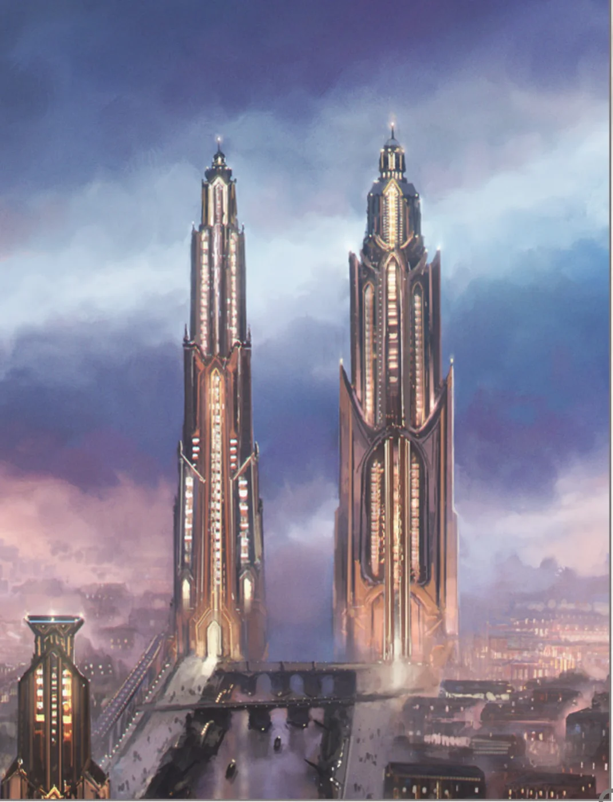
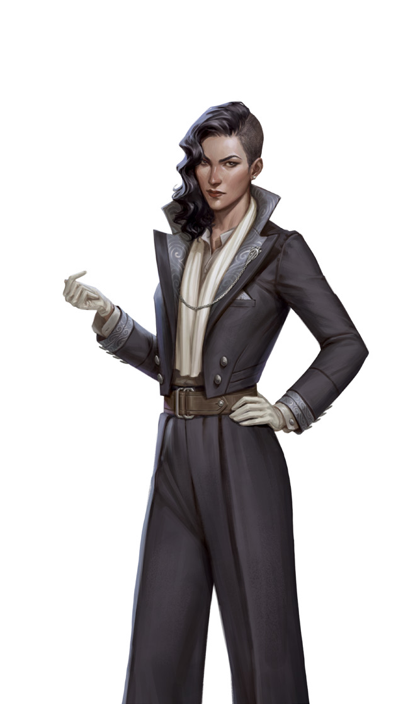
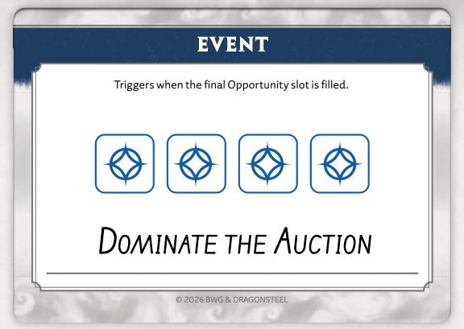

### 時尚潛入

太齊爾塔戒備森嚴，會場擠滿盛裝出席的貴族。身穿太齊爾家族制服的 Morgenthax 打手在大廳巡邏，監視每一位訪客。若隊伍和 Rielle 簽了合約，名單上就有他們的名字。兩名打手會護送他們搭專用電梯到第 48 層。那裡忙成一團，卻還算井然有序。一座華麗的舞廳即將布置完畢，寬大的伸展臺占據中央（見本章稍後的地圖 8.1）。Marthis 正在指揮布置。打手帶隊伍走進後臺，模特兒忙著上妝、整理昂貴的服裝，還不時和忙昏頭的助理拌嘴。如果 PC 沒有假扮模特兒，可以在這時決定他們怎麼進入第 48 層舞廳。他們可以先和 Marthis 聊聊，再到觀眾席就座。若 PC 在第 6 章輸給 Kwylliam，又沒還人情，現在就會遭到沙龍的貴族排擠。那些上流賓客會暗中取笑他們，使 PC 在〈實習生 Marthis〉與〈拍賣攻防〉期間的所有社交檢定獲得一個劣勢。

### 實習生 Marthis

穿制服的 Conrad 工程師在舞廳地板上拉電纜，由 Marthis 督導（見第 6 章的〈扮演 Marthis Elariel／Tekiel〉）。Marthis 沒有聽過 Lysarra 的完整計畫，但他已知道得夠多，察覺今晚很不對勁。PC 走近時，他的反應取決於隊伍在第 6 章怎麼對待他。

若隊伍和 Marthis 交情不錯，朗讀：

Marthis 一看到你們就瞪大眼睛，快步跑了過來。「你們怎麼會在這裡？今晚很重要，而且……你們也知道，有大人物在看。」他擔心地用一雙大手扭著電纜。「我不想……你們離開這裡會比較安全。」

若 Marthis 不喜歡 PC，他就會提高戒心，讓對話更難進行。朗讀：

Marthis 看見你們，立刻移開視線。「沒想到你們會來。」他的臉上閃過一絲掙扎。

「我想……祝你們拍賣玩得開心。聽說壓軸很盛大。」

### 對話方式

通過對抗 Marthis 靈魂防禦（14）的洞察檢定，便會看出他很焦慮。要讓他多說一些（見〈結算對話〉），PC 可以試試以下做法：

**表達關心。** PC 可以設身處地問問 Marthis 還好嗎。

若 PC 通過檢定，這份善意會讓 Marthis 放鬆。下一次有 PC 試圖影響他的檢定獲得一個優勢。他也承認自己整晚都很焦慮。從試煉之後，他就搞不清楚自己究竟捲入了什麼，只是照著 Lysarra 的話做，想讓家人以他為榮。**打聽消息。** 若隊伍打聽 Lysarra 或拍賣的細節，

Marthis 會咕噥自己不能多說。若 PC 通過檢定，他會花費專注點抵抗影響，並承認 Lysarra 到最後一刻才叫他負責督導技術布置，而且她

### 鐵脊大樓（左）

### 和太齊爾塔（右）

跨時代連結

若 PC 已完成一項協助 Marthis 的目標，這場對話自動成功。否則，若他是 Marthis Tekiel（也就是第一時代 PC 在第 2 章未能撮合 Cadme 和 Anastas），只要 Marthis 認為 PC 的檢定可能違背表親 Lysarra 的心意，該檢定就獲得一個劣勢。

第 8 章：致命時尚 161

LEON TUKKER

整晚說話都很不客氣。他說她準備起來一向一絲不苟，覺得她只是因為今晚稍後要離開，才這麼急。他不知道她要去哪裡。**施加壓力。** 若 PC 要他交代清楚，

或指控 Marthis 隱瞞消息，讓一名 PC 進行 DC 18 威嚇檢定。成功時，Marthis 撐不住，對話成功。失敗時，Marthis 在拍賣剩餘時間都不願再理會 PC，對話失敗。這裡很適合提高賭注。

### 抵抗影響

Marthis（結社候補成員）的意識防禦為 13、靈魂防禦為 14，並有 4 專注點。他會花費專注點抵抗追問拍賣細節，或要他背叛 Lysarra 的壓力。他願意接受真心的關懷，尤其是隊伍以前幫過他時。

### 結算對話

如果隊伍建立足夠的信任，讓 Marthis 不再猶豫，或他的專注點降到 0，對話便告成功。若 PC 在第 6 章對他不好，他會提高戒心，只要有一次檢定失敗，對話就失敗。**成功。** 看得出 Marthis 內心很掙扎，原本還謹慎措辭，轉眼就說個不停。他慌得一再強調自己不知道發生了什麼，但事情讓他覺得不對勁，他很害怕。他曾偷聽 Lysarra 提到，除了華麗的時裝秀之外，還有一份驚喜。他覺得自己講這些很傻，但 Lysarra 說「驚喜」時，聽起來像在威脅人。**失敗。** 無論是出於愧疚，還是害怕背叛 Lysarra，Marthis 都會徹底閉口不談。他嘟囔著要你們「別再打擾我跟我家人」，便離開後臺，整晚避著 PC。無論結果如何，對話結束後，若 PC 假扮模特兒，接著進行〈伸展臺上的行動〉。否則直接進入〈拍賣攻防〉。

### 伸展臺上的行動

一名 Young Ascendants 場務（平民，她）開始安排模特兒排隊上臺。朗讀：

布幕外的輕快樂聲愈來愈響，牆上的喇叭播得空洞，還夾著雜音。一名 Young Ascendants 場務朝排好的模特兒熱情一笑，接著大步穿過布幕，

舉起麥克風。「今晚就讓我們穿梭時光，細看布料的風華。Orlen 的店為各位獻上 Fellise 假面舞會系列！」第一位模特兒披著人造毛皮迷霧披風，在禮貌的掌聲中鑽出布幕。一名場務朝臺上一指，壓低聲音對你們說：「下一個就輪到你們，快準備！」

每名 PC 各自走上伸展臺，試著讓在場的上流賓客留下深刻印象。將這段流程作為短試煉，每名 PC 分開嘗試，並各自計算成功次數（見〈結算試煉〉）。

### 走得穩，還是跌一跤？

請每位玩家在走秀的三個關鍵時刻，各為自己的 PC 做一項表現：

**擺個姿勢。** 踏入聚光燈的那一刻，就決定了整段表演的基調。

PC 可以氣勢十足地走出布幕（DC 17 領導），或儀態萬千地走上伸展臺（DC 16 敏捷）。曾成功在 Orlen 店裡和裁縫合作的 PC，在這項檢定中獲得一個優勢。**舞臺中央。** 走到伸展臺中段時，

得稍稍賣弄一下技巧。行一個符合時代的鞠躬禮或屈膝禮（DC 16 學識），或誇張地旋身一圈（DC 17 敏捷），都能吸引觀眾的目光。**最後轉身。** 收尾漂亮，才能讓觀眾記得你。

迷人的微笑能贏得人心（DC 17 說服），巧妙地輕拉衣襬也能露出服裝暗藏的特色（DC 16 竊術）。這裡很適合提高賭注。

### 走得穩，還是跌一跤？

### 機遇與變故

| 結果 | 範例 |
| --- | --- |
| [機遇] | PC 注意到臺前的地毯不自然地皺在一起 （見〈活板門與送餐升降機〉）。 若通過 DC 14 感知檢定（不須花費行動）， 也能看見活板門。 |
| [變故] | PC 的衣服在走秀中途撕破。若未通過 DC 15 竊術檢定掩飾破損， 其〈走得穩，還是跌一跤？〉的表現 扣除一次成功。 |

跨時代連結

若第 2 章觸發了「聲名鵲起」事件，司儀會特別介紹受第一時代角色服裝影響的設計。

第 8 章：致命時尚 162

### 拍賣攻防

### 結算試煉

觀眾對每個角色的反應，取決於該 PC 累積了幾次成功。**零次成功。** PC 表現失手，引起了不必要的注意。〈拍賣槌下〉期間，一名競標對手可以當眾羞辱 PC，把 PC 的一次成功視為失敗。**一次成功。** 表現沒什麼記憶點，但也沒有出糗。**兩次成功。** 觀眾低聲稱讚。〈拍賣槌下〉期間，一名競標對手會表示欣賞，讓 PC 的一次失敗視為成功。**三次成功。** 全場都看得目眩神迷。拍賣開始前，德高望重的 Ismara Buvidas 女士（使用平民數值，她）走向隊伍。他們的表演令她著迷，也讓她想起舊時的華麗排場。她願意資助隊伍，為任意一件物品的競標出資最多 300 盒金。最後一名 PC 走秀完畢後，接著進行〈拍賣攻防〉。

時裝秀結束後，一名 Young Ascendants 場務會帶 PC 回到後臺，收走服裝並準備拍賣。PC 換好衣服後，朗讀：

服裝陳列在臺上，喇叭傳出輕柔的樂聲。貴族端詳拍品，低聲討論出價。他們今晚的打扮也經過精心安排。裙裝與西裝都剪裁得稜角分明，恰好露出一點金屬。刺穿手臂、胸口與肩膀的金屬閃閃發亮，顯然是刻意展示。

有血金術師專長的人會立刻察覺，他們穿刺的位置正是血金術接合點。拍賣即將開始，Merid 有消息要分享，Lysarra 也想和隊伍說幾句話。

### Merid 也在場

過了一會兒，Merid 走過來。朗讀：

「真巧，在這兒碰到你們。」Merid 一身俐落裝扮，

沒穿那件橄欖綠長外套，差點讓人認不出來，好在他的笑容還是那麼自在。「這場鍍金盛會玩得開心嗎？」

Merid 壓低聲音，透露下列消息：

**你怎麼會在這裡？**「守護者組織一直留意這種聚會。

這些人個個都是鑲金邊的刀子。我們還沒見過這麼多 Gilded Few 聚在一塊……嗯，從來沒見過。」**你知道些什麼？**「快有大事要發生了。

太齊爾在搞一項祕密計畫。她把東西全裝上一輛 Breaknaught，今晚盛會一結束就出發。拍賣後我要跟蹤她。你們要一起嗎？」**迷霧披風呢？**「那可是好東西。

要是落入不該拿到的人手裡，真就糟了。」他意味深長地瞥了那群鍍金賓客一眼。**有沒有注意到可疑的事？** 若 Kwylliam 或 Bayron

還活著，Merid 會指出對方今晚竟沒有到場。若 Vorn 還活著，Merid 還會說：「Lysarra 今晚有伴，Vorn 隊長就在她身旁。她連還在替檔案館工作的樣子都懶得裝了。」若 Vorn 已死，Merid 則說：「Lysarra 今晚身邊全是 Morgenthax 的保全。」他會指出太齊爾的保全隊長，那是一名神情冷硬、皺著臉的女子，拿著左輪手槍站在 Lysarra 正後方。

### 活板門與送餐升降機

拍品就擺在舞臺前方的活板門上。活板門通往一間維修室，五名戴防毒面具的 Conrad 特勤人員正悄悄藏在裡面，等著發動 Lysarra 的陷阱（見〈翡翠色的結局〉）。活板門上了鎖，只能從下方開啟。舞臺戒備森嚴，很難靠近。PC 必須通過 DC 20 隱匿檢定，或有合理的理由，例如上臺領取拍品，才能在不引人注意的情況下查看門。若 PC 嘗試開門，Vorn 或接替她的隊長會走過來。室內另有一座小到人進不去的送餐升降機，服務生用它取飲料。

Vorn 已被擊敗？

若 Vorn 在第 5 章喪命，由一名新的太齊爾保全隊長接替，使用精銳殺霧者數值。新隊長形影不離地跟著 Lysarra，時時保持警戒，但認不出 PC，和 Lysarra 也沒有感情糾葛。

第 8 章：致命時尚 163

### 鍍金閒話

若 PC 在拍賣前或拍賣期間偷聽，就會聽見下列談話：

**一代不如一代。** 一群衣著金光閃閃的貴族

邊喝酒，邊抱怨今年參加「試煉」的候補成員素質太差。他們感嘆今不如昔，怪罪結社接納了 Conrad 等「低一等」的貴族家族。**說漏嘴。** Percival Haught 大人（使用平民數值，他）

蓄著鬍子、胸膛厚實，高聲抱怨大報品質愈來愈差。他特別點名 Kwylliam 的大報，當眾說該給這位埃拉瑞爾後裔拉一拉韁繩，讓他重新順從 Gilded Few 的利益。**偷聽 Lysarra。** 留意 Lysarra 的 PC

可以進行 DC 14 洞察檢定。成功時，他們會看見她把 Vorn 拉到一旁，在她耳邊低語，輕輕吻了她一下。

繼承人傳承時刻

一名同樣出席沙龍的 NPC 家人走向繼承人。請和玩家一起決定來者是誰。這名 NPC 已加入 Gilded Few，興奮地以為繼承人也加入了。順著對方的話演下去，繼承人便會獲得 200 盒金作為「見面禮」，可用於拍賣。繼承人也可以試著說服這名家人背離 Gilded Few，需要通過 DC 17 說服檢定。成功時，這名家人會在拍賣中協助繼承人，並讓即將開始的「主宰拍賣」事件自動推進 1 格。

第 8 章：致命時尚 164

執法者傳承時刻

Vorn 走向執法者，提起兩人的過往，並表示執法者的本事足以擔任更高的職位。若 Vorn 已死，由她的接替者來交談，對方會說早就聽過執法者的名聲。Vorn 暗示 Gilded Few 內部將有劇變，並說 Lysarra 需要一名可靠、聽令行事的槍手。如果執法者通過 DC 17 欺騙檢定，假裝有興趣，她會要他在 Robe of Silenced Steel 競標時單獨到後門。若執法者同意照辦，再進行一次 DC 12 欺騙檢定。成功時，就在〈翡翠色的結局〉開始前，Vorn 會帶執法者進走廊，然後鎖上身後的門。失敗時，Vorn 會把執法者鎖在舞廳裡。

### 熱情招呼

拍賣開始前，Lysarra 會從 PC 中挑一名攀談，優先找女性，或性情沉靜、善於思考的角色。扮演 Lysarra 的提示見本書導言的〈重要人物〉。Vorn 始終近身跟著她，會場又到處都是保全。務必讓玩家知道，此時若開打，PC 的人數會遠遠少於對方。Lysarra 真心想知道 PC 想要什麼，也會把話記下來，以便日後利用，例如〈趕火車〉，或第 9 章的〈愚人的自由〉。Lysarra 走向 PC 時，朗讀：

Lysarra Tekiel 女士身穿線條俐落的雅緻套裝，朝你走來。她身旁的保全像老鷹般緊盯著你。「我得說，真令人佩服。我知道你們四處打探，原以為你們大概進不了今晚的會場。既然來了，還是歡迎。你們費了不少工夫

才走到這裡。告訴我，你想要什麼？」

Lysarra 有禮又親切。若 PC 曾在第 5 章捐款，她會表示感謝。若 PC 坦誠回答，或通過 DC 19 欺騙檢定，Lysarra 也會說出自己想要什麼：

「欲望往往受情緒左右。一旦被情緒牽著走，

想要的東西也會變得微不足道。無非是財物、眼前的好處，或證明自己沒錯的一點空洞滿足。這是我叔叔 Augustin 教我的。我想掌握自己的命運。就拿 Kwylliam 或 Bayron 來說，從沒人質疑他們有沒有資格做決定。

自昇華戰士以來，我們走了很遠，但連她也沒戴過王冠。」

Lysarra 會問問題，也樂意客氣地聊上幾句，但對自己的計畫隻字不提。若 PC 開始追問她與犯罪組織的關係、舊陸沙德、NeBaal 或鍍金地圖，她就會抽身離開：

「你說的故事真精彩，Kwylliam 肯定愛聽。

可惜他今晚沒能來。」Lysarra 露出難以捉摸的微笑。「祝你今晚愉快，也真心祝你競標順利。」Lysarra 輕盈地走向下一群賓客，保全隨即在她身後攏上。

Lysarra 不會再和 PC 交談。若 PC 仍緊追不放，Vorn 就會召來五名警衛（打手），護送 Lysarra 離開。賓客為拍賣就座時，Lysarra 走到後臺。

說書人傳承時刻

Lysarra 選擇攀談的 PC 時，會優先找說書人。她一開口就帶著幾分揶揄，提起自己在第 5 章給說書人的提議，說看見說書人名聲日盛，讓她印象深刻。她問，囚犯的故事為何對說書人這麼重要。若說書人誠懇回答，她會說自己會記住這個故事。若話題和囚犯的故事有關，她會感嘆，掌握自己的命運從來不是件容易的事。談過說書人的心願後，若雙方仍維持和氣，Lysarra 會在離開前邀請說書人擔任接下來的拍賣官。若說書人接受，PC 的競標檢定 DC 降低 4。若說書人拒絕，這次和 Lysarra 近距離交談仍會讓說書人更能看清場內的情勢，使觸發「主宰拍賣」事件所需的機遇減少 2。

### Lysarra

### Tekiel

### 拍賣槌下

PC 和其他賓客交際，並與 Merid 和 Lysarra 說過話後，拍賣開始。朗讀：

布幕拉開，露出一座彷彿由克雷迪克．霄森然尖刺搭成的舞臺。微弱的嘶聲響起，霧氣掠過臺面。Lysarra 走了出來。聚光燈照得她左耳的鑽石耳環閃閃發亮。她優雅地牽著一條繫繩，身旁跟著一隻黑毛大獵狼犬。亮藍色迷霧披風神氣地在她周身翻飛，宛如重生之野的昇華戰士雕像活了過來。全場響起雷鳴般的掌聲。她瀟灑地一甩披風，鄭重地把午夜迷霧披風披在人台上，然後走到麥克風前。「各位朋友、贊助者，感謝大家。沒有各位慷慨支持，就沒有 Young Ascendants。我願將自己珍藏的一件歷史遺物獻出。這是昇華戰士紋．太齊爾那個年代獨一無二的迷霧披風，拍賣是為了支持司卡德利亞的下一代

領袖。各位儘管大膽出價！」

Lysarra 把舞臺讓給一名面無表情的拍賣官，由他開始主持競標。

### 拍賣流程

PC 可以以隊伍為單位出價，參與拍賣。向玩家介紹「主宰拍賣」事件，並說明〈競標規則〉。下列任一情況發生時，場景就進入〈翡翠色的結局〉：

- Robe of Silenced Steel（詳見附錄 B）的競標結束。

  若 PC 得標，讓他們先領到長袍。

- 「主宰拍賣」事件觸發。

- PC 發現陷阱。見〈發現陷阱〉。

第 8 章：致命時尚 165

DEANDRA SCICLUNA

### 拍賣物品

下列物品依序上臺：

**繁花扇（Fan of the Bloom）。** 一把精巧的彩繪玻璃扇，製於

世紀之交的「玻璃花園（Glassgarden）」時尚風潮期間，當時在沙龍和園藝社團間十分流行。起標價 75 盒金，價值 500 盒金，競標對手有 2 人。**Robe of Silenced Steel。** 這件長袍能保護藏在底下的物件，

使其免受鎔金術影響（詳見附錄 B）。起標價 100 盒金，價值 2,000 盒金，競標對手有 3 人。**午夜迷霧披風。** 這件物品名義上是最後一項

拍品。

一件拍品上臺時，PC 可以進行 DC 15 學識或 DC 17 工藝檢定來估價。成功時，PC 得知物品的價值，競標該物品的檢定也獲得一個優勢。

### 競標規則

競標以輪進行。每輪發生下列事項：

**出價或退出。** 隊伍必須選擇出價或退出。

若出價，至少要加價 25 盒金。**進行檢定。** 代表隊伍出價的 PC

必須使用相關的意識或靈魂技能進行 DC 16 檢定。若玩家加價至少 50 盒金，就提高賭注。成功時，一名競標對手退出。失敗時，一名對手會加價 100 盒金反擊。**對手出價。** 每名仍在競標的對手

都使目前價格再增加 50 盒金，然後開始新的一輪。

當 PC 退出，或所有對手都退出時，該物品的競標結束。PC 得標時，將「主宰拍賣」事件推進 1 格，並讓一名 PC 立刻上臺付款、領取物品，還可能察覺活板門（見〈活板門與送餐升降機〉）。

### 事件：主宰拍賣

拍賣開始時，建立有四格的「主宰拍賣」正面事件。告訴玩家，這項事件代表他們掌控會場氣氛的程度。觸發事件時，他們就在競標者的鬥智中取得壓倒性的勝利。不過，這項事件實際上是在判定 PC 能否趕在 Lysarra 發動陷阱前察覺。

### 推進事件

PC 可以花費一個機遇，將事件推進 1 格。PC 每贏得一件拍品，事件也推進 1 格。

事件

### [變故]

### [機遇]

### 主宰拍賣

### 主宰拍賣

第 8 章：致命時尚 166

### 觸發事件

填滿四格後，事件便會觸發。依照〈發現陷阱〉的條列消息，描述 PC 逐漸察覺不妙的心情，然後立即進入〈翡翠色的結局〉。

### 發現陷阱

拍賣期間，要在安靜的會場中走動並不容易，必須通過 DC 18 隱匿檢定。失敗時，一名太齊爾警衛（打手）會走過來，把 PC 帶回座位。每名成功在會場走動的 PC，或是特別問起下列某項細節、並通過 DC 14 洞察或感知檢定的 PC，都能得知一項消息：

- 到處都找不到 Lysarra。

- Young Ascendants 的場務消失了。

- 舞臺上有活板門。

- 舞廳的門都鎖上了。

仔細檢查活板門或附近的技術裝置，並通過 DC 14 工藝檢定，便會立即發現陷阱（見〈活板門與送餐升降機〉）。

探索者傳承時刻

探索者從編年史家的筆記認出 Robe of Silenced Steel（詳見附錄 B），也知道第一時代的人對鋁有多麼陌生。請探索者和編年史家的玩家一起說說，編年史家何時、何地遇見長袍原來的持有者，並見識到它的奇特性質。探索者競標長袍的檢定獲得一個優勢。若探索者向場內其他人分享編年史家的故事，也將長袍的競標對手減少 1 人，因為一名 NPC 會出於敬意退出。

