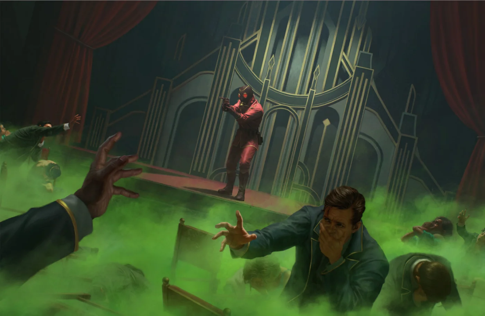
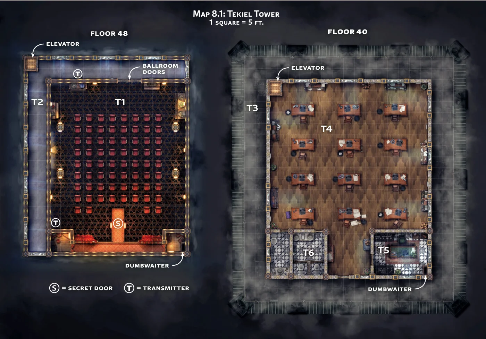
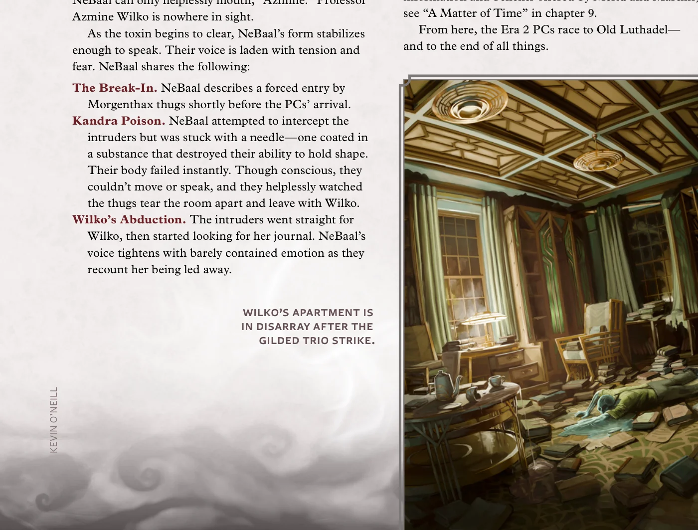
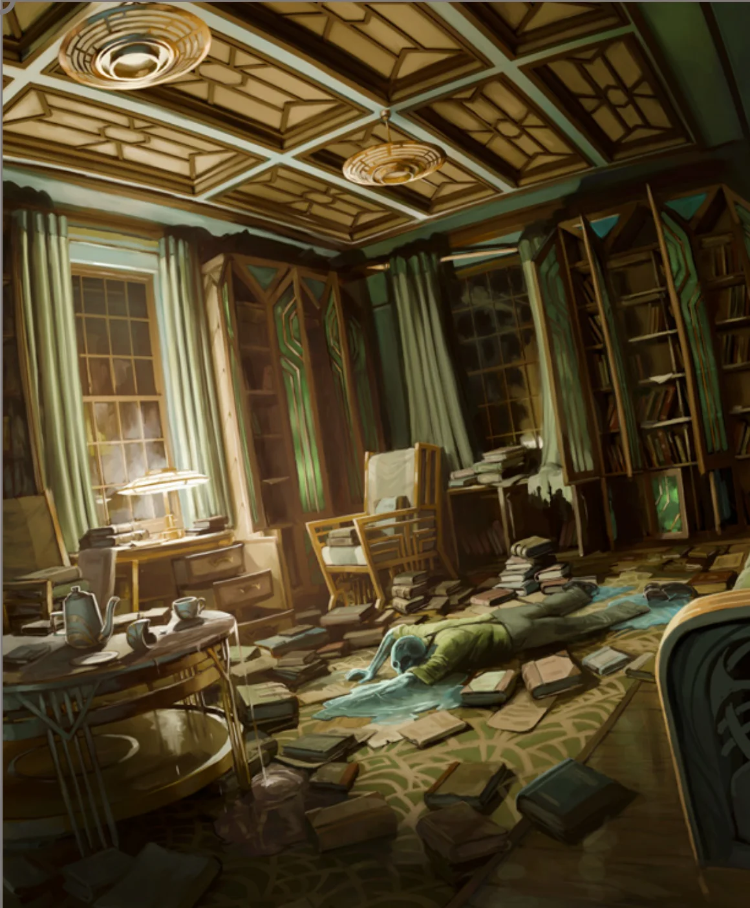

### 翠綠終局

拍賣進行到一半，鍍金三人組開始執行計畫，要消滅 Gilded Few 並取走他們的血金尖刺。請朗讀下文。

交談聲中，舞台上突然傳出一聲爆響，接著是嘶嘶聲。一縷鮮綠的霧從伸展臺旁的通風口冒出，轉眼間像洪水般湧出，吞沒了前排座位。困惑的喊聲變成窒息的咕噥聲，貴族紛紛倒地。坐在後面的人驚慌地奔向舞廳大門。「門鎖住了！」有人大喊。致命的霧彷彿活了一樣向前翻湧，再過片刻就會充滿整個房間。

Lysarra 不見了，門鎖著，致命的綠霧正沿地板翻湧。坐在前排的 Merid 踉蹌起身，撞上一臉驚慌的 Marthis。隊伍若想活命並救人，就得立刻行動。

### 屏住呼吸

PC 必須趕在翠綠迷霧追上前穿過上鎖的加固門。將這個場景作為試煉主持（見「結算試煉」）。

若 PC 完成了主宰拍賣事件，或以其他方式發現這房間是個陷阱，試煉開始時就已累積 2 次成功。

### 特殊規則：翠綠迷霧

試煉中，每個回合開始時，每名角色都受到 1d4 命力傷害。每名在試煉中檢定失敗的角色，額外受到 1d8 命力傷害。不必呼吸的角色不會受到傷害，例如正在汲取呼吸的鎘單藏金術師。

### 特殊規則：無人看管的拍品

舞廳配置見地圖 8.1。所有還沒拍賣的物品都無人看管，留在舞台上（T1 區南端），包括午夜迷霧披風（詳見附錄 B）。Lysarra 打算等霧散後取回披風。PC 可以作出貢獻，例如進行 DC 22 敏捷或 DC 20 紀律檢定，搶走披風或其他尚未取走的拍品。這麼做時，PC 會受到迷霧造成的 2d8 命力傷害。成功時，PC 取得物品，但這次成功不計入試煉。失敗時，PC 拿不到物品。

LIE SETIAWAN

### 趕一班列車

### 特殊規則：其他賓客

Merid（執法者）、Marthis（社團候補成員）和其他友善 NPC 立刻吸入毒氣。若沒有得到協助，他們會在 PC 累積 4 次失敗後死亡。PC 可以作出貢獻，例如進行 DC 12 醫學或 DC 15 運動檢定，幫助特定 NPC。成功時不計入試煉的成功次數，改擲 1d4，將結果加到該 NPC 死亡前尚可承受的失敗次數。若有 PC 去找 Merid，他會開始每回合協助一名 PC，讓該 PC 的檢定獲得一個優勢。

### 破門而出

PC 必須突破舞廳大門，才能逃離不斷湧來的毒霧。可以採用下列方法。

打壞門上的機關。角色可以選用合適的武器，

精準地使用火力，打壞門鉸鏈與加固構件（DC 17 輕型武器或重型武器）。這裡很適合提高賭注。用力撞！角色可以拿宴會餐桌或

講台當撞門槌（DC 17 運動），或協助指揮眾人合力破門（DC 17 領導）。解開門鎖。帶著開鎖工具的角色

可以設法解開這把做工精良、已經卡住的鎖（DC 17 竊術）。

### 結算試煉

隊伍累積 6 次成功或以其他方式完成目標時，試煉成功。若 PC 觸發了主宰拍賣事件，或以其他方式發現房間是陷阱，試煉開始時就已累積 2 次成功。成功。迷霧吞沒整個舞廳之際，PC 衝進走廊，雖然喘個不停，卻活了下來。若還有其他 NPC 生還（見「特殊規則：其他賓客」），他們也已虛弱到無法再提供協助。其餘春季沙龍賓客全都死了。失敗。這場試煉沒有固定的失敗次數門檻。PC 會一直受到翠綠迷霧的傷害，直到逃出或死亡。

地圖 8.1 包含太齊爾塔的兩個樓層。隊伍逃出毒氣瀰漫的舞廳（T1 區）後，來到第 48 層冷峻的玻璃走廊（T2）。請朗讀下文。

|  | 這條宏偉的走廊兩側都是落地窗。 窗外，依藍戴天際線的電燈如繁星般亮著， 環繞著你們。 |
| --- | --- |
|  |  |
|  | 走廊另一頭，Lysarra 瞥了一眼手錶，對著 壁掛式通訊器說：「獻祭完成，可以取出尖刺了……」 她注意到你們，皺起眉頭， 放下麥克風。 |
|  |  |
|  | 保全隊長從陰影中走出，擋在她面前。 「妳還得趕火車。 快去，這裡我來處理。」 |
|  |  |
|  | Lysarra 把手搭在隊長肩上。 「不，出了這個岔子是我的錯。我們一起收拾。」 |

Lysarra 打算拖住 PC，讓「取出尖刺」和其他計畫得以照常進行（見本章開頭的〈Lysarra 的長期布局〉）。PC 聽見舞廳後方傳來動靜。問他們要讓舞廳門開著還是關上，接著開始戰鬥。

### 第 48 層與第 40 層

### 地點

地圖 8.1 標出下列地點。

T1：舞廳。寬敞的活動大廳，設有舞台。

用簾子隔開的兩個空間充當臨時更衣室。通往 T2。T2：玻璃走廊。走廊狹長，設有

可俯瞰依藍戴的落地窗。通往 T1 和 T4（搭電梯）。T3：太齊爾塔屋頂。室外平台環繞

太齊爾塔第 40 層，有以紅銅和石材打造的曲線尖塔。通往 T4。T4：《依藍戴真相報》編輯室。昏暗的

辦公室四周環繞落地窗，桌子排成整齊的方陣，每張桌上都有一台打字機。通往 T3、T5、T6 和 T2（搭電梯）。T5：轉角辦公室。Kwylliam Elariel 的

轉角辦公室，布置雅致，已無人使用。一只雕花泰瑞司櫃內放著一瓶價值 300 盒金的威士忌（酒精飲料）。通往 T4。T6：廁所。有兩間洗手間。通往 T4。

第 8 章：致命時尚 168

### 開始戰鬥

戰鬥在太齊爾塔第 48 層的玻璃走廊（T2）開始。西北角有一部電梯。PC 從舞廳門外開始，Lysarra Tekiel 與 Eliane Vorn 隊長（或接替她的殺霧者精銳）則從壁掛式通訊器正前方開始。除了本場戰鬥適用的「戰場效果」，每回合開始時還會發生以下事件。

第一回合。五名 Conrad 幹員從

舞廳（T1）舞台下方出現，每人都戴著防毒面具（詳見附錄 B）。第二回合。兩名 Morgenthax 打手（法外之徒）

繞過轉角進入 T2，加入戰鬥。第三回合。另外兩名 Morgenthax 打手

（法外之徒）搭電梯抵達 T2。第四回合。通訊器中傳來幹員的聲音，夾著電流雜訊：

「尖刺已取出並送達。」五名戴著面具的 Conrad 幹員抵達舞廳大門，進入 T2，並在 NPC 的慢速輪次加入戰鬥。

### 地圖 8. 1：太齊爾塔

1 格＝5 呎。

### 取出尖刺

戰鬥期間，五名戴防毒面具的 Conrad 幹員在霧氣瀰漫的舞廳中，從 Gilded Few 的屍體上取出尖刺。他們要將尖刺放入送貨升降梯，送到地下一層（見「地下一層的列車月台」）。三回合後，他們就會完成工作。如果 PC 靠近，其中一名幹員會試圖搶走午夜迷霧披風，分散 PC 的注意力，讓其他人繼續工作。

新手傳承時刻

在交鋒與槍聲中，新手想起老兵一句有名的教誨：「打仗要贏，就得掌控戰局。」問新手，老兵曾在什麼時候遭遇優勢敵軍，又是如何取勝。再問老兵，史書漏掉了哪一段真相。回答後，新手可立刻為最多三名盟友重新安排位置，每人最多移動 15 呎，藉此改變戰場局勢。

### 第 48 層

### T1

### T2

### T3

### T4

電梯

電梯

舞廳大門

送貨升降梯

送貨升降梯

第 40 層

＝暗門

＝通訊器

### T6

### T5

ELEDRYLL

### 戰場效果

戰鬥期間，下列效果生效。

玻璃帷幕。窗戶很容易碎裂，

即使攻擊沒有直接瞄準窗戶，在它附近攻擊也可能需要提高賭注。GM 可以花費 [變故] 打碎一扇窗。緊鄰碎裂窗戶的每名角色都必須使用閃避危險（[反應]），否則會被飛散的玻璃造成 1d6 銳利傷害。破窗 10 呎內的區域成為危險地形 [1d4 銳利]。翠綠迷霧。如果舞廳門開著，迷霧會在

每個回合開始時蔓延 15 呎。在霧中開始輪次，或在自己的輪次首次進入霧中的角色，受到 2d8 命力傷害。破窗會吹散 10 呎內的霧，並阻止霧繼續蔓延。自由落體。如果緊鄰破窗的角色

遭到推動（透過推撞或其他方式），可以成功通過 DC 15 敏捷檢定來閃避危險（[反應]）。若角色未能閃避危險，就會摔出窗口，墜落八層樓，跌在第 40 層的室外平台（T3）上，受到 8d6 衝擊傷害並倒地。壁掛式通訊器。角色可以和壁掛裝置

互動（[1行動]），開啟走廊（T2）與舞廳（T1）通訊器之間的通話，之後可以持續使用交談（[自由行動]）。電梯。電梯裡的角色可以互動（

[1行動]）來選擇樓層。下一回合開始時，電梯抵達該樓層。如果有敵手墜落到第 40 層，就會搭電梯回到戰場。

### 趕一班列車

### 機遇與變故

| 結果 | 範例 |
| --- | --- |
| [機遇] | 一次打擊把一名 Morgenthax 打手（法外之徒）撞上 窗玻璃，玻璃應聲碎裂。PC 可以花費 ↻ 把這名打手推出窗外。 |
| [機遇] | 一發流彈打中天花板上的蒸汽管。PC 可以花費 [1行動]，讓滾燙的蒸汽噴向附近一名 敵人。對方必須成功通過 DC 15 敏捷檢定，否則 受到 1d6 能量傷害並陷入迷惑， 直到其下一個輪次結束。 |
| [變故] | 一名敵人射中頭頂的燈具， 火花四濺。PC 必須閃避危險（[反應]），否則受到 1d6 能量傷害並陷入迷惑， 直到其下一個輪次結束。 |
| [變故] | 精準的一槍打中大理石牆面， 碎片迎面噴向 PC。PC 陷入震懾， 直到其下一個輪次結束。 |

### 戰後

Lysarra 打得兇狠，招招致命，但她不想白白送死。如果第 4 回合開始、幹員抵達時她還活著，她會試圖搭電梯撤退，輸入自己的密碼前往地下樓層。可能出現兩種結果。

Lysarra 脫逃。如果 Lysarra 成功搭上

電梯逃走，Conrad 幹員會打破玻璃窗，沿繩索垂降逃逸。Vorn（或接替她的保全隊長）會戰到死，屆時倖存的 Morgenthax 打手會逃走或投降。幾分鐘後，Breaknaught 駛離地下一層月台，整棟建築跟著震動。Lysarra 落敗。如果 PC 打敗 Lysarra，

在她斷氣前一刻，Breaknaught 駛離地下一層月台，整棟建築跟著震動。Lysarra 苦笑道：「太遲了。你們那位教授朋友已經幫了大忙。她的筆記寫得那麼仔細、那麼詳盡……和原件一樣有用。」Lysarra 臨終前仍堅稱，她死了，計畫照樣會成功。Bayron 或 Kwylliam 將會成神，把 PC 這群渣滓從司卡德利亞徹底抹去。戰鬥結束後，具備血金術師專長的 PC 可以試著從 Lysarra 的遺體取出賦予黃銅鎔金術的青銅血金尖刺（見本書導言的「處理血金術」）。

如果 PC 事後回到舞廳，裡面已毫無生氣。調查時只會發現一片死寂，屍體上的尖刺也都被拔走了。每名落敗的 Conrad 幹員身上都有一個防毒面具（詳見附錄 B）。PC 在保全隊長身上找到 1,000 盒金和一張寫有「電梯：1024」的便條，這是通往地下一層的密碼。PC 尚未拿走的拍品都已和尖刺一起經送貨升降梯運下樓。若 Merid 生還而 PC 沒找到電梯密碼，他就會找到密碼並建議使用它。

### 地下一層的列車月台

一名角色在電梯面板輸入 1024 後，電梯猛地一震，以驚人的速度下降，把 PC 送到祕密的地下一層。請朗讀下文。

電梯門打開，前方是個寬敞如洞窟的房間，空氣裡有

機油與水泥的味道。刺眼的電燈照亮列車月台。附近的木箱堆得亂七八糟，牆上一扇小艙門半開。空蕩蕩的鐵軌延伸進一條漫長而漆黑的隧道。

第 8 章：致命時尚 170

### 繼續旅程

這些地下鐵軌是 Lysarra 的祕密鐵路工程的一部分，通往舊陸沙德。Breaknaught 匆忙離開，物資沒全帶走，空蕩蕩的鐵軌仍有餘溫。查看小艙門的 PC 會發現一部帶著血腥味的送貨升降梯，通往舞廳及其他樓層。升降梯內有一支裝滿血的金屬小瓶，裡頭有一根鋅血金尖刺和一根紅銅血金尖刺。

### Wilko 遭到綁架

PC 回到 Wilko 的公寓時，門半開著，裂痕顯示有人強行闖入。屋內一片寂靜。隊伍進門時，請朗讀下文。

門鉸鏈已經損壞，門歪斜著半開，鎖也

扭曲變形。公寓裡一片狼藉。抽屜被掏空，架上的東西被掃落大半，書本遭到撕毀、踩踏。小桌旁，一套精緻的雙人茶具碎了一地，香料茶從杯子的碎片上滴落。滿目瘡痍的房間正中央，有一攤彷彿融化了的透明血肉與骨頭。

查看那攤東西的人會發現，那就是 NeBaal。NeBaal 受到一種使坎得拉無法維持形體的化合物影響，有好幾分鐘只能無助地以口形說出「Azmine」。Azmine Wilko 教授不見蹤影。毒素開始消退後，NeBaal 的形體逐漸穩定，終於能開口。話音透著緊張與恐懼。NeBaal 說出以下情況。

闖入。NeBaal 說，就在 PC 抵達前不久，

Morgenthax 的惡棍強行闖進來。坎得拉毒藥。NeBaal 試圖攔住

闖入者，卻被一根針刺中。針上塗著一種物質，使 NeBaal 無法維持形體。身體立刻癱軟。NeBaal 意識清楚，卻無法動彈或開口，只能眼睜睜看著惡棍翻遍房間，帶走 Wilko。Wilko 遭綁。闖入者直奔

Wilko，接著開始找她的日誌。說到她被帶走時，NeBaal 的聲音繃緊，幾乎壓抑不住情緒。

失竊的日誌。闖入者離開前，

找到了 Wilko 那本按顏色分類的日誌。裡頭有她的大量筆記和草圖，詳載隊伍收集到的鍍金地圖碎片。再加上 Lysarra 持有午夜迷霧披風的這一個月來幾乎肯定查到的資訊，三人組現在已能找到穿越隧道、抵達永恆寶庫的路。

第二時代的角色升至 8 級。此時，PC 可能已經集齊鍍金地圖的三塊碎片，也就是渡鴉面具、團結勳章和午夜迷霧披風（詳見附錄 B）。不過，Wilko 遭到綁架，三人組通往最終目標的路已暢通無阻，隊伍落後了一步。現在，PC 有明確的線索可追，也有一位朋友等著他們去救。如果 Merid 在「翠綠終局」中生還，他會承諾守護者組織將全力相助（見附錄 F）。如果 Merid 死了，則將守護者組織的規模減少 1。如果 Marthis 生還，他會由衷道謝，並提供 1,000 盒金以及他幫得上的忙。有關 Merid 和 Marthis 能提供的更多資訊與好處，見第 9 章的「時間問題」。接下來，第二時代的 PC 將趕往舊陸沙德，奔向一切的終點。

### 鍍金三人組出手後，

### Wilko 的公寓

一片狼藉。

KEVIN O’NEILL

