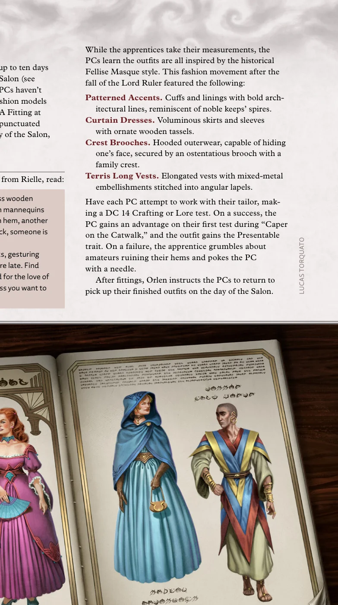
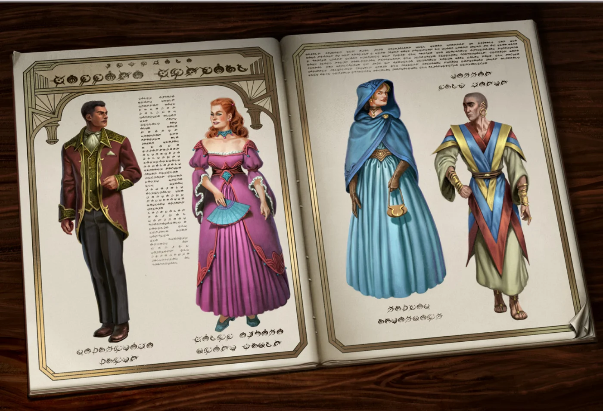
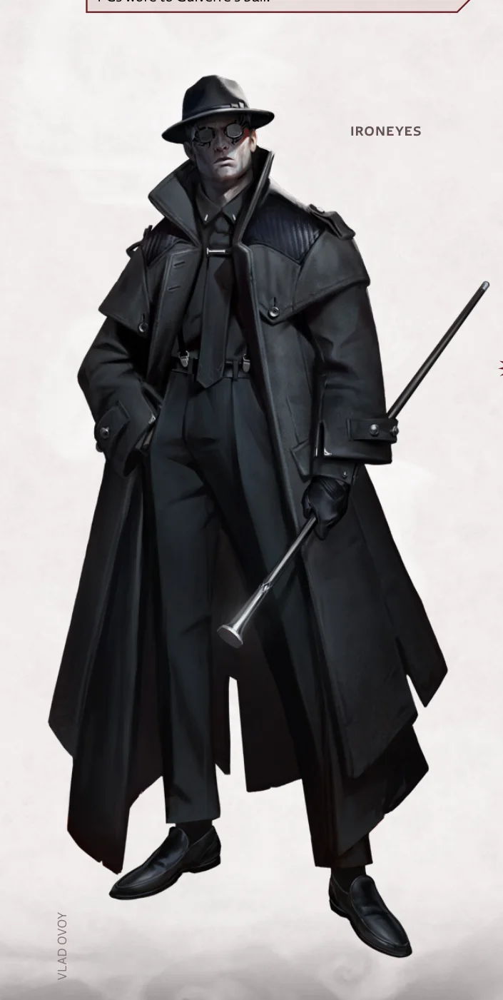
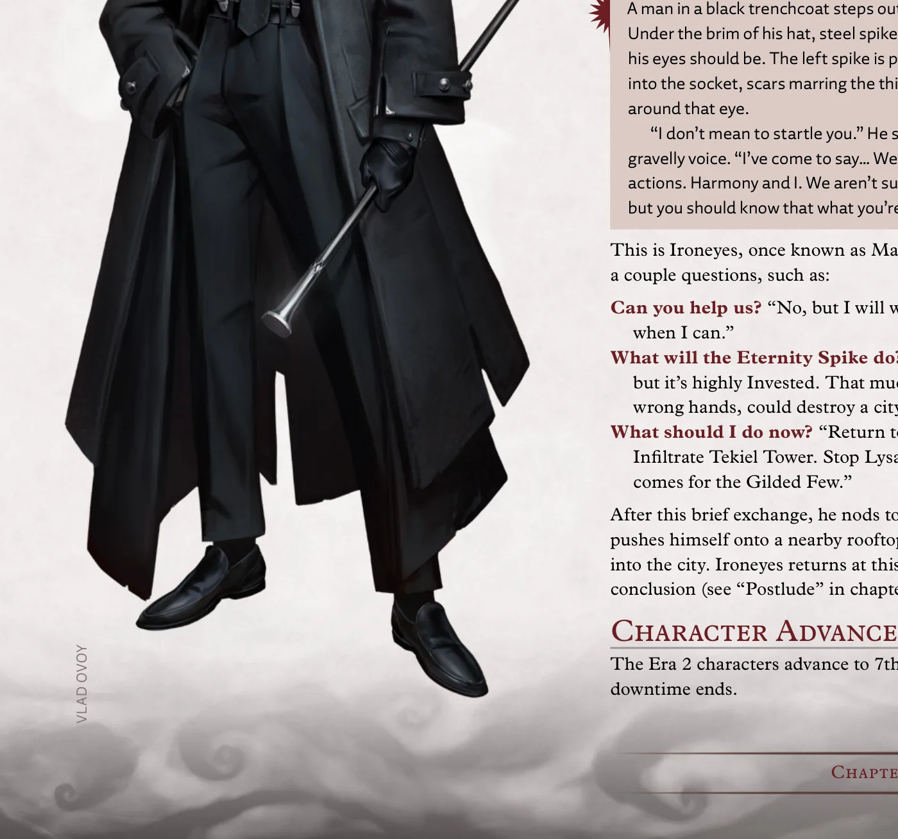
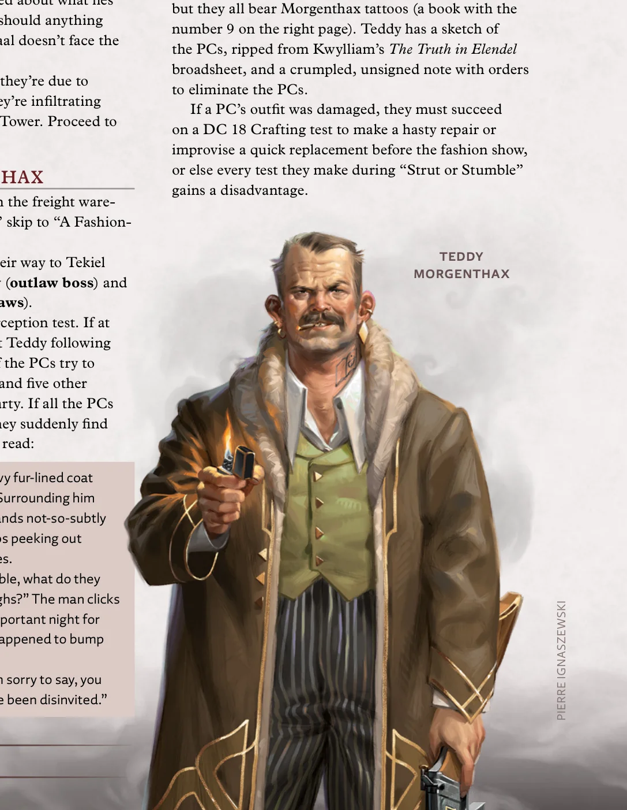

### 盛裝赴殺局

調查結束後，隊伍在埃拉瑞爾春季沙龍前最多有十天休整時間（見〈沙龍前的休整〉）。若 PC 還沒準備好假扮時裝模特兒的服裝，可趁休整時取得，並進行〈在 Orlen 店裡試衣〉。準備期間，鐵眼會來訪。沙龍當天，PC 還會遇上一場暗殺。

### 在 Orlen 店裡試衣

若 PC 拿著 Rielle 給的合約進入 Orlen 的店，請朗讀：

店裡一片混亂。成卷的布料散落在木地板上，學徒在人台與模特兒之間穿梭。有人大喊下襬破了，有人喊衣服沾了污漬，店後肯定還有人在哭。「你們就是新來的模特兒？」Orlen 大聲問，揮著一把看來很鋒利的剪刀。「你們遲到了。找個學徒，挑一套衣服。看在存留的分上，什麼都別碰，除非你們想被縫在上頭！」

學徒量尺寸時，PC 得知這些服裝全都取材自昔日的 Fellise 假面舞會風格。這股風潮在統御主倒台後興起，有以下特色：

**幾何紋飾。** 袖口與內襯以醒目的建築線條裝飾，令人想起貴族堡邸的尖塔。

**帷幔洋裝。** 蓬鬆寬大的裙襬和袖子，綴有精緻的木製流蘇。

**家徽胸針。** 外衣的兜帽能遮住臉，並用一枚華麗的家徽胸針扣住。

**泰瑞司長背心。** 加長版背心，稜角分明的翻領縫有多種金屬飾件。

讓每名 PC 試著與裁縫合作，進行 DC 14 的工藝或學識檢定。成功時，PC 在〈伸展臺上的行動〉中進行的第一次檢定獲得一個優勢，服裝也獲得得體特性。失敗時，學徒會抱怨外行人弄壞了下襬，還會用針扎 PC 一下。試衣完畢後，Orlen 會請 PC 在沙龍當天回來取走完工的服裝。

LUCAS TORQUATO

時代跳躍連結

若 PC 在第 2 章成功觸發「聲名鵲起」事件，第一時代 PC 便影響了 Fellise 假面舞會風格，以及往後數百年的時尚潮流。增加兩套服裝選項，直接取材自第一時代 PC 在 Guiverre 舞會上穿的衣服。

### 鐵眼

### 沙龍前的休整

PC 有十天可以休整（見附錄 E〈在依藍戴休整〉）。在〈調查太齊爾家族〉期間，每有一處地點沒能找到任何線索，就扣除一天。這是第二時代故事的最後一次休整，適合與玩家一起完成 PC 尚未達成的短期目標。

### 與死亡擦肩而過

若你打算主持第 9 章結尾的〈後記〉，就可以安排這段選用的休整場景。PC 已引起和諧的注意，和諧派來一位使者。從對守護者組織感興趣、會格外重視與這名原著人物相遇，或近來較少受到關注的 PC 中選一人。鐵眼（他）會來找這名 PC。這位傳奇的鋼鐵審判者在第二時代守望著司卡德利亞，詳見《迷霧之子世界指南》第 8 章〈鐵眼〉。等選中的 PC 獨處時，請朗讀：

一名穿黑色長外套的男子從陰影中走出。帽沿下，本該是雙眼的位置閃著鋼製尖刺頭的光。左側尖刺深深嵌入眼窩，疤痕劃過眼周濃黑的刺青。「我無意嚇你。」他的聲音低沉沙啞。「我來是想告訴你……和諧和我都感謝你們所做的事。我們不應插手，但你該知道，你們正在做的事很重要。」

這就是鐵眼，曾經名叫沼澤。他會回答幾個問題，例如：

**你能幫我們嗎？**「不能，但只要有機會，我會照看你們。」

**永恆尖刺會造成什麼後果？**「我不知道，但它蘊含大量授予。那股力量若落到歹人手中，足以摧毀這樣一座城市。」

**我現在該怎麼做？**「回去找你的朋友。潛入太齊爾塔，阻止 Lysarra。Gilded Few 清算的時刻到了。」

短暫交談後，他向 PC 點頭，用鋼推把自己推上附近的屋頂，隨即消失在城中。鐵眼會在冒險結尾再度現身（見第 9 章〈後記〉）。

### 角色升級

休整結束時，第二時代角色升到第 7 級。

第 8 章：致命時尚 159

VLAD OVOY

### 沙龍準備

春季沙龍當天下午，Wilko 前來拜訪隊伍，分享她和 NeBaal 查到的消息：

**時裝伸展臺。** 晚會以「金飾與風華：司卡德利亞歷代時尚」時裝秀揭幕。模特兒走上伸展臺，展示即將拍賣的物品。

**拍賣。** 模特兒展示的服裝會與幾件出自當年原作的物品一併拍賣，其中包括午夜迷霧披風。

**社交。** 晚會最後會供應飲品，讓賓客交際。

說明流程後，Wilko 問 PC 怎麼看 NeBaal。她坦承，這名坎得拉彷彿活生生的歷史，令她著迷，但想到他所受的苦，又令她心痛。她對前路感到不安，鄭重請求 PC，萬一她出了什麼事，請別讓 NeBaal 獨自面對未來。討論結束後，若 PC 打算假扮模特兒潛入，就該去 Orlen 店裡取衣服，再前往太齊爾塔。接續〈Morgenthax 的威脅〉。

### Morgenthax 的威脅

若 PC 在〈調查太齊爾家族〉期間已於貨運倉庫擊敗 Teddy，跳到〈時尚潛入〉。否則，隊伍前往太齊爾塔時，Teddy（法外之徒首領）和隨行的五名幫派成員（法外之徒）會攔住他們。讓每名 PC 進行 DC 17 的感知檢定。若至少半數 PC 成功，他們會發現 Teddy 若無其事地跟在後頭。PC 若試圖與他對質或避開他，他就吹響口哨，另外五名幫派成員立刻出現在隊伍正後方。若所有 PC 都失敗，他們要等到突然被包圍，才會察覺異狀。無論結果如何，請朗讀：

一名臉孔瘦削、穿著厚重毛皮內襯外套的男子走上前，捻熄雪茄。他身邊跟著一群面目兇狠的人，手毫不掩飾地握著藏起來的武器，捲起的西裝袖口下露出刺青。「你們惹了不少麻煩啊。人家管你們叫什麼來著，蠻橫區的『鐵路小混混』？」男子不以為然地咂了咂舌。「今晚對我們那位女士很重要，真高興正好碰見你們。」幫派成員紛紛拔出武器。「很遺憾，今晚你們哪場派對也去不了。邀請取消了。」

Teddy 和手下向前逼近，要活捉或殺死 PC。若先前超過半數 PC 未通過感知檢定，隊伍就會被包圍，且幫派成員在戰鬥開始時已在掩體後架防。否則，幫派成員會排成一列，正面迎戰隊伍。

### 戰場效果

本次戰鬥有以下效果：

**穿針引線。** 假扮模特兒的 PC 遭攻擊命中時，必須進行 DC 13 的敏捷檢定來保護服裝。若失敗，PC 必須二選一，承受該次攻擊的最大傷害，或讓服裝受損。

### 戰後

幫派成員不會死戰，Teddy 一倒下便會撤退。被制伏的幫派成員拒絕開口，但身上都有 Morgenthax 刺青，圖案是一本書，右頁寫著數字 9。Teddy 身上有一張從 Kwylliam 的《依藍戴真相報》撕下的 PC 素描，以及一張揉皺、未署名的便條，命令他除掉 PC。若一名 PC 的服裝受損，就必須通過 DC 18 的工藝檢定，在時裝秀前匆忙修補或臨時找一套替代服裝。否則，該 PC 在〈走秀或出糗〉中進行的每次檢定都會獲得一個劣勢。

### Teddy

### Morgenthax

第 8 章：致命時尚 160

PIERRE IGNASZEWSKI

