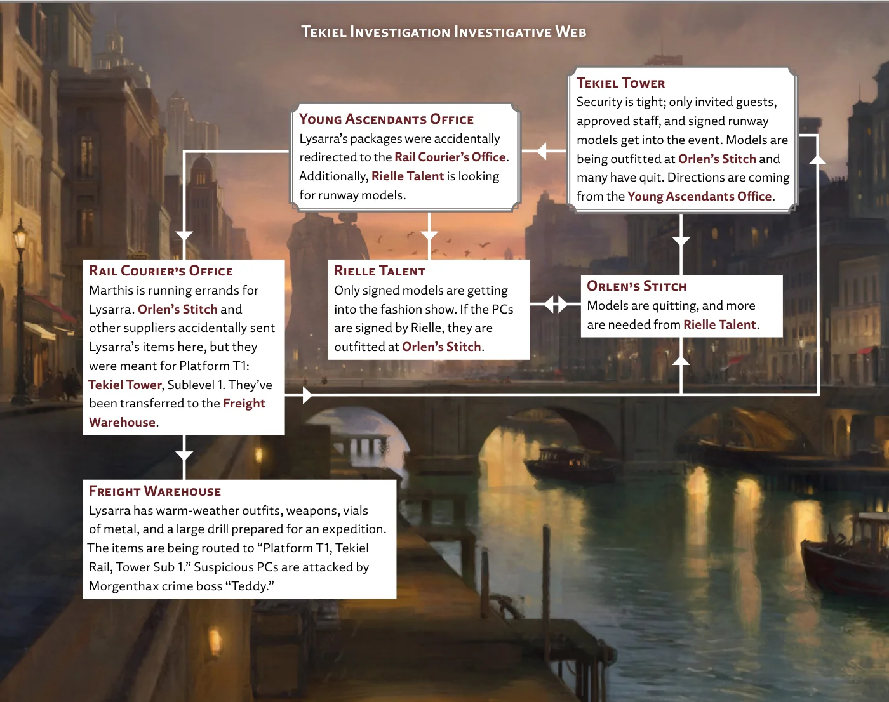
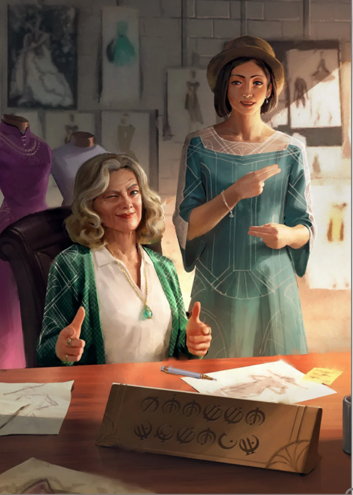

### 盯上太齊爾家族

隊伍回到依藍戴的藏身處，發現 NeBaal 留下便條，請他們到太齊爾塔氏族住宅區內的 Wilko 公寓會面。

### 負面報導

PC 前往赴約時，請朗讀：

一名赤腳街童揮舞著最新一期報紙。「鐵路小混混在蠻橫區撒野！Bayron Conrad 慘遭毒打！快來買《依藍戴真相報》，一份三夾幣。要沒泡濕的，五夾幣！」

頭版在幾幅不怎麼好看的 PC 素描上方刊出大標題「身懷武器，極度危險！」報導指控他們是依藍戴一連串犯罪的主謀，包括非法競速、竊盜、騷擾學生，以及在蠻橫區襲擊 Bayron。若 Bayron 已死，報紙會掩蓋這件事。Lysarra 想在沙龍前避開查問。另一篇〈金飾與風華〉介紹 Lysarra 的時裝秀與拍賣。拍賣將於十天後在太齊爾塔的埃拉瑞爾春季沙龍舉行，為 Lysarra 的慈善組織 Young Ascendants 募款。拍賣焦點是午夜迷霧披風，一件以罕見藍色聞名的獨特遺物。

企業家的傳承時刻

賣報人走向企業家，透露自己和街童同名，也與企業家有共同祖先。對方開口討一筆豐厚的小費或一份工作，理由是「有來有往嘛，對吧？」若企業家答應，讓他們開始「招募賣報人」目標。完成後，他們會得到一名線人作為同伴。

跨時代連結

拍賣的披風就是 NeBaal 當年送給第一時代 PC 的那件鮮藍色午夜迷霧披風。NeBaal 從未告訴他們，那其實是地圖的第三塊碎片（見第 4 章）。

### 惺惺相惜

Wilko 教授在太齊爾塔的家族公寓迎接 PC。他們可能在第 6 章來過這裡。她到廚房泡茶，留下 NeBaal 與隊伍單獨相處。NeBaal 先向他們道謝，再談起自己對 Wilko 教授的感激。NeBaal 欣賞她的熱忱與開明，也感激她把自己當成一個人看待，而非一件奇物。NeBaal 懇求隊伍答應，萬一自己出了什麼事，務必保護 Azmine。

### 地圖與迷霧披風

話題漸歇時，Wilko 回到房間，NeBaal 開始談正事。請朗讀：

「鍍金地圖的最後一塊碎片，是一件摯友做的迷霧披風。她開了頭，我接手做完，英雄們世世代代守護著它。可惜，它現在似乎落到了Gilded Few 手裡。」NeBaal 拿出報紙上的〈金飾與風華〉。「我敢肯定，這就是我們要找的地圖碎片。Lysarra 要在埃拉瑞爾春季沙龍拍賣它。」Wilko 小心倒出香料茶，點頭說：「Lysarra 近來避不見面，不開會也不出席活動。但我們知道迷霧披風是拍賣的焦點，所以還有十天可以想辦法進場。」

NeBaal 與 Wilko 回答問題，透露以下消息：

**迷霧披風就是地圖碎片？** NeBaal 回答：「這件披風很特別，顏色鮮藍，披肩內側用藍線和銀線繡出不顯眼的繁複圖案。只要知道怎麼讀，那就是地圖的一部分。」

**鍍金地圖怎麼用？** NeBaal 回答：「三塊碎片拼起來，就是舊陸沙德地底洞穴系統的地圖。永恆尖刺藏在那裡一座安全的寶庫裡。」Wilko 補充：「落灰之終後，地表已經變了，但那些被稱為『大地子宮』的隧道應該還是老樣子。」

**Lysarra 有什麼計畫？** Wilko 回答：「Lysarra 在華麗的時裝秀上展示迷霧披風，是想讓人聯想到她與昇華戰士紋的關係，並讓大家注意 Young Ascendants。這說得通。不過……既然她要把披風拿出來拍賣，要嘛是她已經不需要了，要嘛她根本沒打算交出去。我猜是後者。」NeBaal 皺眉補了一句：「恐怕你們會踏進陷阱，但我想不到更好的辦法。」

第 8 章：致命時尚 154

### 調查太齊爾家族

**Young Ascendants 是誰？** Wilko 回答：「那是 Lysarra 經營多年的大學社團兼慈善組織。她想借昇華戰士的名聲增加自己的影響力。據說拍賣所得會捐給這個組織。」NeBaal 提醒：「小心些。社團成員大多是年輕貴族，他們的父母肯定有人是 Gilded Few，也會到場。」

**要怎麼拿到迷霧披風？** Wilko 回答：「你們可以在拍賣時出價，也可以直接拿了就跑……可要進場並不容易。現場戒備森嚴，只招待特定賓客，邀請函幾週前就發了。我們得想個辦法混進去。」

答完問題後，NeBaal 建議 PC 在依藍戴四處調查，找出進入春季沙龍的方法。NeBaal 一向好奇城裡還有什麼可看，也表示願意同行。

PC 必須混入埃拉瑞爾春季沙龍，才有機會接觸迷霧披風。調查會揭示他們可以假扮模特兒潛入時裝秀，也能查到〈Lysarra 的長期布局〉中的細節。

### 調查線索網

依《迷霧之子玩家手冊》第 12 章的說明，將這場調查作為調查試煉主持。以下各地點都有一段簡短場景，以及通往其他地點的線索。隊伍可依任意順序追查線索與造訪地點。這場試煉無須記錄成功和失敗次數。不過，每當 PC 首次造訪一個新地點而未能找到至少一條線索，運氣不佳或調查失手就會壓縮隊伍的休整時間（見〈結算試煉〉）。

### 調查太齊爾家族的線索網

| 地點 | 可取得的線索 |
| --- | --- |
| 太齊爾塔 | 現場戒備森嚴，只有受邀賓客、獲准的工作人員與已簽約的模特兒能入場。Orlen 裁縫店正在為模特兒備裝，但許多人已退出。相關指示出自 Young Ascendants 辦公室。 |
| Young Ascendants 辦公室 | Lysarra 的包裹被誤送到鐵路快遞辦公室。此外，Rielle 模特兒經紀公司正在招募走秀模特兒。 |
| 鐵路快遞辦公室 | Marthis 正替 Lysarra 跑腿。Orlen 裁縫店與其他供應商誤把 Lysarra 的物品送到這裡。原定目的地是太齊爾塔地下第 1 層的 T1 月臺。物品已轉送貨運倉庫。 |
| Rielle 模特兒經紀公司 | 只有簽約模特兒能參加時裝秀。PC 若與 Rielle 簽約，便會到 Orlen 裁縫店試裝。 |
| Orlen 裁縫店 | 有模特兒退出，還需要 Rielle 模特兒經紀公司補人。 |
| 貨運倉庫 | Lysarra 為遠征備好適合暖地的服裝、武器、金屬瓶與大型鑽機。貨物將送往「太齊爾鐵路，塔底第 1 層，T1 月臺」。形跡可疑的 PC 會遭到 Morgenthax 幫派首領 Teddy 襲擊。 |

GAL OR

### 初始線索

PC 知道迷霧披風是埃拉瑞爾春季沙龍拍賣的主打品，拍賣所得將用來資助 Young Ascendants。提供下列線索：

**線索：Young Ascendants 辦公室。** Wilko 指出，Young Ascendants 的辦公室位於依藍戴大學的學生活動中心（見第 6 章〈依藍戴大學地點〉）。

**線索：太齊爾塔。** NeBaal 提議去太齊爾塔四處看看，因為埃拉瑞爾春季沙龍將在那裡舉辦。

### Young Ascendants 辦公室

### （第一區）

Young Ascendants 位於依藍戴大學學生活動中心的辦公室十分忙碌。在這裡做事的有懷抱理想的年輕女性，也有獲得組織獎學金的學生。她們滿懷熱忱，卻已忙得喘不過氣。即使 Lysarra 對她們要求很高，她們仍會立刻為她辯護。PC 可以和她們聊天（DC 15 說服），或瞄一眼她們的文件（DC 16 推理）來取得線索。

**線索：Rielle 模特兒經紀公司。** 伸展台模特兒人手不足，Rielle 夫人正急著招募新人。

**線索：鐵路快遞辦公室。** Lysarra 的包裹誤送到了太齊爾調車場的快遞辦公室，原本應送往太齊爾塔。

### 太齊爾塔（第五區）

這座由鋼材和混凝土建成的摩天大樓閃閃發亮，高踞第五區的天際線。除了 6 至 8 樓的家族宅邸，太齊爾家的守衛會在各處巡邏。PC 可能察覺這些守衛比一般守衛更危險（DC 14 洞察），這暗示他們其實全是 Morgenthax 幫的成員（法外之徒）。他們守口如瓶，但悄悄接近（DC 17 隱匿）的 PC 可以偷聽（DC 15 感知）到下列線索，以及其他有用消息。沙龍期間，只有邀請函經過查驗的賓客、Lysarra 的私人工作人員，以及為時裝秀簽約的模特兒可以進入 48 樓。細查電梯的 PC 可以發現（DC 16 工藝或推理），必須在控制面板輸入密碼才能到達某些樓層，其中包括地下 1 樓（見本章末的〈地下 1 樓列車月台〉）。

**線索：Orlen 裁縫店。** 守衛開玩笑說，辭職的模特兒多成這樣，說不定連他們都得去 Orlen 裁縫店量身做表演服。

**線索：Young Ascendants 辦公室。** 辦公室下達的指示格外混亂，顯示 Lysarra 的心思放在別處。

### Rielle 模特兒經紀公司（第二區）

在律師事務所和咖啡館之間，有一棟掛著金色招牌的小磚房。招牌上寫著「Rielle 模特兒經紀公司」。衣著入時的 Rielle 夫人（平民，她）飛快地跟 Young Ascendants 成員 Uvina（平民，她）用手語交談，由 Uvina 為 PC 口譯。PC 可以用魅力打動她（DC 17 說服）、虛張聲勢（DC 15 欺瞞），或展現掌控全場的氣勢（DC 16 領導）來引起她的興趣。比起外貌，她更看重敢於展現自我的個性。Uvina 和 Rielle 解釋，近來有許多模特兒辭職，原因是對太齊爾家財務困難的「無端擔憂」，以及太齊爾家的守衛開始動手傷人的「荒唐傳聞」。

**線索：Orlen 裁縫店。** 如果有 PC 引起 Rielle 的興趣，她會提出簽約，讓該 PC 參加春季沙龍，也會確認只有簽約模特兒才能參加時裝秀。如果 PC 同意，她會請他們到 Orlen 裁縫店配裝，每人預付 25 盒金，並承諾秀後再付 50 枚。

### Orlen 裁縫店（第二區）

Orlen 裁縫店裡擠滿了緊張的模特兒，也陳列著精美的司卡德利亞歷史服飾。店主 Orlen（商人，他）身負克羅司血統，時刻盯著店裡的動靜。若 PC 已跟 Rielle 簽約，需要為時裝秀配裝，接著進行本章稍後的〈在 Orlen 店裡試衣〉。否則，PC 可以指點學徒怎麼縫衣（DC 14 工藝）、偷聽試裝時的對話（DC 16 感知），或留意 Orlen 正在暗自生悶氣（DC 14 洞察），從忙亂中找出線索。若成功偷看堆成一座小塔的包裹（DC 15 竊術），也會發現 Lysarra 近期訂製的物品。這些衣物都是輕薄透氣的長袍和頭巾，適合在沙漠穿戴。

**線索：Rielle 模特兒經紀公司。** 「Lysarra 的打手」做了一場令人害怕的維安簡報，Orlen 又少了一批模特兒。他需要 Rielle 模特兒經紀公司提供更多簽約人手。

### 鐵路快遞辦公室（第八區）

太齊爾調車場的快遞辦公室狹小混亂，到處是高聲叫喊的職員與搬動中的貨箱。Marthis（第 6 章那名申請入社的學生）正和一位滿臉通紅的職員爭論，要求將包裹改送太齊爾塔。如果 PC 先前與他相處融洽，可以和他交談（DC 14 說服），得知他正在 Lysarra 手下實習。Marthis 不知道 Lysarra 那些「超級重要」的包裹裡裝了什麼，但能提供線索。PC 也可以和職員交談（DC 14 說服）來取得線索。如果他們在第 7 章讓太齊爾鐵路工人留下好印象，這次檢定獲得優勢。

第 8 章：致命時尚 156

### Rielle 與她的口譯員 Uvina

**線索：Orlen 裁縫店。** 包裹來自 Orlen 裁縫店。Marthis 說，那裡的「模特兒正在為時裝秀忙重要的時尚工作」。

**線索：太齊爾塔。** 包裹必須送往太齊爾塔的「特殊裝貨月台」（見本章末的〈地下 1 樓列車月台〉）。

**線索：貨運倉庫。** Lysarra 的包裹還放在貨運倉庫，等著改送其他地點。

### 貨運倉庫（第八區）

倉庫空間寬廣，回音不絕，裡頭滿是貨物、軋軋作響的推車和高聲叫喊的工人。PC 可以在搜尋 Lysarra 的包裹時避人耳目（DC 17 隱匿），或假扮搬貨的工人（DC 16 運動）。寄給 Lysarra 的貨件標示清楚，集中放在一起，裡頭有適合炎熱氣候的衣物、普通金屬的小瓶、兩把左輪手槍、一把靴筒手槍，以及 10 發鋁製彈藥。一卷藍圖畫著一輛龐大載具的設計，也就是蒸汽引擎鑽地機。貨單註明將這些物品送至「T1 月台：太齊爾塔地下 1 樓」。

PC 可以注意到一名身材高大、臉形瘦削、穿著俐落西裝的男子。他是 Teddy（法外之徒首領，他），在資助太齊爾家的犯罪集團 Morgenthax 家族中擔任小頭目。如果 PC 引起 Teddy 懷疑，他便會上前。若經過數次明確威脅後，PC 仍不離開，Teddy 會和倉庫裡另外五名幫派成員（法外之徒）一起攻擊。如果 PC 在此擊敗 Teddy，他之後便不會再襲擊他們（見〈Morgenthax 的威脅〉）。

**線索：無。** PC 雖然能在此得知 Lysarra 的計畫，這裡卻沒有通往其他地點的新線索。

### 結算試煉

這場開放式調查在 PC 決定如何潛入春季沙龍時結束，無須判定整體成功或失敗。每當隊伍前往新地點卻找不到任何線索，就會因追逐錯誤猜測、走進死胡同而損失沙龍開始前的一天休整時間。有一件事應始終讓玩家清楚知道，Rielle 模特兒經紀公司正在積極招募春季沙龍時裝秀的模特兒，這是可行的潛入方法。如果 PC 採取這個方法，接著進行〈盛裝赴殺局〉。如果他們知道這項消息卻另有計畫，接著進行〈未簽約的人才〉。

### 未簽約的人才

擔任模特兒是最容易的途徑，PC 也可能選擇其他潛入方法。以下提供幾種可能。

**權貴人脈。** 要說服貴族盟友讓出邀請函，必須通過 DC 19 說服檢定，並承諾在拍賣會競標並買下繁花扇（Fan of the Bloom）。

**慈善捐贈。** 如果 PC 在第 5 章曾捐款給 Young Ascendants，或現在承諾捐出至少 1,000 盒金，可以進行 DC 15 說服檢定。成功時，他們會獲贈貴賓邀請函，作為謝禮。

**不請自來。** 若想經由維修豎井潛入，必須通過 DC 18 推理或竊術檢定，找出可行的入口。這些通道相當狹窄，PC 無法攜帶大型武器或笨重裝備穿過其中的爬行空間。

PC 決定方法後，接著進行〈盛裝赴殺局〉。

第 8 章：致命時尚｜原書第 157 頁

JOSHUA CHIA

