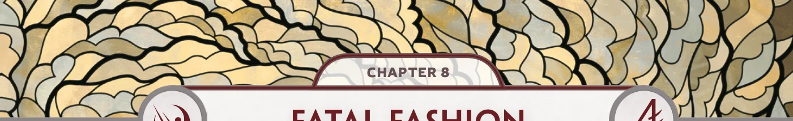
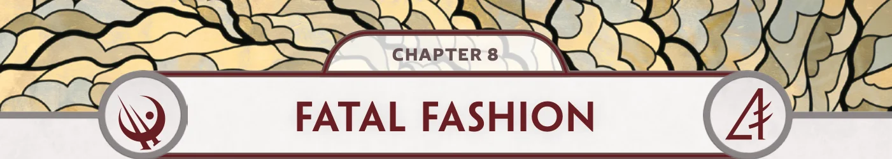
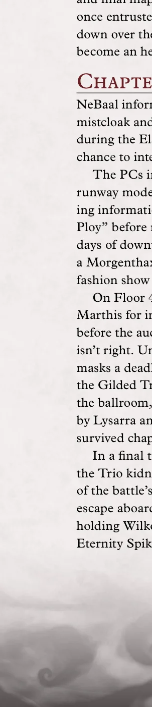

### 如何主持本章

### 第 8 章

### 致命時尚

第 8 章：致命時尚 153

隊伍離開蠻橫區回到依藍戴，此時手上可能已有兩塊鍍金地圖碎片。Lysarra 以最後一塊碎片為餌，把英雄引到一場致命時裝秀。鍍金三人組將在那裡出手，以驚人的手段奪取權力。

本章讓隊伍有機會取得第三塊、也是最後一塊地圖碎片。那是一件色澤鮮藍、獨一無二的迷霧披風，曾託付給第一時代隊伍的一名英雄。這件午夜迷霧披風代代相傳，成了傳家寶。Lysarra 打算用它當誘餌。

### 章節流程

NeBaal 告訴 PC，Lysarra 已取得披風，打算在埃拉瑞爾春季沙龍的時裝秀上拍賣。這是隊伍截下這件遺物的最佳機會。PC 展開調查後，得知可以假扮伸展臺模特兒混入會場，也可能查出關於 Lysarra 的情報。主持這段調查前，請先閱讀〈Lysarra 的長期布局〉。接下來有最多十天的休整時間，最後會遭到一名 Morgenthax 幫派首領襲擊，之後 PC 風光出席時裝秀。拍賣開始前，PC 可以在太齊爾塔第 48 層向 Marthis 追問消息，並向 Merid 打聽情報。兩人都會給出情況不對勁的線索。隊伍並不知道，Lysarra 的拍賣掩蓋著一項致命陰謀。今晚，Gilded Few 將遭殺害，鍍金三人組則會取走他們的尖刺。毒氣灌入舞廳時，隊伍必須逃離，卻會遭到 Lysarra 和她忠心的保全隊長攔截。若 Vorn 在第 5 章倖存，隊長就是她。最後，PC 正為活命而奮戰時，三人組又綁走了 Azmine Wilko 教授。無論戰鬥結果如何，三人組的倖存成員都會挾持 Wilko，搭上開往舊陸沙德的太齊爾列車，直奔永恆尖刺。

### Lysarra 的長期布局

Lysarra 就讀大學時，Augustin Tekiel 的貪腐和惡名昭彰的消隱者四處劫掠，使太齊爾家族陷入財務危機。自此，Lysarra 唯一的目標就是利用永恆尖刺，讓太齊爾家族重現昔日榮光。她先透過情人 Vorn 與 Morgenthax 犯罪家族搭上線，取得資金和保全支援。接著她開始興建私人鐵路、找出舊陸沙德的位置，並調撥資源在洞穴系統入口設立基地。即使有士兵與補給可供搜索隧道，缺了鍍金地圖，他們仍找不到寶庫。Lysarra 利用從 NeBaal 那裡騙來的情報，追查面具、勳章和迷霧披風的下落，指派三人組各自取得一件。她靠個人魅力與慈善活動拿到了披風，也為 Kwylliam 和 Bayron 可能失手備妥了後手。如今，Lysarra 憑著多年縝密的布局，大膽謀求成神。她要以披風引來 PC 與其他 Gilded Few 成員，再突襲殺光他們，取出「家傳尖刺」，重新湊齊 Vadilek 的尖刺陣列。即使 PC 活下來，她也已拖住他們夠久，讓手下到相隔僅數層樓的地方綁走 Wilko 教授，並偷走教授研究隊伍所持地圖碎片的筆記。隨後她打算搭逃亡列車直抵舊陸沙德基地，帶著完整的鍍金地圖，或一份同樣可用的完整副本。備齊昇華儀式的一切所需後，Lysarra 就要完成 Vadilek 延續多年的傳承，登上神位，奪得最終的獎賞，也就是掌控司卡德利亞的命運。

### 角色升級

第二時代角色以第 6 級開始本章。〈沙龍前的休整〉結束後立刻升到第 7 級，與 Lysarra 交戰後升到第 8 級。

