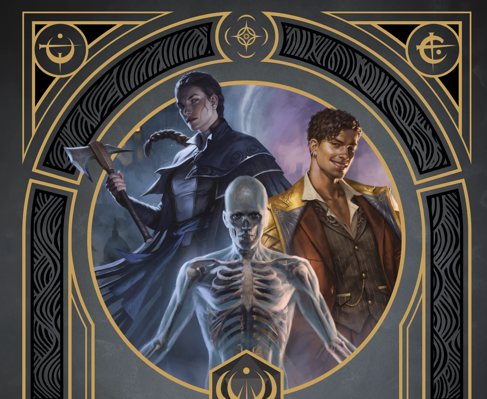
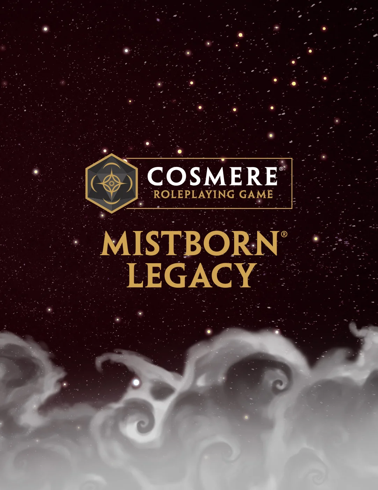
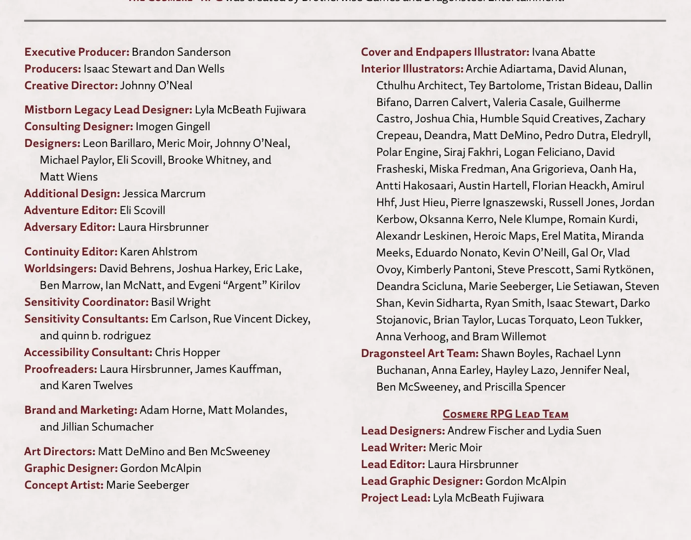

## 《迷霧之子®傳承冒險》（Mistborn® Legacy）

在這部寰宇®角色扮演遊戲冒險中，對抗兩個世代的邪惡勢力。

## 《迷霧之子®傳承冒險》（Mistborn® Legacy）

寰宇®角色扮演遊戲

## 製作名單

寰宇® RPG 由 Brotherwise Games 與 Dragonsteel Entertainment 共同創作。

總監製：Brandon Sanderson

製作人：Isaac Stewart、Dan Wells

創意總監：Johnny O’Neal

### 《傳承冒險》

首席設計師：Lyla McBeath Fujiwara

設計顧問：Imogen Gingell

設計師：Leon Barillaro、Meric Moir、Johnny O’Neal、Michael Paylor、Eli Scovill、Brooke Whitney、Matt Wiens

其他設計：Jessica Marcrum

冒險編輯：Eli Scovill

敵手編輯：Laura Hirsbrunner

設定一致性編輯：Karen Ahlstrom

歌世者（Worldsingers）：David Behrens、Joshua Harkey、Eric Lake、Ben Marrow、Ian McNatt、Evgeni “Argent” Kirilov

敏感議題協調：Basil Wright

敏感議題顧問：Em Carlson、Rue Vincent Dickey、quinn b. rodriguez

無障礙顧問：Chris Hopper

校對：Laura Hirsbrunner、James Kauffman、Karen Twelves

品牌與行銷：Adam Horne、Matt Molandes、Jillian Schumacher

美術總監：Matt DeMino、Ben McSweeney

平面設計師：Gordon McAlpin

概念美術：Marie Seeberger

封面與環襯插畫：Ivana Abatte

內頁插畫：Archie Adiartama, David Alunan, Cthulhu Architect, Tey Bartolome, Tristan Bideau, Dallin Bifano, Darren Calvert, Valeria Casale, Guilherme Castro, Joshua Chia, Humble Squid Creatives, Zachary Crepeau, Deandra, Matt DeMino, Pedro Dutra, Eledryll, Polar Engine, Siraj Fakhri, Logan Feliciano, David Frasheski, Miska Fredman, Ana Grigorieva, Oanh Ha, Antti Hakosaari, Austin Hartell, Florian Heackh, Amirul Hhf, Just Hieu, Pierre Ignaszewski, Russell Jones, Jordan Kerbow, Oksanna Kerro, Nele Klumpe, Romain Kurdi, Alexandr Leskinen, Heroic Maps, Erel Matita, Miranda Meeks, Eduardo Nonato, Kevin O’Neill, Gal Or, Vlad Ovoy, Kimberly Pantoni, Steve Prescott, Sami Rytkönen, Deandra Scicluna, Marie Seeberger, Lie Setiawan, Steven Shan, Kevin Sidharta, Ryan Smith, Isaac Stewart, Darko Stojanovic, Brian Taylor, Lucas Torquato, Leon Tukker, Anna Verhoog, and Bram Willemot

Dragonsteel 美術團隊：Shawn Boyles, Rachael Lynn Buchanan, Anna Earley, Hayley Lazo, Jennifer Neal, Ben McSweeney, and Priscilla Spencer

### 寰宇 RPG 核心團隊

首席設計師：Andrew Fischer、Lydia Suen

首席撰稿人：Meric Moir

首席編輯：Laura Hirsbrunner

首席平面設計師：Gordon McAlpin

專案負責人：Lyla McBeath Fujiwara

© 2026 Brotherwise Games, LLC。本書改編自 Brandon Sanderson 的《迷霧之子®》系列小說。小說著作權 © 2006、2007、2008、2011、2015、2016、2022 歸 Dragonsteel Entertainment, LLC 所有，並經該公司明確許可使用。

Plotweaver™ 遊戲系統 © 2025 Brotherwise Games, LLC。

ISBN：978-1-966528-08-1

初版印刷（v1.02）

中國印製

## 目錄

| 條目 | 原書頁碼 |
| --- | ---: |
| **導論** | 2 |
| 關於本書 | 2 |
| 歡迎來到司卡德利亞 | 2 |
| 帶領冒險 | 4 |
| 冒險摘要 | 10 |
| 冒險流程圖 | 11 |
| 重要人物 | 12 |
| 次要角色 | 16 |
| 發音 | 18 |
| **創造角色** | 19 |
| 這些角色是誰？ | 19 |
| 角色的傳承 | 19 |
| 角色提問 | 24 |
| 冒險目標 | 25 |
| **第 1 章：逝者的回聲** | 26 |
| 本章背景 | 26 |
| 帶領本章冒險 | 26 |
| 我們就是做這行的 | 27 |
| 寧靜的夜晚 | 28 |
| 祕密坩堝地點 | 29 |
| 逃離鎢都 | 39 |
| 繼續旅程 | 41 |
| **第 2 章：鍍金面具之後** | 42 |
| 帶領本章冒險 | 42 |
| 運河上的休整 | 43 |
| 還是那座老城 | 43 |
| 一封熱情的邀請函 | 43 |
| 祕密晚宴 | 46 |
| 絲綢陷阱 | 52 |
| 繼續旅程 | 57 |
| **第 3 章：多數與少數** | 58 |
| 帶領本章冒險 | 58 |
| 逃亡中的走私團 | 58 |
| Kandor 營造公司的危機 | 59 |
| 循跡而行 | 62 |
| 示威日 | 65 |
| Duvall 的地盤 | 70 |
| 坐上談判桌 | 72 |
| 繼續旅程 | 73 |
| **第 4 章：永恆寶庫** | 74 |
| 帶領本章冒險 | 74 |
| 籌措資源 | 74 |
| 最後準備 | 76 |
| 建造寶庫 | 81 |
| 正面交鋒 | 84 |
| NeBaal 的坦白 | 86 |
| 為明天而戰 | 88 |
| 在新帝國繼續旅程 | 91 |
| **第 5 章：引擎與諜報** | 92 |
| 帶領本章冒險 | 92 |
| 發動引擎 | 93 |
| 我們怎麼走到這一步？ | 95 |
| 汽車混戰 | 97 |
| 上流社會的竊案 | 100 |
| 繁文縟節與風險 | 104 |
| 火速追擊 | 108 |
| 繼續旅程 | 110 |
| **第 6 章：飢渴靈魂的渴望** | 111 |
| 帶領本章冒險 | 111 |
| 算清舊帳 | 112 |
| 時間緊迫 | 112 |
| 調查報導 | 115 |
| 依藍戴大學地點 | 117 |
| 準備試煉 | 121 |
| 午夜試煉 | 125 |
| 入會 | 129 |
| 退出 | 131 |
| 竊來的祕密 | 132 |
| 繼續旅程 | 132 |
| **第 7 章：敲擊鐵砧** | 133 |
| 帶領本章冒險 | 133 |
| 逐漸消失的線索 | 133 |
| 鐵軌上的詭計 | 136 |
| 蠻橫之地的混戰 | 139 |
| 探索風化鎮 | 141 |
| 這鎮上容不下兩個人 | 146 |
| 繼續旅程 | 152 |
| **第 8 章：致命時尚** | 153 |
| 帶領本章冒險 | 153 |
| 盯上太齊爾家族 | 154 |
| 調查太齊爾家族 | 155 |
| 盛裝赴殺局 | 158 |
| 時尚滲透行動 | 161 |
| 拍賣場上的交鋒 | 163 |
| 翡翠色的結局 | 167 |
| 趕上火車 | 168 |
| 繼續旅程 | 171 |
| **第 9 章：一切終於陸沙德** | 172 |
| 帶領本章冒險 | 172 |
| 前往過去 | 172 |
| 與永恆競速 | 177 |
| 命運的絲線 | 182 |
| 愚人的自由 | 184 |
| 尾聲 | 187 |
| 繼續你的戰役 | 188 |
| **附錄 A：敵手** | 189 |
| 顧問 | 189 |
| Anastas Elariel | 190 |
| 鐵砧 | 191 |
| 灰侯．塞特 | 192 |
| Azmine Wilko | 193 |
| Bayron Conrad | 194 |
| Bezryl | 196 |
| 保鑣 | 197 |
| 布維達雙胞胎 | 198 |
| Eliane Vorn 隊長 | 200 |
| 平民 | 202 |
| 騙術高手 | 203 |
| Conrad 員工 | 204 |
| 警員 | 207 |
| Delina Tekiel | 208 |
| Duvall Haught | 210 |
| 打手 | 212 |
| 自由鬥士 | 213 |
| 駐軍士兵 | 214 |
| Guiverre Seeris | 215 |
| 殺霧者 | 216 |
| 血金野獸 | 218 |
| 血金術怪物 | 220 |
| 線人 | 222 |
| 煽動者 | 222 |
| 克羅司氏族保護者 | 223 |
| Kwylliam Elariel | 224 |
| 執法者 | 226 |
| Lysarra Tekiel | 227 |
| 商人 | 229 |
| 迷霧之子 | 230 |
| 霧魅 | 232 |
| NeBaal | 233 |
| 法外之徒 | 234 |
| 法外之徒首領 | 235 |
| 反抗者 | 236 |
| 社交名流 | 237 |
| 結社成員 | 238 |
| **附錄 B：物品** | 240 |
| **附錄 C：永恆尖刺** | 242 |
| **附錄 D：講義** | 243 |
| **附錄 E：休整** | 256 |
| 在陸沙德休整（第一時代） | 256 |
| 在依藍戴休整（第二時代） | 259 |
| **附錄 F：守護者組織** | 262 |
| **致謝** | 264 |
