### 永恆在等著我們。昇華

### 儀式將在夜幕降臨時

### 開始。唯有夠格的人

才能熬過接下來的一切。

### 烈火會驗出

礦石是否純淨。

——V.

### 附錄 D

### 講義

本附錄依《迷霧之子傳承》冒險中的出現順序，收錄所有必備的玩家講義。

### Vadilek 的第一封信

### 第 1 章

### Vadilek 的第二封信

### 第 1 章

### Enge 的信

### 第 1 章

我有點私事，出去一下，

### 天黑前就會回來，還會帶酒

### 給大家在路上喝！今天就

放鬆休息吧。這是你們應得的。

### 敬往後還有好多差事，

### 能跟我最棒的這群夥伴一起幹！

### ——Enge

Engeanthe，我很後悔上次和你說的話。

### 我當時向你提出的要求，

### 是我以為非做不可的事。

### 我那時根本不懂

自己在要求什麼。現在我明白代價了。

### 我欠你一句道歉，

### 也欠你一個解釋。請讓我

彌補過錯。回 Velstane 那裡吧。

### 你要知道，你夠格，

### 而且這裡一直都會

有你的位置。

——V.

附錄 D：講義 243

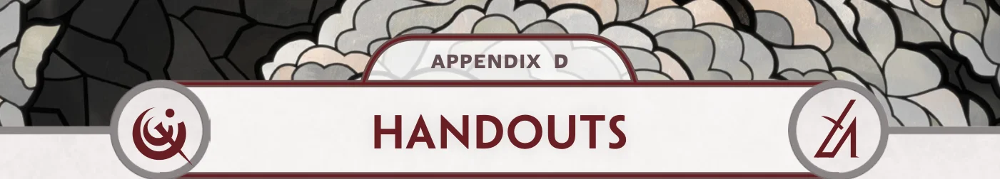

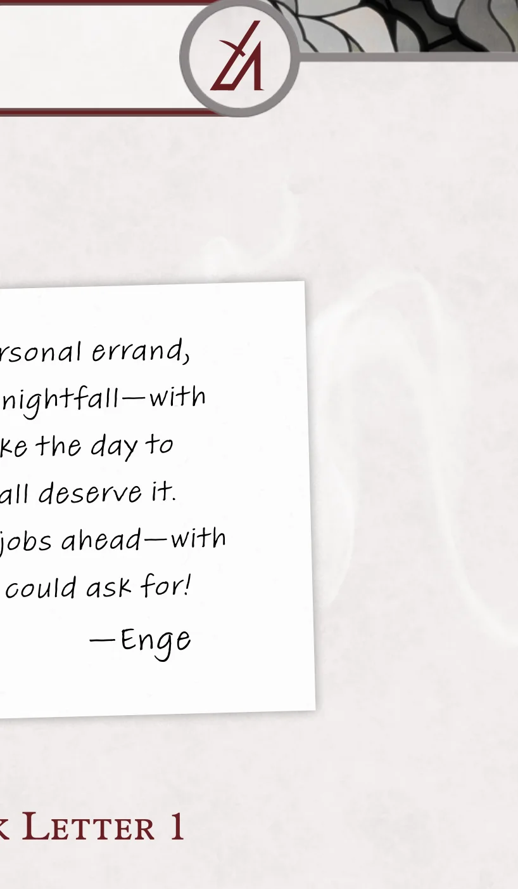

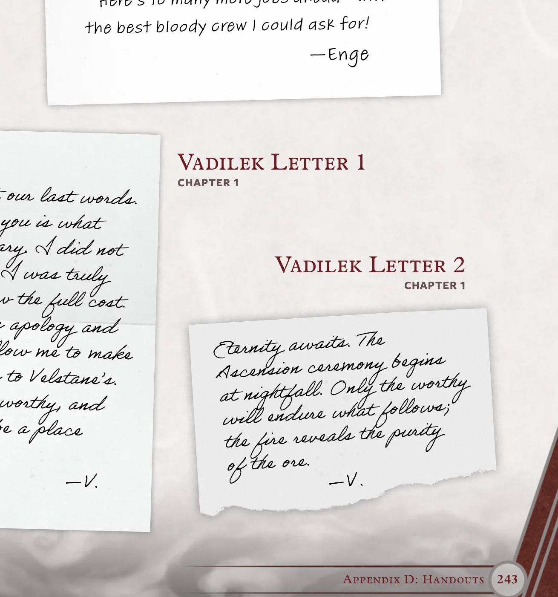

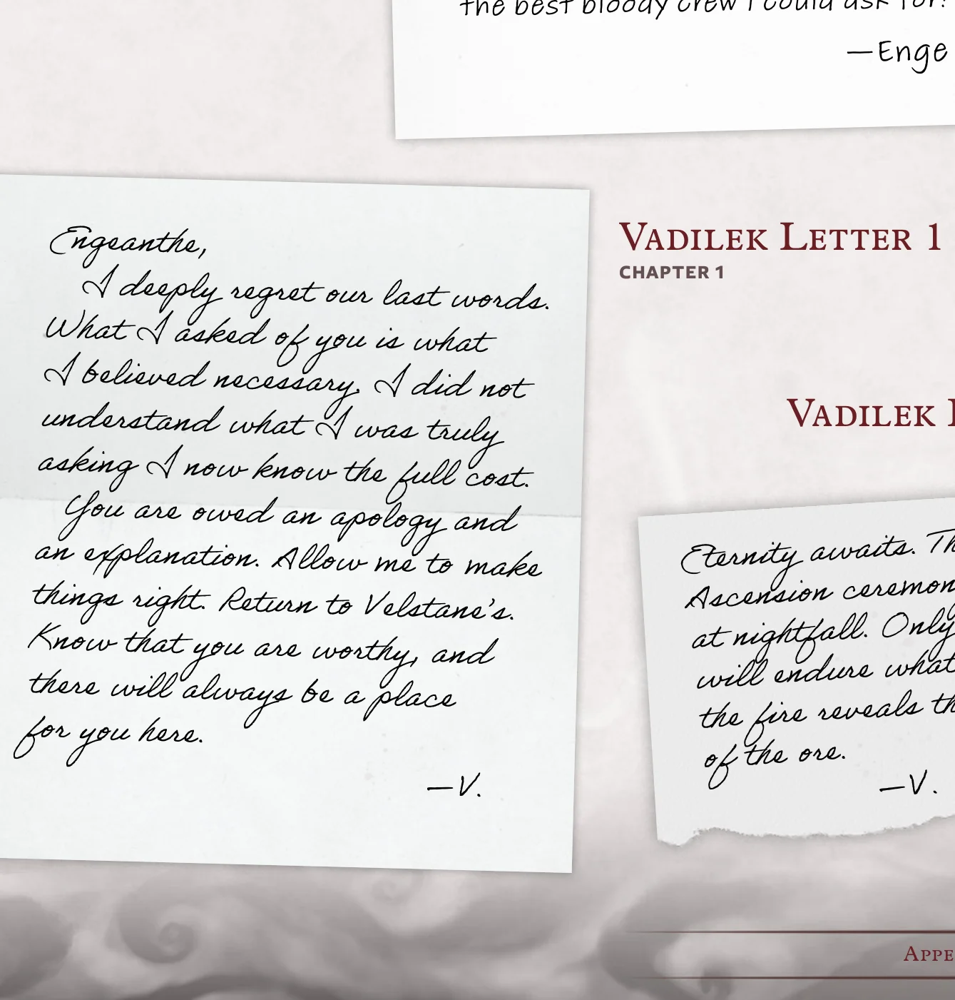

### Vadilek 的日誌

### 第 1 章

### 第 47 則

### 第 47 則

尖刺的歌聲愈來愈響。我依然堅守。

### 省思、犧牲、高貴。統御主缺少這些，

而我會將這些做到極致。

### Gilded Few 還沒準備好。

### 午夜試煉已經證明了這點。Delina 把野心

### 偽裝成忠誠，但我看得見她眼中的渴望。Engeanthe

拒絕了我……而這或許正是她的長處。

不管她願不願意，我們的未來都在她身上。

我的犧牲會催生我們偉大的未來。

### 我選定的繼承人將會昇華。就算我

### 最後失敗，也早已安排好後路，

### 確保有一名配得上的繼承人

能為帝國昇華。

傳承將長存。

### 給 Idren 的信

### 第 1 章

Idren：

### 你不用聽從

Vadilek 的心血來潮，也不用服從他那該死的一套。

### 他懂很多事，卻無法

### 衡量或評斷一個人的價值。你

### 不必「重塑世界」，也不必被

### 「鍛造」。離開鎢都吧。選擇

### 活下去不會讓你成為恥辱或輸家。

### 回家吧。——父親

附錄 D：講義 244

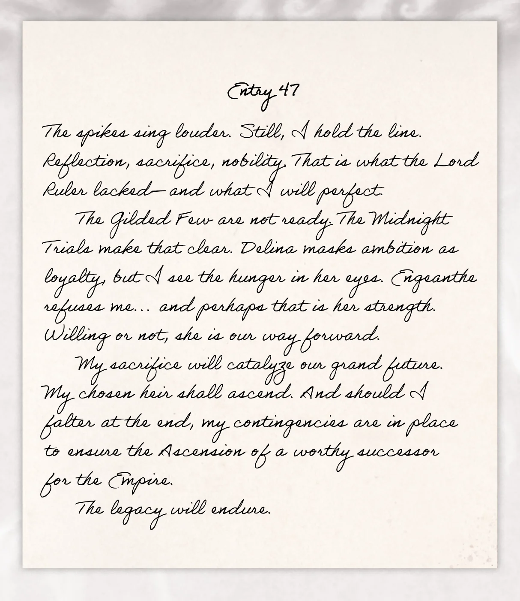

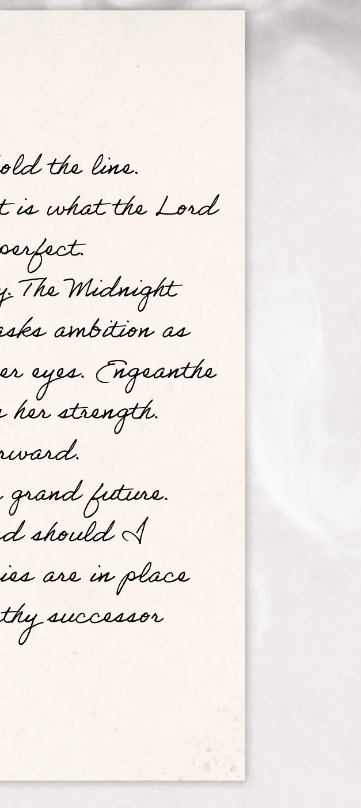

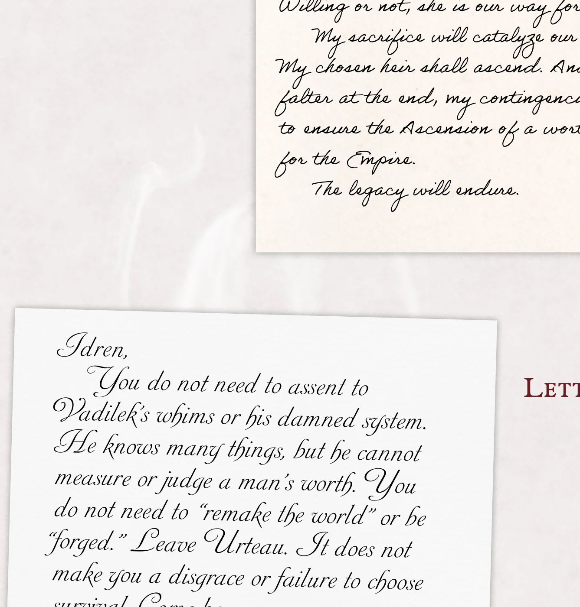

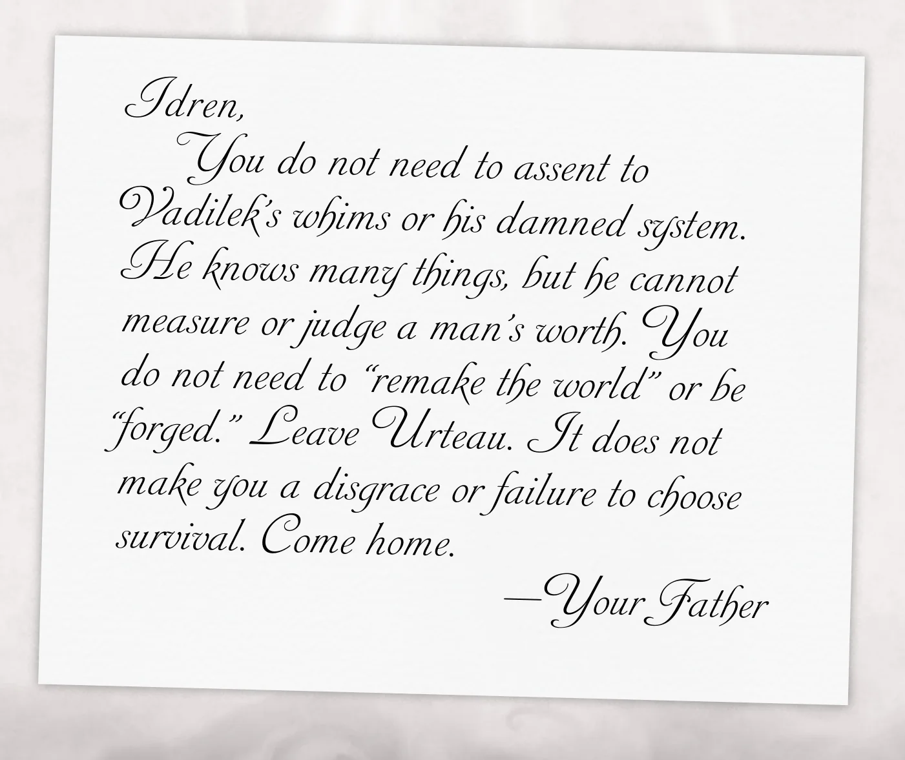

親愛的 Engeanthe（和各位朋友）：

### 誠摯邀請各位出席一場祕密假面舞會，

### 地點在 Fellise 的 Seeris 家族莊園，詳情隨函附上。

### 期待各位與我共度本季最私密、

最不為人知的一場盛會。

### 請出示本邀請函入場。你們一行人

不分階級或身分，都歡迎前來。

### 為了配合新時代，本活動不限制服裝，但請

務必戴上面具。

請務必帶上你們從鎢都取回的珍玩。

### 第二輪舞曲結束後，請靜候我的召見。

我給的報酬一定和我本人一樣可觀，

### 要是沒有更可觀的話！

### 還請各位務必低調，

免得引來不必要的注意。

懷著深深的情意，

### ——Guiverre Seeris 大人

### 附註：有個小霧精靈告訴我，你們可能從鎢都

帶回了一樁不想碰上的麻煩。如果真是這樣，

我或許有些看法可以供你們參考。

### 舞會邀請函

### 第 2 章

附錄 D：講義 245

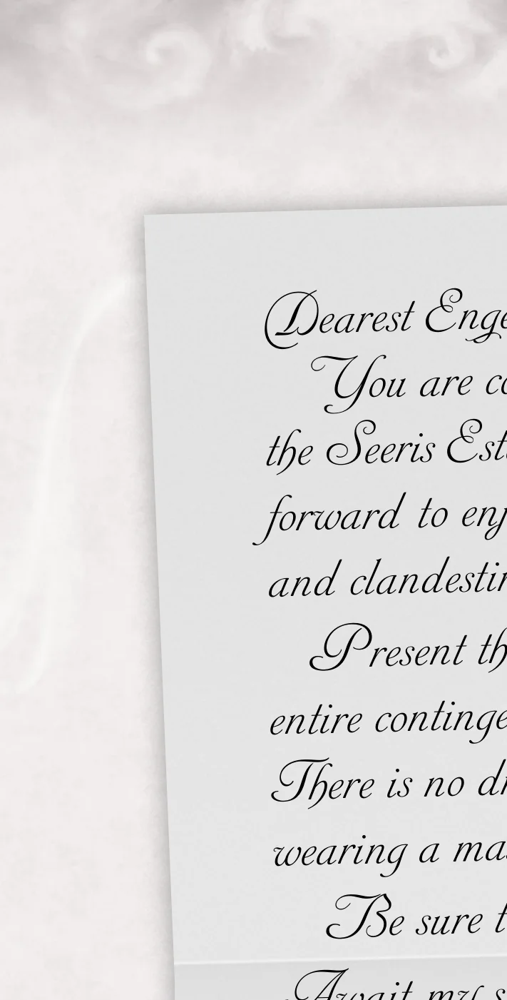

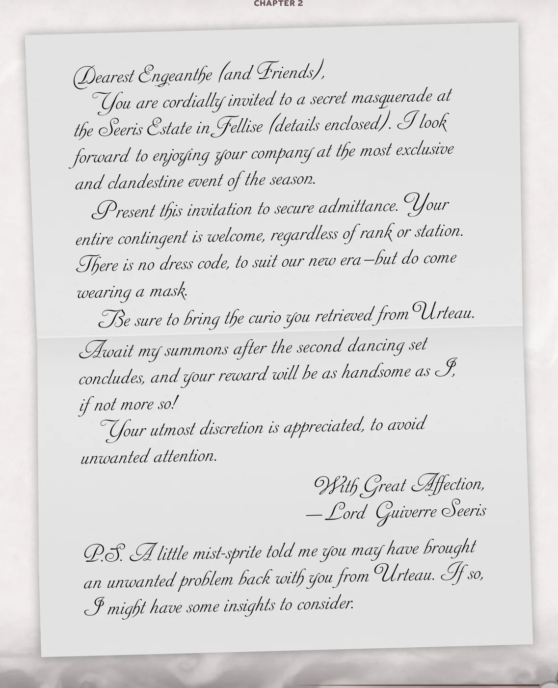

### 永恆寶庫地圖

### 第 4 章

HEROIC MAPS

246

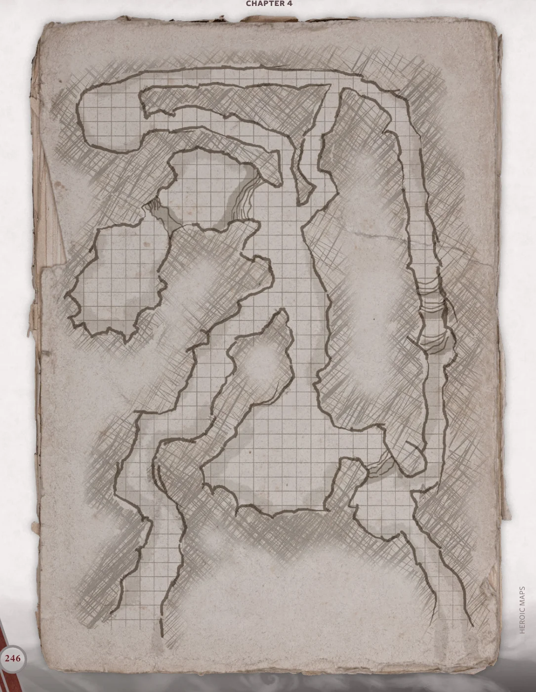

### 寶庫陷阱（第 4 章）

「寶庫陷阱」和「陷阱改裝」表列出你可以在寶庫內建造的陷阱及其改裝。每項都有以下數值。

先決條件。建造陷阱或改裝所需的

條件。建造會消耗人力和材料，圖紙則不會消耗。如果圖紙數值為 2，就可以建造所有要求「圖紙 2」或更低的項目。改裝的先決條件也會列出可以套用的陷阱。材料。從材料總量中扣除的

數量。一旦嘗試建造陷阱，無論成功或失敗，都會消耗材料。DC。成功建造陷阱必須達到的

檢定結果。花費人力可以降低 DC。

效果。陷阱會造成什麼。尺寸。陷阱在地圖上占據的空間，

同時以呎與格數表示。尺寸是約略的建議值。

只要材料足夠，基礎陷阱可以重複建造任意次數。但每項改裝（例如酸液塗層）對同一個陷阱只能套用一次。

有更好的點子？

你也許想在寶庫裡建造其他機關。請和 GM 一起參考清單中類似機關的數值，決定你想提出的新機關應有的數值。

### 寶庫陷阱

| 類型 | 先決條件 | 材料 | DC | 效果 | 尺寸 |
| --- | --- | --- | --- | --- | --- |
| 酸液池 | 圖紙 4 | 3 | DC 19 | 踩到陷阱上方的地板時，地板會打開， 露出一個巨大的酸液池。可傷害坎得拉。 | 15 呎 × 15 呎（3×3）或 20 呎 × 20 呎（4×4） |
| 誘餌匣 | 圖紙 2 | 1 | DC 16* | 這個匣子看起來就像存放永恆尖刺的真匣子。 這可能分散入侵者的注意， 並拖慢他們。 | 5 呎 × 10 呎（1×2） |
| 陷坑 | 圖紙 1 | 1 | DC 17 | 坑底插滿致命尖刺，上面鋪了碎石， 看起來像堅固的地板。陷阱會傷害 並拖慢入侵者。 | 10 呎 × 10 呎（2×2） |
| 滾動巨石 陷阱 | 圖紙 3 | 2 | DC 16 | 觸發時，一塊巨石會從天花板掉下來， 沿走廊滾動。PC 在放置陷阱時 決定巨石滾動的方向。 | 10 呎 × 10 呎（2×2） |
| 尖刺陷阱 | — | 1 | DC 15 | 觸發時，尖刺會從地面升起或從天花板降下， 傷害入侵者。 | 10 呎 × 10 呎（2×2） |
| 擺盪斧 | 圖紙 3 | 2 | DC 18 | 觸發時，這些金屬斧會在房間裡 來回擺盪。 | 10 呎 × 25 呎（2×5）或 15 呎 × 25 呎（3×5） |
| 牆壁飛鏢 | 圖紙 1 | 1 | DC 15 | 觸發時，飛鏢會從牆上射出， 傷害入侵者。 | 5 呎 × 15 呎（1×3） |

*以真正的血金尖刺製作誘餌時，PC 在建造本陷阱的檢定中獲得一個優勢。

### 陷阱改裝

| 類型 | 先決條件 | 材料 | DC | 效果 | 尺寸 |
| --- | --- | --- | --- | --- | --- |
| 酸液塗層 | 尖刺陷阱或 牆壁飛鏢， 圖紙 2 | 1 | DC 17 | 陷阱的尖刺或飛鏢塗有持久的 酸液，能造成更多傷害。這可以傷害 坎得拉。 | 任意陷阱 |
| 加固 | 任意陷阱、圖紙 1 | 1 | DC 13 | 加固陷阱會讓它更堅固， 經得起時間的侵蝕。 | 任意陷阱 |
| 妥善隱藏 | 任意陷阱、圖紙 1 | 1 | DC 14 | 把陷阱藏好可以讓它更有效。 | 任意陷阱 |

附錄 D：講義 247

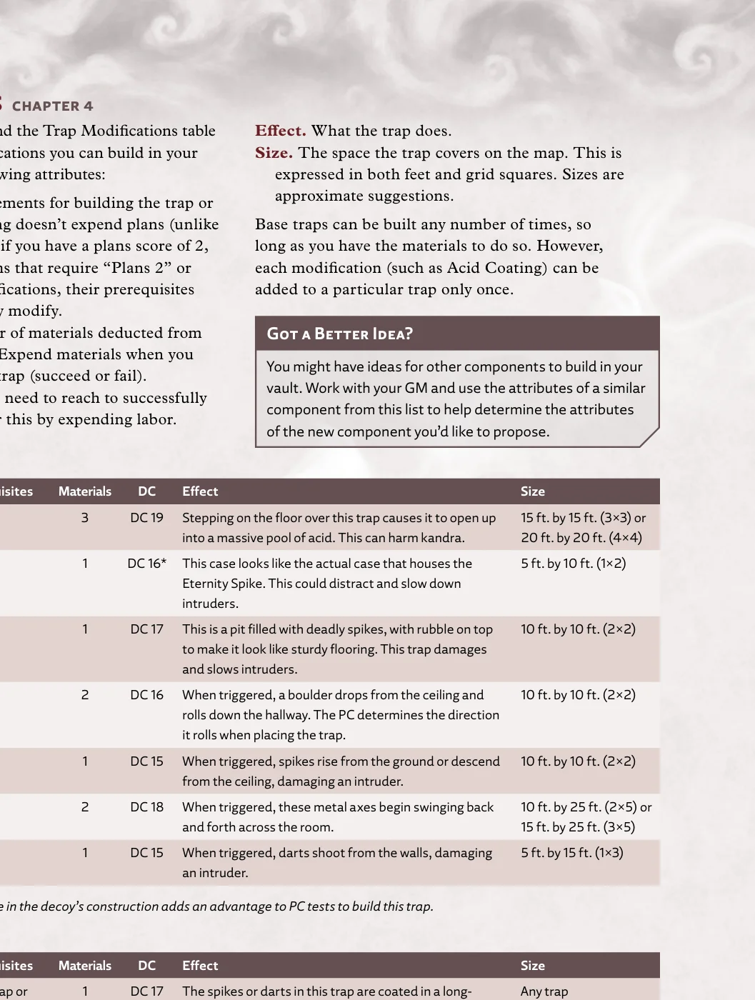

如果你們讀到這封信，表示我已經離開。你們為了幫我做了那麼多，

理應得到一個解釋。

我的真名是 NeBaal。我是坎得拉，曾與 Vadilek 訂下契約。

他折磨了成千上萬的人，再任由他們死去，但契約要我為他效力。

所以我照做了。我受命看著他的姪女，因此有幸認識

Enge，也認識了你們。

Vadilek 做對了一件事。他看出 Enge 的潛力。但她與叔叔唯一

相同的地方就是熱忱。她是個好人。我看著她長大。Vadilek

引她回去時，我親眼看見 Delina 殺了她。我哀悼 Enge，然後成了她。

你們若覺得受了背叛，我能理解。我欺瞞你們，你們卻給了我一份禮物。

這幾個月，我得以透過 Enge 的雙眼看這個世界。我看見你們有多愛她，

也感受到她有多愛你們。我們有多愛你們。

我只遺憾沒有早點告訴你們真相。

### 尖刺暫時安全。但活得像我這麼久，就會明白

未來有多難預料。我其實不是你們的頭兒，沒資格開口要求，

但這支團隊還有最後一樁走私差事。我畫了一份指向寶庫的地圖，

好讓我們為未來守住尖刺……無論我或你們出了什麼事。

我把地圖分成兩塊，已和 Tresting 信得過的熟人安排妥當，

讓兩批截然不同的人分別守好地圖。

我希望有朝一日，能由全人類共同決定永恆尖刺的結局，

而非由某個人說了算。但首先，我們得把地圖碎片平安送出城，

讓 Gilded Few 和入侵陸沙德的人都拿不到。

我也希望不必拜託你們。這樁差事極為困難，

### 圍城讓它更致命，你們可能會因此喪命。但我相信你們，就像 Enge 相信

你們。Vadilek 和她有血緣關係，你們才是她的家人。這張地圖是我最後、也是最好的希望。

也許有一天，人類會學到教訓。也許未來會更仁慈。在沒有

Gilded Few 的世界，尖刺可以用來做好事。或許人們對

金屬技藝的了解會日益加深，終於有人能摧毀尖刺。無論如何，

地圖都必須留下，好保住尖刺和世界的未來。

請別草率決定。用一個晚上好好想想。拒絕

確實比較安全。如果你們選擇幫忙，今晚好好休息，

天亮前出發。

我留了幾樣最後的禮物給你們。希望你們收下，把地圖送到

### 安全的地方。我希望你們能活下來，有機會卸下重擔。

或許我也終於卸下了自己的重擔。我或許已經離開，但我愛你們，

永遠如此。謝謝你們做的一切、付出的一切，也謝謝你們給了 Enge 一個真正的家。

永遠感激你們的 NeBaal。

### NeBaal 的信（第 4 章）

248

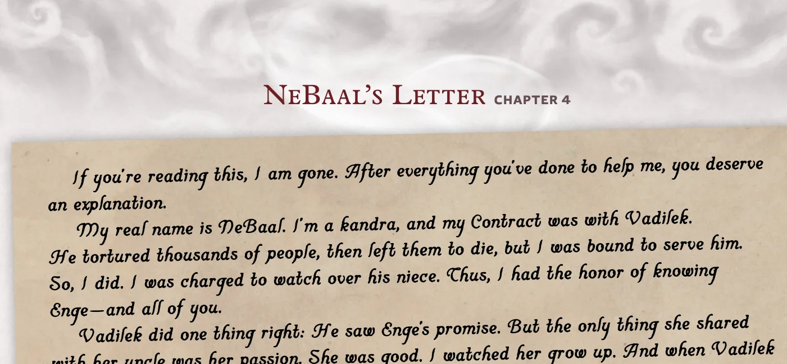

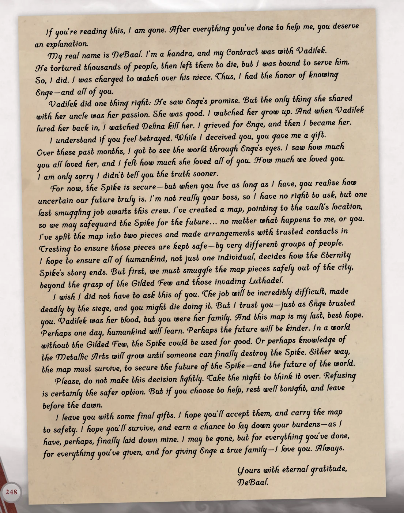

### 我的傳承

### 第 4 章

玩家姓名：　角色姓名：　傳承：

你的角色想留下什麼傳承？希望後世如何記住他們？

即使任務可能讓你的角色喪命，他們還是會在黎明赴約，接受 NeBaal 的任務嗎？

❍ 是，我接受任務　❍ 否，我拒絕任務

死亡日期、時間與方式：

附錄 D：講義 249

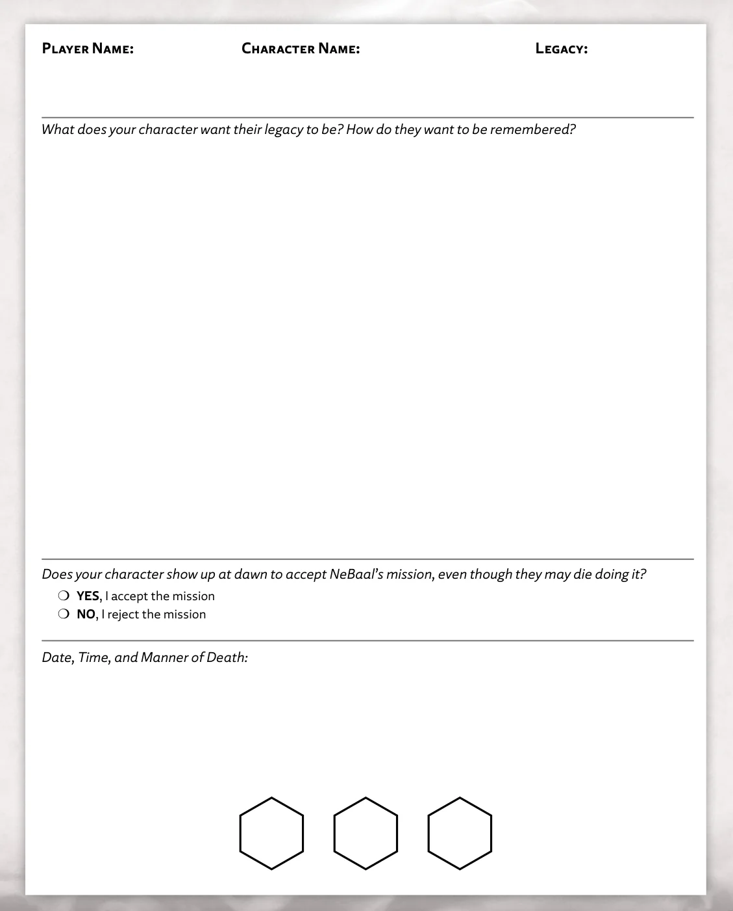

### 345 年 Cladence 月 6 日

### 2C 版

### Newsworthy Co

### Newsworthy Co

收錄最後帝國覆滅後

那段動盪時期的紀事。

兩場展覽能在這個時候相互呼應，多虧了 Kwylliam Elariel。他是

依藍戴大學校友，

如今也是國家檔案館董事。這名 Elariel 家族後裔捐助了兩場展覽，公開展現出一份有人稱為「近來才顯露」的認真態度。

「悲劇與勝利」收錄

### 街頭汽車競速

### 進步的象徵，還是現代的威脅？

當代機械奇蹟在依藍戴的青年之中不乏熱情擁護者，尤其是有閒暇、有財力購買最新汽車的人。入夜後，引擎在原本安分的大道上轟鳴，駕駛較量速度與膽量，架勢更像比賽而非代步。憂心的市民指出，這些招搖的行動似乎有人組織。儘管目前沒有任何人正式被點名，汽車本身已說明了許多。這些車價格昂貴，車手卻毫不在意車輛受損或造成損害，顯然修理費與罰款對這些不守規矩的人而言不過是小麻煩。著名實業家兼發明家 Bayron Conrad 等創新倡議者認為，這類過度行為是進步難以避免的伴隨現象。另一些人則質疑，若把放縱誤當勇氣，是否會侵蝕依藍戴從灰燼中崛起所仰賴的紀律。街頭情勢危險，依藍戴警署至今仍未發表意見，儘管……

### 歡迎光臨 Exquisite Excursions

Trellis Draam 依南方做法準備精緻的 Malwish 巧克力與熱甜點。風味濃郁，難得一見。

如今就在依藍戴為您服務！

### 信賴太齊爾

### Breaknaughts！

太齊爾 Breaknaughts，連結依藍戴

與盆地之外的商機。客貨鐵路運輸，值得信賴！

準時可靠，保障周全！

### Elariel 春季沙龍

### 即將驚豔全城

Elariel 春季沙龍今年將以嶄新的盛況回歸，由 Lysarra Tekiel 女士在甫告落成的太齊爾塔主持。專屬邀請函已陸續送出，依藍戴也正翹首期待本季門檻最高的社交盛會。沙龍的重頭戲「鎏金華采」是一場時裝秀及拍賣，呈現司卡德利亞歷代風華。主辦方承諾重現歷史上的服裝輪廓，工藝與成本之高，除了富裕貴族，少有人能親眼見識。收益將捐給太齊爾女士創辦的依藍戴慈善組織青年昇華者，協助今日的青年成為明日的領袖。關注社交圈的讀者請留意！城中最顯赫的家族一定會趁這場年度盛事見人也讓人看見，在變革加速的年代延續傳統。太齊爾塔首次向如此尊貴的賓客敞開大門，今年的沙龍可望為整個社交季定下基調！

### 依藍戴大學展出司卡德利亞歷史

愛好歷史的學生有福了！這個展季，本市慷慨獻上多場展覽。依藍戴大學開放圖書館展出《創世箴言》，首次向公眾展示罕見的 Pledfellow 版本。與此同時，附近的國家檔案館也隆重推出

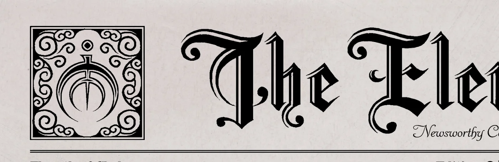

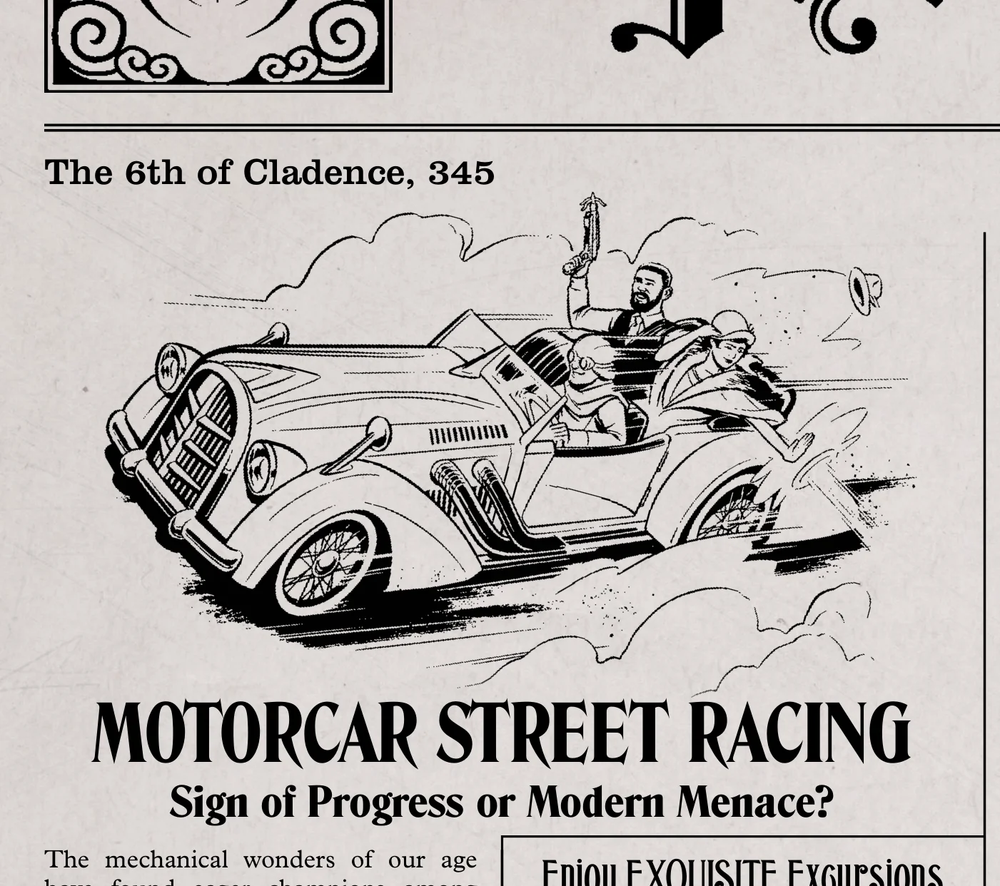

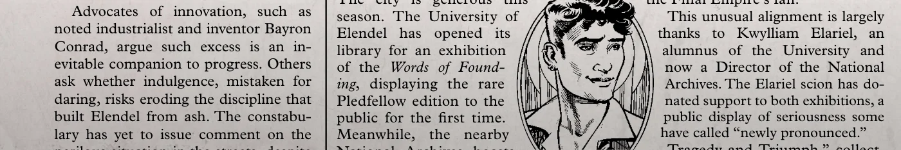

### C5JMSR

### 售價 2¢

### 每一區都有

### 每一區都有好內容！

### 好內容！

| 進步付諸實踐！ 本週，依藍戴警署開始試用  Conrad  Industries  提供的新科技。 消息人士指出， 這些新發明可能徹底 改變盆地乃至更遠地區的執法方式。 警員測試了一款重新設計的手槍， 在發射位置稍遠處 就幾乎聽不到槍聲。 同時試用的還有小巧的通話裝置。 這些精巧的裝置能把聲音傳到遠方， 使各分區警署能以前 所未有的速度通訊。 警署仍在評估新工具， 預計還會進行更多測試。 | 學業上的昇華 一名一年級學生在 校園受訪時說：「沒 有青年昇華者， 我根本不會申請入學。」 該慈善組織替她支 付費用、安排住宿， 讓她能離開工廠，開始接受高等教育。 這個組織由慈善家 Lysarra  Tekiel 創辦並主持， 與依藍戴大學合作， 提供有潛力的青年進階就讀的機會。 「它給了我起步的機會， 我只要維持成績， 偶爾幫忙辦活動就好。 真是美夢成真！」 全文續見背面。 | Vif 氣泡補身飲 清爽、氣泡充足，深受大眾喜愛， 提振精神又能安養身體。 記住醫師的話：天天喝  Vif 氣泡補身飲！ |
| --- | --- | --- |
|  |  | 縫補趁早 講究的裁縫與修改 服務，處處細心。 Orlen’s Stitch  深受專業人士信賴， 衣服經得起長時間、高強度的使用。 我們收購金屬！ 以具競爭力的價格收 購廢金屬，純度不拘！ Briggs &  Sons，持照冶金師。 第六區 Smelter’s  Row 3217 號。 |
| 蠻橫區風波 蠻橫區仍拒絕接受任何建立法治與秩序的努力，依舊是盆地管不到的暴力荒野。 太齊爾家族近日試圖延伸重要鐵路，又遭土匪與亡命之徒襲擊。 地處偏遠、秩序混亂，助長了他們的膽量。 其中最令人憂心的是一名只知綽號「鐵砧」 的危險人物，這個名號愈來愈常和蠻橫區的暴行連在一起。 報導將破壞與暴力事件歸咎於她，也讓人擔憂， 在盆地之外，進步本身是否已成了挑釁。 報導續見背面。 |  |  |

裝填時，我們就往那個通道跑。」

Liza 緊緊抓住她的袖子。「Vane，你已經不再佩戴

徽章了！你沒有誓言要守，

也沒有義務因為我選擇

為家族追求更好的前程

就賠上性命。」Vane 轉向她，在昏暗的光線下目光堅定。「沒有義務，」她說，「是我自己的選擇。」她們並肩跑去，靴子在冰上一滑，一起鑽進

### P. Maylor 著

### 第 18 回，共 48 回

拱門下狹窄的遮蔽處。Liza 貼著石牆，Vane 站到她面前，擋住開口。「可惡，Vane，」Liza 低聲說，「我不要看見你為我倒在雪地裡流血。」Vane 直視她，眼裡的火彷彿能驅散刺骨的寒冷。「我或許沒有徽章了，」她低聲說，「但我一眼就知道什麼值得保護。」有那麼一瞬，兩人屏息，只感到彼此的熱度，忘了寒冷。Liza 的手摸到 Vane 的外套，把她拉得更近……就在這時，身旁突然響起踩雪的腳步聲！

### 愛情與法律！

### 長篇連載

槍聲驟響，打中她們上方的石塊，碎片四散在冰面上。Vane 咒罵著把 Liza 拉到矮牆後，又一聲槍響劃過廢墟，她的手臂也跟著扣緊 Liza 的肩膀。「趴低，」Vane 低吼。「這是我惹出來的，」Liza 激動地低聲說。「是我把我們帶到這裡的。你不必替我付出代價。」又一聲槍響，這次更近了。Vane 瞥向前方殘破的拱門。「等他們重新

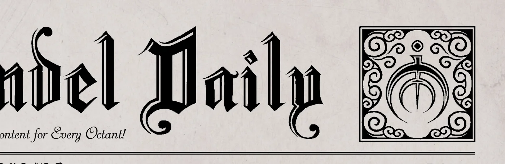

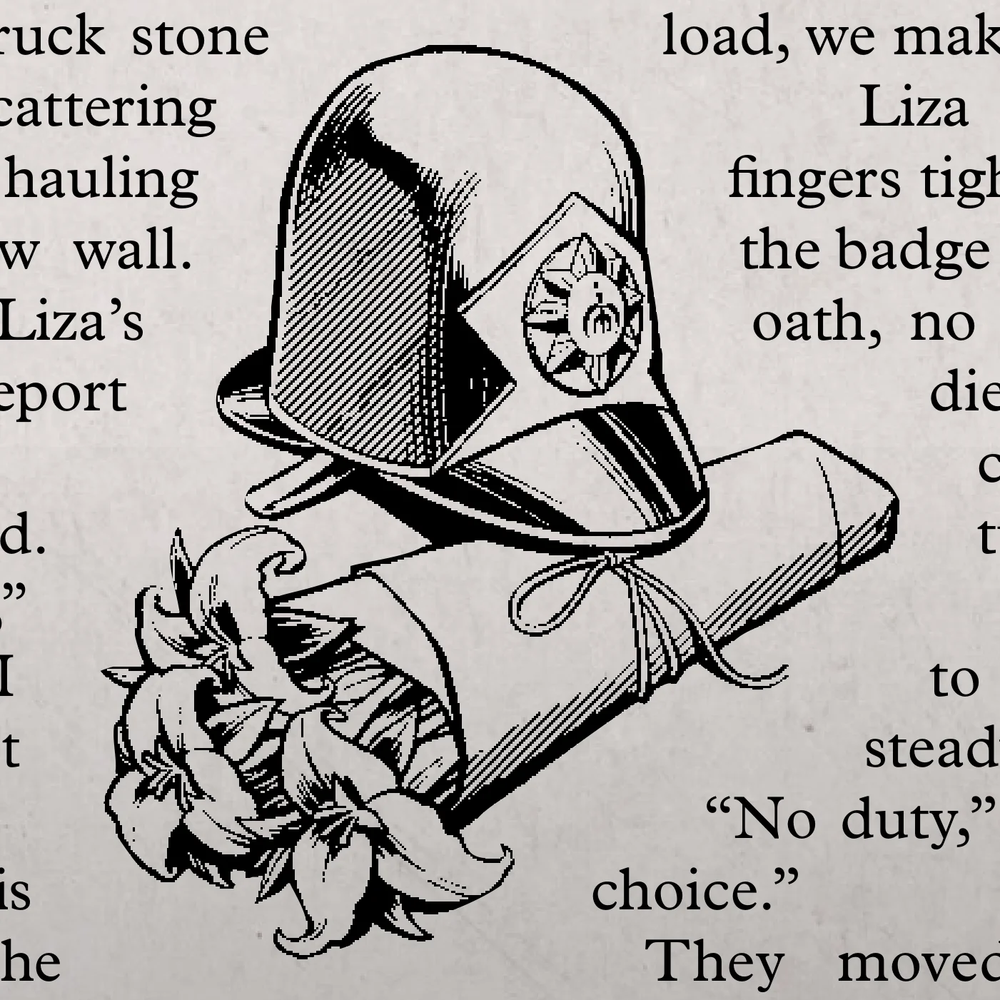

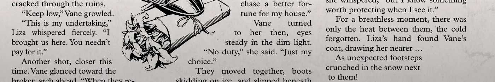

### 國家檔案館竊案地圖

### 第 5 章

### 國家檔案館徽章

### 第 5 章

HEROIC MAPS; ANNA VERHOOG

附錄 D：講義 252

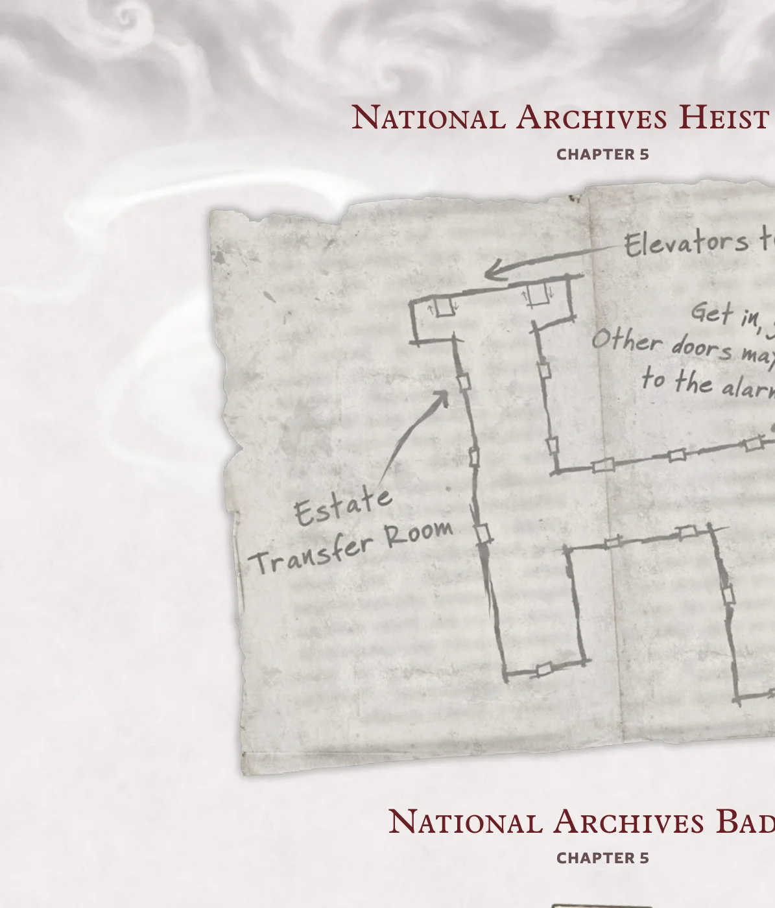

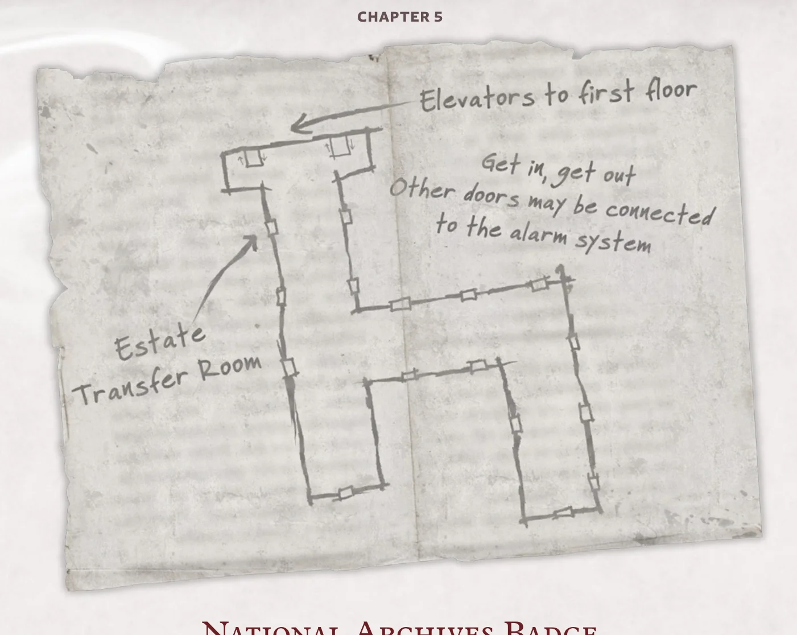

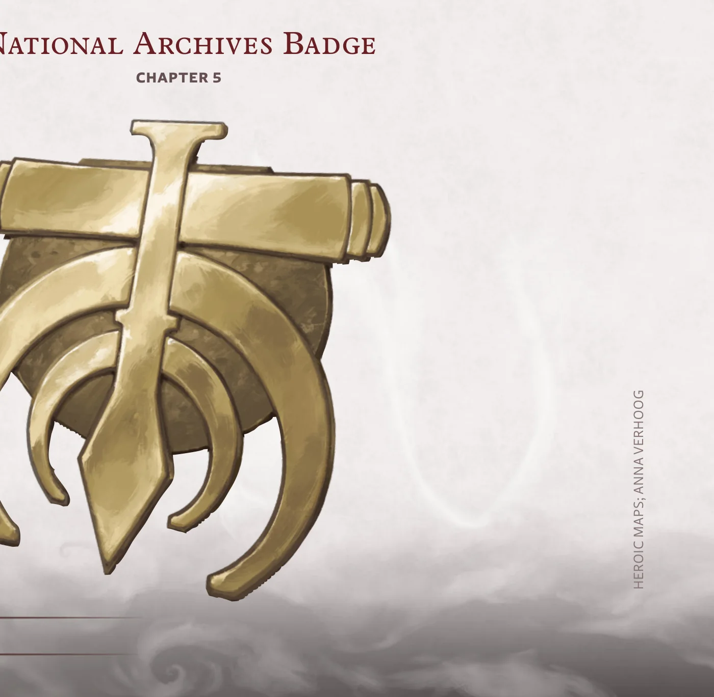

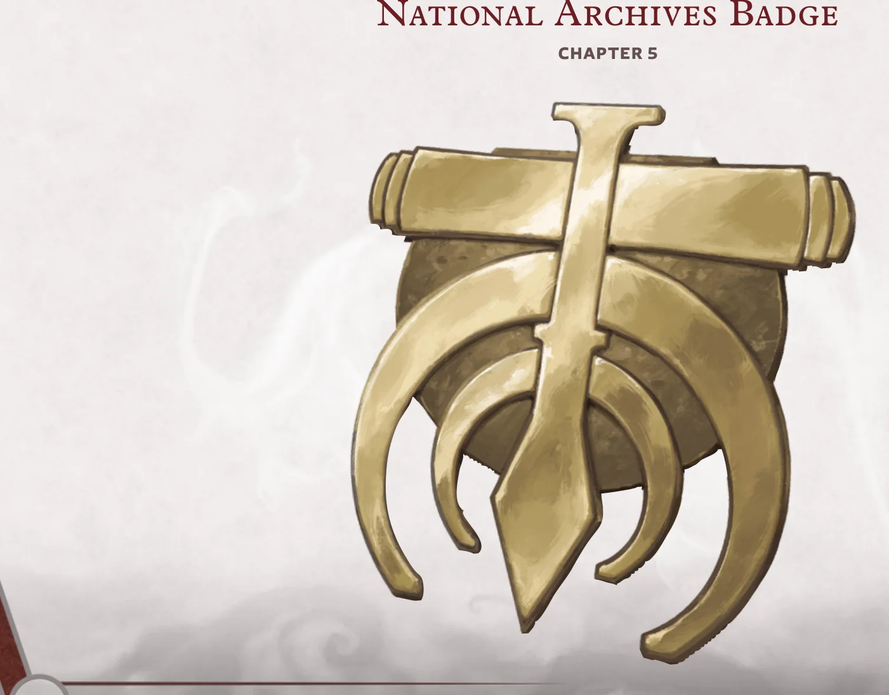

### 依藍戴大學

### Wilko 的便條

### 第 6 章

好消息：好消息：我查到了箱中物品的一些線索。

### 我相信我們拿到的是一把「創始者之鑰」。據傳，有三把這樣的鑰匙，

### 出自大學早期的一位老師。他把珍貴的

### 寶藏藏在校園底下，再將鑰匙一代代傳給

### 貴族學生保管。我想那件寶藏就是

「鍍金地圖」……這件事我們見面再詳談。

### 眼下還有一件更急的事。我以前的一名學生

### 一直追著我問鑰匙。只有和諧知道

### 她怎麼聽說的。她是《學生之聲》的記者。要是

她繼續查下去，我怕她會知道我們最近做了什麼。她說她有關於鑰匙的重要消息。

你們能去和她談談嗎？這樣問有點丟臉，但我實在不會說謊。

敬上，

### A. Wilko

### 附註：說到丟臉，也許只是我太緊張了，但我一直覺得

### 有人在監視我。要是我出了什麼事，面具和鑰匙藏在

### 我那本《Trials of Monument》裡。還有，請銷毀這張便條！

### 還有，請銷毀這張便條！

附錄 D：講義 253

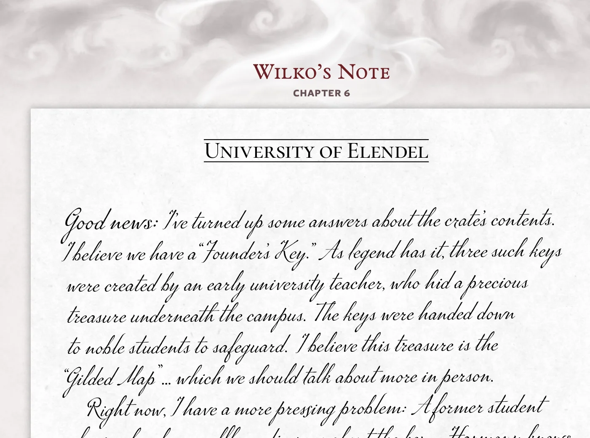

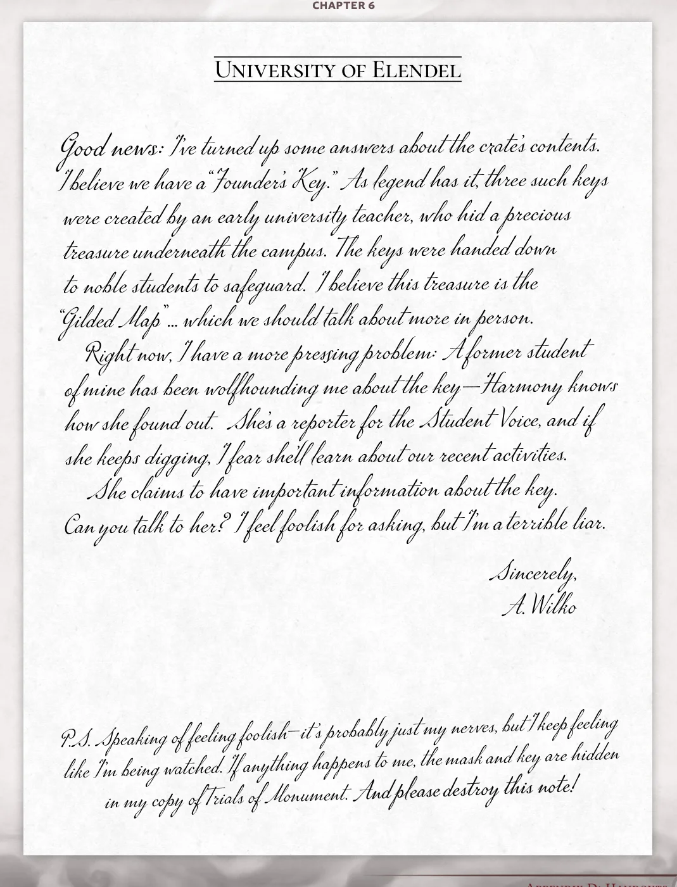

### Child of Noblest Blood—

### The Midnight Trials are at the final bell on the

### 16th day of Cladence. Those judged Worthy shall

inherit our Legacy. In preparation:

- Don proudly the Mask of the Order.

- Come bearing a Cazzian offering.

The Worthy must seek the Trial’s starting location.

### On the map, chart a Nelazan Route, connecting

the pairs of Strange Eyes. Read the Letters in Steel. Hidden at the Crossings are the directions you seek.

The fire reveals the purity of the ore.

### 午夜試煉邀請函

### 第 6 章

### 對頁：依藍戴大學校園地圖

### 第 6 章

MATT DEMINO; RYAN SMITH

附錄 D：講義 254

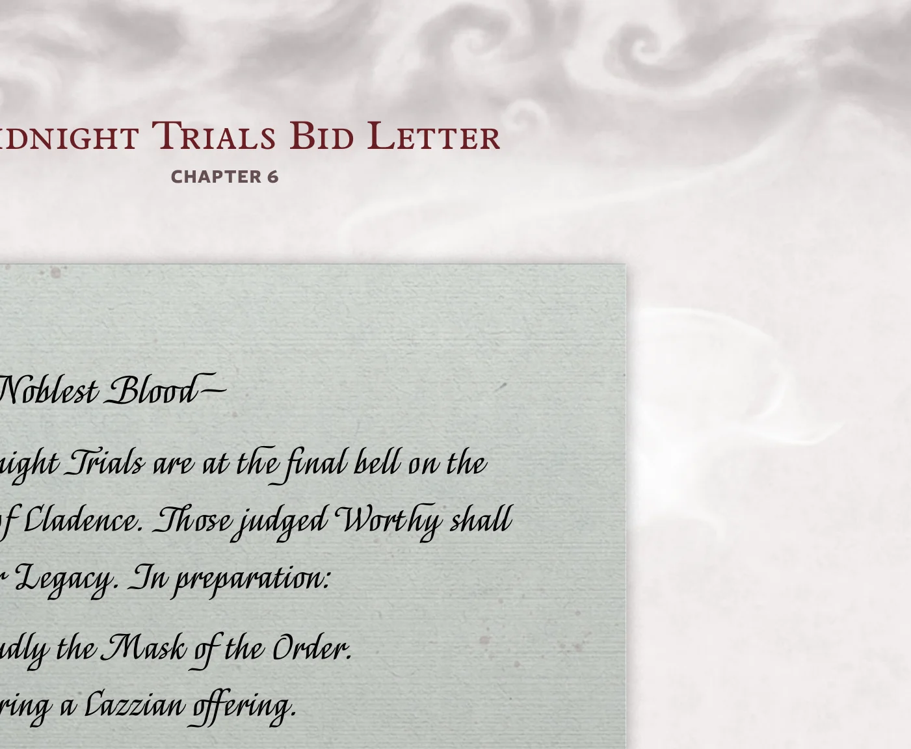

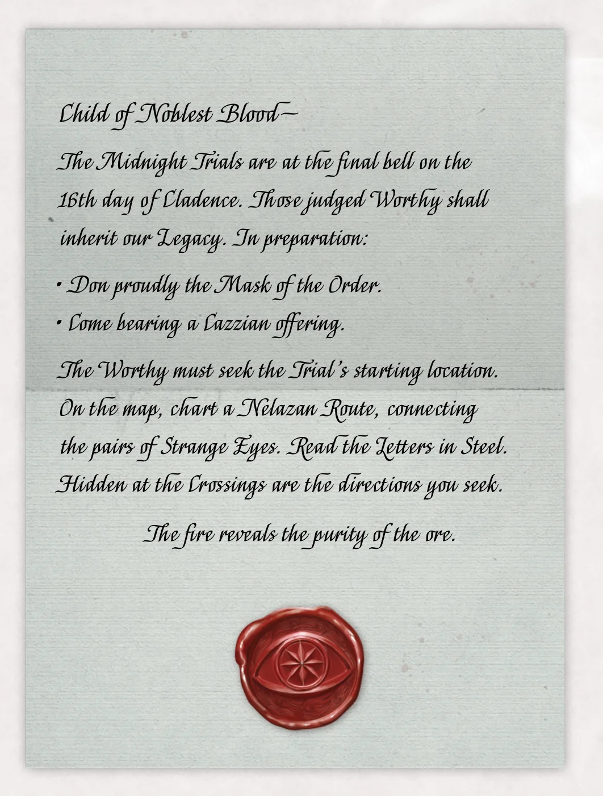

校門與

校地

電金宿舍群

體育館與

運動場

依藍戴大學

圖書館

進階科學與

冶金

實驗室

小教堂與

墓園

鐘樓

學生

中心

紅銅館

Pashadon 館

Lastrum 館

社團街

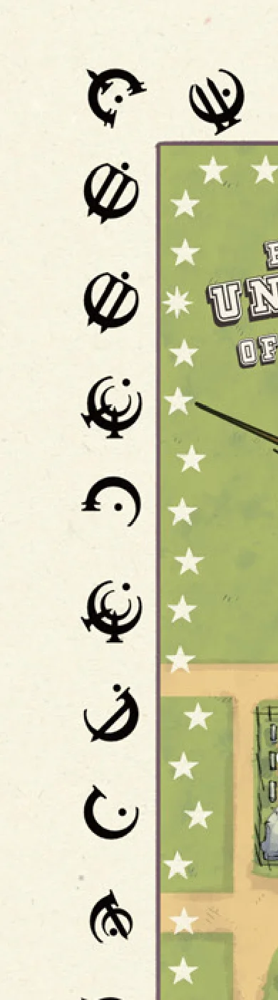
