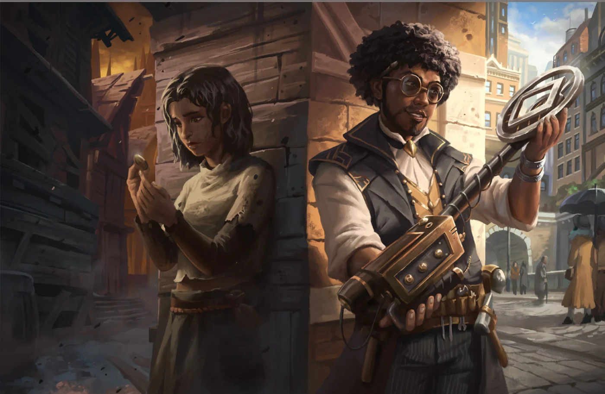
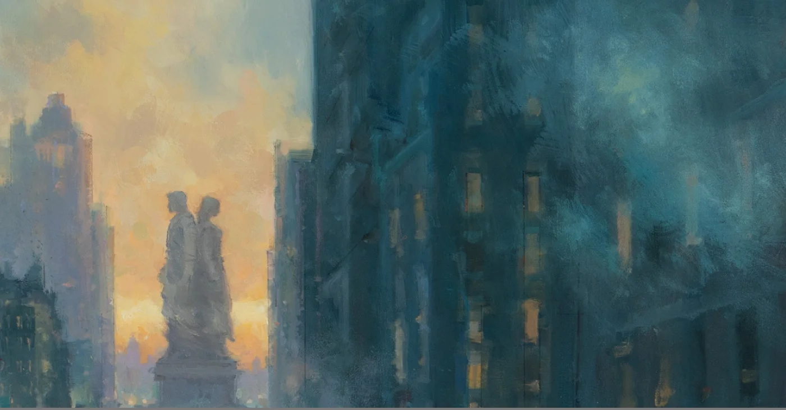

## 創造角色

本節說明如何在正式遊玩前進行第零場次，讓玩家合作創造角色，確立角色在世界中的身分，以及彼此相識的經過。進行《迷霧之子傳承》的第零場次時，依下列步驟協助玩家組成一支第一時代的玩家角色隊伍。

1. **確立共識。** 依《玩家手冊》第 13 章的「第零場次」進行。該節會引導你們建立安全工具、對戰役的基調取得共識，以及討論遊戲要在多大程度上遵循正史。
2. **組成隊伍。** 依「角色是誰？」一節，介紹玩家角色隊伍的核心概念。
3. **選擇傳承。** 依「角色傳承」一節介紹傳承機制，並按照該節的指示選擇傳承。
4. **創造角色。** 玩家選好傳承、理解戰役前提後，就可以創造 1 級角色。完整創角說明見《玩家手冊》第 1 章。
5. **建立連結。** 依「角色問題」一節，為隊員建立一些共同經歷和彼此的連結。
6. **設定目標。** 最後，參照「冒險目標」一節的建議，選擇與本冒險相關的目標。

第 4 章結束時，你們將依同樣的步驟創造第二時代的角色。這些角色從 3 級開始。

### 角色是誰？

在兩個時代，玩家角色在冒險開始前都已隸屬於一支隊伍。第一時代是走私團隊，第二時代則是尋寶團隊。玩家必須創造符合隊伍概念的角色。競爭與小摩擦可以帶來有趣的角色扮演，但角色大致上應該喜歡彼此，能好好合作。請將以下冒險隊伍的描述分享給玩家。

#### 第一時代隊伍

**第一時代隊伍目標**　在最後帝國覆亡後，成功經營走私生意。

第一時代的玩家角色是一支小規模的走私團隊，以一艘往來鎢都與陸沙德的運河船為據點。同一天內，他們可能先假扮貴族運送一批珍本，再和一夥司卡竊賊會面。最後帝國覆亡改變了這門生意，但仍有許多人需要他們的走私本領。

Enge 是這支隊伍熱情豪爽的老大。幾年前，她在運河船上把眾人聚在一起，像大姊一樣照顧隊員。關於 Enge 的更多資訊，見導論前面的「重要角色」。

#### 第二時代隊伍

**第二時代隊伍目標**　發掘歷史文物，與世人分享。

第二時代的玩家角色從 3 級開始，是一群以依藍戴為據點的尋寶人與不受學界約束的學者。他們的理論或個性與上流社會格格不入。他們想藉由「解放」陸沙德的文物，更深入了解過去，揭露司卡德利亞歷史上的重要真相。Azmine Wilko 教授是隊伍最親近的盟友和共謀者，會從事研究、提供線索，支持隊伍的冒險。關於 Wilko 的更多資訊，見導論前面的「重要角色」。

### 角色傳承

角色傳承代表玩家角色的過去及其在世界上的位置。你可以透過傳承時刻，把玩家原創的角色直接融入《迷霧之子傳承》的設定與故事。這些聚焦於個別角色的場景，提供個人抉擇、揭露真相或角色扮演的機會。傳承也讓相隔數百年的英雄彼此相連，使每位第一時代玩家角色的行動影響一位與其有連結的第二時代玩家角色。

#### 使用傳承

- **創造第一時代角色時。** 每位玩家為自己的角色從六項第一時代傳承中選擇一項，回答該傳承的角色問題，並取得其專長。這項專長額外於創角時獲得的專長。
- **創造第二時代角色時。** 每位玩家從「玩家角色的傳承連結」表中，選擇與第一時代已選傳承相連的一項第二時代傳承。例如，第一時代若選了官員、囚犯、街童與貴族，第二時代就只提供執法者、說書人、企業家與繼承人。鼓勵玩家選擇與其他玩家角色相連的傳承。接著讓玩家回答傳承問題，並依相連的第一時代角色所採取的行動，取得傳承的起始獎勵。
- **遊玩期間。** 看到「玩家角色傳承」側欄時，為具有該傳承的角色安排一個傳承時刻。若隊伍中沒有指定傳承的角色，跳過該側欄。

導論 19

#### 玩家角色的傳承連結

| 第一時代傳承 | 角色連結 | 第二時代傳承 |
| --- | --- | --- |
| 貴族 | 貴族與繼承人出身同一家族。 | 繼承人 |
| 編年史家 | 探索者所掌握的知識以編年史家的著作為核心。 | 探索者 |
| 街童 | 街童的決定使後裔企業家受益。 | 企業家 |
| 官員 | 官員的理念影響執法者的工作。 | 執法者 |
| 囚犯 | 囚犯的故事是說書人作品的主要題材。 | 說書人 |
| 老兵 | 老兵傳奇般的英勇事蹟，成為新手必須努力追上的標竿。 | 新手 |

### 第一時代傳承

請每位玩家為自己的第一時代角色選擇下列六項傳承之一。

#### 編年史家（第一時代）

編年史家肩負見證當下歷史的使命，留下的紀錄將為後世守護真相。這可能是他個人的志業，也可能源於史學機構的委託，例如由藏金術師組成的泰瑞司守護者。

**角色問題**

- 你記錄的歷史以什麼為重點？
- 你用什麼方式留下紀錄？你的紀錄有名稱嗎？

**額外專長。** 編年史家獲得旅行者或泰瑞司統御區文化專長。這項選擇可以反映他過去的旅程，或蒐集紀錄的地點。

#### 囚犯（第一時代）

囚犯曾被統御主下令關押，後來大膽越獄，從此必須時時提防鋼鐵教廷。如今，Enge 的走私生意讓他有機會重新開始。

**角色問題**

- 你因什麼罪名被判刑？你真的犯了這項罪嗎？
- 你是怎麼越獄的？

**額外專長。** 囚犯獲得執法實用專長或地下社會文化專長，反映他身陷司法體系期間學到的事。

#### 貴族（第一時代）

貴族曾在最後帝國殘酷的階級制度中享有特權。無論是因反抗還是失敗，他已被家族排斥，只能在這個無情的世界裡自行謀生。

**角色問題**

- 你的家族姓什麼？以什麼聞名？
- 為什麼你永遠無法回到貴族家族？

**額外專長。** 貴族獲得上流社會或陸沙德文化專長。若他曾代表家族活躍於首都政壇，後者尤其合適。

#### 官員（第一時代）

每個帝國都需要官僚。官員曾是鋼鐵教廷的聖務官，或曾以其他方式密切參與最後帝國的治理。統御主殞落後，他離開原職，加入 Enge 的走私生意。雖然在教廷任職的經歷可能仍令他難以釋懷，如今他有機會把本領用在更好的地方。

**角色問題**

- 你與鋼鐵教廷的哪個聖務廷關係最密切，例如財務廷、教義廷或資源廷？你的眼睛周圍有聖務官的刺青嗎？
- 是什麼讓你察覺教廷或你所屬機構犯下的不義有多嚴重？

**額外專長。** 官員獲得鋼鐵教廷實用專長或內統御區文化專長。這項選擇可以反映他過去與教廷或貴族何者往來較密切。

導論 20

AUSTIN HARTELL

#### 街童（第一時代）

街童出身卑微，卻決心擺脫貧困、出人頭地。這並不容易。統御主雖已死去，陸沙德的階級偏見依舊根深柢固。貴族通常對街童抱持戒心，司卡則多半會同情他。

**角色問題**

- 你有什麼特別的本領，讓隊伍少不了你？
- 你想躋身富裕的上層階級，還是讓每個人有公平的機會？

**額外專長。** 多數街童獲得地下社會文化專長。一心想躋身上層貴族，或偏好假扮貴族或行騙的街童，可以改為獲得上流社會文化專長。

#### 老兵（第一時代）

老兵可能是被徵召入伍的平民，也可能是代表貴族家族領兵的人。他參與過統御主麾下的多場交戰，服役多年，表現出色，最終卻對最後帝國的戰爭現實感到失望或厭惡。他因此逃離軍隊，掌握自己的命運。

**角色問題**

- 你在統御主的軍隊中擔任什麼職務，例如士兵、醫護兵或戰略參謀？
- 你是怎麼離開軍隊的？

**額外專長。** 老兵獲得軍旅生活實用專長或外圍統御區文化專長。這項選擇可以反映他曾駐守的地區。

一名鎢都街童是依藍戴企業家的祖先。

KEVIN SIDHARTA

### 第二時代傳承

請玩家選擇與彼此的第一時代玩家角色相連的第二時代傳承，對應關係見前面的「玩家角色的傳承連結」表。每項第二時代傳承列出兩種傳承連結起始獎勵。每位玩家只能獲得一種，可選的獎勵由相連的第一時代玩家角色所採取的行動決定。若兩種獎勵都與該角色的行動不符，可和玩家一起選擇一項合適的階層 1 獎勵來體現這段連結，或使用下列獎勵。

**銘記圍城。** 第二時代角色在一條以相連的第一時代角色命名的街道上長大。每週一次，他可以請鄰居幫忙，讓鄰居擔任一天的保鑣同伴。

#### 企業家（第二時代）

依藍戴是一座充滿機會的城市，企業家決心參與塑造它的未來。他從街童祖先手上繼承了有價值的事物，正著手實現自己的遠大構想。

**角色問題**

- 你或你的公司打算創造什麼？
- 你最珍視哪一項非金錢的遺產？那可能是一個點子、一段與名人的淵源，或是你最喜歡用來思考的地方。

**傳承連結起始獎勵**

根據街童的行動，企業家獲得下列其中一項獎勵。

- **Kandor 的贊助。** 若街童接受 Kandor 的指導，企業家就是一家規模 1 商業企業的領導者。見《玩家手冊》第 8 章的「組織」。企業家起始時額外獲得 100 盒金，企業每月也會帶來 100 盒金的利潤。
- **Cynwise 的人脈。** 若街童加入 Cynwise 的人脈網，企業家獲得依藍戴及地下社會文化專長。若在第 3 章中，Cynwise 因街童拒絕 Kandor 而給了街童盒金，企業家也獲得 100 盒金。

#### 探索者（第二時代）

探索者出身上流社會，興趣廣泛，不拘成規，立志發掘過去，尤其關注編年史家的著作。

**角色問題**

- 為什麼你與學界格格不入？
- 你為什麼特別專注於編年史家的紀錄？

**傳承連結起始獎勵**

根據編年史家的行動，探索者獲得下列其中一項獎勵。

- **Bezryl 的靈感。** 若編年史家指導 Bezryl 在勞工示威活動上演講，探索者會重視泰瑞司的歷史，並獲得一名泰瑞司顧問同伴。
- **塞特的宣傳者。** 若編年史家同意散播灰侯．塞特的宣傳，探索者明白建立實用人脈的重要性。他是「灰侯之友」的成員。這是一個規模 1 的社交俱樂部，發行自己的傳紙。見《玩家手冊》第 8 章的「組織」。

#### 繼承人（第二時代）

繼承人的貴族血統可以追溯到數百年前、落灰之終以前的世界，並與貴族傳承的角色相連。繼承人仍在世的親族尤其難纏，而他常違抗家人的期望。這些期望也可能受到貴族傳承角色的影響。這項傳承尤其適合金屬之子玩家角色，見第 6 章的繼承人傳承時刻。

**角色問題**

- 你在哪一方面未能達到家族的期望？
- 你是自己選擇不順從，還是沒有能力達到他們的期望？

**傳承連結起始獎勵**

根據貴族的行動，繼承人獲得下列其中一項獎勵。

- **Anastas 的效忠。** 若貴族協助 Cadme 與 Anastas Elariel 私奔，他善於建立同盟的名聲會成為家族的一部分。繼承人獲得自選的一批階層 1 稀有金屬。見《玩家手冊》第 8 章的「稀有金屬」。

導論 22

AUSTIN HARTELL

- **欺瞞 Duvall。** 若貴族曾與 Duvall Haught 見面商議背叛一事，他擅長操弄與欺瞞的名聲會代代流傳。繼承人的家族提供給他一頂鋁襯帽。

#### 執法者（第二時代）

執法者知道法律有其缺陷。他曾在依藍戴警署任職，如今踏上自己的道路，追尋正義真正的意義。他以官員的歷史事蹟為借鏡，因為官員也曾離開體制。

**角色問題**

- 哪件案子或哪種情況讓你從警署辭職或被解職？
- 你的工作態度或正義觀如何受到官員理念的啟發？哪些地方又與他的理念相左？

**傳承連結起始獎勵**

根據官員的行動，執法者獲得下列其中一項獎勵。

- **審判理論。** 若官員同意協助 Murn 向陸沙德新政府投降，執法者便有一個官員相信正義終會伸張的例子可循。他獲得依藍戴警署或依藍戴參議院實用專長。
- **建制理論。** 若官員接受「重建診所」的目標，診所的分支機構至今仍在營運，執法者獲得一名醫師作為贊助者。休整期內每週一次，官員每為該目標標記一個里程碑，醫師就能將一處傷勢的持續時間縮短 1d3 天。

#### 新手（第二時代）

新手是著名英雄老兵的後裔，老兵的事蹟已在歷史中成為傳說。無論新手是否願意，都得活在這位傳奇人物的陰影下。

**角色問題**

- 什麼特徵讓人一眼就認出你與著名老兵的關係，例如姓名、外貌或其他特徵？
- 你希望怎麼做，讓別人看出你與老兵的不同？

**傳承連結起始獎勵**

根據老兵的行動，新手獲得下列其中一項獎勵。

- **守護眾人。** 若老兵冒險從血金術野獸手中救出囚犯，新手總是找得到願意幫忙的人。若新手擁有藏身處，可以自動加上食品庫或儲藏室升級。見《玩家手冊》第 8 章的「藏身處」。
- **德穆的引薦。** 若老兵在 Kandor 建設的談判中令德穆印象深刻，德穆就會在依藍德和倖存者教會面前為他說情。新手至今仍受惠於這些歷史上的人脈，即使自己不是從政者，也能享有規模 1 政治團體的好處。見《玩家手冊》第 8 章的「組織」。

#### 說書人（第二時代）

說書人深信故事與寓言的重要性。他只發掘出囚犯生平的一部分，正循著線索追查，想完成下一部偉大的史詩。

**角色問題**

- 你是怎麼得知囚犯的故事的？
- 囚犯故事中的哪一部分最讓你難以理解？為什麼？

**傳承連結起始獎勵**

根據囚犯的行動，說書人獲得下列其中一項獎勵。

- **同袍情誼的故事。** 若囚犯在第 3 章 Kandor 的倉庫失火時安撫了反抗者，說書人就在寫一位平民英雄的故事。每週一次，他可以請一名反抗者同伴隨行一天。
- **足智多謀的故事。** 若囚犯善用獄中經驗，為金庫至少標記一次，說書人就在寫一位以機智或善於找到稀奇事物聞名的英雄。他可選擇獲得一件迷霧外套或一枚階層 1 鎔金手榴彈。請說書人的玩家描述角色是如何取得該物品的。

導論 23

### 角色問題

冒險開始前，先建立角色共有的經歷與背景。每個時代的隊伍都已合作一年以上。歷經許多危險任務後，他們學會信任並倚靠彼此。請依下列方式確定角色連結的細節。

- **創造第一時代角色時。** 請每位玩家回答「與 Enge 的連結問題」和「第一時代的隊伍連結問題」。
- **創造第二時代角色時。** 請每位玩家回答「第二時代的隊伍連結問題」。

#### 與 Enge 的連結問題（第一時代）

請每位玩家選擇以下其中一個問題，代自己的角色回答。

1. Enge 擅長修補各種東西，無論是物品還是感情。她最近幫你縫補或修好一樣你很重視的東西。那是什麼？
2. 別人都不信任你時，只有 Enge 願意相信你。你做了什麼事，讓人覺得你特別不可信？
3. 在早期的一趟走私行動中，Enge 鼓勵你試做一件你原本不知道自己擅長的事。結果你做得很好。你有什麼不為人知的本領？
4. 幾年前，Enge 第一個邀請你加入她的走私團隊。你起初有些猶豫。她開出什麼條件說服你加入？
5. 有一次出任務時，Enge 為了保護你而失去自己的某樣東西。她為你犧牲了什麼？
6. Enge 為你保守過一個祕密。那是什麼？

#### 第一時代的隊伍連結問題

請每位玩家選一個問題問隊伍，由另一位玩家回答，為兩人的角色建立連結。每位玩家都應該至少問一個問題、回答一個問題，並和其他玩家一起確定彼此角色之間的具體關係。你們可以使用以下問題，也可以自行設計。

1. 我和你有一場友善的競賽，一直記著雙方的分數。我們在比什麼？目前誰領先？
2. 加入 Enge 的團隊前，我和你就曾合作。我們做過什麼？為什麼這麼合得來？
3. 出走私任務時，我和你總是假扮成一對貴族。我們假扮的兩人是怎麼相處的？這和我們真正的交情又有何截然相反之處？
4. 你花了好幾個小時教我做一件事。那是什麼？我們在船上的哪裡練習？
5. 我開始在每次出任務前做一個小儀式。那是什麼？你為什麼樂於參加？
6. 我覺得自己有責任在走私行動中保護你。為什麼？
7. 剛加入不久，我曾打算離開隊伍，是你說服我留下。你答應了我什麼？
8. 某次走私行動出了岔子。只有你和我知道這件祕密。當時發生了什麼事？

導論 24

BRIAN TAYLOR

#### 第二時代的隊伍連結問題

請每位玩家選一個問題問隊伍，由另一位玩家回答，為兩人的角色建立連結。每位玩家都應該至少問一個問題、回答一個問題，並和其他玩家一起確定彼此角色之間的具體關係。你們可以使用以下問題，也可以自行設計。

1. 我給你取了個綽號，只有你和我知道它的來歷。那個綽號是什麼？
2. 我和你為一件事爭論了好幾年。我們在爭論什麼？
3. 我們有一樣的刺青。它們紀念什麼？
4. 我和你都認識同一名以依藍戴為據點的 NPC，但對此人的看法大不相同。那名 NPC 是誰？這曾讓我們感到尷尬嗎？
5. 我遇到人生難題都會向你請教。你最近給了我什麼建議？
6. 有件事你很討厭做，每次都是我幫你。那是什麼事？
7. 有一趟惡名昭彰的探險徹底失控。隊員中只有你和我參加過。這趟探險叫什麼？提起它時，我們是把它當成只有彼此聽得懂的笑話、暗號式的警告，還是用它來代指其他事情？
8. 我和你都會去依藍戴的同一個地方放鬆、喘口氣或尋求平靜。那是哪裡？

### 冒險目標

創造角色時，《迷霧之子傳承》會請玩家回答有關角色傳承及與其他角色關係的問題，分別見「角色傳承」和「角色問題」。根據這些回答，和每位玩家一起為其角色建立至少一項起始個人目標。目標可以是角色想完成的成就、想解開的謎團、想償還的人情債，或其他類似的事。

與玩家角色傳承相關的目標很適合這場冒險，因為各章的傳承側欄都提供標記里程碑和創立新目標的機會。與第一時代陸沙德及第二時代依藍戴的地點和 NPC 相關的目標也很合適，因為玩家角色在每次休整期內都有機會探索這些城市。見附錄 E。

此外，第一時代的玩家角色已經和走私團隊的老大 Enge 合作至少一年，因此也可以設定與她或隊友同行，或協助他們的目標。隨著故事中的祕密揭曉，與 Enge 有關的目標會為劇情帶來有趣的發展。

導論 25

