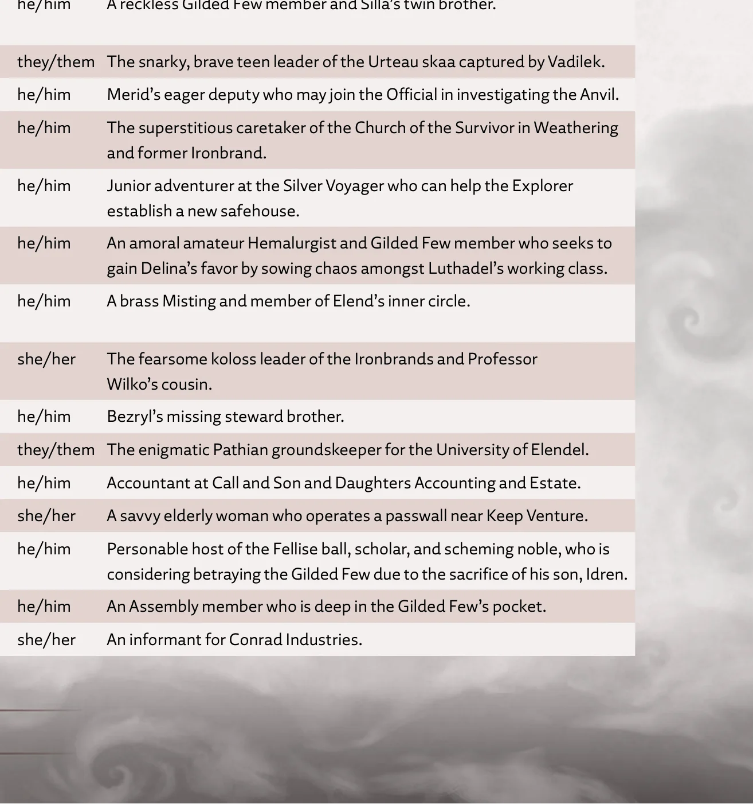
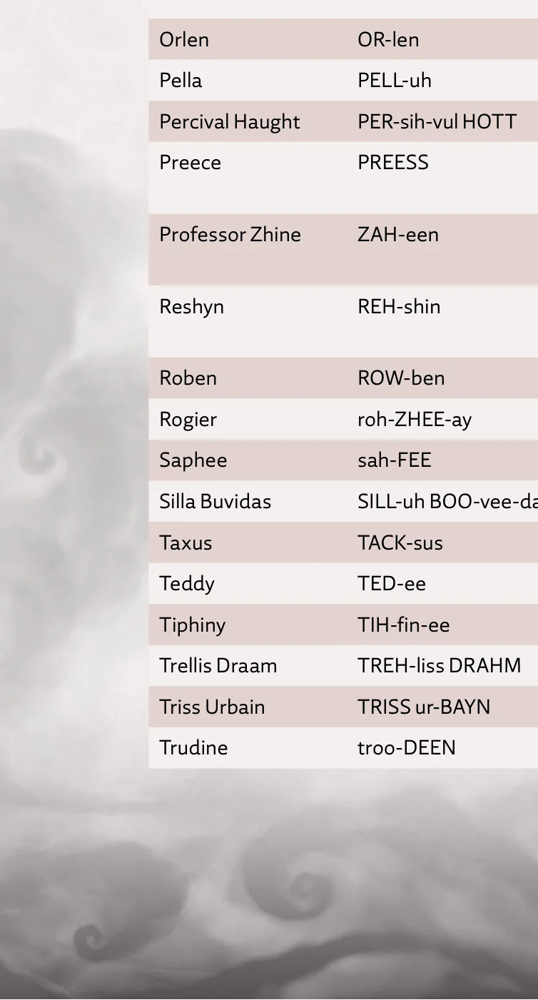

### 次要角色

「次要角色」表依英文姓名的字母順序，列出本冒險中其他有名字的角色。如果一名 NPC 出現在多個章節，表中只列出首次登場的章節。

| 姓名 | 發音 | 章節 | 代名詞 | 說明 |
| --- | --- | --- | --- | --- |
| Aime | EYE-may | 1 | she/her | 來自鄔都的難民，被 Vadilek 俘虜。 |
| 愛瑪蘭塔 | ah-mah-RAN-tuh | 4 | she/her | 泛圖爾大人的首席藥草師，暗中與他作對。 |
| Anastas Elariel | an-AHS-tus eh-LAIR-ee-al | 2 | he/him | 浪漫又富詩意的貴族，愛著 Cadme， 也努力不辜負旁人對他的期望。 |
| 檔案管理員 Wynn | WIN | 5 | they/them | Wilko 教授在國家檔案館的聯絡人， 也是守護者組織的成員。 |
| 灰侯．塞特 | ASH-weh-ther SET | 4 | he/him | 不討人喜歡但善用戰術的哈佛富雷克斯市貴族， 正試圖奪取依藍德的王位。 |
| Bezryl | BEZ-rill | 3 | she/her | 一位德高望重、舉止莊重的泰瑞司守護者，精通建築技術， 正在調停 Kandor 的勞資糾紛。 |
| Boots | BOOTS | 6 | he/him | 醉馬刺酒館的酒保， 能協助新手建立一處新的安全屋。 |
| Cadme | CAD-may | 2 | she/her | Enge 光彩照人的朋友，也是替人牽線的能手。她安排了鄔都的差事，愛著 Anastas， 另有一個名叫「Sarafine Causana」的身分。 |
| 德穆隊長 | de-MOO | 3 | he/him | 虔誠信奉倖存者，擔任依藍德的衛隊隊長， 負責監督與 Kandor 營造公司的談判。 |
| Eliane Vorn 隊長 | eh-lee-AH-nah VOHRN | 5 | she/her | 沉著堅定的前警員，出身 Morgenthax 犯罪家族。 她為 Lysarra Tekiel 工作，兩人也是戀人。 |
| Junkson 隊長 | JUNK-sun | 6 | she/her | 執法者的前同事兼好友。 |
| Caridus Buvidas | KAR-ee-dus BOO-vee-dass | 1 | he/him | 行事莽撞的 Gilded Few 成員，也是 Silla 的雙胞胎兄弟。 |
| Cynwise | SIN-wise | 1 | they/them | 鄔都司卡群體的青少年領袖，嘴上不饒人又勇敢，被 Vadilek 俘虜。 |
| Daryl Kant | DAIR-ill KANT | 7 | he/him | Merid 熱切的副手，可能會與官員一同調查鐵砧。 |
| Derruk | DEH-ruk | 7 | he/him | 耐抗鎮倖存者教會的看守人，個性迷信， 曾是 Ironbrand 的成員。 |
| Dindrop | DIN-drop | 6 | he/him | 銀色旅人的年輕冒險者，能協助探索者 建立一處新的安全屋。 |
| Duvall Haught | due-VALL HOTT | 2 | he/him | 毫無道德顧忌的業餘血金術師，也是 Gilded Few 成員。 他想在陸沙德的勞工階層中製造混亂，藉此討好 Delina。 |
| Edgard「微風」 Ladrian | ED-gard LA-dree-an | 3 | he/him | 黃銅迷霧人，也是依藍德核心幕僚的一員。 |
| Elanda「鐵砧」 Wilko | eh-LAHN-dah WILL-koh | 7 | she/her | 令人畏懼的克羅司，是 Ironbrands 的首領， 也是 Wilko 教授的堂表親。 |
| Fadwal | FAHD-wall | 3 | he/him | Bezryl 失蹤的兄弟，原是侍從官。 |
| Fan | FAN | 6 | they/them | 依藍戴大學一位神祕的道徒，負責維護校園場地。 |
| Garisel Daring | gah-rih-SELL DAIR-ing | 6 | he/him | Call and Son and Daughters Accounting and Estate 的會計師。 |
| Hilde 婆婆 | HILLD | 4 | she/her | 精明的老婦，在泛圖爾堡附近經營一處暗門。 |
| Guiverre Seeris | gwee-VAIR SEER-iss | 2 | he/him | Fellise 舞會上親切的主人，也是學者和善於盤算的貴族。 兒子 Idren 遭到獻祭後，他正考慮背叛 Gilded Few。 |
| Haltier Habren | HALL-teer HAY-bren | 2 | he/him | 一名議會成員，早已被 Gilded Few 收買。 |
| Helina Dobs | he-LEE-nuh DOBZ | 7 | she/her | Conrad Industries 的線人。 |

導言 16

| 姓名 | 發音 | 章節 | 代名詞 | 說明 |
| --- | --- | --- | --- | --- |
| Idren Seeris | EYE-dren SEER-iss | 1 | he/him | 犧牲自己以強化一枚血金尖刺。 |
| 鐵眼 | EYE-ern-eyes | 8 | he/him | 和諧的信使、鋼鐵審判者，也是死亡的化身。 有些人稱他為沼澤。 |
| Ismara Buvidas | iss-MAR-uh BOO-vee-dass | 8 | she/her | Gilded Few 的成員，也是一名熱愛時尚的貴婦，出席 Elariel 春季沙龍。 |
| Jaja | JAH-jah | 7 | she/her | Last Round Armory技藝出眾的槍匠。 |
| Jedd | JED | 4 | he/him | 老兵的前戰友，現在為泛圖爾大人效力。 |
| K.T. Quiven | KAY-TEE KWI-ven | 6 | she/her | 《大學之聲》幹勁十足的學生記者，正在撰寫 一篇揭露千眼會的報導。 |
| Kandor | CAN-door | 3 | he/him | Kandor 營造公司的老闆，精明的司卡商人， 曾協助建造教廷的祕密隧道。 |
| Kliss Gardre | KLISS GAR-druh | 2 | she/her | 精明又愛打聽閒話，在中央統御區的舞會圈裡很有名。 |
| M 女士 | EM | 6 | she/her | House of Wisteria的接待人，能協助執法者 建立一處新的安全屋。 |
| Legin | leh-JIN | 6 | she/her | Legin’s Lumber的老闆，能協助企業家 建立一處新的安全屋。 |
| Penfor 夫人 | PEN-for | 6 | she/her | 依藍戴大學 Pashadon Hall 的舍監。 |
| Rielle 夫人 | ree-ELL | 8 | she/her | 衣著時髦，經營 Rielle Talent 模特兒經紀公司。 |
| Marthis | MAR-this | 6 | he/him | Anastas 的後代，容易輕信他人的大學生， 正在申請加入千眼會。 |
| Merid | MARE-id | 7 | he/him | Wilko 教授和善的兒時好友， 也是祕密結社守護者組織的成員及耐抗鎮的執法者。 |
| Murn | MERN | 1 | he/him | 膽小的血金術師，曾協助 Vadilek 研製永恆尖刺。 |
| Olivora | AH-lih-vor-uh | 6 | she/her | 依藍戴大學女子射擊社充滿活力的學生教練， 負責指導社團成員。 |
| Orlen | OR-len | 8 | he/him | Orlen’s Stitch 的老闆兼首席裁縫，有克羅司血統，眼光敏銳。 |
| Pella | PELL-uh | 1 | she/her | 來自鄔都的難民，被 Vadilek 俘虜。 |
| Percival Haught | PER-sih-vul HOTT | 8 | he/him | Gilded Few 的一位貴族，出席 Elariel 春季沙龍。 |
| Preece | PREESS | 3 | she/her | 心懷不滿的 Kandor 營造公司工人， 在服刑期間認識了囚犯。 |
| Zhine 教授 | ZAH-een | 6 | he/him | 依藍戴大學的教授，講課單調， 教授解剖學及金屬之子的生物科學。 |
| Reshyn | REH-shin | 6 | they/them | Clarvonne’s Theater的戲劇顧問，能協助說書人 建立一處新的安全屋。 |
| Roben | ROW-ben | 1 | he/him | 來自鄔都的難民，被 Vadilek 俘虜。 |
| Rogier | roh-ZHEE-ay | 3 | he/him | 一名已故 Kandor 營造公司工人的年邁父親。 |
| Saphee | sah-FEE | 2 | she/her | 老兵以前帶過的學員，十分崇拜老兵。 |
| Silla Buvidas | SILL-uh BOO-vee-dass | 1 | she/her | 缺乏耐性的 Gilded Few 成員，也是 Caridus 的雙胞胎姊妹。 |
| Taxus | TACK-sus | 7 | he/him | 在Dust and Draft Saloon演奏的本地吉他手，長相英俊。 |
| Teddy | TED-ee | 8 | he/him | 為 Lysarra 效力的 Morgenthax 小頭目，令人畏懼。 |
| Tiphiny | TIH-fin-ee | 6 | she/her | 自視甚高卻懂得掩飾的大學生，正在申請加入千眼會。 |
| Trellis Draam | TREH-liss DRAHM | 5 | she/her | 愛聊八卦的Malwish 巧克力師，習慣接待依藍戴的上流人士。 |
| Triss Urbain | TRISS ur-BAYN | 2 | she/her | Gilded Few 成員，已故 Idren Seeris 的朋友。 |
| Trudine | troo-DEEN | 6 | she/her | 依藍戴大學熱心助人的圖書館員。 |

導言 17

### 發音

| 姓名 | 發音 | 章節 | 代名詞 | 說明 |
| --- | --- | --- | --- | --- |
| Tuss | TUHSS | 1 | he/him | 來自鄔都的難民，被 Vadilek 俘虜。 |
| Uvina | oo-VEE-nuh | 8 | she/her | Rielle 夫人的助手，也是年輕昇華者。 |
| Vadilek Elariel | VAD-ih-lek eh-LAIR-ee-al | 1 | he/him | 由聖務官轉任審判者，製造了永恆尖刺， 並創立 Gilded Few。 |
| Vereta “Brickfist” Wilko | veh-RATE-uh WILL-koh | 7 | she/her | Barrowcrest 的 Wilko 克羅司氏族成員，以自己的氏族為傲。 |
| Yannen | YAN-en | 3 | he/him | Haught Infirmary一名心懷悔意的醫師，向官員求助。 |
| Yestal Haught | YES-tahl HOTT | 2 | he/him | Gilded Few 成員、已故 Idren Seeris 的朋友，也是 Duvall 的兄弟。 |
| Ylvwa | IL-vah | 6 | she/her | 千眼會會館一名備受刁難的泰瑞司女傭。 |
| 詹 | ZAYN | 4 | he/him | 史特拉夫．泛圖爾古怪的私生子，是一名迷霧之子。 |

導言 18

「發音指南」表列出本冒險中重要事件、地點與物品名稱的發音。NPC 姓名的發音請見本導言前面的「重要角色」和「次要角色」。

### 發音指南

| 詞語或名稱 | 發音 |
| --- | --- |
| 鎔金術師（Allomancer） | AH-loh-man-serr |
| 鎔金術（Allomancy） | AH-loh-man-see |
| 天金（atium） | AY-tee-uhm |
| 貝爾黛（Beldre） | BEL-dree |
| 落灰之終（Catacendre） | kat-ah-SAWN-drah |
| 卡西（Cazzi） | KAZ-ee |
| 香奈瑞河（Channerel） | CHA-nerr-ehl |
| Cladence | KLAH-denss |
| Clarvonne | KLAR-vonn |
| 寰宇（cosmere） | KOZ-meer |
| Dilisteni | dih-LISS-teh-nee |
| 依藍德．泛圖爾（Elend Venture） | EHL-end vehn-TCHUR |
| 依藍戴（Elendel） | EHL-en-dehl |
| 哈佛富雷克斯市（Fadrex） | FA-dreks |
| Fellise | feh-LEEZ |
| Feltrel | FEL-trell |
| 單藏金術師（Ferring） | FAIR-ing |
| 藏金術師（Feruchemist） | feh-roo-KEH-mihst |
| 藏金術（Feruchemy） | feh-roo-KEH-mee |
| Galivan | GAL-ih-van |
| 血金術師（Hemalurgist） | HEE-mah-lur-jisst |
| 血金術（Hemalurgy） | HEE-mah-lur-jee |

| 詞語或名稱 | 發音 |
| --- | --- |
| House Buvidas | BOO-vee-dass |
| 塞特家族（House Cett） | SET |
| House Conrad | CON-rad |
| 埃拉瑞爾家族（House Elariel） | eh-LAIR-ee-al |
| 艾瑞凱家族（House Erikell） | air-I-kel |
| 海斯丁家族（House Hasting） | HAY-sting |
| 浩特家族（House Haught） | HOTT |
| 拉德利安家族（House Ladrian） | LA-dree-an |
| House Seeris | SEER-iss |
| 太齊爾家族（House Tekiel） | TEE-kee-ehl |
| 泛圖爾家族（House Venture） | vehn-TCHUR |
| 坎得拉（kandra） | KON-drah |
| 克羅司（koloss） | KOH-lawss |
| 克雷迪克．霄（Kredik Shaw） | KREH-dik SHAW |
| 拉司達（Larsta） | LAR-stuh |
| Lastrum | LAS-trum |
| Lestibournes | LEH-sti-boor-nehss |
| 陸沙德（Luthadel） | LOO-thah-dehl |
| Madion商區（Madion Ways） | MA-dee-ehn WAYZ |
| Malwish | MAL-whish |
| Morgenthax | MOR-gen-thaks |
| Nelazan | NELL-uh-zan |

| 詞語或名稱 | 發音 |
| --- | --- |
| Pashadon | PASH-uh-don |
| 道徒（Pathian） | PATH-ee-an |
| Pledfellow | PLED-fell-oh |
| 沙賽德（Sazed） | SAY-zehd |
| 司卡德利亞（Scadrial） | SKA-dree-al |
| 珊．埃拉瑞爾（Shan Elariel） | SHAN eh-LAIR-ee-al |
| shelldry | SHEL-dreye |
| 司卡（skaa） | SKAW |
| 史特拉夫．泛圖爾（Straff Venture） | STRAF vehn-TCHUR |
| 倖存者教（Survivorism） | sur-VY-vur-ihz-em |
| Tarcsel | TARK-sell |
| 塔辛文（Tathingdwen） | ta-THING-dwehn |
| 泰瑞司（Terris） | TAIR-iss |
| 廷朵（Tindwyl） | TIN-dwill |
| Trelagism | TREHL-ah-jihz-em |
| Trell | TREHL |
| Trellium（trellium） | TREHL-ee-uhm |
| Tresting | TRESS-ting |
| 鎢都（Urteau） | UR-toh |
| Velstane | VEL-stayn |
| 紋（Vin） | VIN |
| 尤門（Yomen） | YOH-men |
