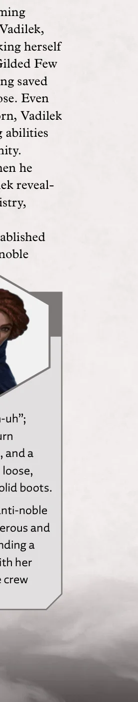
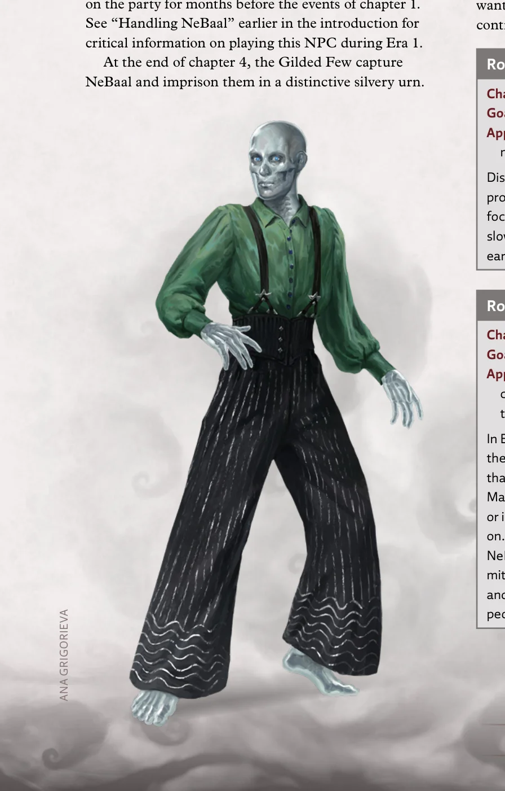
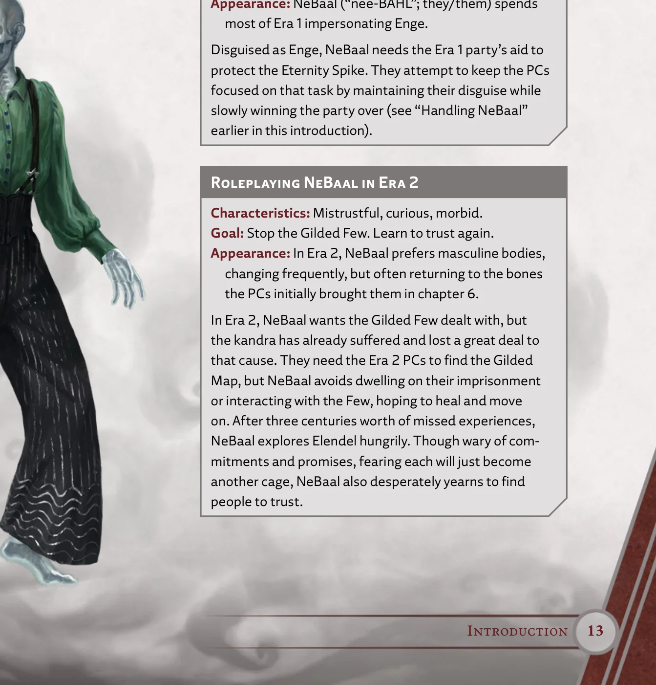
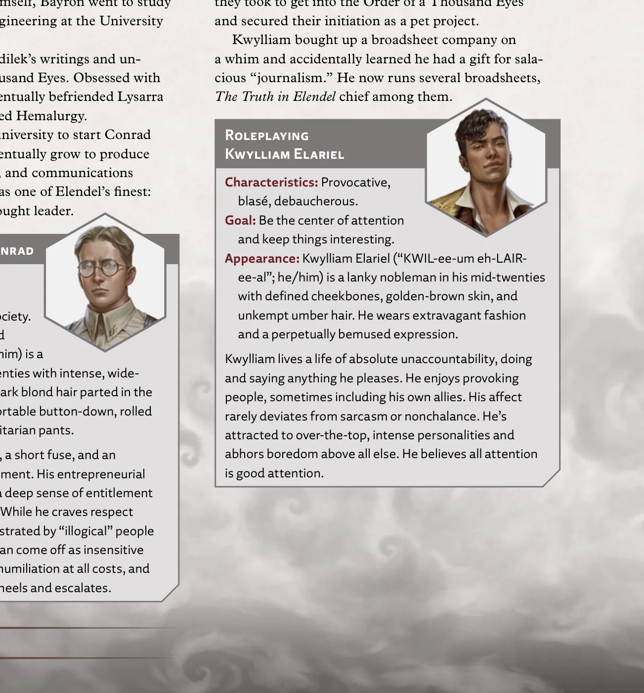
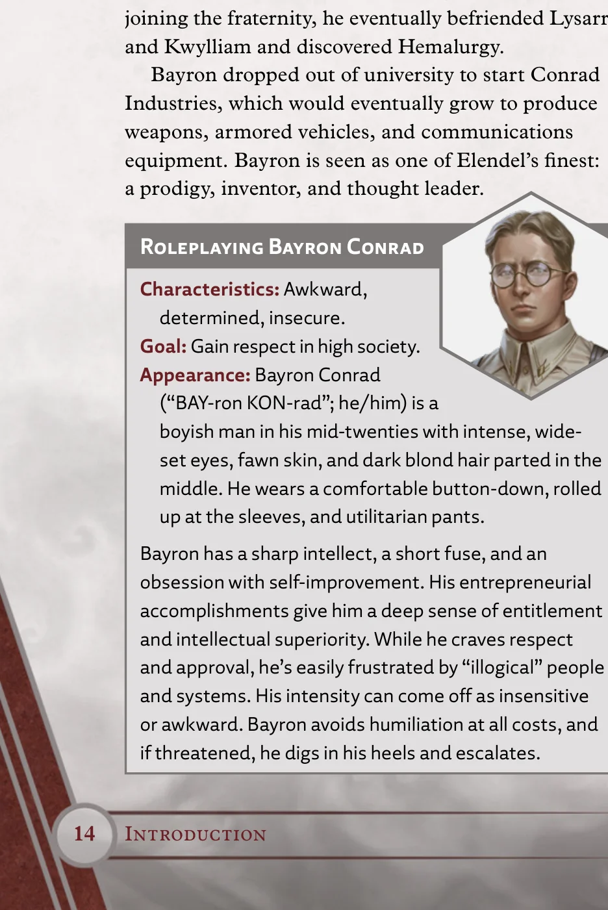
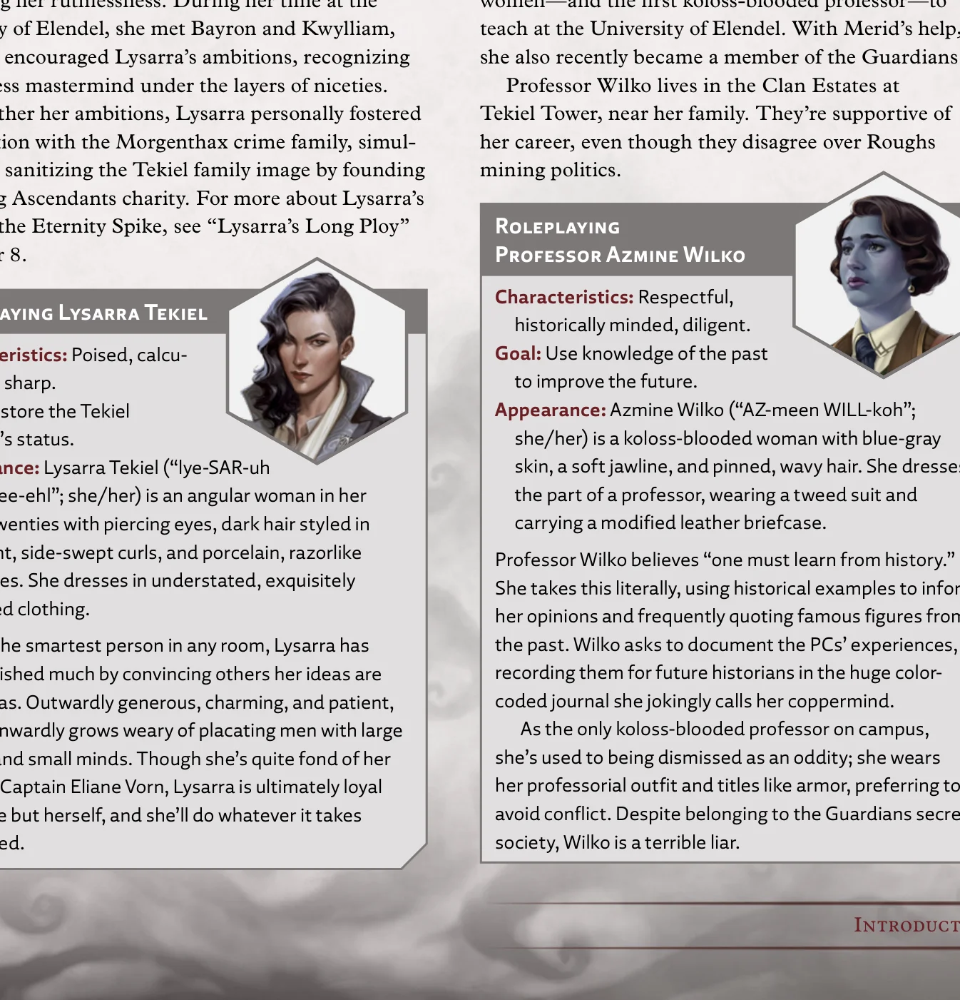
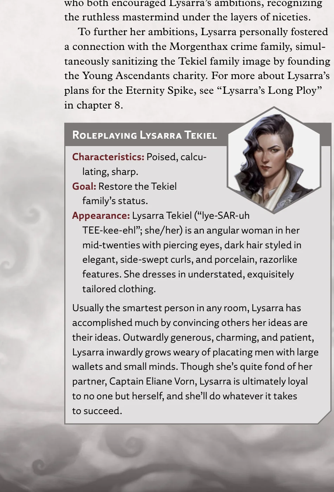
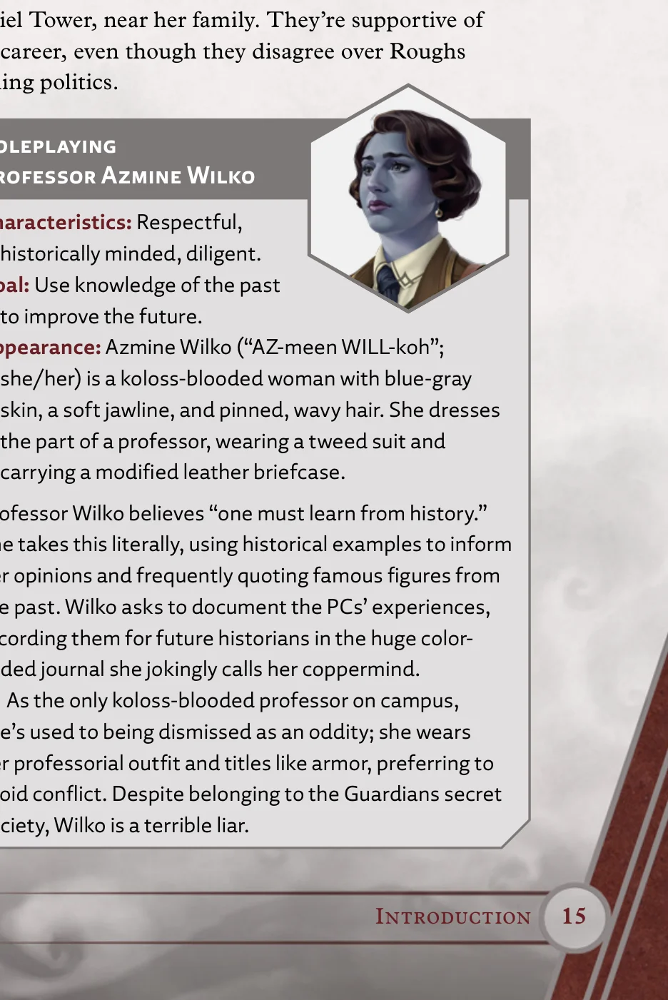

### 重要人物

冒險期間，英雄們會遇見與司卡德利亞各方勢力有深厚淵源的盟友與敵手。以下介紹《傳承冒險》第一時代與第二時代的重要具名人物。

### Delina Tekiel（第一時代）

Delina Tekiel（她）是強大的迷霧之子，也是第一時代的主要反派。Delina 自信而積極，Vadilek 死後成為 Gilded Few 實際上的領袖。

### Delina 的故事

Delina 是太齊爾家族家主的堂表親，年紀比家主小。她地位崇高，卻不在直接繼承順位上。她是 Vadilek 最忠心的學生之一，與珊．埃拉瑞爾競爭，想成為他最看重的人選。Delina 與 Enge 感情深厚，並未把她當成對手。Delina 一直不知道 Enge 為何離開 Gilded Few，只知道她一聲不響就走了。太齊爾家族撤離陸沙德時，Delina 大多數親人死於海斯丁家族的刺客之手。Vadilek 說服 Delina 別捲入貴族內鬥，至今她仍為當時沒有出手援助家人而內疚。珊遇害後，Delina 以為自己會獲選承受永恆尖刺。

#### 扮演 Delina Tekiel

**特質。** 直率、易怒、好勝。  
**目標。** 查明 Enge 的遭遇，取回永恆尖刺，成為新一任統御主。  
**外貌。** Delina Tekiel（讀作 deh-LEE-nah TEE-kee-ehl，代名詞為她）是位氣勢逼人的貴族女子，五官鮮明，神情生動，身材結實而健壯。一道長疤貫穿她的左臉頰，是珊．埃拉瑞爾在過去的戰鬥中留下的。Delina 將黑髮編成便於活動的辮子，穿著做工精良又實用的衣服。

Delina 出身優渥，卻長年承受壓力，磨練得強悍而不屈。她嚴守訓練時程，遇到阻礙便迎面解決，相信自己能應付任何挑戰。家人的死讓她更決心不計代價取得成功。失去她自認應得的昇華成神機會後，她滿懷痛苦與憤怒，為了達到目的，即使與人決裂也在所不惜。與人交談時，Delina 言簡意賅，語帶威脅，毫無幽默感。

導論 12

然而，即使 Delina 多年來接受嚴苛的訓練並作出犧牲，Vadilek 最後還是選了 Enge 成神。Delina 怒不可遏，在昇華儀式上發動血腥政變，殺死 Enge。她認為昔日好友早已背叛他們，也不配成為 Vadilek 的棋子。如今，Delina 會不擇手段從隊伍手中奪回永恆尖刺，取回她自認應得的神位，並揭露「Enge」的真實身分。

### Engeanthe「Enge」Elariel（第一時代）

Engeanthe Elariel（她）是紅銅迷霧人（煙陣），也是隊伍所屬走私團的頭目，更是第一時代 PC 可以依靠的朋友。冒險第一章，坎得拉 NeBaal 暗中取代了 Enge。

### Engeanthe 的故事

Enge 年幼時雙親過世，由叔父 Vadilek Elariel 監護。在 Vadilek 指導下，Enge 磨練煙陣的能力，為擁有較「有用」能力的 Gilded Few 成員掩護行動，因此成了團體不可或缺的一員。她屢次靠著機智救了 Delina 的性命，兩人感情深厚。Vadilek 一邊暗示 Enge 比不上真正的迷霧之子，一邊逼她精通紅銅迷霧人的能力，還要她成為貴族女性的典範。Vadilek 開始研究血金術後，Enge 對他的構想產生了疑問。當 Vadilek 透露打算讓她潛入鋼鐵教廷時，她放棄頭銜，逃離家族。幾年艱苦的生活之後，Enge 終於組成一支小型司卡走私團，拿一艘偷來的貴族遊艇走私。

#### 扮演 Engeanthe「Enge」Elariel

**特質。** 說話粗俗、擅長鼓舞人心、重情義。  
**目標。** 離開家族後闖出一番成就。  
**外貌。** Enge（讀作 ENG-uh 或 ENG-uh-anth-uh，代名詞為她）是人類女子，留著赤褐色的俐落短髮，有濃眉、淺紅褐色皮膚，笑起來爽朗熱情。沒有工作時，她穿寬鬆舒適的洋裝、保暖大衣和耐穿的靴子。

拋開貴族禮數後，Enge 對貴族與階級制度深惡痛絕，也樂於大聲說笑、講粗話。她把團員當作家人，喜歡幫每個人找到歸屬，做自己擅長的事。Enge 手巧，常親手替團員縫衣，或動手改裝運河船。

### NeBaal

NeBaal（使用中性代名詞 they/them）是六代坎得拉，在兩個時代都是 PC 的盟友。為保護 Vadilek 的遺產永恆尖刺，NeBaal 願意犧牲一切，最後也會要求 PC 作出同樣的承諾。

### NeBaal 在第一時代的故事

在 Vadilek 成為 NeBaal 主要的契約持有人以前，NeBaal 已經為埃拉瑞爾家族工作了兩百多年。NeBaal 一向疼愛 Enge，也覺得 Vadilek 對自己的姪女太嚴苛。昇華儀式前，Vadilek 與 NeBaal 訂立契約，萬一自己倒下，就由 NeBaal 執行他的遺願。NeBaal 奉命取走永恆尖刺、妥善保管，並確保它傳給一位配得上它的貴族繼承人。第一章事件開始前，NeBaal 也已暗中監視隊伍好幾個月。有關在第一時代扮演這名 NPC 的重要資訊，見導論前文的「如何扮演 NeBaal」。第四章結尾，Gilded Few 抓住 NeBaal，將其囚禁在一個造型獨特的銀色甕裡。

### NeBaal 在第二時代的故事

第二時代的故事開始時，Gilded Few 已在依藍戴大學以菁英兄弟會「千眼會」的身分扎根。他們每年審問 NeBaal，作為入會儀式的一環。三百多年囚禁期間，NeBaal 靠著存在的祝福維持心智穩定，始終拒絕透露永恆尖刺的下落。只有鍍金三人組成功從 NeBaal 口中騙到情報，那點情報也只夠他們開始尋找鍍金地圖。第六章，第二時代的 PC 釋放 NeBaal 時，這名坎得拉已錯過三百年的歷史與技術進展。NeBaal 渴望自由，希望擊敗 Gilded Few，主要是為了往後能不必再提心吊膽地生活。

#### 在第一時代扮演 NeBaal

**特質。** 堅定、守密、心懷希望。  
**目標。** 保護 Vadilek 的遺產，找到歸屬。  
**外貌。** NeBaal（讀作 nee-BAHL，使用中性代名詞 they/them）在第一時代大部分時間都冒充 Enge。

偽裝成 Enge 的 NeBaal 需要第一時代隊伍協助保護永恆尖刺。NeBaal 一面維持偽裝，設法讓 PC 專注於這項任務，一面逐漸爭取隊伍的信任，詳見導論前文的「如何扮演 NeBaal」。

#### 在第二時代扮演 NeBaal

**特質。** 難以信任他人、好奇、對陰森事物感興趣。  
**目標。** 阻止 Gilded Few，學會再次信任他人。  
**外貌。** 第二時代的 NeBaal 偏好男性身形，經常更換外貌，但時常換回第六章 PC 起初帶來的那副骨骼所塑造的身形。

第二時代，NeBaal 希望有人對付 Gilded Few。為此，這名坎得拉已承受許多痛苦，也失去了很多。NeBaal 需要第二時代的 PC 找到鍍金地圖，但希望從過去的遭遇中復原，繼續生活，因此不願反覆談起被囚的日子，也盡量避免與 Gilded Few 接觸。錯過三百年的人生經歷後，NeBaal 迫不及待地探索依藍戴。NeBaal 對承諾和約定有所戒心，怕每一項承諾都會變成另一座牢籠，卻也迫切渴望找到值得信任的人。

導論 13

ANA GRIGORIEVA

### Bayron Conrad（第二時代）

Bayron Conrad（他）是企業家、發明家，也是鍍金三人組的一員。三人組是第二時代的主要反派。加入三人組並發現血金術後，Bayron 藉由植入軀幹的兩根鋼製血金尖刺，為自己取得白鑞鎔金術（白鑞臂）和鋼鎔金術（射幣）的能力。

### Bayron 的故事

Bayron 的父親 Sterling Conrad 在北方蠻橫區建立了石油事業。Bayron 年少時在 New Seran 的貴族私立寄宿學校就讀。他不擅社交，又沒有金屬之子的能力，被同學嘲笑出身於二流貴族家庭，沒人把他當回事。他在人際交往上處處碰壁，卻展現了工程方面的天分。Bayron 第一項重要發明是效率更高的抽油泵。一次抽油泵事故造成六名工人死亡後，Sterling 終止了計畫。Bayron 深感羞愧，也因此與父親決裂，逐漸認定一切有價值的進步都必須付出慘痛代價。

為了改變自己，Bayron 進入依藍戴大學研習冶金、歷史與工程。他在那裡找到 Vadilek 的著作，也發現了千眼會。他一心想加入這個兄弟會，後來與 Lysarra 和 Kwylliam 成為朋友，並發現血金術。Bayron 退學創辦 Conrad Industries，公司日後擴展到製造武器、裝甲車輛和通訊設備。在依藍戴人眼中，Bayron 是城裡最傑出的人物之一，既是天才發明家，也是思想領袖。

#### 扮演 Bayron Conrad

**特質。** 不擅社交、意志堅定、缺乏安全感。  
**目標。** 贏得上流社會的尊重。  
**外貌。** Bayron Conrad（讀作 BAY-ron KON-rad，代名詞為他）二十五歲上下，臉上仍帶著稚氣。雙眼炯炯有神、眼距較寬，膚色淺褐，深金色頭髮從中間分開。他穿著舒適的鈕扣襯衫，袖子捲起，搭配實用的長褲。

Bayron 頭腦敏銳、脾氣火爆，執著於提升自己。創業有成讓他覺得自己理應享有特權，頭腦也比別人高明。他渴望受到尊重和認同，卻很容易因為「不合邏輯」的人和制度而不耐煩。他過於認真的態度有時顯得不近人情，或讓場面尷尬。Bayron 會竭力避免丟臉，一旦受到威脅，就會堅持到底，讓衝突愈演愈烈。

### Kwylliam Elariel（第二時代）

Kwylliam Elariel（他）出身依藍戴最富有的貴族階層，是鍍金三人組的一員。三人組是第二時代的主要反派。Kwylliam 是雙生師，能使用鋅鎔金術（煽動者）和硬鋁藏金術（聯絡）。他也能使用鉻藏金術（旋轉），能力來自一根家傳的彎管合金尖刺。

### Kwylliam 的故事

Kwylliam 是四個手足中年紀最大的，自幼享有最優渥的教養與教育，他卻大多沒放在心上。他靠著家族與依藍戴大學的淵源入學，心思卻都放在尋歡作樂、消磨時間和幹些小壞事上，出了事就由家人出面收拾。他在大學認識 Bayron 和 Lysarra，三人都不把傳統規矩放在眼裡，因此成了朋友。Kwylliam 覺得 Bayron 和 Lysarra 很有意思，鼓勵他們用出格的手段打進千眼會，還親自張羅，讓他們順利入會。Kwylliam 一時興起買下一家大報公司，意外發現自己擅長製作聳動的「新聞」。如今他經營好幾份大報，其中以《依藍戴真相報》為首。

#### 扮演 Kwylliam Elariel

**特質。** 愛挑釁、漫不經心、放蕩。  
**目標。** 成為眾人注意的焦點，讓日子一直有趣。  
**外貌。** Kwylliam Elariel（讀作 KWIL-ee-um eh-LAIR-nee-al，代名詞為他）二十五歲上下，是位瘦高的貴族男子，顴骨分明，膚色金棕，深棕色頭髮總是亂糟糟的。他打扮奢華，臉上總掛著一副看熱鬧似的神情。

Kwylliam 想做什麼、說什麼都隨心所欲，從來不必承擔後果。他喜歡挑釁別人，有時連自己的盟友也不放過。他平時不是冷嘲熱諷，就是一臉無所謂。他特別喜歡作風誇張、個性強烈的人，最受不了無聊。他覺得只要有人注意他，就是好事。

導論 14

### Lysarra Tekiel（第二時代）

Lysarra Tekiel（她）是才智出眾、精於算計的女繼承人，也是鍍金三人組的一員。三人組是第二時代的主要反派。Lysarra 是單藏金術師，能使用鋅藏金術（星火）。她也能使用黃銅鎔金術（安撫者），能力來自一根家傳的青銅尖刺。

### Lysarra 的故事

Lysarra 出身貴族，從小在依藍戴長大。她是顯赫的太齊爾家族女繼承人，家族自稱與昇華戰士有祖先淵源。她有頭銜，實際能享有的特權卻不多。Lysarra 在家族財務與社會地位動盪之際成為繼承人，處境並不好。叔父 Augustin 的貪腐與經營不善讓家族破產，Lysarra 接手掌管家業，決心恢復家族往日榮光。

她是家中排行居中的女兒，身處一個爭強好勝的家族，幾乎沒有人重視她。從小，Lysarra 就學會耐心布局、順著有權勢的男人說話，並藏起自己心狠的一面，藉此取得權力，掌握局勢。就讀依藍戴大學時，她認識了 Bayron 和 Kwylliam。兩人看出她客套外表下善於謀劃、不留情面的一面，於是鼓勵她放手追求自己的野心。為了達成抱負，Lysarra 親自與 Morgenthax 犯罪家族建立關係，同時創立慈善組織 Young Ascendants，替太齊爾家族重塑清白形象。關於 Lysarra 如何打算運用永恆尖刺，見第八章「Lysarra 的長期布局」。

#### 扮演 Lysarra Tekiel

**特質。** 沉著、精於算計、敏銳。  
**目標。** 恢復太齊爾家族的地位。  
**外貌。** Lysarra Tekiel（讀作 lye-SAR-uh TEE-kee-ehl，代名詞為她）二十五歲上下，五官稜角分明，眼神銳利。她的深色鬈髮優雅地梳向一側，面容白皙如瓷，輪廓鋒利。她穿著低調、剪裁極為講究的衣服。

Lysarra 通常是房間裡最聰明的人。她很擅長說服別人相信主意是他們自己想出來的，靠這一手辦成了不少事。她外表慷慨、迷人、有耐心，心裡卻愈來愈厭倦安撫那些錢包厚、見識淺的男人。她很喜歡自己的伴侶 Eliane Vorn 隊長，但她最終只忠於自己，為求成功可以不惜一切。

### Azmine Wilko 教授（第二時代）

Azmine Wilko 教授（她）在依藍戴大學任教，是行事隱密的守護者組織資淺成員。在整個第二時代的冒險中，她始終是 PC 堅定的盟友。

### Wilko 教授的故事

Wilko 家族是從事採礦的克羅司混血氏族。Wilko 教授與她的直系家人從北方蠻橫區遷到依藍戴。青少年時期，Azmine 有四年住在蠻橫區的親戚家。那段經歷對她影響深遠，也讓她開始對盆地歷史感興趣。那時，Azmine 與自己的堂表姊妹 Elanda 及 Elanda 的朋友 Merid 很親近。Elanda 留在蠻橫區，成了「鐵砧」（見第七章），如今已是教授的 Azmine 卻不知情。

Azmine 選了另一條路，進入依藍戴大學就讀，成為歷史學者。她與 Bayron、Lysarra、Kwylliam 就讀大學的時間有重疊。Azmine 以優異成績完成歷史學業，畢業後不久就成為依藍戴大學少數女性教師之一，也是第一位克羅司混血教授。最近，在 Merid 的協助下，她也加入了守護者組織。Wilko 教授住在太齊爾塔的氏族住宅區，離家人不遠。家人支持她的事業，儘管他們對蠻橫區的採礦政治有不同看法。

#### 扮演 Azmine Wilko 教授

**特質。** 尊重他人、重視歷史、勤勉。  
**目標。** 運用對過去的了解改善未來。  
**外貌。** Azmine Wilko（讀作 AZ-meen WILL-koh，代名詞為她）是位克羅司混血女子，膚色灰藍，下顎線柔和，將一頭波浪髮用髮夾固定。她一身教授打扮，穿著粗花呢套裝，提著改裝過的皮革公事包。

Wilko 教授相信「人必須從歷史中學習」，而且把這句話付諸實行。她會用歷史上的例子來形成自己的觀點，也常引述過往名人的話。Wilko 會請求記錄 PC 的經歷，寫進她那本以顏色標記、厚重的日誌，留給未來的歷史學家。她開玩笑稱那本日誌是自己的紅銅意識。身為校內唯一的克羅司混血教授，她早已習慣被人當成異類而不受重視。她把教授的衣著和頭銜當成護甲，盡量避免衝突。Wilko 雖然是祕密結社守護者組織的一員，卻很不擅長說謊。

導論 15

