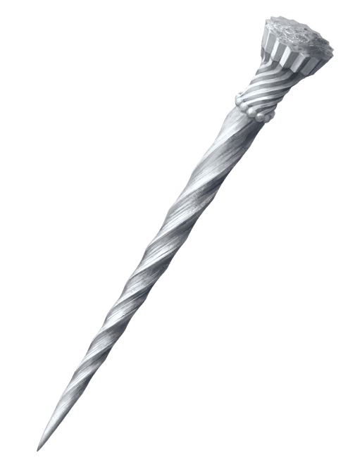
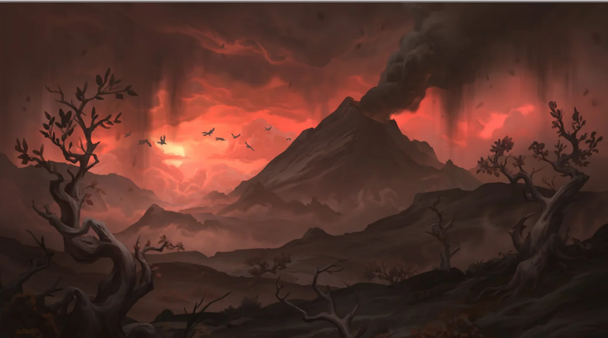
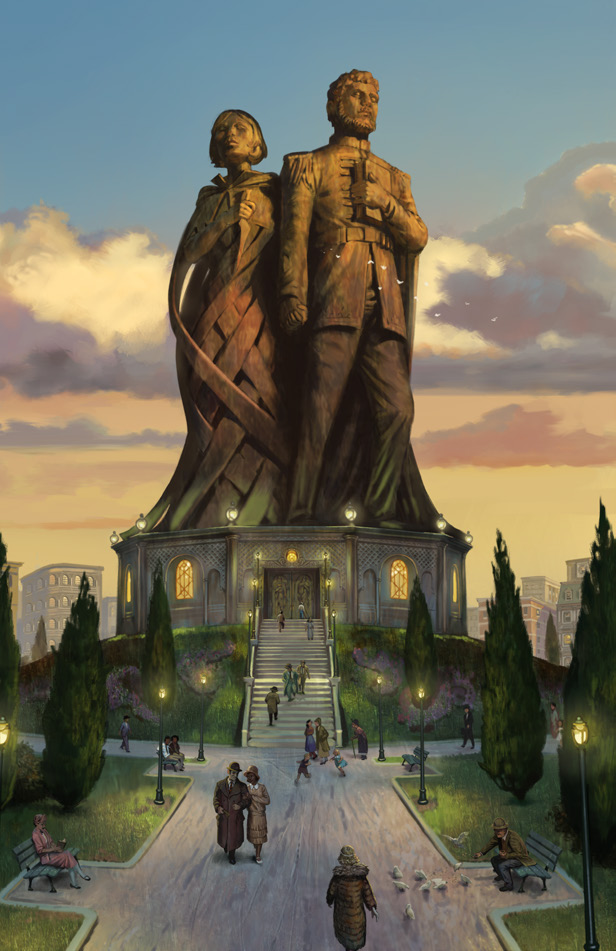
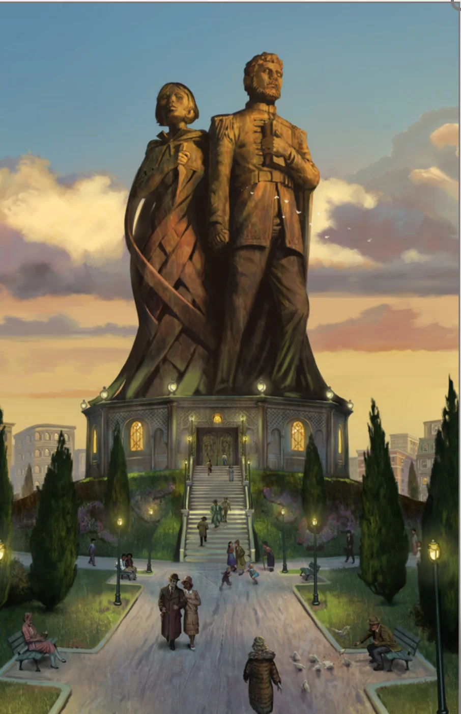
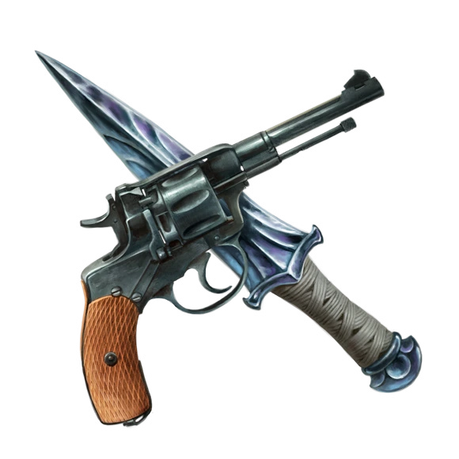
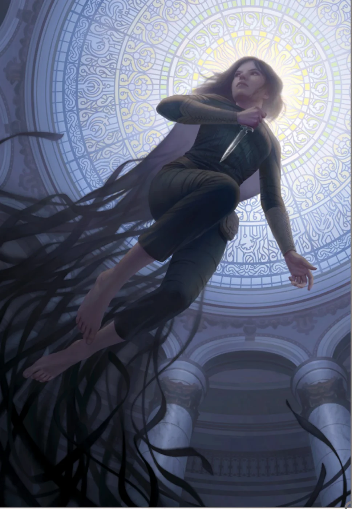
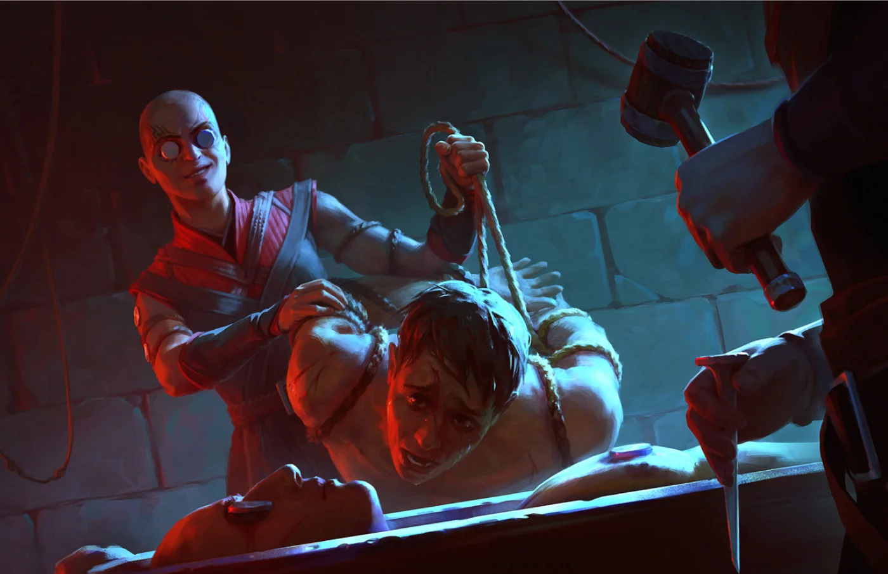

### 關於本書

### 歡迎來到司卡德利亞

在司卡德利亞，祕密永遠不會只有一個。在這世界的陰影與迷霧中，狡猾的敵手聚集起來，進行足以改寫歷史的駭人實驗。《迷霧之子傳承》講述永恆尖刺（Eternity Spike）的故事。這件神器來歷可怖，蘊藏的潛能仍是謎團，也讓一代又一代的人為之著迷。故事分成兩部，描寫貪婪之人如何追求昇華與不朽，以及兩支英雄隊伍如何與他們對抗。兩支隊伍相隔數百年，身處截然不同的世界。本導言概述整個冒險，提供主持建議，並說明如何讓角色融入這場跨越兩個時代的故事。

《迷霧之子傳承》最適合由四名玩家角色（PC）遊玩。冒險進行到一半時，玩家會改用另一組角色。第一時代的英雄會阻撓一個危險的祕密結社，第二時代的英雄則會與新一代暗中作惡的反派交鋒。兩個時代的故事都圍繞著永恆尖刺展開。本冒險共九章。前四章講述第一時代的故事，PC 會從 1 級升到 6 級。後五章講述第二時代的故事，PC 會從 3 級升到 9 級，也可以在本冒險結束後繼續升到 10 級。某一節或規則若只適用於單一時代，本書會用符號標示，分別為第一時代與第二時代。

### 各章與各時代的角色等級

| 章節 | 等級 | 時代 |
| --- | --- | --- |
| 第 1 章：逝者的回聲 | 1 | 第一時代 |
| 第 2 章：鍍金面具之後 | 2 | 第一時代 |
| 第 3 章：多數與少數 | 3–4 | 第一時代 |
| 第 4 章：永恆寶庫 | 5–6 | 第一時代 |
| 第 5 章：引擎與諜報 | 3 | 第二時代 |
| 第 6 章：飢渴靈魂的渴望 | 4 | 第二時代 |
| 第 7 章：敲擊鐵砧 | 5 | 第二時代 |
| 第 8 章：致命時尚 | 6–7 | 第二時代 |
| 第 9 章：一切終於陸沙德 | 8–9 | 第二時代 |

遊玩《迷霧之子傳承》時，除了本書，你還需要一份《迷霧之子玩家手冊》。

司卡德利亞是布蘭登．山德森《迷霧之子》系列的舞台。這個世界迷霧瀰漫，神祇在幕後操弄世事，處處都有冒險的機會。第一時代著重陰謀、求生與革命。第二時代發生在重塑後的世界，科技與進步推動故事發展。無論哪個時代，金屬技藝對世界與人民都至關重要。

祕密歷史

本冒險以《迷霧之子》小說的事件為基礎，涵蓋直到《悼環》為止的內容。本書提供的許多背景資訊，都是首部三部曲的重要揭露。因此，本冒險含有第一時代的重大劇透，以及第二時代的輕微劇透。

### 永恆

### 尖刺

ANNA VERHOOG

2

### 第一時代：最後帝國

最後帝國由不朽的皇帝統御主掌控，稱霸千年。《迷霧之子傳承》的第一時代篇章發生於最後帝國紀年（FE）1024 年，也就是革命推翻並殺死統御主的一年後。這個時期有以下幾項重點。

統御主的殞落。在倖存者發動的革命中，

一名叫紋的迷霧之子打敗了統御主。如今陸沙德由依藍德．泛圖爾國王與議會共同治理。議會是立法機構，由貴族、商人與司卡三方代表組成。司卡獲得自由。原先身處社會底層的司卡得到解放，

如今他們可以在陸沙德自由經商、創作、實踐信仰，或追求其他志趣。主要的司卡勢力包括倖存者教會和逐漸壯大的商人階層。貴族家族。統御主倒台時，大家族不是逃離首都，

就是遭到殺害。規模較小的家族加入了新政府，或另尋生路。本冒險中有數名重要的非玩家角色（NPC）出身於 Elariel、Haught、Seeris 和太齊爾家族。鋼鐵教廷。統御主倒台後，部分聖務官放棄了信仰，

留在陸沙德生活，其他人則跟著大家族離開。有些人在更遠的地方致力於延續統御主的傳承。

泰瑞司人。守護者在昔日的帝國各地公開傳授知識，

不過許多侍從官回到了泰瑞司統御區。

### 第二時代：依藍戴盆地

新神和諧重塑世界，至今已過了三百年。灰山不再活動，社會持續向前發展。《迷霧之子傳承》的第二時代篇章發生於落灰之終後紀年（PC）345 年，就在悼環重現、Malwish 與南司卡德利亞居民為世人所知的數年後。這個時期有以下幾項重點。

科技興起。新奇的科技隨處可見。

貴族駕駛原型汽車在街頭競速，大量印製的報紙傳播新聞，原本由祕密組織獨占的無線電技術也出現了各種新用途。上流社會。最後帝國貴族家族的後裔

在依藍戴盆地仍掌握著遠超其人數的權力。本冒險的重要敵手出身於 Conrad、Elariel 和太齊爾家族。蠻橫區。這片邊疆自由、遼闊，

也時常缺乏法紀。蠻橫區在礦業和運輸公司的控制下，為盆地供應原料。Ironbrand 盜匪與 Wilko 克羅司氏族都生活在這裡。

### 在最後帝國時期，司卡德利亞

是個嚴酷無情的世界。

DAVID FRASHESKI

### 主持冒險

### 金屬技藝

無論是英雄還是反派，都會使用金屬技藝來達成目的。

鎔金術。鎔金術師吞下特定金屬來驅動能力，

能操弄情緒、不經接觸便移動金屬，還能做到其他事。藏金術。藏金術師用特定金屬儲存屬性，

可以讓自己變得更強壯、動得更快，甚至思考得更迅速。血金術。這是一種遭到禁止的金屬技藝。血金術用

金屬尖刺從受害者身上奪取特質或能力，過程中通常會害死受害者，再將奪來的能力交給另一個人。

關於司卡德利亞的歷史與金屬技藝，詳見《歡迎來到司卡德利亞》與《迷霧之子世界指南》。

### 三個世紀之後，

### 最後帝國時期的英雄

已成為傳說。

### 遊玩較黑暗的主題

《迷霧之子傳承》是一場節奏明快、跨越時代的冒險，舞台充滿恐怖元素，善惡也往往難以劃分。內容可能涉及流血、血腥描寫、身體恐怖、人體實驗、自我傷害（邪教獻祭）、暗示酷刑、提及自殺、優生學、種族歧視、極端階級歧視（例如遇見以非人的方式對待貧困者的行為）、入會霸凌，以及針對平民的毒氣攻擊。由於本冒險涉及這些較黑暗的主題，開場前請先告訴玩家可能遇到哪些內容，並和每個人確認他們對上述元素的接受程度。《迷霧之子玩家手冊》第 13 章的「安全指南」說明如何確認玩家能接受哪些題材，以便所有人都能安心享受遊戲。

主持本冒險時，你需要《迷霧之子玩家手冊》。主持《迷霧之子傳承》所需的其他資訊都在本書中。

像這樣的方框裡的文字，請朗讀給玩家聽，

也可以用自己的話轉述。通常在角色抵達某處，或觸發文字所述的情況時使用。

PC 傳承時刻

像這樣的方框會說明如何把特定 PC 的傳承帶進場景，前提是隊伍中有符合的角色。傳承時刻讓 PC 有機會成為場景的焦點，並影響故事。關於這項玩法的完整說明，見本導言稍後的「角色傳承」。

跨時代連結

像這樣的方框會標示第一與第二時代冒險之間的連結。在第一時代，這些方框提醒你何時要記下 PC 的選擇或發生的事件。在第二時代，這些方框提醒你查看第一時代的筆記，判斷第一時代 PC 的選擇如何影響第二時代的故事。

ROMAIN KURDI

NPC 的名字以粗體標示時，表示你在這個場景會用到該 NPC 的資料區塊。本書附錄 A 收錄所有資料區塊。

物品以粗斜體標示時，表示它有特殊規則。如果 PC 取得該物品，記得把規則提供給玩家。這些物品詳見《迷霧之子玩家手冊》第 7 或第 8 章，另有標註的則見本書附錄 B。唯一的例外是附錄 C 的永恆尖刺物品說明，請勿提供給玩家。

### 處理原著設定

《迷霧之子傳承》涉及原著中的數名角色、地點及事件。《迷霧之子玩家手冊》第 13 章的「原著設定與故事連貫性」說明了處理原著設定的不同方式。

### 最後帝國（第一時代）

本冒險有些情節與《昇華之井》的事件同時發生。如果你的團體希望與原著保持連貫，《迷霧之子傳承》的第一時代篇章會在下列時間點與原著角色及事件相交。

第 1 章（1024 FE 年，夏季）。統御主死後一年，

冒險從鎢都開始。鎢都是仍由史特拉夫．泛圖爾統治的貴族據點。PC 離開鎢都不久後，史特拉夫．泛圖爾就會揮軍前往陸沙德。第 2 章（1024 FE 年，秋季）。由於依藍德已停辦陸沙德的舞會，

PC 前往 Fellise 參加一場祕密舞會。原著提過的出席者包括 Kliss、Haltier Habren 大人、Triss Urbain 和 Yestal Haught。本章結束時，有人發現史特拉夫．泛圖爾的軍隊，陸沙德圍城就此展開。第 3 章（1024 FE 年，秋季）。灰侯．塞特的軍隊

也加入圍城，微風回到陸沙德，資源日益短缺。PC 剛開始替 Kandor 調查，史特拉夫．泛圖爾就對城市發動試探性的攻擊。德穆宣講倖存者的事蹟。第 4 章（1024 FE 年，冬季）。議會對依藍德通過不信任案，

並商議另選新王。塞特進城占領海斯丁堡。隊伍突襲泛圖爾營地時，詹、史特拉夫和愛瑪蘭塔都在那裡。PC 在紋和依藍德與塞特會面的同一週見到塞特。隊伍開始興建寶庫時，Penrod 當選，塞特則撤離城市。PC 在陸沙德之戰前夕與 Delina 交戰，並在大戰爆發時將鍍金地圖偷偷帶出城。

### 落灰之終後（第二時代）

《迷霧之子傳承》的第二時代篇章發生於 345 PC 年春季，介於《悼環》與The Lost Metal之間。冒險的第二時代故事線期間，原著沒有發生重大事件。

### 跨越時代

《迷霧之子傳承》是分別在兩個時期遊玩的兩段相連戰役。PC 在第一時代做出的選擇會反映在第二時代的故事中，讓玩家的決定自然影響三個世紀後的情節。請留意「跨時代連結」側欄，它們會標示兩段故事交會的重要時刻。PC 的傳承也會將兩個時代串連起來（見本導言稍後的「角色傳承」），讓第一時代的 PC 形塑司卡德利亞的未來，也影響第二時代 PC 的背景故事。每組玩家在第一時代的選擇都不同，所以第二時代的隊伍也會帶著不同的傳承獎勵開始故事。為了讓第二時代的故事能順利展開，第一時代一定會發生以下三件事。

1. NeBaal 必須被 Gilded Few 俘虜（通常在第 4 章）。2. 永恆尖刺必須藏入寶庫（第 4 章）。3. 地圖碎片必須在陸沙德之戰（第 4 章）中保存下來，並撐過之後的落灰之終。

LUCAS TORQUATO

導言 5

### 與金屬之子一起遊玩

《迷霧之子玩家手冊》第 5 章提供金屬之子 PC 的完整規則與 GM 指引。以下幾節提供《迷霧之子傳承》專用的補充建議。

### 《迷霧之子傳承》中的

### 訓練與製作

在時代與金屬取得等一般限制下，《迷霧之子傳承》的角色有充足的機會尋找導師、取得金屬，以及訓練金屬之子的能力。在第一時代，統御主已倒台，鋼鐵教廷四散。泰瑞司藏金術師公開施展技藝，司卡迷霧人也不必再躲藏。到了第二時代，迷霧之子與完整的藏金術師已不復存在，但迷霧人、單藏金術師與雙生師很容易找到導師和材料。

### 運用金屬技藝

金屬之子的能力在各種場景都派得上用場，戰鬥只是其中之一。玩家在試煉與談話中作出貢獻時，讓他們發揮創意，運用自己的金屬技藝。

MIRANDA MEEKS

導言 6

### 與坎得拉和克羅司混血

### 一起遊玩

《迷霧之子傳承》在設計時已將人類、坎得拉與克羅司混血 PC 納入考量，鼓勵玩家在本冒險中自由選擇這些血統。（克羅司混血一如往常只在第二時代開放。）本冒險盡量安排能讓角色的血統、文化或傳承為故事增添層次的情境。扮演人類、坎得拉或克羅司混血會改變遊玩方式，但任何血統都不應明顯限制角色參與或影響遊戲的能力。《迷霧之子玩家手冊》第 13 章的「安全指南」說明如何體貼地將坎得拉與克羅司混血 PC 帶入戰役。

### 《迷霧之子傳承》中的坎得拉

對 GM 而言，坎得拉 PC 會帶來獨特的挑戰，也提供了創造難忘情節的機會。準備主持《迷霧之子傳承》時，可以考慮以下事項。

### 假扮反派

《迷霧之子傳承》中有幾次機會讓坎得拉 PC 取得敵人的骨骸並假扮對方。不過，坎得拉 PC 沒有一個月的時間觀察或研究這場戰役中的敵手，例如 Duvall、Delina 和鍍金三人組。因此，坎得拉 PC 必須依一般規則進行欺瞞檢定，才能維持偽裝（見《迷霧之子玩家手冊》第 2 章的「坎得拉偽裝」天賦）。

### 與 NeBaal 互動

坎得拉 PC 沒有能察覺 NeBaal 或識破其偽裝的特殊能力。不過，NeBaal 或許會提早向這名 PC 揭露自己的身分，希望有人能理解自己。更多指引見「處理 NeBaal」。在第二時代，坎得拉 PC 可以在第 6 章起幫助 NeBaal 適應新世界。

### 坎得拉的不朽

坎得拉實際上不會老死，因此同一名坎得拉 PC 可以出現在兩個時代的故事中。PC 在第一時代的戰役會升到 6 級，但再度登場的坎得拉 PC 應和其他 PC 一樣，以 3 級開始第二時代的故事。這可以反映坎得拉疏於練習、換了全新的身分，或曾失去尖刺一段時間而喪失記憶。同樣地，在冒險開始前，這名坎得拉不應知道鍍金地圖的碎片是什麼或在哪裡。請和玩家一起決定，這名坎得拉 PC 在過去三個世紀裡為何失去了這些線索。

### 第二時代：探索者

坎得拉探索者可能曾在決議期間或其他時候取下尖刺，因此失去記憶。如今，這名探索者希望透過編年史家的紀錄重新找回自己的過去。把「你為什麼現在如此關注編年史家的紀錄？」換成「你是怎麼失去尖刺，又是怎麼拿回尖刺的？」

### 第二時代：執法者

坎得拉執法者可能需要在秉持官員理念的責任與對和諧的義務之間權衡。把「你的工作態度或正義觀如何受到官員理念的啟發？又或者，你如何拒斥這套理念？」換成「身為和諧的僕從，你如何看待維護法律與官員的理念？」

### 其他傳承

除了這裡提到的傳承，第一時代的編年史家、囚犯，以及第二時代的說書人，也都適合坎得拉 PC。這些傳承的側欄與問題只需少量調整。

### 處理血金術

血金術在《迷霧之子傳承》中舉足輕重。發掘血金術知識，是兩個時代 PC 的一項重大成就。除非另有說明，請遵循《迷霧之子玩家手冊》第 8 章「血金尖刺」一節的規則。使用血金尖刺並理解血金術，必須完成目標以取得「血金術師」特殊專長。規劃如何在遊戲中呈現血金術時，可以參考《迷霧之子玩家手冊》第 13 章的「安全指南」，尤其是「暴力、血腥與恐怖」一節。

### 《迷霧之子傳承》中的血金術文獻

PC 可能在下列章節找到血金術文獻。

第 1 章。Vadilek 本人的血金術筆記

藏在祕密熔爐的一個隱藏保險箱內。第 2 章。隊伍離開時可能會帶走 Guiverre 的

血金術筆記。第 3 章。隊伍打敗 Duvall 後，

會找到他的血金術筆記。第 5 章。劫來的板條箱裡裝著第一時代隊伍的

血金術筆記。第 6 章。本章沒有筆記，但看見

「入會」一節中解剖圖的 PC 有機會立即推進目標。第 7 章。Bayron 的「致命交易」包含他的

血金術筆記。

### 第一時代的坎得拉

第一時代篇章發生在統御主死後一年。此時，坎得拉與外界隔絕，居於故鄉。如果你遵循第一時代的原著設定，大多數坎得拉只有受契約約束，才能合法離開故鄉。契約除了其他規定，一律禁止坎得拉殺死或傷害人類。PC 的契約可能由 Enge 持有。她曾從 Elariel 家族的一處天金藏庫「借」走天金，聘請一名坎得拉間諜協助走私。另一種可能是艾瑞凱或海斯丁等貴族家族聽說了 Gilded Few 的傳聞，派出坎得拉監視 Vadilek 不受管束的姪女。

### 第二時代的坎得拉

第二時代篇章所處的時期，坎得拉受到鼓勵去追求自己的興趣，因此可能自然而然地遇上隊伍。另一種可能是，加入第二時代隊伍的坎得拉受和諧所託，要密切監視鍍金三人組的動向。在這種情況下，鐵眼若在第 8 或第 9 章接觸隊伍，可能會將這名坎得拉視為同僚或助手。

### 建議的坎得拉傳承

為了讓坎得拉 PC 自然融入《迷霧之子傳承》，本冒險的 PC 傳承（見「角色傳承」）需要稍作調整。可以參考下列建議。

### 第一時代：官員

先決定這名坎得拉 PC 何時取得聖務官的骨骸，以及當初為何這麼做。許多團隊都用得上能假扮聖務官的間諜，包括 Enge 的走私團隊。如果 PC 在帝國覆滅前只假扮過那名聖務官一小段時間，把「是什麼讓你意識到教廷或你所屬機構犯下的不公有多嚴重？」換成「你曾以官員的身分被迫做出什麼艱難決定？為什麼這件事至今仍令你難以釋懷？」

### 第一時代：老兵

先決定這名坎得拉 PC 何時取得一名知名戰爭英雄的骨骸，以及當初為何這麼做。是出於感情、實際考量，還是純屬巧合？若 Enge 和 PC 訂立契約，老兵的外貌也許有助於執行任務。若 PC 在監視 Enge，老兵值得信賴的名聲就能派上用場。第 4 章中，老兵會認出一名士兵 NPC。若 PC 是在老兵退伍後才取得骨骸，請調整這一幕，問玩家其坎得拉 PC 為什麼會認識這名 NPC。

導言 7

### 學習血金術

休整期，PC 可以花七天研讀一份血金術文獻，並進行 DC 15 的學識或醫學檢定。成功時，PC 讀懂文獻，可以推進「學習血金術」目標。失敗時，目標沒有進展，但下次研讀同一份文獻時，此檢定獲得一個優勢。

### 第一時代的血金術里程碑

在第一時代，每份血金術文獻只能用來推進目標一次。

### 第二時代的血金術里程碑

在第二時代，PC 會找到第一時代隊伍的血金術筆記，並受益於他們的研究。成功研讀這些筆記後，每名第二時代 PC 可以標記的里程碑數，等於第一時代 PC 最終標記的數量。如果有第一時代 PC 達成「學習血金術」目標，第二時代 PC 花七天成功研讀該 PC 的筆記後，就可以標記所有剩餘的里程碑，完成「學習血金術」目標。Bayron 的血金術筆記同樣詳盡，足以讓第二時代 PC 在成功研讀後達成目標。PC 可以在第 7 章接受 Bayron 的「致命交易」以取得這些筆記。

### 尖刺的祕密

無論在哪個時代，PC 標記血金術里程碑時，都會依序得知以下內容。

第一個里程碑。昇華儀式需要

兩種不同的尖刺，一種是永恆尖刺，另一種是像審判者身上那樣排列成網的尖刺。第二個里程碑。永恆尖刺蘊藏

大量能量。這些能量可用於昇華儀式，但也可能另有用途嗎？第三個里程碑。儀式似乎有

一處 Vadilek 無法解決的數學矛盾或錯誤。第一時代 PC 在實驗室找到的野獸已失去人形，很可能就是因為這個缺陷。

### 解鎖專長

完成「學習血金術」目標的角色，會取得《迷霧之子玩家手冊》的「血金術師」特殊專長。在《迷霧之子傳承》冒險中，通常會在第 4 章的休整期取得。

ALEXANDR LESKINEN

血金術摧殘身體與靈魂。

### 處理 NeBaal

在第一時代，NeBaal 假扮成 Enge。NeBaal 有自己的缺點，卻仍是個值得同情的角色。讓隊伍發現這名坎得拉的真實身分，是為了讓投入且善於觀察的玩家得到回報。NeBaal 的身分必定會在第 4 章結束前揭曉，但如果玩家起疑，NeBaal 也可能提早坦白。本節列出可用來預告情節轉折的線索，也說明如何處理提前揭曉的情況（見「坦白真相」）。

### 可以透露的暗示

NeBaal 善於假扮他人，有數百年履行契約的經驗，也暗中看著 Enge 好幾年。Vadilek 派 NeBaal 監視 Enge 與 PC，因此 NeBaal 甚至知道隊伍成員如何相處，以及他們各自的背景。這名坎得拉的偽裝鮮少露出破綻，但讓玩家猜一猜，真相揭曉時會更有趣。你可以試著透露以下暗示。

意外生還。大多數 NPC 都以為 Enge

死了，Delina 親眼看見她死去。NeBaal 聲稱 Delina 用永恆尖刺襲擊 Enge，讓她身受重傷，但 Vadilek 阻止了致命一擊。為了讓 PC 相信這套說詞，「Enge」說她用招牌動作「你沒抓到我」逃走了。消失的鎔金術。坎得拉無法使用鎔金術。

Enge 避開需要她擔任隊伍煙陣的任務。若有人詢問，Enge 會承認自己感覺不到金屬存量，猜測永恆尖刺奪走了她的鎔金術。避不見人。NeBaal 在第 2 章留在

運河船上，也一直避免與 Gilded Few 接觸。Enge 有理由避風頭，但她還聲稱自己受傷後虛弱又難以集中精神，彷彿永恆尖刺耗盡了她的體力。遺忘的祕密。NeBaal 不知道某些

只和 Enge 分享過的祕密，並將記憶缺漏歸咎於傷勢。

如果一名 PC 有理由起疑，請讓該角色對 NeBaal 進行洞察檢定。檢定的 DC 依目前章節而定，第 1 章為 DC 25，第 2 章為 DC 24，第 3 章為 DC 22，第 4 章為 DC 20。失敗時，Enge 看起來說的是實話，但 PC 察覺她藏著悲傷與恐懼。成功時，PC 知道 Enge 沒有說出全部真相，也可能發現與 NeBaal 的祕密有關的另一項暗示或線索。若 PC 繼續追問，請參考「坦白真相」。

### 可以找到的線索

如果 PC 成功監視 Enge，可能會發現以下線索。

第 2 章。Enge 的私人物品中有些潦草筆記，

寫著該如何處置永恆尖刺，反覆追問「她」會希望怎麼做。若有人詢問，Enge 會聲稱「她」是指自己的母親。第 3 章。PC 前往 Kandor 營造公司之前，

Enge 早已在構想建造寶庫。她的房間裡找得到規劃如何取得物資的筆記，顯示她早在向隊伍解釋自己的想法之前，就已在盤算如何獨自保護尖刺。第 4 章。在第 4 章開頭的休整期，

Enge 製作了鍍金地圖的大部分。PC 可能看見她與 Cadme 會面以取得面具，或向 Kandor 營造公司一名可信任的 NPC 取得團結勳章。PC 搜查她的私人物品時，也可能找到這些物品。計畫會議結束後，PC 可能發現 Enge 正在尋找暗門，或在 Tresting 安排地圖碎片的去向（見第 4 章的「盼望更良善的未來」）。如果 PC 拿這些第 4 章的線索來質問 NeBaal，NeBaal 會立即坦白。

### 坦白真相

如果玩家不接受 NeBaal 一開始的搪塞，或在任何時候直接指責 NeBaal「不是 Enge」，NeBaal 就會坦白。若要處理提早揭曉的情況，可以先看第 4 章末尾「NeBaal 的告白」一幕，找出其中符合你們目前情節的談話內容，再以這些內容安排自己的場景。如果 NeBaal 已和 PC 建立感情，著重描寫這名坎得拉不得已說謊的悲傷，以及終於能向自己視為朋友甚至家人的人坦誠時的如釋重負。如果 NeBaal 尚未和 PC 建立感情，就著重描寫彼此對 Enge 的感情，以及擊敗 Gilded Few 的共同目標。真相揭曉後，NeBaal 會成為 PC 的同伴（見《迷霧之子玩家手冊》第 8 章的「同伴」），但依然會避開 Gilded Few。

### 信任破裂

如果 PC 拒絕合作，NeBaal 會請求一個贏得隊伍信任的機會，主動表示願意為 PC 和他們各自的利益效力。萬不得已時，內心深感矛盾的 NeBaal 甚至會提出與 PC 訂立契約。

導言 9

