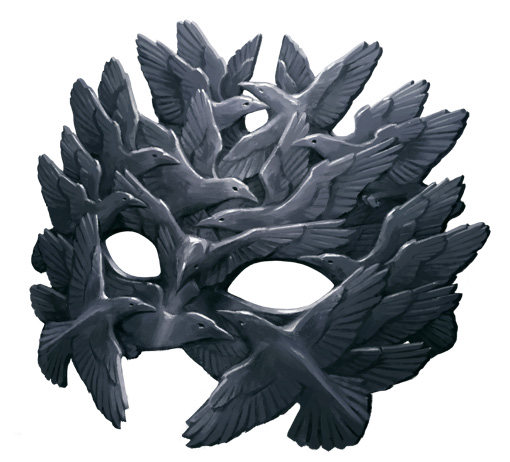
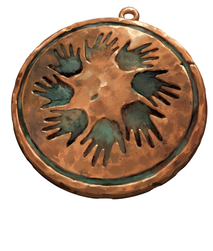

本附錄詳列《迷霧之子傳承》（Mistborn Legacy）冒險中出現的獨特物品（unique items）。本冒險提到的其他物品，詳見《迷霧之子玩家手冊》第 7 章。

### 噴火器（第二時代）

特殊武器，50 磅。

技能：重型武器（Heavy Weaponry）。傷害：2d4 能量（energy）。射程：遠程 [10/20]。特性：危險（Dangerous）、裝填（Loaded）[5]、雙手（Two-Handed）、獨特（Unique）。專家特性：獨特，失去危險特性。

這具燃燒裝置由背負式金屬燃料槽、軟管和手持噴管組成，槽內裝有易燃液體。啟動時，燃料從槽內經軟管流入噴管，由噴管點燃，形成一道火柱。獨特特性。噴火器具有下列獨特特性：

火焰噴射（Blast of Fire）。當你用這件武器命中一個目標時，

你也會擦傷（graze）所有位於你與目標之間直線上的其他角色（由 GM 裁定）。你可以花費這次攻擊擲出的 [機遇]，改為命中這些受到擦傷的角色。

### 創始者之鑰

特殊裝備，0.25 磅。

這把大型金色鑰匙裝飾華麗。鑰匙柄上描繪著一隻眼睛，虹膜呈星形。

### 防毒面具（第二時代）

裝備，1 磅。

面具由橡膠塗層布料和卡其布製成，嵌有圓形護目鏡。長橡膠軟管接到裝有化學吸收劑的濾罐，可隔絕有害氣體與煙霧。獨特特性。防毒面具具有下列獨特特性：

不易操控（Unwieldly）。戴著面具時，交談（Banter）

自由行動須花費 [1行動]，且佩戴者受到減損（Diminished）[察覺 −2]。空氣過濾（Air Filter）。戴著防毒面具時，佩戴者

免疫於必須由目標吸入有害物質才會生效的效果。

### 地雷（第二時代）

裝備，4 磅。

技能：重型武器。傷害：2d6 衝擊（impact）。射程：近戰。特性：爆破（Blast）[10]、危險、一次性（Single-Use）、獨特。專家特性：無。

這個金屬圓筒直徑六吋，由壓力板、絆線與炸藥組成。地雷用於埋設，壓下壓力板或越過絆線都會引發致命的爆炸。獨特特性。地雷具有下列獨特特性：

絆線（Trip Wire）。接觸這枚地雷時，你可以花費 [2行動] 設置地雷，布置一條 5 至 15 呎長的絆線。角色可以使用技能（Use a Skill，花費 [1行動]），並在 DC 15 的感知（Perception）檢定中成功，以安全跨過絆線。否則，當中型或更大的角色進入地雷或絆線所在的空間時，地雷就會爆炸。爆炸時，對爆炸物 10 呎內每個角色的實體防禦（Physical defense）進行一次工藝（Crafting）攻擊。GM 也可以裁定爆炸會損壞範圍內的物件。連鎖反應（Chain Reaction）。如果爆炸中的

地雷波及另一枚地雷或其絆線所在的空間，另一枚地雷也會爆炸。

### 午夜迷霧披風

特殊護甲，5 磅。

偏轉值（Deflect Value）：1。特性：獨特。專家特性：獨特。

這件獨一無二的迷霧披風（mistcloak）做工精細。披肩是醒目的藍色，上頭以銀線與藍線繡出繁複的圖樣。獨特特性。午夜迷霧披風具有下列獨特特性：

飄動流蘇（Flowing Tassels）。穿著這件護甲時，如果你身處

黑暗、霧中等遮蔽視線的區域，則對主要感官受到該區域遮蔽的角色進行隱匿（Stealth）檢定時，你獲得一個優勢。此外，這些角色對你進行感知檢定時，獲得一個劣勢。

### 附錄 B

### 物品

240

### 午夜

### 迷霧披風

若你具有迷霧披風特殊專長（specialist expertise），再加上下列特殊專家特性：

迷霧之子威勢（Mistborn Gravitas）。穿著這件護甲時，

當你對能感知到你、也沒有理由認定你並非迷霧之子的非迷霧之子角色進行威嚇（Intimidation）檢定時，你獲得一個優勢。

### 國家檔案館徽章（第二時代）

特殊裝備，0.25 磅。

國家檔案館（National Archives）的董事會成員會獲頒這枚金色金屬徽章。它可以當成鑰匙，開啟館內任何房間的門鎖並進入其中。

### 留聲機（第二時代）

裝備，10 磅。

這個小型機械裝置可以播放錄在特製刻紋圓筒或圓盤上的聲音。

### 渡鴉面具

特殊裝備，0.5 磅。

這面化裝舞會用的面具以深色金屬製成，造型宛如一群飛翔的渡鴉。

### 渡鴉哨

特殊裝備，0.25 磅。

吹響這支黑色木哨時，會發出類似渡鴉啼叫的聲音。

### Robe of Silenced Steel

特殊裝備，6 磅。

穿戴者攜帶的物件只要藏在這件長袍底下，就無法成為鎔金術（Allomancy）的目標。

### 團結勳章

特殊裝備，0.5 磅。

這枚金屬圓章由司卡（skaa）工匠打造，刻有一圈黑色手印，紀念最後帝國紀元 1024 年的勞工權益抗議（見第 3 章）。

### 渡鴉

### 面具

### 團結

### 勳章

ANNA VERHOOG & LUCAS TORQUATO

### 留聲機

附錄 B：物品 241

