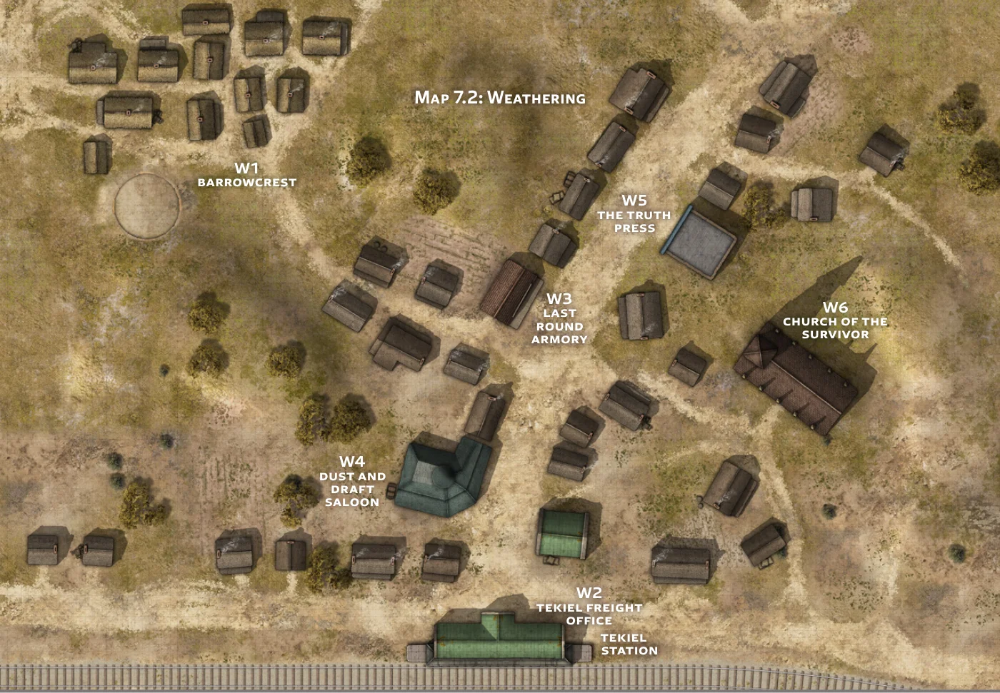
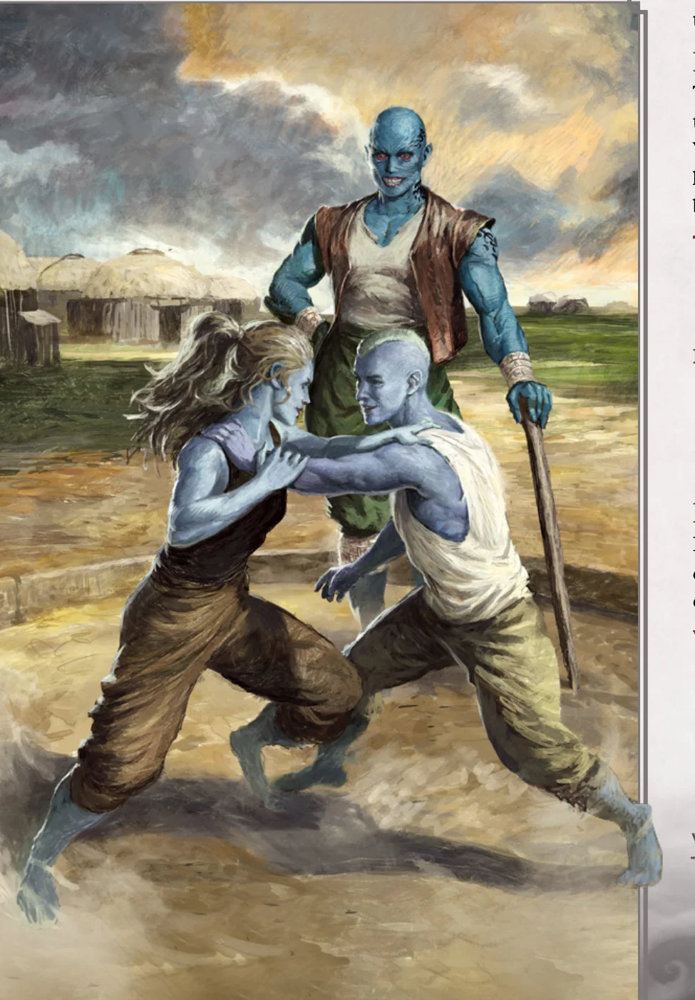
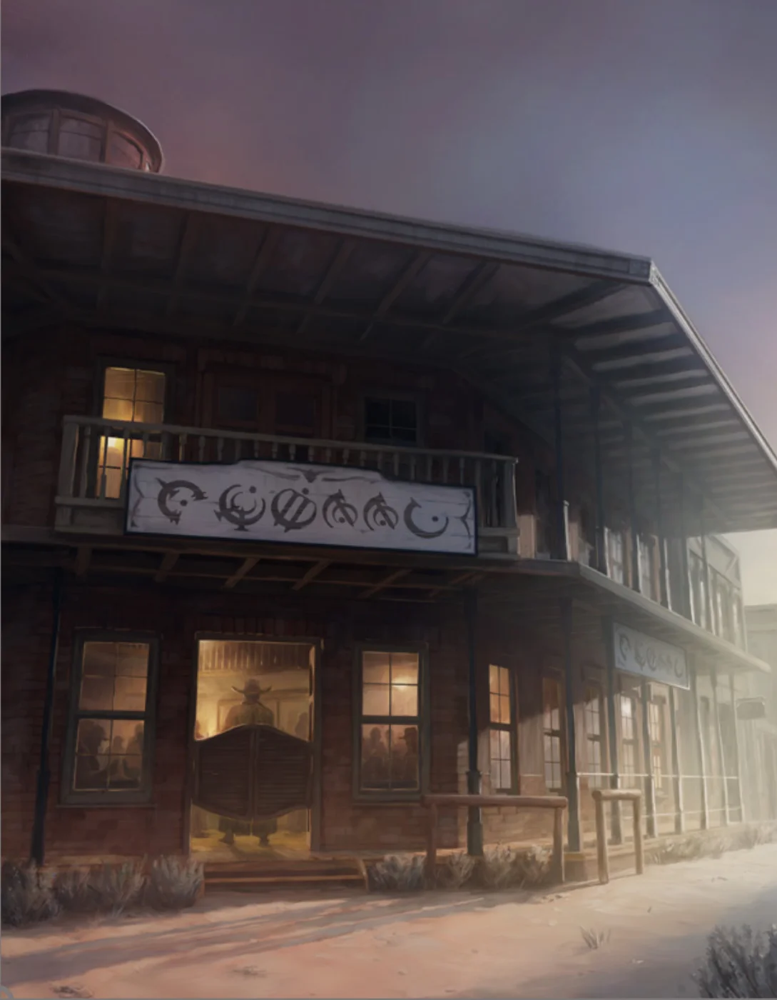
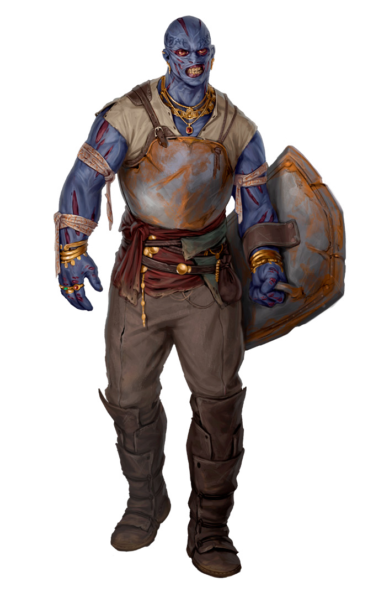
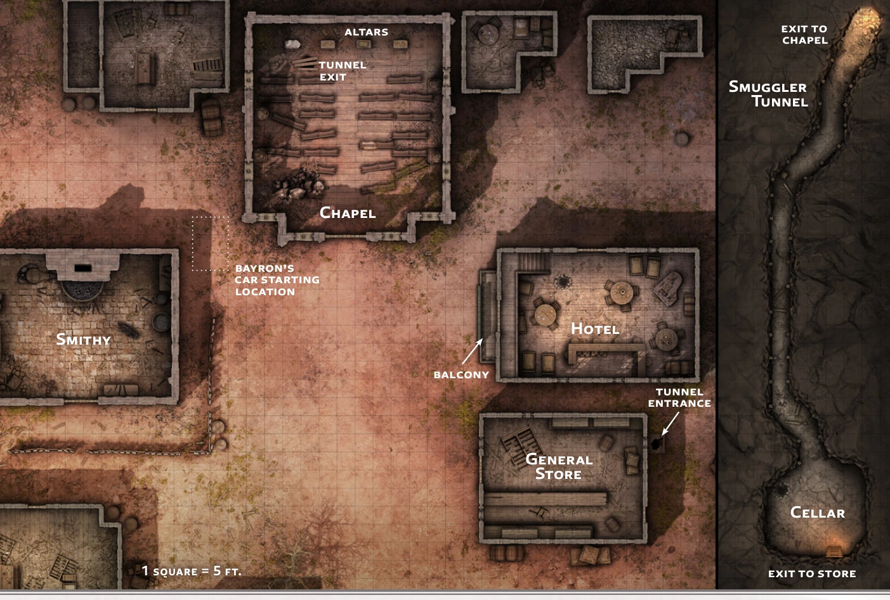
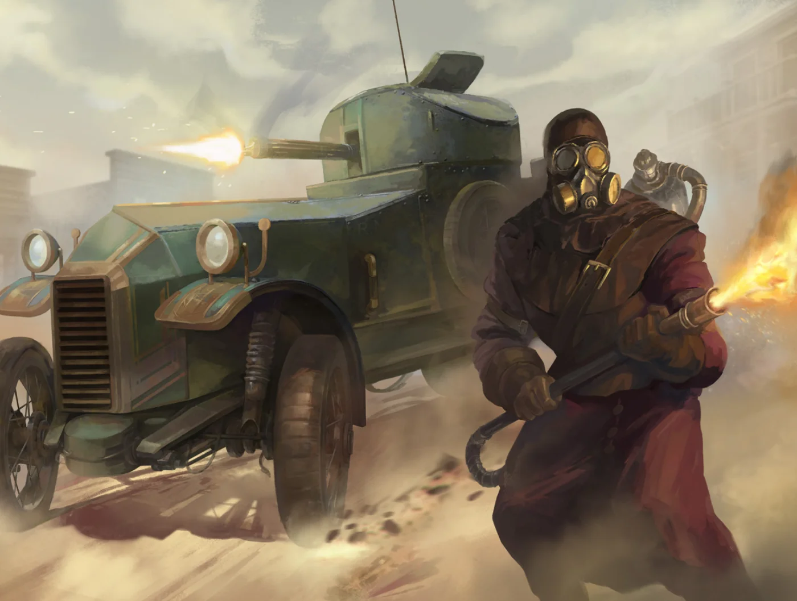
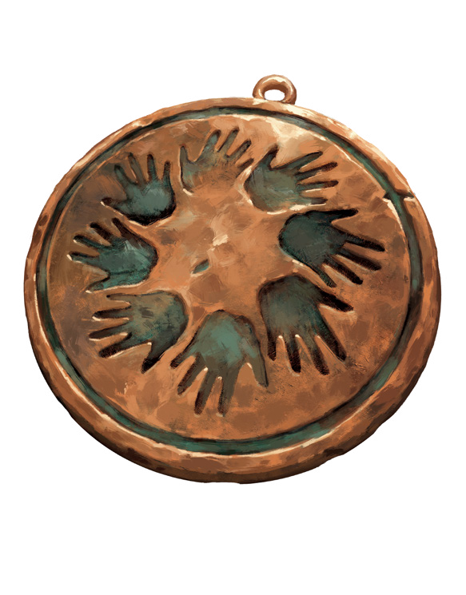

### 探索耐抗鎮

W1 Barrowcrest

W4 Dust and Draft 酒館

W3 Last Round 軍械店

W5 The Truth Press 報社

W6 倖存者教堂

W2 太齊爾貨運辦公室

太齊爾車站

### 地圖 7.2：耐抗鎮

隊伍可以自由探索耐抗鎮，打聽鐵砧的消息，但也得應付 Bayron 留下的危險特勤人員。

### 緊追鐵砧

鐵砧的下落很好查。她就在鬼鎮 Feltrel 一座廢棄的倖存者教禮拜堂。要拼湊鐵砧的身世與如今的計畫，則需要更深入調查：

**身世。** 鐵砧曾當過執法者，後來成了罪犯，

如今則是自由鬥士。這一路的轉變始於父親的死，她認為責任在 Bayron Conrad（見本章開頭的〈鐵砧的鍛成〉）。

**計畫。** 鐵砧正在招募人手，籌集物資和炸藥，

準備炸毀一處貴族的採礦設施。她打算讓蠻橫區成為獨立國家，把依藍戴貴族趕出油田和礦場，自行修建鐵路，成立貿易主管機關。她做這些都是為了蠻橫區的人民，而且她更願意訴諸武力。

### 麻煩遲早上門

隊伍調查時，Bayron 的特勤人員會盯著 PC，盡可能找他們麻煩。PC 走訪鎮上最初兩處地點後，兩名 Conrad 特勤人員與一名 Conrad 精銳特勤人員會在附近巷弄伏擊。精銳特勤人員戴著一頂有鋁襯的帽子。他們會一直打到精銳特勤人員被制服，才試圖撤退，還大聲抱怨：「Conrad 先生給的錢根本不夠我們賣命！」

第 7 章：敲擊鐵砧 141

HEROIC MAPS

### W1：Barrowcrest

Barrowcrest 是克羅司和克羅司血裔的家園。二十人圍著一處石砌鬥場，為正在進行的比試喝采。朗讀：

夯實的泥地圍成一個不太規整的圓形鬥場。兩名克羅司血裔戰士邊吹噓邊揮拳，

人群興奮不已。一名克羅司女子轉向你們，上下打量。「想跟我們討什麼，就先亮出本事！」她喊道。「一個個進場，說說你們風光的事，再讓我們瞧瞧你們的拳頭有多硬。」她掰響指節，咧嘴一笑。「我會親手把你們全打趴！」

要贏得氏族的信任，一名 PC 可以走進鬥場，迎戰剛才下戰帖的 Vereta「磚拳」Wilko（克羅司氏族守護者，她）。擁有克羅司血裔文化專長的 PC，或通過 DC 12 學識檢定的 PC，知道比試規則。否則，由 Vereta 說明規則。

新手傳承時刻

若新手在場，Vereta 認出新手是老兵的親屬，便出言激新手進場。若新手答應，並承認這層關係，群眾會大聲喝采，新手的下一次檢定獲得一個優勢。比試過後，Vereta 會送給新手一件紀念物。和老兵的玩家一起描述老兵的一件裝備如何代代相傳，如今由 Vereta 交到新手手中。這可以是任何價值低於 200 盒金的第一時代武器或護甲，並獲得一項進階物品特性，視同以卓越工藝打造（見《迷霧之子手冊》第 7 章）。

### 迎戰 Vereta

將比試作為一場特殊對話來帶領（見〈結算對話〉）。同一時間只能有一名 PC 在場內與 Vereta 交手。每輪每名 PC 都可以發言或行動一次，具體取決於他們在鬥場內還是在人群中。

### 鬥場內

場內 PC 直接與 Vereta 交手。這名 PC 每次檢定失敗就失去 2 專注點。檢定成功時，Vereta 仍認為自己的身手更好，會花費專注點抵抗影響。可採取的行動包括：

**交手。** PC 施展身手，以運動或敏捷檢定對抗 Vereta 的

實體防禦（19），和她交手或閃躲她的拳頭。**吹噓。** PC 大談自己的英勇事蹟，爭取 Vereta 的敬重。

這項檢定對抗她對應的防禦（DC 14）。若群眾因爭取支持失敗或 Conrad 特勤人員從中作梗而反對 PC，檢定獲得一個劣勢。

### 人群中

場外 PC 無法直接與 Vereta 交手，但能影響觀眾。可採取的行動包括：

**爭取群眾。** PC 可以喊出琅琅上口的口號，

爭取群眾支持（DC 15 領導），也可以找幾小群觀眾個別攀談（DC 16 說服或威嚇）。成功時，群眾轉而支持 PC，Vereta 花費 1 專注點抵抗影響。失敗時，群眾轉而反對 PC。

### Vereta 在一旁指導

兩名年輕人對練。

ANTTI HAKOSAARI

**換人上場。** PC 可以進行 DC 10

敏捷或領導檢定，換下場內的 PC。無論結果都能完成換人，但檢定失敗時，入場的 PC 也會失去 1 專注點。**抵抗 Bayron 的干擾。** 一名 Conrad 特勤人員混在人群裡，

散播 PC 是依藍戴間諜的謠言，煽動觀眾與隊伍為敵。PC 可以通過 DC 13 感知檢定找出這名搗亂者，再通過 DC 14 說服或威嚇檢定讓她閉嘴。一旦她停手，就會說出 Bayron 雇她拖延隊伍、查找鐵砧的把柄，好讓 Bayron 奪得團結勳章。如果沒處理這名特勤人員，對話就無法完全成功（見〈結算對話〉）。

### 抵抗影響

Vereta 的意識防禦為 14、靈魂防禦為 14、實體防禦為 19，並有 5 專注點。她敬佩膽識和力量，也愛聽風光的事蹟。

### 結算對話

Vereta 的專注點不足以抵抗影響時，對話便完全成功，前提是 PC 已處理 Bayron 的特勤人員，否則只算部分成功。若目前在鬥場內的 PC 耗盡專注點，對話便告失敗。若特勤人員未被制伏，她會混入人群，消失無蹤。**完全成功。** 群眾歡呼，Vereta 樂意攀談。若問起鐵砧，她會搖頭，說 Elanda 是「讓人傷腦筋、滿腦子理想的倔丫頭」。Elanda 的父親死後，Elanda 堅持找石油公司報仇，但鎮民認為那只是意外，地方報社也這麼說。Elanda 始終放不下這件事，最後離開家族與耐抗鎮，創立了 Ironbrands。Vereta 提到教堂（W6）的 Derruk 和她很熟，但也提醒大家，Derruk 非常迷信。**部分成功。** Vereta 還是願意談鐵砧，但隊伍得拿出 100 盒金，讓她為氏族購買食物和醫療用品。**失敗。** 群眾大聲嘲笑，Vereta 把 PC 打發走。

### W2：太齊爾貨運辦公室

PC 接近太齊爾貨運辦公室時，朗讀：

車站外，憤怒的鎮民堵在太齊爾貨運辦公室的磚牆外，指責聲像槍響般刺耳。「我的孩子都快餓死了，你們太齊爾家族卻拿我們的物資把依藍戴餵得飽飽的！」一名太齊爾員工吼了回去：「你們那幫土匪朋友搶我們的列車好幾個月了！我們替你們維護鐵路、看守貨物，結果你們倒搶起我們來了！」他一看見你們，立刻補上一句：「他們就在車上。他們親眼看到警衛中槍！」他轉向你們。「跟他們說 Ironbrands 是怎麼動手的！」

要讓群眾相信事情不能怪太齊爾家族，一名 PC 必須通過 DC 17 領導檢定。成功時，群眾雖嘟囔著，仍接受說法，各自散去。太齊爾鐵路員工連聲道謝，把眾人帶進辦公室，給他們 100 盒金，感謝他們「保衛鐵路」。若他們曾協助對付列車上的匪徒，再給 250 盒金。讓每名 PC 進行感知檢定。結果最高的角色注意到一份貨運清單，顯示耐抗鎮實際收到的貨物遠少於付費訂購的數量。物資被轉運到依藍戴第八區的太齊爾列車調度場。若 PC 拒絕或未能說服群眾，激動的人群會迫使太齊爾員工退進辦公室。鎮民樂意和 PC 聊聊，抱怨供應物資遲遲沒送到。若問起鐵砧，他們堅定支持她和 Ironbrands，因為即使火車沒送來糧食和藥品，Ironbrands 也會帶來。一名表態支持鐵砧的 PC 若通過 DC 14 說服或欺騙檢定，便能得知鐵砧正在囤積武器，並招募人手。若 PC 當下沒有替太齊爾員工說話，事後才來領獎，他會拒絕付錢，除非一名 PC 通過 DC 17 威嚇或說服檢定。

第 7 章：敲擊鐵砧 143

### W3：Last Round 軍械店

Last Round 軍械店由古怪卻才華出眾的槍匠 Jaja（叛軍，她）經營。她販售價格最高 400 盒金的槍械及護甲，店後還藏著兩枚閃光手榴彈、兩枚震盪手榴彈和一把卡賓槍。她只要求每位購槍的新主人為武器取個名字，再由她刻上去。PC 抵達時，Last Round 剛遭人陷害。一名特勤人員擅自在幾箱存貨上壓出太齊爾家族的商標，讓它們看起來像贓物，然後向太齊爾警衛通風報信。朗讀：

擺滿步槍和左輪手槍的牆上飄著槍油味。一名皮膚深褐、飽經風霜的年長女子嚼著一根草莖，檢查霰彈槍的膛室，對站在收銀臺旁的太齊爾警衛視若無睹。警衛啪地把搜索令拍在桌上，總算引起她的注意。「奉太齊爾家族命令，我要清查你的存貨。」槍匠哼了一聲。「你們這群禿鷹，就是想搶我的貨。」看見你們走進來，她皺著臉對警衛說：「那就快點。我還有客人要招呼。」

太齊爾警衛（執法者）會調查並沒收「失竊」的貨箱，除非一名 PC 通過 DC 14 威嚇檢定把警衛嚇走，或通過 DC 15 學識檢定，證明搜索令無效。同時，PC 若調查貨物，可通過 DC 15 竊術或洞察檢定識破騙局。若 Jaja 的存貨被沒收，警衛會帶走卡賓槍和所有手榴彈，其餘存貨的價格提高 10%（以《迷霧之子手冊》第 7 章為準）。若 PC 阻止沒收，Jaja 會一路罵到警衛走出店門，然後樂得大笑，提議只收 650 盒金就把卡賓槍賣給 PC。她也樂意回答關於鐵砧的問題，告訴 PC，Ironbrands 最近向她特別訂購了好幾箱炸藥，全帶往南方。Ironbrands 首領想要的武器比小店能提供的更多。Jaja 懷疑鐵砧躲在 Feltrel，正策劃一件大事。

### W4：Dust and Draft 酒館

PC 走進 Dust and Draft 酒館時，朗讀下文。第二段歌詞要帶入守護者組織的全名（見附錄 F）：

酒館的木門一推開，喧鬧的笑聲和刺鼻酒味便迎面而來。客人圍著搖晃的桌子喝酒，酒保把盛滿酒的杯子沿吧臺推了出去。一名身材魁梧的樂師披著一頭飛揚的長髮，撥著吉他，放聲唱起輕快的曲子：

「Kandor 數著堆堆銀幣，

Bezryl 聽見工人呼聲。Cyn 靈巧的雙手又痠又累，心裡還盼能多爭一點。

「如今勳章刻下了名字，

［產業／智慧／勞工］當之無愧。讓蠻橫區人人都記得，團結並肩，永不倒下。」

第 7 章：敲擊鐵砧 144

KEVIN O’NEILL

PC 若與客人攀談，會聽到耐抗鎮西南方的 Feltrel 鬼鎮鬧鬼的故事。據說克羅司當年把所有人都趕走，鎮子從此荒廢。現在又有傳言說克羅司重新在那裡集結，可能會組成一整支軍隊。一名 PC 若偷聽或與當地人攀談，並通過 DC 13 感知或說服檢定，就能證實鐵砧的藏身處在 Feltrel，也會得知當地人很喜歡 Ironbrands，總是盡力替這些法外之徒打掩護。

### 樂師 Taxus

PC 可以和樂師 Taxus（平民，他）聊聊。他知道許多關於鐵砧的歌。請他喝一杯，他就會樂意和大家分享。

### 酒館煙霧

PC 進酒館幾分鐘後，一名 Conrad 特勤人員會把一只罐子從窗外射進來，想讓濃厚的灰煙充滿酒館。PC 有一次機會通過 DC 16 敏捷或運動檢定攔下罐子，把它扔出窗外，或先蓋住它再移到外面。如果罐子在酒館裡放出煙霧，演出就會中斷，客人也會逃走。若 PC 成功攔截，Taxus 會讓他們搶先聽到一首新歌。這首歌取材自他最近和鐵砧的一次交談：「她要驅鐵穿過塵土，讓百姓親手打破王冠。」Taxus 解釋，鐵砧想修一條自己的鐵路，讓蠻橫區和依藍戴做生意，藉此爭取獨立。他猜她需要富有的盟友出資。

說書人傳承時刻

Taxus 邀請說書人一起演出。問玩家會如何把囚犯的故事編進 Taxus 的歌裡，再讓說書人進行 DC 12 說服檢定，代表表演中由他負責的部分。即使失敗，Taxus 仍會聽得起勁，說出鐵砧的身世。若成功，Taxus 還會多透露一件事。Lysarra Tekiel 也在建造新鐵路，但沒人知道那條鐵路通往哪裡。此外，Taxus 提議陪隊伍走一段路。若說書人答應，Taxus 會成為夥伴，直到 PC 回到依藍戴。有他的音樂伴奏，說書人的領導和說服檢定獲得一個優勢。

### W5：The Truth Press 報社

The Truth Press 是 Kwylliam 的大報在耐抗鎮的分社。Bayron 的特勤人員在上鎖的門上裝了一個小型酸液陷阱。PC 通過 DC 10 感知檢定便能察覺。角色可通過 DC 14 竊術檢定解除陷阱。若檢定失敗，或有人在解除陷阱前撬鎖或強行開門，陷阱就會觸發。距離門 10 呎內、以視覺為主要感官的角色，必須通過 DC 16 敏捷檢定，否則陷入迷惑，直到完成長休。

PC 開門時，朗讀：

大報社裡可能到處都是打字機的喀噠聲和忙得團團轉的記者，The Truth Press 的辦公室卻安靜許多。印好的大報掛在細繩上晾乾，最新頭條印得又大又粗：「校園黑衣警衛遭闖入者壓制」及「法外之徒肆虐，鐵路受威脅」。舊報紙沿牆堆放，

積了一層灰，像一座逐漸褪色的地方史圖書館。

PC 可以翻查舊報紙。

### 舊聞

一名翻查舊報紙的 PC 若通過 DC 12 學識或推理檢定，會找到八年前兩篇相關報導：

**〈油泵慘劇〉。** 一則頭版標題

報導當地的事故：「鎮民命喪油泵慘劇」。鎮上向 Conrad 石油公司買來的一臺新油泵嚴重故障，造成六名耐抗鎮居民死亡、另外十人受傷。報導推測，這場事故或許原可避免。**〈易主公告〉。** 下一期的

頭版宣布 The Truth Press 已換了新東家，承諾把「真正的真相」帶給耐抗鎮人民。第 2 頁接著刊登聲明，撤回〈油泵慘劇〉的報導。

第 7 章：敲擊鐵砧 145

### 這鎮容不下兩方

### W6：倖存者教堂

PC 進入教堂時，朗讀：

這座樸素的木造禮拜堂裡，彩繪玻璃窗映著光，把斑斕色彩灑在長椅上。幾名信徒分散坐著，靜靜沉思。一側牆上是一幅大壁畫，描繪倖存者引領信徒。一名身穿灰袍的克羅司血裔男子悄然走近，好奇地打量你們。

此人是 Derruk（打手，他），曾是 Wilko 氏族的一員，如今負責照料禮拜堂。只要 PC 沒有對鐵砧表露惡意，通過 DC 14 說服檢定就能說服 Derruk 承認自己與她有過一段交情。不過，他剛一開口，詭異的耳語便在禮拜堂裡迴盪，打斷他的話。Derruk 十分迷信，嚇得無法繼續說下去。一名 PC 若通過 DC 14 推理檢定，就會發現聲音來自一臺小留聲機（見附錄 B），由 Bayron 的一名特勤人員藏在長椅後。Derruk 如釋重負，繼續說下去。他是最早加入 Ironbrands 的人之一，還幫鐵砧把 Feltrel 的舊禮拜堂布置成藏身處。Derruk 很懷念和鐵砧共事的日子。鐵砧嫌他太心軟，說他白費了自己的一身力氣，把他逐出 Ironbrands。「我還在奮戰，只是換了種方式。」他語帶惆悵。若檢定失敗，PC 最後還是會找到留聲機，但在那之前，Derruk 已離開，去向教堂的主祭回報。他答應明天回來，卻來不及協助 PC 的調查。

### 拼湊線索

PC 有充足時間探索耐抗鎮、完成調查後，天色便近黃昏。如果 PC 先前獲得 Merid 的協助，他會在此刻回來。朗讀：

太陽沒入地平線，Merid 笑著慢步走來，滿懷期待。「馬都備好了。你們查到什麼？」

如果 PC 還沒查出鐵砧的基地在 Feltrel，Merid 已從線人那裡打聽到，會告訴隊伍。

角色分享完各自的發現後，朗讀：

Merid 點點頭。「看樣子情報都齊了，該動手了。鐵砧要是看見我，就不肯談。所以快到 Feltrel 時，我會先留在後頭。要是有人開槍，我就會來幫你們。等你們拿到勳章，我再告訴你們，我真正為誰做事。那些人是真心想扳倒 Gilded Few。」

到 Feltrel 路途遙遠，Merid 建議 PC 隔天一早騎馬出發。隊伍可以先長休，再進入〈這鎮容不下兩方〉。

跨時代連結

如果 Merid 是倖存者教信徒，隊伍一提起 Feltrel，他就會推測，鐵砧在那裡的倖存者教禮拜堂。那座禮拜堂曾是守護者組織的藏身處，有一段血腥的過去。他會告訴 PC 走私隧道的事（見〈抵達 Feltrel〉）。

第 7 章：敲擊鐵砧 146

### 這鎮容不下

### 兩方

PC 從耐抗鎮騎馬前往 Ironbrands 在 Feltrel 的基地，得穿過大片草原、紅土沙漠，以及迂迴曲折的峽谷。如果 PC 依照 Merid 的建議一早出發，旅途會花兩天。他們會在日落前不久抵達毀壞的禮拜堂，與鐵砧及 Bayron Conrad 談判。

### 抵達 Feltrel

隊伍騎馬進入 Feltrel 時，朗讀：

Feltrel 像一具被遺棄的屍骸，能拿的東西早被搜刮一空，歲月留下厚厚的塵土。只有一棟建築燈火通明、守備森嚴，那是一座倖存者教禮拜堂。四面磚牆仍在，屋頂卻不見了。一名帶武器的克羅司男子在空蕩的門口戒備。禮拜堂前停著一輛眼熟的墨綠色汽車，車身鉚接，如今還裝了旋轉炮塔和車首火炮。四名穿制服的守衛分列兩旁。

Bayron 的裝甲車旁有四名 Conrad 特勤人員。車身覆有鋼板，以鉚釘接合，裝有旋轉炮塔和車首火炮。和第 5 章的比賽相比，顯然已經改裝過。

一名克羅司氏族守護者把守禮拜堂入口，要求所有來人報上來意。PC 可以進行社交檢定，對抗他的意識防禦（14）。若用上鐵砧支持者提供的情報，包括 Vereta、Jaja、Derruk 和 Taxus 的線索，就獲得一個優勢。成功時，他會放行。失敗時，他只肯讓 PC 舉起雙手進去，並從背後用槍指著他們。如果 PC 尋找其他入口，可以憑 Merid 的提示，或通過 DC 17 感知檢定，發現一條從舊店鋪地窖通往禮拜堂的走私隧道（見地圖 7.3），繞過守衛。

### 最後一筆交易

儘管 Bayron 千方百計拖延 PC，他們還是在他和鐵砧談判時趕到了。Bayron 穿著樸素衣服，貼著一大撇假鬍子，裝成低調的生意人，想買下團結勳章（詳見附錄 B）。鐵砧一直在用力抬價，想看看能從這位「生意人」手中榨出多少物資，卻不知道他就是害死父親的富商 Bayron Conrad。PC 進入禮拜堂時，朗讀：

半打法外之徒懶散地坐在長椅上，或倚著牆站著，充滿敵意地瞪著你們。禮拜堂前方還留著四座供奉倖存者的祭壇。一座鋪滿地圖，另一座擺滿最近劫來的財物，團結勳章就在其中閃閃發亮。第三座祭壇上放著打開的手提箱，裡面塞滿盒金。Bayron Conrad 僵著身子坐在附近的長椅上，正對著鐵砧。他穿著工作服、戴著扁帽，還多了一撇鬍子，幾乎認不出來。他猛地轉頭看向你們，鼻翼一張一合，氣急敗壞地說：「這是私人會面。」鐵砧往後一靠，神態自在，卻透著威嚇。她的目光從 Bayron 掠向你們，細細打量。「這下可越來越有意思了。」她慢條斯理地說。「你們是來入夥，還是來擋我的路？」

PC 等了許久，終於有機會和鐵砧談判，拿到團結勳章。

扮演鐵砧

**特質。** 自信、果斷、崇尚武力。**目標。** 讓蠻橫區成為獨立國家。**外貌。** Elanda Wilko（「eh-LAHN-dah WILL-koh」，她）

是一名膚色深藍的克羅司女子，身高 7 呎 2 吋。她穿著巨大的鐵製胸甲，提著同樣巨大的鋼盾。她的耳朵、頸間和指節上閃著從毫無戒心的貴族身上搶來的珍寶。她剃光的頭上滿是交錯的刺青和舊傷疤。

Elanda「鐵砧」Wilko 在蠻橫區鄉間長大。她性子狂野、槍法精準，胸懷大志。她年輕時當過執法者。父親死於油泵意外後，她懇求氏族和執法者替他討回公道，卻沒人理會（見本章開頭的〈鐵砧的鍛成〉）。最後她拋下本名和警徽，接受克羅司尖刺，成為鐵砧，創立 Ironbrands。如今，她有膽量和遠見，足以讓蠻橫區成為獨立國家，只差一筆資金。

### 鐵砧

第 7 章：敲擊鐵砧 147

GUILHERME CASTRO

### 與鐵砧談判

角色可以透過一場對話，試著說服鐵砧交出勳章（見〈結算對話〉）。Bayron 唯一能拿到團結勳章的辦法，就是一直瞞著自己的真實身分，直到說服鐵砧賣給他。

### 特殊規則：Conrad 插話

Bayron 帶來一只裝滿盒金的手提箱，承諾提供武器，還下定決心不惜代價也要贏。每次 PC 發言或行動後，Bayron 會立刻插話，試圖削弱他們的論點或把價碼抬得更高。只要 Bayron 仍在對話中，PC 的發言或行動就獲得一個劣勢。Bayron 的處境並不穩固。鐵砧認為 Conrad 石油公司害死了她父親，寧願殺掉 Conrad 家族的人，也不願收他們的錢。PC 可以用自己這次發言或行動進行相關檢定，試著揭穿 Bayron 的真實身分。若失敗，鐵砧會揮手打發這個說法。若成功，她會看清真相，Ironbrands 會把結結巴巴、一路抗議的 Bayron 連人抬出禮拜堂。Bayron 離場後，PC 的發言或行動就不再獲得劣勢，但仍得說服鐵砧交出團結勳章。

### 抵抗影響

鐵砧的意識防禦為 15、靈魂防禦為 15，並有 5 專注點。訴諸她對貴族的憎恨，或承諾提供武器，在她看來都是極有說服力的論點。若有人主張問題能以非暴力方式解決，她只需花費 1 專注點抵抗影響。

### 結算對話

PC 提出特別有說服力的論點，或鐵砧已沒有足夠專注點抵抗影響，對話就成功。若 PC 威脅鐵砧，或隊伍多次沒能說動她，對話便告失敗。

繼承人傳承時刻

若隊伍揭穿 Bayron 的身分，他會反過來抖出繼承人的貴族出身。鐵砧啐了一口。「我憑什麼不當場把你開膛破肚？」問繼承人會否認自己的出身，還是引以為傲。如果繼承人真心否認這層身分，鐵砧會敬重這份反抗，認為繼承人接下來的論點極有說服力。如果繼承人承認，鐵砧會問他自己和 Bayron 有什麼不同。若繼承人答不出合理的理由，或未通過相關社交檢定，一名克羅司氏族守護者會把 Bayron 和繼承人一併請出去。

### 開始談判

如果 PC 阻止列車劫案，鐵砧會一開口就要求 PC 補償她損失的食物和物資。PC 可以送上價值至少 500 盒金的禮物安撫她，也可以解釋自己當時不明白她的正當目標，但該檢定獲得一個劣勢。若一名 PC 檢定失敗，鐵砧會更不信任隊伍，下一次

第 7 章：敲擊鐵砧 148

PC 的發言或行動獲得一個劣勢。如果 PC 送禮或通過檢定，鐵砧的怒氣會平息。她花費 1 專注點抵抗影響，承認事情已經無法挽回。之後，PC 可以談下列話題：

**收買與交換。** 鐵砧需要資源推進她的志業，

願意接受金錢、武器或人手。PC 若檢定失敗，鐵砧會暗示隊伍拿不出足夠的資金。若成功，她會花費專注點抵抗影響，強硬地要求更好的條件。**革命目標。** 若 PC 問起向 Jaja 訂的炸藥，

或通過檢定摸清鐵砧想要什麼，她會說出自己打算炸毀一處貴族的採礦設施，讓蠻橫區離獨立更近一步。表態支持這個目標可以贏得她的認同，但若 PC 檢定失敗，鐵砧會嘆氣，認為隊伍只是嘴上有理想，根本不敢動手。若成功，她會花費專注點抵抗影響，仍然不輕易買帳：「說起來容易，真要做到就難了。」**提到 Azmine。** 若 PC 提起 Wilko 教授，

鐵砧會驚訝得僵住，接著問起表親的近況。她既好奇又帶著怨氣。若 PC 主張 Azmine 希望她交出勳章，她只需花費 1 專注點抵抗影響，並把表親說成「嬌弱的城裡學者」，根本不懂「真正的世界」。**提到鐵砧的父親。** 若 PC 提起她的父親，

無論檢定結果如何，鐵砧都會立刻失去 1 專注點，憤怒地痛罵貴族的欺壓和剝削。若 PC 成功說服她，幫助隊伍能讓害死她父親的人付出代價，鐵砧不會抵抗這個說法。這時很適合提高賭注。

**成功。** 鐵砧同意把團結勳章交給 PC。若 Bayron 尚未被趕出對話，他會氣得滿臉紅斑，咬牙說：「沒人贏得過 Conrad！」然後用力踩著步子走出禮拜堂。不論如何，Bayron 都會在外頭帶著裝甲車等候，PC 一出來就攻擊他們。接著進行〈日落槍戰〉。**失敗。** 鐵砧拒絕把團結勳章交給 PC。若 Bayron 沒有被趕出對話，她會用勳章跟他交換一整箱盒金，Bayron 則試圖搭裝甲車逃走。否則，鐵砧會留下勳章。PC 得空手離開，或冒著極大的危險，和鐵砧及六名 Ironbrands（五名自由鬥士、一名克羅司氏族守護者）交戰，硬把勳章搶到手。若 PC 和鐵砧交戰，Bayron 就會逃走。等他們離開禮拜堂時，Bayron 早已不見人影，直接進行〈戰後〉。

### 日落槍戰

PC 在談判時，Merid 已讓守護者組織的援兵各就各位。PC 走出禮拜堂時，朗讀：

Bayron 等在裝甲車拉長的陰影裡。「我早算到這一步了。」他舉起雙拳，踮著腳尖蹦跳，眼中閃著瘋狂的光，肌肉賁起。「以為你們能把我踩在腳底下？你們可算錯了，這下要賠上性命。有膽量才有明天！」太陽一碰到地平線，裝甲車的引擎就轟然發動，旋轉炮塔轉向你們。引擎的轟鳴幾乎蓋過一陣急促的腳步聲，只聽見 Merid 大吼：「為了耐抗鎮！」

戰場（見地圖 7.3）爆發多方槍戰。PC 面對一支落單的小隊，四周則亂成一團。描述 PC、Conrad 特勤人員、守護者組織，以及可能參戰的 Ironbrands 激烈交鋒的混亂景象。Bayron 的部隊包括 Bayron Conrad、兩名 Conrad 特勤人員（其中一名拿著火焰噴射器，詳見附錄 B）、兩名駐軍士兵，以及駕駛裝甲車的兩名平民（見〈戰場效果〉）。Bayron 的生命值降至 15 或以下時，他會試著撤回裝甲車，因為不願為勳章送命（見〈買命交易〉）。

PC 接著有一輪時間摧毀裝甲車，否則車子就會全速開往依藍戴。若 Bayron 落敗，任何存活的特勤人員都會擠上裝甲車逃走。

### 鐵砧會怎麼做？

若 PC 在〈與鐵砧談判〉中成功，鐵砧與 Ironbrands 會協助對抗 Bayron，牽制他的一部分兵力。從這場戰鬥移除一名未持火焰噴射器的 Conrad 特勤人員，以及兩名駐軍士兵，以呈現這項影響。若 PC 談判失敗，鐵砧不會介入與 Bayron 的戰鬥，只有遭到攻擊才會自衛。

### Bayron

### 卸下

### 偽裝後

第 7 章：敲擊鐵砧 149

DEANDRA SCICLUNA

### 戰場效果

戰鬥中，適用下列效果：

**還太年輕，也太有錢，不能死。** Bayron 的生命值

降至 0 時，他仍有意識，會試圖投降。再受到任何傷害，他就會死。立刻進行〈買命交易〉。**裝甲車。** Bayron 的兩名手下（平民）

坐在裝甲車裡，一人開車，一人乘車。駕駛在每個慢速輪次花費 [3行動] 操作車輛，使車輛移動最多 80 呎。車門蓋上了鎖，但通過 DC 22 運動檢定即可打開。角色也可以直接攻擊車輛。車輛的實體防禦為 18、生命值為 60、偏轉值為 5。當車輛剩餘 30 生命值時，車門蓋會破開。**旋轉機槍。** 裝甲車配有一挺車載

旋轉機槍（見《迷霧之子手冊》第 7 章），由乘員操作。乘員會在自己的輪次盡量使用旋轉機槍打擊，進行重型武器攻擊檢定（加值 +0），擲出 3d4 銳利傷害。

### 地圖 7.3：Feltrel 槍戰

### 日落槍戰

### 機遇與變故

| 結果 | 範例 |
| --- | --- |
| [機遇] | 一名守護者向正在攻擊 PC 的敵人開槍。 敵人受到驚嚇，承受 1d10 銳利傷害， 並失去下一次反應。 |
| [機遇] | 守護者壓制一名敵人。 該敵人在下一個輪次第一次移動時， 受到 1d10 銳利傷害，且直到該輪次結束前， 其攻擊都獲得一個劣勢。 |
| [變故] | 戰場上四處閃著槍口火光。PC 必須 通過 DC 14 敏捷檢定，否則受到 2d6 銳利 傷害。 |
| [變故] | 敵我難辨。PC 的下一次攻擊擊中一名盟友。  |

隧道出口

通往禮拜堂

陽臺

隧道入口

Bayron 車輛的起點

通往商店

祭壇

### 禮拜堂

### 旅館

### 雜貨

### 店

### 地窖

### 走私

### 隧道

每格 = 5 呎

### 鐵匠鋪

第 7 章：敲擊鐵砧 150

HEROIC MAPS

企業家傳承時刻

企業家認出裝甲車的一個關鍵零件，是仿造自己曾研究過的設計。問玩家發現了什麼缺陷。企業家與裝甲車互動的檢定獲得一個優勢，並可以選擇下列一項額外好處：

- 通過 DC 17 竊術檢定即可打開車門蓋的鎖。

- 裝甲車的偏轉值為 0。

- 車載旋轉機槍造成 2d4 銳利傷害

（原為 3d4）。

OANH HA

### Conrad 特勤人員

### 用 Bayron 的裝甲車與

### 實驗型火焰噴射器發動攻擊！

### 買命交易

若 PC 把 Bayron 的生命值降至 0，他會跪倒在地，高舉雙手，開價求饒：「等等！只要你們放我走，我就給你們 5,000 盒金！」任何存活的特勤人員也會投降。為了活命，Bayron 什麼都肯做，含淚懇求 PC 饒他一命。如果 PC 試圖判斷他有沒有說實話，會察覺他確實打算依約付錢。若 PC 繼續施壓，Bayron 還會提出交出血金術筆記（見本書導言的〈處理血金術〉），承諾能帶來力量，並露出穿過上半身的兩枚鐵軌般的尖刺。如果 PC 同意放他走，Bayron 會交出團結勳章（若勳章在他手上），開一張能在耐抗鎮的太齊爾貨運辦公室兌現的支票，召集任何活著的手下，然後搭車疾駛離開。支票有效，可以順利兌現。Bayron 的特勤人員已經撤出鎮上。

### 繼續上路

### 戰後

如果 Bayron 倒下時帶著團結勳章，PC 可以取走它。此外，具備血金術師專長的 PC 可以試著從 Bayron 屍體取出兩枚鋼製血金術尖刺。一枚賦予白鑞鎔金術，另一枚賦予鋼鎔金術（見本書導言的〈處理血金術〉）。如果所有特勤人員都被擊敗，PC 獲得一具火焰噴射器（詳見附錄 B）。若 PC 擊敗鐵砧，而她先前已把勳章交給 Bayron，PC 還能取得 Bayron 的手提箱，裡面有 1,500 盒金。戰後，守護者組織的部隊退回沙漠，Merid 走向 PC。若鐵砧還活著，她會回到禮拜堂的藏身處籌劃下一步。隊伍準備好繼續時，進入〈同心協力〉。

### 同心協力

若 PC 拿到勳章，既沒和鐵砧交戰，也沒接受 Bayron 的交易，Merid 會欣喜若狂。如果 PC 和鐵砧交過手，Merid 聽聞會明顯失望，難過得要停一會兒消化這個壞消息。不論如何，只要 PC 找回團結勳章，且沒有接受 Bayron 的交易，Merid 就完成了任務，守護者組織的規模增加 1。Merid 會祝賀 PC，答應引介他們認識守護者組織，並終於說明這個祕密結社完整的宗旨（見「跨時代連結」側欄與附錄 F）。他邀請 PC 加入，讓他們能運用組織的資源。若 PC 未能取得勳章，但沒有接受 Bayron 的交易，Merid 只會失望一會兒，很快就振作起來。朗讀：

「好消息是，地圖一共有三塊，」

他樂觀地說。「Gilded Few 那群人拿得越少越好。只要還沒放棄，我們就還沒輸。」

守護者組織的規模不會增加，但 Merid 仍會邀請 PC 加入守護者組織。若 PC 接受 Bayron 的交易，則朗讀：

「放那傢伙走，搞不好哪天會反咬你們一口。」

Merid 頓了一下。他滿身是血，卻咧嘴笑了。「不過我相信你們也會咬回去。」

守護者組織的規模不會增加，Merid 也不會邀請 PC 加入。

第 7 章：敲擊鐵砧 152

ANNA VERHOOG

本章結尾，朗讀：

「Gilded Few 那樣的人，確實是個大威脅。」Merid

望向整片戰場。太陽沒入地平線，紫色夜幕垂落在 Feltrel 上。「但我們能這樣打敗他們。」他抬了抬帽簷。「一起上。」

跨時代連結

如果 PC 加入守護者組織，Merid 會帶他們回到 Dust and Draft 酒館，並說起第 4 章的兩名可信任 NPC 如何創立守護者組織的傳說。第一時代角色若在 NeBaal 的最後任務中存活，請他們的玩家描述這些角色身為早期成員，曾給組織帶來哪一項影響。接著，Merid 說明守護者組織能提供的好處（見附錄 F）。

不論隊伍是否拿到團結勳章、手上是否沾了 Bayron 的血，他們都可以離開 Feltrel，返回依藍戴。蠻橫區的冒險結束後，第二時代 PC 升至第 6 級。

### 團結

### 勳章

