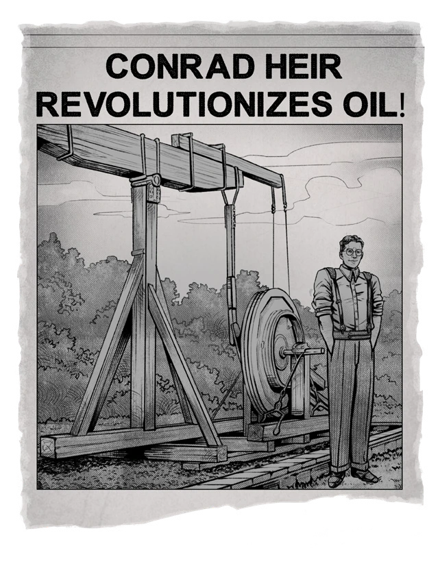
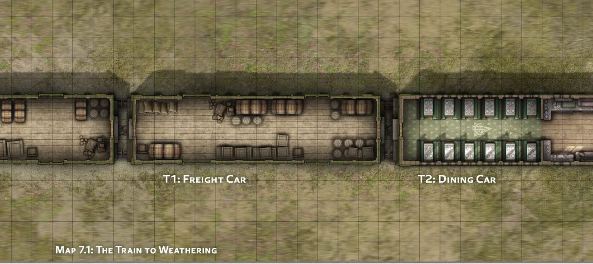
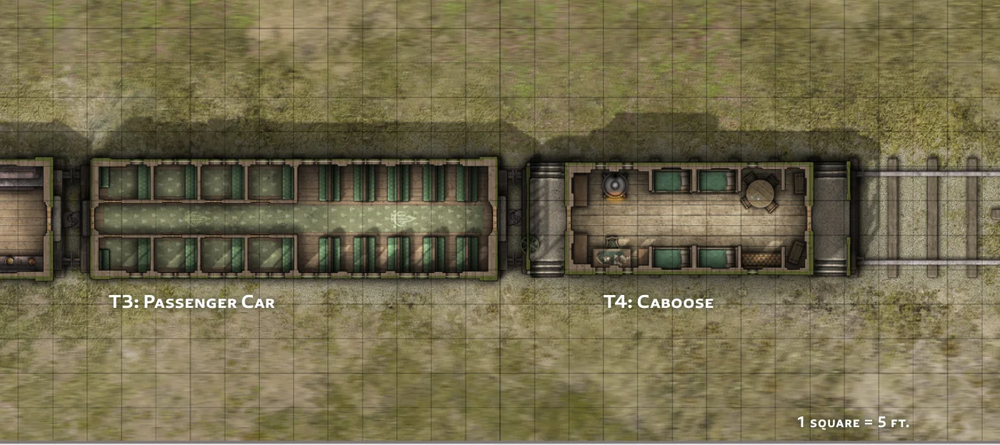

### 如何主持本章

### 漸淡的蹤跡

第 7 章：敲擊鐵砧 133

隊伍帶著 NeBaal 逃離依藍戴大學後，便開始尋找鍍金地圖。他們已拿到第一塊碎片渡鴉面具，接下來要轉往北方。下一塊地圖碎片在蠻橫區，由一名令人畏懼的克羅司法外之徒持有。

隊伍重新會合後，NeBaal 會說出下一塊鍍金地圖碎片是團結勳章。這枚勳章是在 1024 FE 年的勞工權益示威後頒發的，詳見第 3 章。PC 必須前往蠻橫區，與 Bayron Conrad 爭奪勳章。

### 章節流程

與 NeBaal 交談，可以了解這名坎得拉的過往、鍍金地圖的來歷，並確認隊伍的下一個目標是團結勳章。接下來有十天休整時間。在此期間，無論自行研究或與 Azmine Wilko 教授交談，都會得到指向耐抗鎮的線索。隊伍搭乘北上的列車時，會遭到鐵砧率領的法外之徒幫派 Ironbrands 伏擊（見〈鐵砧的鍛成〉）。隊伍抵達耐抗鎮後，名叫 Merid 的執法者會提供協助。他是祕密結社守護者組織的成員，相關背景見附錄 F。隊伍很快便發現 Bayron Conrad 也在尋找團結勳章。Bayron 在耐抗鎮留下手下並設下障礙，阻止隊伍追到廢棄小鎮 Feltrel。他希望趕在 PC 插手前，在那裡找到鐵砧並說服她交出勳章。PC 得一邊應付 Bayron 的手下，一邊探索耐抗鎮，查明鐵砧的過往與計畫。PC 會在 Ironbrands 的藏身處與 Bayron 對峙，並有機會說服鐵砧站在隊伍這邊。主持這場攸關成敗的對話前，可先閱讀本書導言的〈扮演 Bayron Conrad〉。即使 PC 拿到勳章，也得應付 Bayron 和他的裝甲車，才能活著離開。

### 鐵砧的鍛成

鐵砧本名 Elanda Wilko。若 PC 透過研究、與 Merid 交談及在耐抗鎮調查蒐集到足夠的線索，就能得知 Elanda 父親的遭遇。他死於一場本可避免的意外。Conrad 石油公司一款號稱「創新」的新油泵發生故障，而那正是 Bayron 的首項重大工程成就。為了保住 Bayron 的名聲，Conrad 家族壓下事故，Wilko 家族始終未能討回公道。復仇的渴望促使鐵砧先接受克羅司尖刺，再成為劫匪，最後投身爭取政治自由的鬥爭。這也使她與 Wilko 家族其他成員漸行漸遠。在本章結尾與鐵砧談判時，若能以這段往事說服她，PC 就能成功。

### 角色升級

第二時代角色以第 5 級開始本章，在 Feltrel 槍戰後升到第 6 級。若 PC 取得 Bayron 的血金術筆記，就能完成「了解血金術」短期目標（見本書導言〈處理血金術〉）。

本章緊接第 6 章。隊伍帶著 NeBaal 逃離大學時，朗讀：

依藍戴大學消失在霧中，遠處鐵軌傳來的嘶鳴掩蓋了你們匆忙的腳步聲。

NeBaal 雖已筋疲力竭，仍按捺不住好奇，打量四周。那雙閃亮的眼睛一一看過你們的臉、周圍高聳的建築和鋪好的道路。「陸沙德……變了好多。」NeBaal 嗓音沙啞。「有沒有安全的地方可以談談？」

### 完整真相

如果隊伍去找 Wilko 教授尋求庇護，見本章稍後的〈拜訪 Wilko〉。否則，隊伍可以另找一處藏身地（見第 6 章的〈漫長的一夜〉）。

### 敲擊鐵砧

### 第 7 章

隊伍抵達安全處後，NeBaal 說出自己知道的事，並這樣開場：

「我是 NeBaal。我說過自己就是鍍金地圖，但事情沒那麼簡單。

大學裡那個可惡的結社相信，我知道他們失落已久、原本就該由他們繼承的東西在哪裡。他們把它當成寶物，但我很清楚，那是一件非同尋常、獨一無二又極其危險的東西。」「我不是鍍金地圖，但地圖是我做的。所謂的『寶物』其實是好幾百年前的奇物，

只有靠那張地圖才能找到它。偏偏有比那個結社更危險的人也開始找地圖了。所以我得趕在他們前面。也許該說，我們得趕在他們前面。」

NeBaal 坦然回答問題，說出自己知道的一切，唯獨不肯透露第三塊地圖碎片是什麼、可能在哪裡。NeBaal 主動提供以下消息：

**寶物是什麼？**「我曾侍奉一位名叫 Vadilek Elariel 的貴族。

他用無辜者的鮮血打造了一件力量駭人的奇物，自以為能靠它取代統御主，左右司卡德利亞的未來。他把那件奇物叫作永恆尖刺。後來他的傲慢害了他，就由我來保管尖刺。幾百年來，它一直藏得好好的。」**鍍金地圖是什麼？**「永恆尖刺藏在陸沙德下方，

那裡的洞窟隧道像迷宮，根本很難找路。我把隧道畫成地圖，拆成幾塊，再安排人保護這些碎片。為了保守祕密，我告訴最早的守護者只有兩塊，其實還有第三塊。這三件物品合起來，就是他們說的『鍍金地圖』。現在我怕它正落入最不該拿到它的人手裡。」**還有誰在找地圖？**「千眼會

替一個危險的祕密結社 Gilded Few 招募成員。Gilded Few 是一群自命不凡、卻大多成不了事的貴族，一心想得到永恆尖刺。我守了幾百年祕密。幾年前，千眼會的三名學生『放了』我，就像你們剛才那樣，卻騙我把一切都說了出來。直到他們又把我關起來，我才知道，他們想自己使用永恆尖刺，根本沒打算幫我保護它。我希望……我只希望你們和他們不一樣。這關係到我們所有人。」

**永恆尖刺究竟是什麼？**「一枚稀有金屬製成的尖刺，經由血金術這門黑暗技藝灌入龐大力量。

那股力量來自駭人的實驗，數以千計的司卡為此遭到折磨。永恆尖刺完成後，力量大得可怕，任何人若沒經過強化，都無法承受。於是 Vadilek 和 Gilded Few 殺害了迷霧人、迷霧之子和藏金術師，用尖刺組成一道陣列，好讓他們當中一個人能承受永恆尖刺。」**地圖碎片在哪裡？**「世界已經變了。

碎片可能早已不在當時藏匿的地方，但我能追查。第一塊是舞會上戴的一副面具。第二塊是一枚勳章，源於一場勞工起事。我應該能找到這兩件物品的紀錄。不過……上一次我以為自己獲得自由，把知道的事全說了，結果鑄下大錯。等找到前兩塊，我們再談第三塊。」

如果 PC 說出自己已經拿到渡鴉面具，NeBaal 會大大鬆一口氣，也立刻更願意相信 PC。如果 PC 沒有提到面具，NeBaal 會從 Wilko 那裡得知，並視需要向隊伍補充消息。NeBaal 打算調查團結勳章的下落，以及前往舊陸沙德的路。如果還不知道 PC 已拿到面具，也會查面具的下落，並邀請 PC 幫忙。

第 7 章：敲擊鐵砧 134

DAVID ALUNAN

探索者傳承時刻

探索者聽了 NeBaal 的描述，認出那是編年史家記錄過的團結勳章，為紀念 1024 FE 年促成陸沙德勞工改革的抗議而製。NeBaal 注意到探索者的反應，熱切地問起編年史家的紀錄。請編年史家的玩家說說曾與 NeBaal 分享的最重要一段回憶，再問探索者，NeBaal 忘了其中哪個關鍵部分。若探索者在〈休整期間的研究〉中投入時間研究，NeBaal 會主動幫忙，讓探索者能同時花五天休整時間進行另一項自行選擇的活動。

### 休整期間的研究

和 NeBaal 談完後，PC 有十天休整時間，可以協助 NeBaal 研究、拜訪 Wilko，或從事其他休整活動（見附錄 E 的〈在依藍戴休整〉）。

### 前去拜訪 Wilko

若有 PC 想去找 Wilko，NeBaal 會請求同行，很想見見這位歷史學家。參見〈拜訪 Wilko〉。

### 進行研究

國家檔案館和大學圖書館都適合研究。不過，如果 PC 觸發過檔案館封鎖事件，或和校園警備起過衝突，就必須通過 DC 15 竊術檢定喬裝，才能到相應的地點研究。研究需要整整十天休整時間，每天另花 3 盒金購買用品。問每名參與的 PC 想研究勳章還是舊陸沙德的位置，再讓他們用推理、學識或說服進行 DC 14 檢定。依檢定結果，告訴他們所選題目的相關消息：

**團結勳章。** 無論成功或失敗，研究都會查出勳章在落灰之終後失落，最近又在耐抗鎮出現。

檢定成功也會查到 Bayron Conrad 的消息。一則罕見的報紙剪報寫道，Bayron 最早在北方蠻橫區展現發明才華，為父親經營的 Conrad 石油公司發明了油泵。當時人人稱讚那是革命性的發明，奇怪的是，此後再也沒人提起這項成就。

**舊陸沙德。** 檢定成功時，隊伍會查到舊陸沙德的位置，也就是最後帝國被掩埋的首都。

此外，他們也會查到 Lysarra Tekiel 的消息。據說她正在興建一條祕密鐵路，沒人知道終點在哪裡。另有傳聞說，蠻橫區糧食短缺，供應的物資也被轉運到別處。種種跡象顯示，Lysarra 可能早就知道舊陸沙德在哪裡，正把大量物資運往那裡。

### 研究未果

隊伍即使研究失敗，NeBaal 仍會發現舊陸沙德的位置，Wilko 也一定知道勳章在耐抗鎮。不過，如果整支隊伍都選擇不研究，PC 會在休整期間注意到一名 Conrad 特勤人員（Conrad 錫眼線人）正在跟蹤他們。到了〈開往耐抗鎮的列車〉，那名特勤人員會有保鑣陪同。

### 不為人知的往事

一個月前，鐵砧搶劫太齊爾家族的列車時，在一箱其他贓物中找到團結勳章。她猜得出勳章很值錢，卻一點也不知道它的來歷，也從沒聽過鍍金地圖。

### 拜訪 Wilko

Wilko 正和家人待在氏族住宅區，暫避風頭。如果 PC 一直沒去拜訪，她會在休整第 10 天找到隊伍。NeBaal 想認識 Wilko，會請求和 PC 一起赴約。Wilko 會談起下列話題：

**受傷的 Wilko。** 若 Wilko 在爆炸後失去意識，

她還在養傷。她問：「是不是有人想殺我們？」她也想知道創始者之鑰後來怎麼了。**安然無恙的 Wilko。** 若 Wilko 當時沒有失去意識，

她會改問試煉中發生了什麼事。如果 NeBaal 在場，見到無面不朽者會讓她又驚又喜。Wilko 待人親切，隊伍也明顯信任她，NeBaal 很快就對她有了好感。**團結勳章。** Wilko 可以順口說出，

團結勳章製於 1024 FE 年，還能迅速幫忙確認勳章如今在耐抗鎮的哪裡。**渡鴉面具。** 只要有人提起面具或鍍金地圖，

NeBaal 很快就會知道隊伍已經拿到 Cadme 的化裝舞會面具。如果 NeBaal 還沒有解釋這副面具的重要性，現在就會告訴大家，它正是鍍金地圖的第一塊碎片。

第 7 章：敲擊鐵砧 135

### 鐵軌上的詭計

**前往耐抗鎮。** Wilko 建議搭乘太齊爾家族的列車前往

耐抗鎮，找一名叫 Merid 的泰瑞司執法者（他）。Wilko 交給隊伍一枚木製信物，可以拿給 Merid 證明身分（見〈Wilko 知道的事〉）。她請隊伍把信物藏好。

Wilko 很想以匿名方式記錄隊伍的冒險，對 NeBaal 十分著迷，也很希望隊伍取得鍍金地圖。PC 離開前，她有兩個請求：

**Wilko 的家人。** Wilko 說她有親人住在

蠻橫區，請 PC 幫忙留意她的表親 Elanda（她）。「小時候她就像我的姊妹，但我們從那時起就沒再見過面。上一次聽到她的消息，只知道她當了執法者。那是很久以前的事了，差不多就在我叔叔過世的時候。如果你們碰巧遇見她……告訴她我很想她，也很抱歉，請她來看看我。」Wilko 已經好幾年沒和 Elanda 說過話，也沒聽過鐵砧（見本章開頭的〈鐵砧的鍛成〉）。**與 NeBaal 作伴。** Wilko 很希望隊伍前往蠻橫區時，

NeBaal 能留下陪她。除非 PC 另有請求，NeBaal 會答應。

### Wilko 知道的事

如果 PC 問起信物，Wilko 會先試著敷衍幾句，但她實在不擅長掩飾，很快就坦承自己是祕密結社產業／智慧／勞工守護者組織的初階成員。這個組織的重心由第一時代隊伍的選擇決定，詳見附錄 F。她解釋，這枚信物表示守護者組織信得過 PC。她向隊伍保證，Merid 能說明更多。

開往耐抗鎮的車票很容易買到，車程約一天半。若 Wilko 在爆炸後未失去意識，她會替隊伍安排一間私人包廂。否則，隊伍可以花 100 盒金訂一間。

### 開往耐抗鎮的列車

隊伍從第八區的太齊爾列車調度場出發。如果他們事先調查車站，見〈列車上的傳聞〉。PC 準備好出發時，朗讀：

蒸汽嘶嘶作響，列車緩緩駛進車站。旅客相互推擠著下車，湧進擁擠的月台，彷彿一群螞蟻湧向野餐墊。站長擦去額頭的汗，瞥向一群穿制服的公司警衛。他們個個佩戴太齊爾家徽，帶著武器，神情戒備。

列車長大喊：「請上車！」太齊爾警衛邁步向前，後方幾名旅客也跟著擠上車。

列車從前往後有下列車廂，見地圖 7.1：

- T1：貨車廂

- T2：餐車

- T3：客車廂

- T4：守車

隊伍的包廂在客車廂（T3）。Bayron 的一名特勤人員坐在隔壁包廂，監視隊伍。太齊爾警衛採用執法者數值，會巡邏每節車廂。

### 地圖 7.1：開往耐抗鎮的列車

### T1：貨車廂

### T2：餐車

第 7 章：敲擊鐵砧 136

HEROIC MAPS

### 列車上的傳聞

旅途中，隊伍可以自由探索餐車（T2）和客車廂（T3），透過交談或偷聽蒐集情報。每名通過 DC 12 說服或感知檢定的 PC，都可以擲骰查閱〈列車上的傳聞〉表。檢定失敗或出現變故時，該 PC 必須通過 DC 15 說服檢定，讓太齊爾警衛相信自己並非法外之徒，否則警衛會起疑心，影響〈車上激戰〉。累積三次失敗後，PC 會被拘留在守車（T4）。並非每則傳聞都是真的，真偽標在各則傳聞後方的括號中。

### Bayron 的特勤人員

在客車廂（T3）中，Helina Dobs（Conrad 錫眼線人，她）坐在 PC 隔壁的包廂偷聽。如果 PC 在休整期間沒有做研究，Helina 已經監視他們一段時間，並帶了兩名保鑣阻止外人闖入她的包廂。若發生打鬥，太齊爾警衛會起疑。若 PC 在 Helina 獨處時找上她，她會立即投降。通過 DC 14 說服或威嚇檢定，可以說服她交出筆記本，並承認自己替 Conrad Industries 工作。若她在休整期間監視過 PC，筆記也會記下每名 PC 的休整活動。

每格 = 5 呎

### T3：客車廂

### T4：守車

### 列車上的傳聞

| d8 | 傳聞 |
| --- | --- |
| 1 | 一支克羅司軍隊正在蠻橫區一座廢棄小鎮集結。 下一步就要進軍依藍戴。（假） |
| 2 | 反對太齊爾家族擴建鐵路，或與他們競爭，都會倒楣。 貨物失蹤、鐵軌被毀， 還有人死得不明不白。（真） |
| 3 | 開往蠻橫區的太齊爾列車一再遇襲。 治安警察正在掩蓋消息。（真） |
| 4 | 蠻橫區的人日子比從前更難過。太齊爾家族運來的貨更少， 收的錢卻更多。（真） |
| 5 | 有個克羅司像撕錫箔一樣撕開太齊爾列車，把糧食留給鎮民。 大家都說那是英雄。（真） |
| 6 | 耐抗鎮 Last Round 軍械店的天才槍匠 正在打造一把槍， 能射出木製子彈。（假） |
| 7 | 惡名昭彰的蠻橫區殺手 Bloody Tan 死後成了鬼， 在蠻橫區的倖存者教教堂出沒。（假） |
| 8 | 通過 DC 10 感知檢定時，PC 會聽見隔壁包廂傳來怪聲 （見〈Bayron 的特勤人員〉）。 若失敗，重擲一則不同的傳聞。 |

第 7 章：敲擊鐵砧 137

### 車上激戰

PC 蒐集完情報後，餐車會供應一頓精緻晚餐，餐費已包含在車票內。問哪些 PC 前去用餐，並確認其餘 PC 在列車上的位置（見地圖 7.1）。Ironbrands 會在用餐時襲擊列車，目標是貨車廂（T1）的食物與物資。待在餐車（T2）的 PC 會親眼目睹伏擊。其他車廂也聽得到騷動。戰鬥開始時，朗讀：

列車隆隆作響，蓋過餐車裡叉子和瓷杯碰撞的聲音。「不好意思。」一名男子開口招呼巡邏中的太齊爾警衛。她快步走上前。一聲震耳欲聾的巨響，車廂霎時安靜下來。太齊爾警衛倒了下去，鮮血在她一動也不動的身體下聚成一灘。

那名男子猛然起身，甩開斗篷，露出霰彈槍和皮製長外套。是個法外之徒。頭頂傳來沉重的腳步聲，每節車廂都聽得見。「手舉起來！」法外之徒低吼一聲，一把抓住一名身穿華麗 New Seran 條紋套裝的貴族當人質。「各位都客氣點，就不用再死人了。」

戰鬥開始時，三名 Ironbrands（兩名自由鬥士和一名打手）在餐車（T2）拔出武器，挾持一名人質（平民）。另外兩名 Ironbrands（自由鬥士）跳上貨車廂（T1）車頂，安放炸藥後退到餐車車頂，等待炸藥引爆。Ironbrands 每輪都會設法推進計畫：

**第一輪。** 車頂的 Ironbrands 在貨車廂安放炸藥，

餐車裡的 Ironbrands 則負責轉移注意。任何車廂都聽得到車頂的腳步聲。**第二輪。** 貨車廂的炸藥引爆。

餐車裡的 Ironbrands 繼續戰鬥。車頂的 Ironbrands 趕去制服貨車廂內的太齊爾警衛。**第三輪。** 貨車廂裡的 Ironbrands 搶走物資。

若人質還沒獲救，餐車裡的 Ironbrands 會試圖朝他的腿開一槍，再把他放走。最後，倖存的 Ironbrands 全都跳車逃走。

### 戰場效果

戰鬥中，適用下列效果：

**車門受阻。** 餐車（T2）的三名 Ironbrands

擋住通往貨車廂（T1）的路。擊敗他們之前，PC 只能從車頂繞過。**行駛中的列車。** 角色在車頂結束輪次時，

必須通過 DC 12 敏捷或運動檢定，否則陷入倒地（Prone）。此後每次檢定失敗，還會被往車尾推移 15 呎。**太齊爾警衛。** 除非警衛已對隊伍起疑，否則他們會在

貨車廂協助 PC。他們每輪都會開火，使一名敵人受到 2d6 銳利傷害。

### 車上激戰

### 機遇與變故

| 結果 | 範例 |
| --- | --- |
| [機遇] | 車頂有一處炸藥沒有引爆。Ironbrands 要到 第三輪才會闖入貨車廂（T1）， 比原定的第二輪晚一輪。 |
| [變故] | 一名嚇壞的平民踉蹌闖入險境。除非有 PC 願意 承受 2d6 銳利傷害救人， 這名平民就會喪命。 |

### 戰後

Ironbrands 遭到制服或完成計畫時，遭遇便告結束。若成功制止 Ironbrands，貨物會安然無恙。只要 PC 有出力，太齊爾警衛就會請隊伍前往耐抗鎮的太齊爾貨運辦公室（見地圖 7.2 的 W2 區域），領取 250 盒金的獎賞。如果 Ironbrands 沒有被制止，就會帶著物資逃走。無論結果如何，PC 都會在戰鬥結束時看見鐵砧。朗讀：

遠處一名騎士握著韁繩，獨自望著列車。那是一名身形寬闊的克羅司女子，像座山一樣一動也不動。片刻後，她策馬疾馳，巨大的坐騎消失在地平線上。列車繼續隆隆前行。

劫案過後，太齊爾警衛詢問目擊者，其他旅客則退回包廂。PC 可以盤問 Ironbrands 成員或搜索他們的屍體，查出下列消息：

- 這群匪徒名叫 Ironbrands，首領人稱鐵砧。

- Ironbrands 搶食物，是因為蠻橫區的人正在挨餓。

- Ironbrands 認為，物資短缺是太齊爾家族害的。

第 7 章：敲擊鐵砧 138

