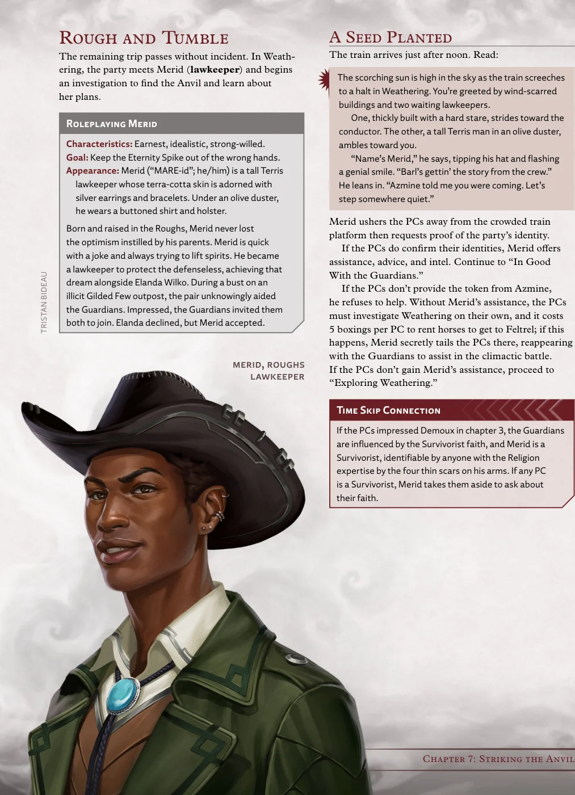

### 蠻橫區的風波

剩下的旅程平安無事。隊伍抵達耐抗鎮後，見到執法者 Merid，並開始調查鐵砧的下落與計畫。

扮演 Merid

性格：誠懇、理想主義、意志堅定。目標：不讓永恆尖刺落入歹人之手。外貌：Merid（讀作「MARE-id」，他）是一名高大的泰瑞司執法者，膚色如陶土，戴著銀耳環與銀手鐲。橄欖色防塵長外套底下穿著扣領襯衫，配有槍套。

Merid 在蠻橫區出生長大，始終保有父母教給他的樂觀。他善於說笑，總想讓身邊的人打起精神。他為了保護無力自衛的人而成為執法者，並與 Elanda Wilko 一同實現這個夢想。兩人在突襲 Gilded Few 的非法據點時，無意間幫了守護者組織。守護者組織對兩人的表現印象深刻，便邀請他們加入。Elanda 婉拒，Merid 則接受了。

### 播下種子

列車在正午過後不久抵達。請朗讀：

烈日當空，列車在耐抗鎮發出刺耳的煞車聲，停了下來。映入眼簾的是飽受風蝕的建築，以及兩名等候已久的執法者。其中一名身形粗壯、眼神嚴厲，大步走向列車長。另一位身穿橄欖色防塵長外套的高個子泰瑞司人，則慢步走向你們。「我叫 Merid。」他抬了抬帽沿，露出和善的笑容。「Barl 正向列車上的人打聽經過。」他靠近了些。「Azmine 說過你們會來。咱們找個清靜的地方談。」

Merid 帶 PC 離開擁擠的月臺，請他們證明隊伍的身分。如果 PC 證實了身分，Merid 會提供協助、建議與情報。接續〈與守護者組織交好〉。若 PC 沒有出示 Azmine 給的信物，他就會拒絕協助。隊伍只能自行調查耐抗鎮，前往 Feltrel 的馬匹租金為每名 PC 5 盒金。Merid 會暗中尾隨隊伍前往 Feltrel，到最終決戰時再與守護者組織一同現身助陣。如果 PC 沒有獲得 Merid 協助，接續〈探索耐抗鎮〉。

時代跳躍連結

若 PC 在第 3 章讓德穆留下深刻印象，守護者組織便會受到倖存者信仰的影響，而 Merid 也是倖存者信徒。擁有宗教專長的人都能從他手臂上的四道細疤辨認出來。如果有 PC 信奉倖存者，Merid 會把對方拉到一旁，問起他們的信仰。

### Merid，蠻橫區

### 執法者

第 7 章：敲擊鐵砧 139

TRISTAN BIDEAU

### 與守護者組織交好

PC 向 Merid 證明身分後，請朗讀：

「聽 Azmine 這麼說，你們打從檔案館那票案子以來，鬧出的動靜比別人一輩子還大。」Merid 讚許地說。「我挺佩服你們，和我共事的人也一樣。聽說你們在找團結勳章，想拼好某張地圖……？」他打量你們好一會兒，才咧嘴一笑。「我想咱們可以互相幫忙。好消息是我知道勳章在哪兒，在一個叫鐵砧的法外之徒手上。壞消息是 Gilded Few 正在打什麼主意。一群帶著高級玩意兒的城裡人，搭上一班列車到了鎮上。」

下列話題，Merid 都樂於回答：

**Azmine Wilko。**「咱們認識很久啦。小時候 Azmine 在這兒住過幾年，後來才去當教授。她人很好，我也這麼跟一塊兒共事的人說過。」

**鐵砧。**「鐵砧是 Ironbrands 的頭兒。大城市的人管他們叫法外之徒，可是物資短缺，他們偷東西多半是為了讓人有飯吃。我本來不會去管她，可團結勳章在她手上……而且我覺得她在籌劃什麼大事，說不定很危險。」

**Elanda Wilko。** 談到 Wilko 教授或鐵砧時，PC 可以進行 DC 12 的洞察檢定。若檢定成功，或 PC 問起 Azmine 的表親 Elanda Wilko，他們就會察覺 Merid 不太願意談這件事。若繼續追問，他一貫的笑容便會淡去，並透露：「Elanda Wilko 就是鐵砧。說來話長，也不是什麼開心的事。咱們以前都當執法者，一起騎馬巡邏。她父親過世那陣子，她退出了，還要我也走。我那時剛加入守護者組織，就回絕了她。她氣壞了，說我寧可保護蒙灰的老古董，也不肯保護人。她後來成了完整的克羅司，改了名字，也不肯再跟我說話。我不想讓 Azmine 操心，而且這事……很複雜，城裡人很難懂。」

**守護者組織或鍍金地圖。**「我是守護者組織的人。現在只消知道，咱們是個低調的團體，專門防止危險的東西落到危險的人手裡。所以咱們很願意幫你們保住地圖，免得被那些鍍金的傢伙搶走。」

**Gilded Few 或鍍金三人組。**「要我說，守護者組織跟那些人糾纏得夠久了。那些鍍金的傢伙總有什麼大計畫，滔滔不絕地講他們了不起的傳承之類的。說到底，就是那些貴族以為想要什麼、想抓誰都能如願。Conrad 甚至來這兒四處打探，想用高級武器賄賂執法者。可咱們不吃這一套。」

隊伍證明自己值得信任之前，Merid 不會再透露更多守護者組織的事。

### Merid 的提議

答完問題後，Merid 向 PC 提出一個辦法。他解釋：

「我希望你們能說服鐵砧交出團結勳章，別殺她，也別逮捕她，畢竟蠻橫區的人還指望她弄糧食來。要緊的是先調查。我去張羅馬匹和援手，你們先到鎮上打聽。只要查出她在哪兒、她在乎什麼、又打算做什麼，我看要說服她不成問題。能查到的越多越好。我擔心她想做的不只是打劫列車。」

如果 PC 同意調查，Merid 會承諾聯繫守護者組織的盟友，並為隊伍備妥馬匹，讓他們能前往鐵砧的藏身處。他說自己黃昏前後會回來，接著指出耐抗鎮值得留意的地點（見地圖 7.2），建議 PC 先到鎮郊的 Barrowcrest 調查。

執法者的傳承時刻

執法者注意到 Merid 隨身帶著一本談論官員治政理論的書。請問官員這本論文集的書名，再問執法者這本書在他任職警署期間如何幫過他。若執法者和 Merid 討論這些文章，Merid 會留下深刻印象，並問能否讓自己的副手同行，學習執法者的行事風格。如果 PC 同意，熱心得有些過頭的副手 Daryl Kant（警員，他）會成為執法者的同伴，直到本章結束。

第 7 章：敲擊鐵砧 140
