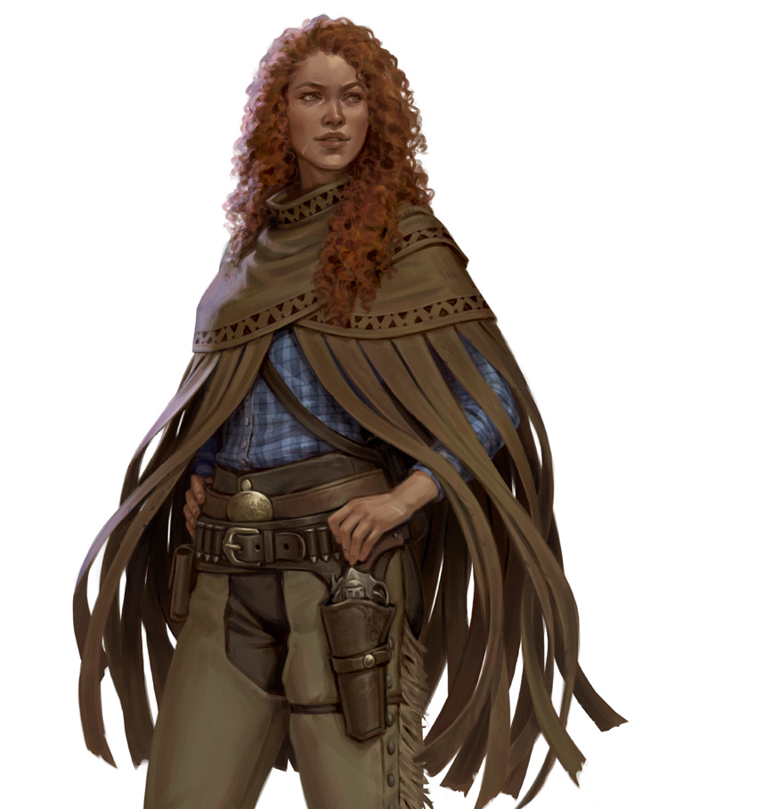

本附錄介紹《迷霧之子傳承》冒險中的守護者組織（Guardians），可搭配《迷霧之子玩家手冊》第 8 章〈組織〉查閱。守護者組織是個祕密結社，致力於保護永恆尖刺、對抗 Gilded Few。這項使命延續了數個世紀。

### 組織首務

最終帝國紀年（FE）1024 年，Kandor 營造公司完成勞資談判後，第一時代隊伍所信任的 NPC 開始參與對抗 Gilded Few，守護者組織也隨之成立。守護者組織始終以跨越時代保護並保存寶庫地圖為首務，藉此守護永恆尖刺。組織的核心理念與價值觀取決於第一時代的 PC 在第 3 章所做的選擇。Kandor、Bezryl、Cynwise 都可能成為 Kandor 營造公司的領導者，並對組織未來的方向與首務造成不同的長遠影響。這名 NPC 負責監督寶庫工程，通常也是第一位寶庫地圖守護者，因而成為守護者組織中深具影響力的領袖。在陸沙德之戰中倖存的第一時代 PC，也可能在組織的創立中扮演關鍵角色。如果第二時代的 PC 獲准加入守護者組織，玩家可從 Merid（或 Wynn）得知這段歷史。守護者組織的全名反映創立者的首務，分為產業守護者（Guardians of Industry）、智慧守護者（Guardians of Wisdom）和勞工守護者（Guardians of Labor）。三者提供不同的成員福利，指派給第二時代 PC 的組織目標也應符合各自的首務。

### 組織規模

守護者組織的初始規模為 1。規模會依 PC 在冒險中的行動調整。下列事件會影響守護者組織的規模：

- 如果 PC 成功完成第 4 章的「陸沙德的赤色黎明」（Red Dawn in Luthadel），規模提高 1。

- 如果 PC 取得第 7 章的團結勳章，且沒有接受 Bayron 的交易，規模提高 1。

- 如果 Merid 死亡，規模降低 1（最低為 1）。

以上事件決定組織的規模，可能為 1–3，並可隨冒險進展而變動。

### 產業守護者

如果隊伍選擇了 Kandor，守護者組織往後會以司卡商人的利益為優先。他們痛恨貴族，但作風務實、重視階級，對處境較差的人漠不關心。

### 投資回報

守護者組織由商人組成，可以提供隊伍無息貸款。申請貸款需要花費一天休整時間，通常必須在一個月內還清，同一時間只可辦理一筆貸款。此外，PC 在任何一座大城市花費三天休整時間後，可以找到一名與守護者組織有關、販售特定商品（如槍械、樂器或冶金用品）的商人。該商人會以折扣價販售商品給 PC。

### 產業守護者福利

| 規模 | 貸款 | 商店折扣 |
| --- | --- | --- |
| 1 | 最多 500 盒金 | 5% |
| 2 | 最多 1,000 盒金 | 10% |
| 3 | 最多 2,000 盒金 | 20% |
| 4+ | 最多 4,000 盒金 | 30% |

### 附錄 F

### 守護者組織

262

### 智慧守護者

如果隊伍選擇了 Bezryl，守護者組織會優先蒐集情報、理解歷史脈絡並締結同盟。他們冷靜理智、見識廣博，但行政程序繁複，行動緩慢。

### 我們查得到

只要答案曾在司卡德利亞的歷史上留下記錄，組織就能查出任何一個問題的答案。取得資訊所需的時間由 GM 決定，冷僻的資訊通常要花幾天，深奧難查的資訊則要花數週。

### 智慧守護者福利

| 規模 | 知識的冷僻程度 | 額外效果 |
| --- | --- | --- |
| 1 | 專門、艱深 或學術性的知識。 | — |
| 2 | 隱藏或失傳的知識 （重要性低，或因意外 而失傳）。 | 這項知識足以讓一個 相關的 PC 短期目標 推進 1 格。 |
| 3 | 隱藏的知識（重要性高， 或遭有權勢者 隱藏）。 | 這項知識足以讓一個 相關的 PC 短期目標 推進 2 格。 |
| 4+ | 整段歷史上 只留下過一次記錄 的知識。 | 組織可以 同時調查 2 個問題。 |

### 勞工守護者

如果隊伍選擇了 Cynwise 和工人，守護者組織會採取集體決策與分散運作的方式。他們行動迅速、善於應變，偏好反擊、擾亂對手及保持匿名。

### 共同理念

守護者組織在勞工、服務業人員與傭兵中安插了密探。休整期間，PC 可請守護者組織辨認已打入敵對組織（如 Gilded Few）的密探。在之後涉及該組織的一個場景中，指定數量的 NPC 會投降或退出，隊伍也就少了這些對手。

### 勞工守護者福利

| 規模 | 效果 |
| --- | --- |
| 1 | 一名嘍囉 |
| 2 | 兩名嘍囉或一名勁敵 |
| 3 | 四名嘍囉或兩名勁敵 |
| 4+ | 最多六名嘍囉或三名勁敵 |

DEANDRA SCICLUNA & LOGAN FELICIANO

