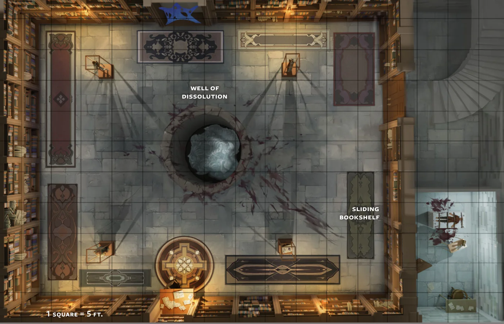

### Duvall 的地盤

Duvall 急著讓 Delina 刮目相看，又傲慢得從未想過自己會失手。他把 PC 引到自己的巢穴，打算親手制伏他們，再試著用 Bezryl 和她的弟兄製造血金術尖刺。他命令部下和家人今晚離開浩特堡，自己留下等候隊伍。

### 無人看守的病房

角色抵達浩特堡時，請朗讀：

浩特堡的大門敞開，無人看守。門後的醫務所入口一片昏暗寂靜。紅光透過彩繪玻璃，將一排排病床染成逐漸褪去的深紅。病人一動也不動地躺著，有些在睡夢中咳嗽或呻吟。穿過由舞廳改成的病房，另一扇敞開的門就在前方。

通過 DC 10 的醫學檢定，就能確認病人都被施以重度鎮靜。敞開的雙扇門通往一段寬闊的樓梯，可下到堡邸的底層。

### Duvall 的藏書室

PC 走下樓梯時，請朗讀：

醫務所下方的樓梯通往一間氣派的藏書室，最近才改建成實驗室。書架沿牆從地板直抵天花板。展示櫃裡擺著奇怪的圖樣與標本，包括大理石雕成的骨架、一張懸掛的藍色皮革，以及一幅剝皮男子的解剖圖。房間中央的石地板鑿出一口井。Duvall Haught 站在房間盡頭，兩側各有兩名守衛。「陷阱收網了。」Duvall 滿意地說。守衛立刻衝了過來。

### 與 Duvall 決戰

與 Duvall Haught 及其守衛（四名駐軍士兵）展開戰鬥。Duvall 一邊打，一邊嘲弄 PC：

「你們竟敢和 Gilded Few 作對？為了什麼，就為了救幾個骯髒的司卡？你們可幫了我一個大忙。等我告訴 Delina，我已經把你們的能力收割到手，她一定很高興。」

戰鬥中，Duvall 命令守衛攻擊角色，自己則從遠處射出一陣錢幣。他會調整位置，試圖用鋼推把 PC 推進坑裡。坑中囚禁著一隻霧魅，負責消化死於 Duvall 血金術實驗的人。

### 戰場效果

這場戰鬥有下列效果：

**消解之井。** 房間中央有一口深 20 呎、直徑 15 呎的石坑。掉下去的角色受到 1d6 衝擊傷害。要爬出坑，必須通過 DC 12 的運動檢定。失敗時，角色倒地。

**被囚禁的霧魅。** 坑中囚禁著一隻霧魅。牠不會主動攻擊，但會慢慢消化掉進來的屍體。在坑內結束輪次的角色，會因其食屍者特徵受到 1d6 命力傷害。坑外的角色不受霧魅的駭人外貌和詭異氣場影響。

### 戰後

Duvall 會戰到死。他落敗後，倖存的守衛會投降。戰鬥結束後，可以聽到 Fadwal 沉悶的喊聲從 Duvall 的辦公室傳來。辦公室藏在東牆的滑動書架後（見〈密室〉）。Duvall 身上帶著 200 盒金及解開 Fadwal 束具的鑰匙，手指上還戴著 Fadwal 的戒指。若 Duvall 已死，且一名 PC 已在「了解血金術」短期目標記下至少兩個里程碑，該 PC 就能取下 Duvall 的青銅血金術尖刺（參見本書導言〈處理血金術〉）。若 PC 現在沒有取走尖刺，Enge 今晚晚些時候會悄悄折返，親自取出尖刺（見第 4 章〈Enge 的小提議〉）。若 Duvall 被活捉，他會拒絕開口，但實驗室裡有充分的證據可以證明他的罪行。無論如何，藏書室裡有幾件值錢的物品：

- 一具石製坎得拉真體，可當作奇物賣得 300 盒金。Enge 若在場，看到真體和霧魅時會格外不安。

- 一本罕見的《虛假黎明之書》，價值 100 盒金。

- 幾瓶藥物，含五劑麻醉劑、兩劑有效毒藥及一劑補藥。

- 一本日誌，記有更多 Vadilek 的血金術筆記，可在休整期間研讀。

- 刻有泰瑞司傳統圖樣的紅銅與黃銅飾品，價值 30 盒金。

第 3 章：多數與少數 70

### 密室

滑動書架後方是 Duvall 為 Gilded Few 收割血金術尖刺的辦公室。請朗讀：

這間昏暗的密室聞起來有鋼鐵和鮮血的氣味。房間中央擺著一張桌子，桌面打出人形凹槽，染上污漬的溝槽通往地板的排水孔。旁邊的書桌散放著筆記和手術工具。木架上擺著四枚閃亮的尖刺，分別是紅銅、鐵、錫和鋅。一名神色驚恐的泰瑞司男子被綁在桌上，頭髮剃光，雙眼流露出深切的情緒。

這名泰瑞司侍從官就是 Bezryl 失蹤的弟兄 Fadwal（商人，他）。Duvall 囚禁了他兩週，準備用他和他姊妹製造血金術尖刺。這裡的尖刺尚未使用，無法賦予任何能力。Duvall 的筆記載有工地事故的日期、每處工地遭綁架的迷霧人人數，以及付給各個傭兵的款項。這些筆記證明 Duvall 策劃了 Kandor 營造公司和陸沙德其他工地的事故，浩特醫務所也一直在迫害自己的病人。

消解之井

滑動書架

### 地圖 3.2：Duvall 的藏書室與實驗室

官員的傳承時刻

Duvall 落敗後，浩特醫務所的醫師 Yannen（平民，他）會來找官員。他認得對方曾在鋼鐵教廷（或另一個機構）任職。如今擺脫了 Duvall 的勒索，Yannen 希望讓醫務所真正造福社群。他能重新利用部分浩特醫務所的設備，但需要有人協助開張。他知道官員有管理經驗，便請對方贊助他的新計畫。若接受，官員獲得「重建醫務所」短期目標。完成後，官員將領導醫務所，視為規模 1 的組織（見《迷霧之子玩家手冊》第 8 章）。若拒絕，浩特醫務所便會徹底解散，Yannen 也會逃離陸沙德。

每格 5 呎。

第 3 章：多數與少數 71

DALLIN BIFANO

