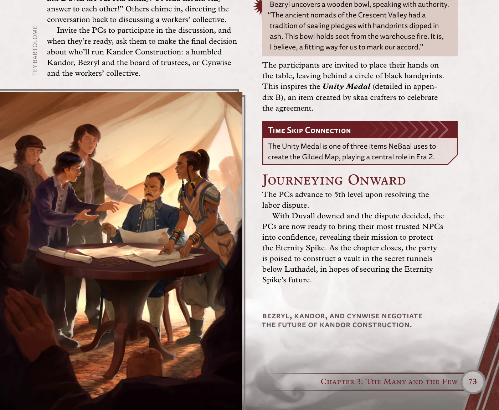

### 走上談判桌

Bezryl 含淚與 Fadwal 重逢。Duvall 落敗，削弱了 Gilded Few 對陸沙德的控制。PC 化解勞資糾紛，Enge 則想出長期保護永恆尖刺的計畫。

### 信任的問題

隊伍擊敗 Duvall 後，Kandor 履行承諾，告知他們陸沙德地底未經測繪的隧道位於何處。入口就在資源廷舊總部附近，隊伍可在第 4 章前去探查。這時，Enge 把 PC 拉到一旁，商量如何處置永恆尖刺。她指出，即使洞穴藏得再好，把強大的神器放在洞裡無人看管，似乎仍不妥當。萬一發生地震呢？將來又怎麼辦？不過，解決辦法已經浮現。Enge 相信 Kandor 營造公司的新盟友能在隧道深處建造寶庫，讓永恆尖刺長久受到保護。這項工程相當複雜，何況城市還在被圍。Enge 估計，隊伍至少要讓 Kandor、Bezryl 和 Cynwise 這三位公司的關鍵 NPC 中的兩人知情。她問隊伍最信任誰，願意讓對方主持寶庫工程、協助藏起永恆尖刺，並永遠守住祕密。PC 選好最信任的 NPC 後，Enge 便領隊前去開會。

### 集體協商

PC 抵達 Kandor 的辦公室時，看見外頭搭起一頂大帳篷。請朗讀：

Kandor 迎你們來到桌邊。桌旁坐著來自陸沙德各地的工人和司卡社群領袖。他在 Bezryl 與 Cynwise 之間的椅子上慢慢坐下。在熟悉的面孔中，你們看見一位早已聽過大名的人。他是反抗軍的英雄，也是城市衛隊的隊長德穆。Kandor 請你們入座，有些尷尬地笑了笑。「好，人都到齊了。咱們把事情談妥，讓每個人都能接受。」

這場示威引起了全城關注。德穆隊長（保鑣，他）代表依藍戴前來調解，為工人爭取公平的協議。

時代跳躍連結

如果德穆留下深刻印象，請記錄下來。這會影響第二時代的守護者組織。

扮演德穆

性格：審慎、虔誠、拘謹。目標：保護並引導司卡，實踐倖存者的理想。外貌：德穆（讀作「de-MOO」，他）是二十歲出頭的司卡男子，髮線後退。他是司卡反抗軍的英雄，蒼白的頭皮上有一道蜿蜒的疤痕。

德穆忙完依藍戴衛隊隊長的工作後，便向司卡傳揚倖存者卡西爾的事蹟。他相信依藍戴與卡西爾所構想的司卡自治社會，也努力將它化為現實。如果 PC 告知他 Gilded Few 的事，他會解釋依藍戴已被罷黜，而衛隊眼下正忙著保護遭圍困的城市。德穆為此致歉，並承諾政治局勢明朗後會提供更實質的協助。

### 長久的協議

PC 拯救了 Kandor 營造公司，因此眾人請他們協助決定公司的未來。做決定之前，每名 NPC 都會提出解決勞資糾紛的方案。

**Kandor 的悔意。** Kandor 深深後悔自己相信了 Duvall。若 PC 以委婉的方式交涉，Kandor 會承認在動盪的圍城期間經營公司令他筋疲力盡，還會提到已有同業關門歇業。通過 DC 14 的說服檢定，就能說服 Kandor 把管理職責交給一名由 PC 擔保的員工。

**Bezryl 的紅銅意識。** Bezryl 查閱自己的紅銅意識後，提議成立董事會，監督安全和勞工權益。Kandor 提供她一份長期工作，她也接受了，但她並不認為自己適合擔任領導者。PC 若通過 DC 14 的領導檢定，就能鼓舞她接下這項職責。

**Cynwise 發言。** Cynwise 主張成立勞工合作社。Kandor 和 Bezryl 的票與其他員工同等，所有決定都以民主方式作成。

**德穆的決定。** 如果有角色在協商中提出特別鼓舞人心的論點，德穆會留下深刻印象，最終決定讓倖存者教會支持協商催生的組織。

第 3 章：多數與少數 72

### 繼續旅程

老兵的傳承時刻

老兵認識依藍戴的衛隊隊長德穆。請問玩家，老兵曾如何讓德穆留下深刻印象。進行〈集體協商〉時，德穆特別重視老兵的意見，而且一定會讓倖存者教會支持守護者組織，無須檢定。此外，若老兵在這個場景中通過一項檢定，德穆便承諾在依藍戴面前替老兵美言幾句。老兵可以請人幫一次政治上的忙，視同規模 2 的政治團體成員（見《迷霧之子玩家手冊》第 8 章）。

如果 PC 試圖揭露 Duvall 的血金術活動或 Gilded Few 的存在，群眾似乎不太相信，Cynwise 便插話說：「對啊！你們還不懂嗎？像 Duvall 那樣的貴族才是我們真正的敵人！我們司卡只需要對彼此負責！」其他人紛紛附和，把話題拉回勞工合作社。請邀請 PC 參與討論。等他們準備好後，讓他們決定 Kandor 營造公司的未來由誰掌管：收斂了傲氣的 Kandor、Bezryl 和董事會，或 Cynwise 和勞工合作社。

時代跳躍連結

隊伍選出的領導者將影響 Kandor 營造公司的未來結構。如下表所示，這決定了 PC 在第 4 章建造寶庫時獲得的加成，最終也會決定第二時代祕密結社守護者組織的首務（見附錄 F）。

| 領導者 | 公司 結構 | 守護者組織 首務 | 第 4 章 加成 |
| --- | --- | --- | --- |
| Kandor | 私營企業 | 產業 | +2 材料 |
| Bezryl | 董事會 | 智慧 | +2 計畫 |
| Cynwise | 合作社 | 勞工 | +2 人力 |

第 3 章：多數與少數 73

TEY BARTOLOME

### 攜手同心

談判結束時，請朗讀：

Bezryl 掀開木碗的蓋子，語氣堅定地說：「新月谷的古代遊牧民族有個傳統，他們用手蘸灰留下手印，以此締結誓約。碗裡裝的是倉庫火災留下的煙灰。我想，用它見證我們的協議再合適不過。」

眾人受邀把手按在桌上，留下一圈黑色手印。司卡工匠由此得到靈感，打造團結勳章來紀念這項協議（詳見附錄 B）。

勞資糾紛解決後，PC 升到第 5 級。Duvall 已遭擊敗，糾紛也已解決，PC 現在可以向最信任的 NPC 坦白，說明他們保護永恆尖刺的使命。本章結束時，隊伍準備在陸沙德地底的祕密隧道中建造寶庫，希望讓永恆尖刺在未來也受到保護。

時代跳躍連結

團結勳章是 NeBaal 用來製作鍍金地圖的三件物品之一，在第二時代扮演關鍵角色。

### Bezryl、Kandor 和 Cynwise 協商

Kandor 營造公司的未來。

