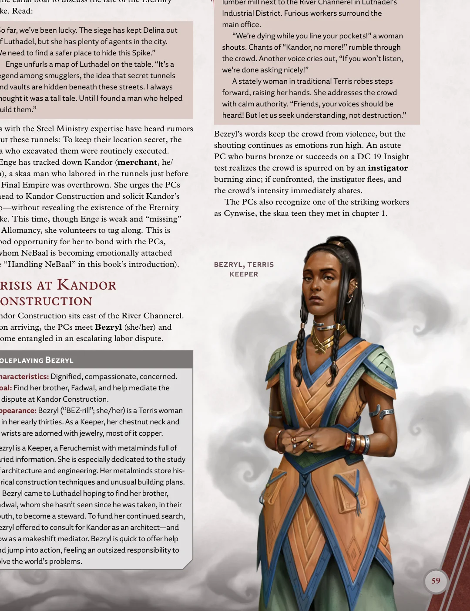
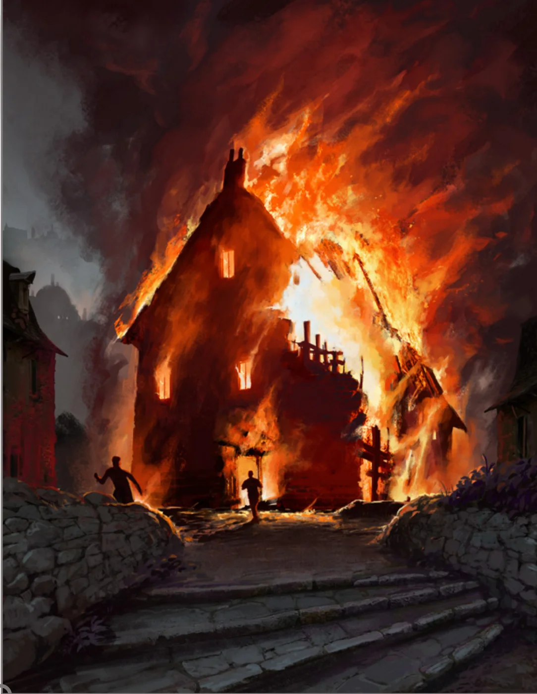
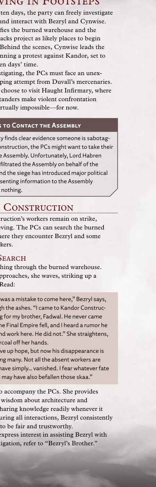
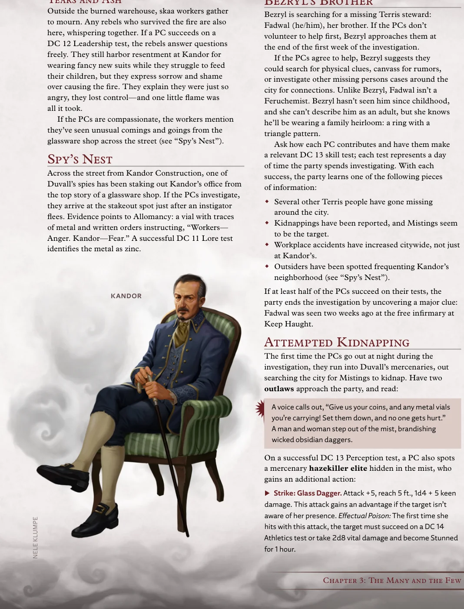
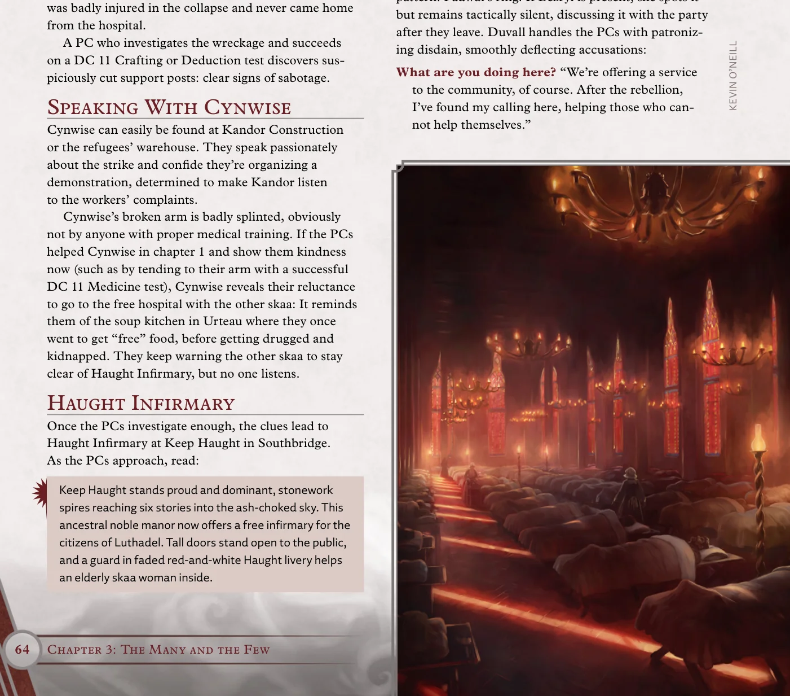
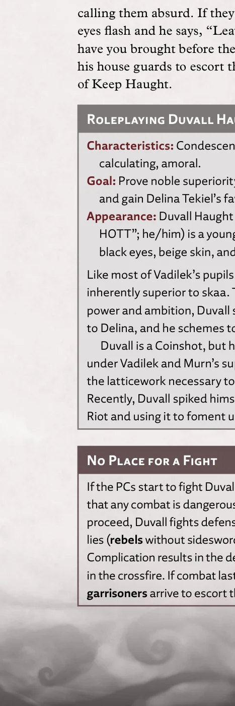
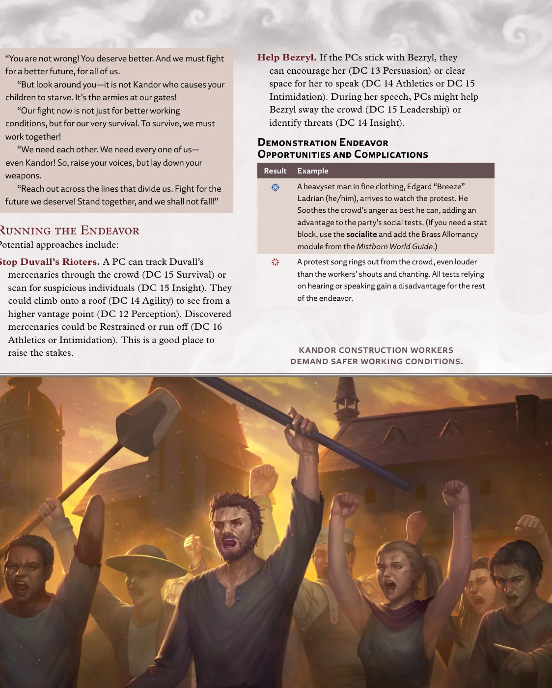
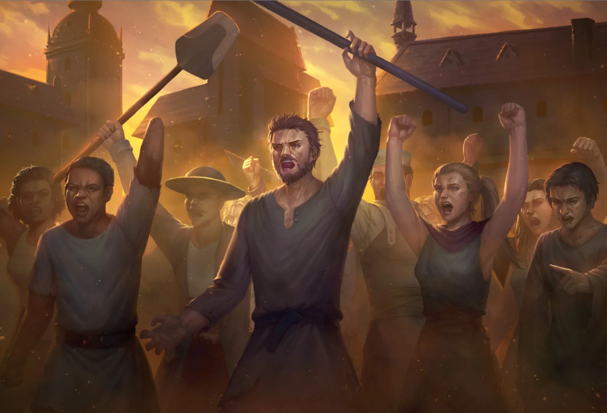
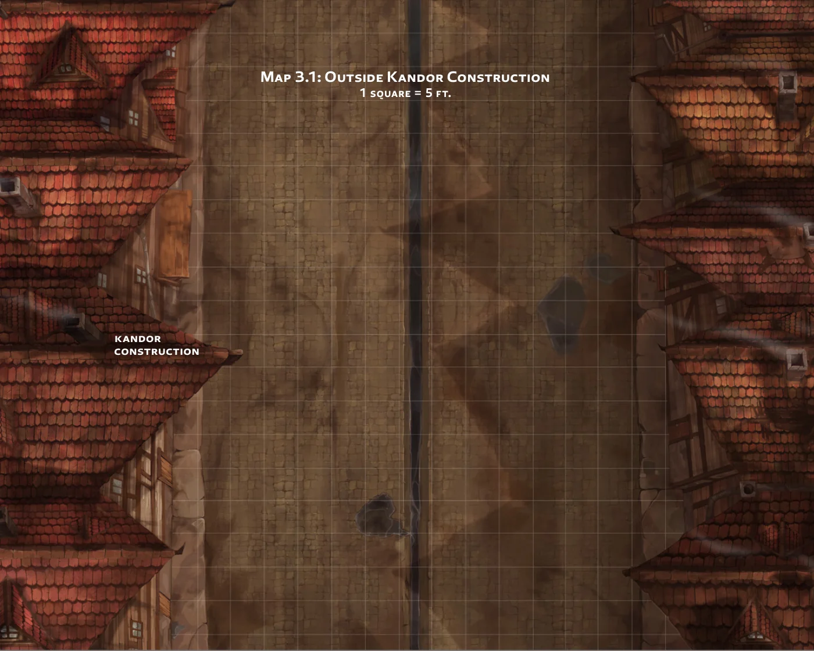

### 第 3 章：多數與少數

第 3 章：多數與少數 58

### 帶領本章冒險

隊伍逃離 Delina、返回陸沙德後，帶著司卡德利亞最燙手的違禁品，困在遭到圍攻的城裡。Gilded Few 步步進逼，隊伍必須盡快找到盟友，想出保護永恆尖刺的辦法。

角色竭力搶在 Gilded Few 前頭時，Enge 想到可以把永恆尖刺藏進陸沙德地底的祕密隧道。本章中，PC 會結交新盟友、阻撓 Gilded Few，並擬訂長期保護尖刺的計畫。Enge 可以在這段冒險中與 PC 同行，但會以 Vadilek 的儀式後一直莫名虛弱為由，避開激烈行動及戰鬥（見本書導論〈如何扮演 NeBaal〉）。

#### 本章流程

休整 21 天後，隊伍前往 Kandor 營造公司找 Kandor，很快就捲入工人罷工。他們會見到 Bezryl，也可能與 Cynwise 重逢（見第一章〈扮演 Cynwise〉）。接著一棟建築離奇起火，Kandor 請隊伍調查。PC 可自行選擇調查順序，揭開 Duvall Haught 的陰謀。他是 PC 可能在第二章遇到的 Gilded Few 成員。Duvall 以慈善醫院為掩護，暗地綁架並殺害迷霧人與藏金術師，想重現 Vadilek 的實驗，博取 Delina 的青睞。Duvall 擅長操控他人，會煽動工人並阻撓 PC。帶領本段前，先讀本章稍後的〈扮演 Duvall Haught〉及〈循跡而行〉。

調查期間，PC 必須挫敗綁架企圖、蒐集證據，也可協助 Bezryl 尋找她失蹤的弟兄，一名泰瑞司侍從官。接著 Cynwise 會發起示威，PC 必須在阻止 Duvall 的煽動者和保護 Bezryl 之間作出選擇。衝突在浩特莊園達到高潮，PC 將與 Duvall 正面交鋒。本章結束時，PC 要選一名可信賴的 NPC 管理 Kandor 營造公司，解決勞資糾紛。這項決定影響深遠，因為這名 NPC 會在第四章帶領寶庫的建造工程，最後創立守護者組織，保護永恆尖刺數百年（見附錄 F）。

#### 角色進展

第一時代角色在本章開始時為第 3 級，在〈示威日〉之前升至第 4 級，決定 Kandor 營造公司的未來後升至第 5 級。取得 Guiverre 或 Vadilek 血金術筆記的 PC，可在休整期推進「了解血金術」短期目標（見本書導論〈處理血金術〉）。

### 逃亡中的走私團

Enge 想辦法保護永恆尖刺時，PC 有三週的時間在被圍困的陸沙德休整。

#### 低調休整

PC 勉強逃過 Delina 的追捕，必須低調行事。依附錄 E〈在陸沙德休整〉帶領這 21 天的休整。PC 在公共場所進行休整活動時，提高其檢定的風險，因為 Gilded Few 會騷擾不夠低調的 PC。可參考附錄 E〈在陸沙德休整的機遇與變故〉。若 PC 聯絡 Cynwise 或難民，便會得知大多數難民正在修築防禦工事，並接受訓練，準備保衛圍城中的陸沙德，抵擋史特拉夫．泛圖爾。

休整期間，有鎔金術師在陸沙德的屋頂襲擊依藍德國王的護衛紋。多數人以為他們是史特拉夫．泛圖爾派來的，其實是西方統御區的軍閥塞特所派。塞特的大軍不久後也抵達，加入圍城。此外，依藍德的顧問 Edgard Ladrian（微風）回到了陸沙德。

### Kandor 營造公司的危機

#### 走私客的計畫

休整即將結束時，Enge 把 PC 召集到運河船上，討論永恆尖刺的去向。讀出下文。

> 「到目前為止，我們運氣不錯。圍城讓 Delina 進不了陸沙德，但她在城裡還有一大堆手下。我們得找個更安全的地方藏尖刺。」Enge 在桌上攤開陸沙德地圖。「走私客之間有個傳說，說這些街道底下藏著祕密隧道和寶庫。我一直當那是鬼扯，直到我找到一個參與過工程的人。」

擁有鋼鐵教廷專長的 PC 聽過這些隧道的傳聞。為了不讓位置外洩，當初挖掘隧道的司卡工人往往在事後遭到處決。Enge 找到了 Kandor（商人，他），一名在最後帝國覆滅前曾在隧道裡做工的司卡人。她敦促 PC 前往 Kandor 營造公司，尋求 Kandor 的協助，同時別透露永恆尖刺的存在。這次 Enge 雖然虛弱，鎔金術也「消失」了，仍主動提出同行。這正是與 PC 加深情誼的機會，NeBaal 已對他們有了感情（見本書導論〈如何扮演 NeBaal〉）。

Kandor 營造公司位於香奈瑞河東側。PC 抵達時遇見 Bezryl（她），捲入一場愈演愈烈的勞資糾紛。

##### 扮演 Bezryl

**特質。** 莊重、富同情心、心懷憂慮。  
**目標。** 找到弟兄 Fadwal，協助調解 Kandor 營造公司的糾紛。  
**外貌。** Bezryl（讀作 BEZ-rill，代名詞為她）是位三十歲出頭的泰瑞司女子。她是守護者，栗色的頸項及手腕戴著許多飾物，大多是紅銅製成的。

Bezryl 是守護者，也是一名藏金術師。她的金屬意識庫記錄著各種知識。她尤其專注於建築和工程研究，金屬意識庫裡有歷代的工法和罕見的建築圖。她來陸沙德尋找弟兄 Fadwal。Fadwal 年少時被帶走當侍從官，她從此再沒見過他。為了籌措繼續尋人的費用，Bezryl 主動為 Kandor 提供建築顧問服務，現在還臨時擔任調解人。Bezryl 總是立刻伸出援手，主動投入行動。她覺得自己有責任解決世上的難題，肩上的擔子遠超過她該承擔的分量。

隊伍抵達時，讀出下文。

> Kandor 營造公司在陸沙德工業區的香奈瑞河畔，有一間辦公室、一座倉庫和一座鋸木廠。憤怒的工人包圍了主要辦公室。「你把錢往自己口袋塞，我們卻一個個送命！」一名女子喊道。人群傳出一陣陣「Kandor，夠了！」的口號。另一個聲音大喊：「你再不聽，我們就不跟你客氣了！」一名穿傳統泰瑞司長袍、舉止端莊的女子走上前，舉起雙手，以沉穩威嚴的聲音對群眾說：「朋友們，你們的心聲應當被聽見！我們一起把話說開，別砸了這裡。」

Bezryl 的話阻止了暴力，但群眾情緒高漲，吶喊仍未平息。PC 若燃燒青銅，或通過 DC 19 洞察檢定，便能察覺有一名煽動者正在燃燒鋅，推高群眾的情緒。若有人出面質問，煽動者便逃走，群眾也立即冷靜許多。PC 也認出一名罷工工人，正是第一章遇到的司卡少年 Cynwise。

泰瑞司守護者 Bezryl

59

NELE KLUMPE

#### 與 Cynwise 敘舊

Cynwise 在最近的兵營倒塌事故中摔斷手臂，傷處包紮得很草率，勉強用簡陋的吊帶吊著。若 PC 在鎢都沒有幫助 Cynwise，Cynwise 會冷冷一笑，語帶怨懟地招呼他們：「我就說我自己會想辦法。」PC 只要真誠道歉，Cynwise 的態度就會很快軟化，但信任很難重新贏回來。若 PC 曾救出 Cynwise，這名少年見到他們會很高興，並答應稍後再談（見本章稍後〈與 Cynwise 交談〉）。眼下 Cynwise 正忙於自己參與組織的罷工。

#### 調解人 Bezryl

憤怒的工人仍圍著 Kandor 的辦公室。Bezryl 自我介紹，解釋 Kandor 正忙著處理勞資糾紛。

> 「你們來得不是時候。」泰瑞司女子搖了搖頭。「昨天有人死於一場原本可以避免的事故。真是悲劇。工人一天比一天憤怒，Kandor 也怕了。我得說服他聽聽工人的話。」

她從工人的立場解釋這場危機。

- 幾週以來，Kandor 營造公司的工地事故與傷害不斷。
- 昨天興建新兵營時，建物倒塌，十多人喪命。
- 城市遭到圍困，Kandor 給的工資只比帝國覆滅前司卡人的收入高一點，工時依舊長得難以負荷。
- 工人現在拒絕上工，正準備發起罷工，有些人還公然威脅 Kandor。

Bezryl 走向辦公室時，群眾讓開一條路。

#### 激烈的糾紛

Kandor 坐在辦公室裡，低頭在帳簿上寫字。隊伍進門時，讀出下文。

> Kandor 營造公司的老闆從桌上一疊帳簿間抬起頭來。他滿臉風霜，看得出熬過了苦日子，身上卻穿著一套昂貴的傳統貴族式訂製西裝。「終於有個能講道理的人來了！」Kandor 拄著一根精緻的桃花心木手杖，吃力地站起來。「客人隨時歡迎……不過恐怕我的員工現在不肯上工。」他轉向 Bezryl，語氣變得刻薄。「他們有什麼資格教我怎麼做生意？連該死的房子都蓋到倒下來！」

##### 扮演 Kandor

**特質。** 輕慢、精明、執拗。  
**目標。** 保住自己身為陸沙德新興商人階層一員的利益。  
**外貌。** Kandor（讀作 CAN-door，代名詞為他）是位四十多歲的司卡男子，但他膚色黃褐，滿臉風霜，看起來至少六十歲。他穿著招搖，刻意讓自己看起來比實際上更富有。

Kandor 曾是鋼鐵教廷的司卡工匠，做了數十年繁重的營造工作。長年苦役讓他終身跛腳，走路必須拄手杖。維護陸沙德地底的祕密隧道本來會是他最後一項工程，最後帝國卻出乎意料地覆滅，讓他撿回一命。Kandor 憑苦役磨練出的技術創辦了自己的營造公司。他想與過去被奴役的日子劃清界線，專注於自己在陸沙德新興商人階層的前途。近來圍城使財務吃緊，接連發生的工安事故也引發罷工，生意因而停擺。

Kandor 對 PC 有禮，卻瞧不起司卡工人，認為他們態度傲慢，又自以為應得更多。在他看來，他們做的工遠比他在教廷手下的苦役輕鬆。Kandor 把建物倒塌怪在「想偷工減料的懶工人」頭上。Bezryl 堅稱工人已經竭盡全力，餓著肚子苦撐長工時。昨天發生事故，Kandor 仍不肯讓步，讓她很挫折。如果有 PC 問起陸沙德地底的隧道，Kandor 會瞇起眼睛，問他們怎麼知道隧道的事。接著〈突如其來的爆炸〉打斷談話。

#### 突如其來的爆炸

Kandor 辦公室裡的談話暫歇，或 PC 提起隧道時，一起縱火事件讓勞資糾紛升級。讀出下文。

> 一聲轟然巨響震得窗戶作響。外頭工人的口號變成尖叫：「失火了！」Kandor 驚慌地朝門口奔去。「倉庫爆炸了。」他的臉色發白。「鋸木屑很容易燒起來。」Bezryl 握緊拳頭，指上的黃銅戒和鋼戒閃著光。「我剛才就在倉庫裡。裡面還有人！」她衝出 Kandor 的辦公室。

第 3 章：多數與少數 60

Kandor 懇求 PC 幫忙，先救出工人。他拄著手杖，盡力趕上 Bezryl。

#### 救火與救人

PC 走出辦公室時，讀出下文。

> 一座沒有窗戶的倉庫正熊熊燃燒，濃煙從門口湧出。工人爭相逃離火場，有些人慌亂地奔向河邊，還困在裡面的人則尖聲呼救。

將滅火和救援工人的過程視為一項試煉（見〈判定救援試煉結果〉）。可能遇到以下障礙。

- **猛烈火勢。** 可以用桶子從附近的河裡提水（DC 14 運動），也可以反轉鋸木廠的水閘來引水（DC 13 推理）。
- **受困者。** 角色可協助 Bezryl 尋找受困工人（DC 13 求生），並帶他們穿過嗆人的濃煙（DC 14 紀律）。第一位獲救的員工是 Cynwise。
- **反抗者。** 若 PC 先前沒有趕走混在人群裡的煽動者，倉庫裡有三名被煽動得暴力好鬥的反抗者。每名反抗者都可被繳械（DC 13 運動）、命令停手（DC 14 威嚇）或勸服（DC 15 說服）。此處適合提高風險。

##### 救火與救人的機遇與變故

| 結果 | 範例 |
| --- | --- |
| [機遇] | Bezryl 向一名反抗者講道理，說服對方為了自身安全離開。 |
| [變故] | 火勢蔓延。建物內每名 PC 受到 1d6 能量傷害。 |

**囚犯的傳承時刻。** 囚犯在倉庫裡認出一名好鬥的反抗者 Preece（她）。請玩家解釋囚犯在服刑期間曾幫過 Preece 什麼忙。若囚犯對 Preece 通過 DC 12 社交檢定，所有反抗者都會停手。如果結果高出 DC 至少 5，反抗者會主動協助救援，囚犯在這個場景的所有檢定也獲得一次優勢。

第 3 章：多數與少數 61

SIRAJ FAKHRI

##### 判定救援試煉結果

隊伍在累積 4 次失敗前取得 6 次成功，或以其他方式達成目標，試煉即告成功。如果試煉結束時尚未處理反抗者，場景會進入戰鬥。

- **成功。** 隊伍撲滅火勢，減輕損失。兩人罹難，另有數人受傷，但 Bezryl 說，情況本來可能慘烈得多。
- **失敗。** 烈火延燒了將近一小時，隊伍和 Bezryl 才將它撲滅。至少十名工人在大火中罹難或失蹤，工人立刻把這些傷亡怪到 Kandor 頭上。

##### 戰鬥

試煉期間未被制伏的反抗者會戰鬥兩回合，然後突然投降。事後，他們回想起那股怒火燒得太烈，讓他們非動手不可。

### 循跡而行

#### Kandor 坦白相告

倉庫火災後，Kandor 找隊伍私下談話。他會回答問題，坦白說出自己知道的事。

- **你對陸沙德地底的隧道知道多少？**「這問題可不簡單。鋼鐵教廷確實維護過城底的祕密隧道。隧道又深又隱密，教廷想殺掉每個知道這件事的工人。我付出很大的代價，才帶著這些消息逃出來。」Kandor 用手杖敲了敲地面，加重語氣。
- **你願意幫我們嗎？**「我們做筆交易。我可以帶你們去看那些隧道，還有教廷任何地圖上都沒有的洞窟。幫我阻止這些該死的事故，讓工人守規矩，我就把知道的全告訴你們。」
- **你要我們做什麼？**「調查事故。和 Bezryl 談，和工人談。查清楚為什麼這麼多事都出了差錯。再找個證據證明這不是我的錯，叫他們別再怪我！」
- **你為什麼不多幫幫工人？**「他們不斷犯粗心的錯，我還要繼續僱用他們，錢都快賠光了。浩特醫務所要不是肯免費收治司卡人，我早就倒閉了。」

Kandor 要等罷工解決後，才會透露隧道的位置（見〈走上談判桌〉）。

**街童的傳承時刻。** Kandor 在街童身上看見自己的影子，兩人都想闖出名堂。本章中，街童在 Kandor 面前展現這股企圖心時，Kandor 會把對方叫到一旁，詢問其目標，接著提出教導街童經商之道。若街童同意，且本章結尾仍由 Kandor 掌管公司，Kandor 會請街童來找他，賺些盒金，也認識陸沙德日益壯大的商人階層。第四章的休整期，街童可以和 Kandor 一起工作，每週賺 5d10 盒金。

若街童拒絕 Kandor，Cynwise 稍後會找上街童，坦承自己偷聽了談話，而且很認同街童的回答。Cynwise 會給街童 10 盒金，既是「投資」，也是彼此信任的象徵。第四章的休整期，Cynwise 會把街童介紹給司卡社區的組織者，推進「加入 Cynwise 的人脈網」短期目標（如適用）。

接下來十天，隊伍可自由調查事故，與 Bezryl 和 Cynwise 互動。Kandor 建議從燒毀的倉庫和倒塌的兵營工地查起。Cynwise 則在幕後帶領工人策劃抗議 Kandor 的行動，預計十天後發起。調查期間，PC 必須應對 Duvall 傭兵出其不意的綁架企圖。他們也可以前往浩特醫務所。那裡有許多無關民眾，眼下幾乎無法和 Duvall 動武。

#### Kandor 營造公司

Kandor 營造公司的工人悲憤交加，仍在罷工。PC 可搜索燒毀的倉庫，並在那裡遇見 Bezryl 和幾名哀悼死者的工人。

##### Bezryl 的搜尋

Bezryl 正在燒毀的倉庫裡搜索。隊伍靠近時，她揮揮手，開口攀談。讀出下文。

> 「我在想，來這裡是不是個錯誤。」Bezryl 一邊翻找灰燼，一邊說。「我來 Kandor 營造公司找我弟兄 Fadwal。最後帝國覆滅後，他一直沒回家。我聽說他可能在這裡找到了工作，結果沒有。」她直起身，拍掉手上的炭灰。「我不會放棄希望，可現在失蹤的人已經不只他一個。沒回來的工人並非全都死了。有些人就這樣……不見了。我怕 Fadwal 的遭遇也發生在那些司卡人身上。」

Bezryl 主動提出與 PC 同行。她擁有世代累積的建築和工程知識，只要有幫助就會大方分享。每次與她來往，都能看出她公正而值得信賴。若 PC 有意協助 Bezryl 調查，見〈Bezryl 的弟兄〉。

**試著聯絡議會。** 找到有人破壞 Kandor 營造公司的明確證據後，隊伍可能想把調查結果交給議會。然而，Habren 大人已代表 Gilded Few 滲入議會，圍城也造成嚴重的政治動盪。將情報呈交議會不會有任何結果。

第 3 章：多數與少數 62

##### 淚水與灰燼

燒毀的倉庫外，司卡工人聚在一起哀悼。若有反抗者在火災中活下來，也在這裡低聲交談。若一名 PC 通過 DC 12 領導檢定，反抗者便會有問必答。工人還在為養活孩子苦撐，Kandor 卻穿著華麗的新西裝，讓他們至今心懷怨氣。他們也為引發火災感到悲痛與羞愧。他們說，當時實在太憤怒，完全失去了控制，而一點小小的火苗就釀成了大禍。若 PC 對他們表示同情，工人會提到街對面的玻璃器皿店有不尋常的人員出入（見〈密探的據點〉）。

##### 密探的據點

Kandor 營造公司對街，一名 Duvall 的密探一直在玻璃器皿店頂樓監視 Kandor 的辦公室。PC 若前往調查，會在一名煽動者剛逃走後抵達監視地點。現場證據指向鎔金術，包括一個殘留金屬的玻璃小瓶，以及一張寫著「工人：憤怒。Kandor：恐懼。」的書面命令。通過 DC 11 學識檢定，可以辨認出瓶中金屬是鋅。

##### Bezryl 的弟兄

Bezryl 正在尋找失蹤的泰瑞司侍從官 Fadwal（他），也就是她的弟兄。若 PC 沒先主動幫忙，Bezryl 會在調查第一週結束時來找他們。若 PC 同意，Bezryl 建議尋找實物線索、四處打聽傳聞，或調查城內其他人口失蹤案，看看是否有關聯。Fadwal 並非藏金術師。Bezryl 自童年後就沒見過他，無法描述他長大後的長相，但知道他會戴著家傳的一枚三角形花紋戒指。

詢問每名 PC 如何提供協助，並請他們進行一次相關的 DC 13 技能檢定。每次檢定代表隊伍花了一天調查。每次成功，隊伍得知以下一項資訊。

- 城內還有幾名泰瑞司人失蹤。
- 有人通報綁架案件，目標似乎是迷霧人。
- 工安事故在全城各地都變多了，Kandor 的工地只是其中之一。
- 有人看到外來者頻繁出入 Kandor 附近一帶（見〈密探的據點〉）。

若至少半數 PC 通過檢定，隊伍在調查結尾會發現一條重大線索。兩週前，有人在浩特堡的免費醫務所見過 Fadwal。

##### 綁架未遂

調查期間，PC 第一次在夜裡外出，就會遇上 Duvall 的傭兵。他們正在城裡尋找可綁架的迷霧人。讓兩名法外之徒接近隊伍，並讀出下文。

> 一個聲音喊道：「把錢交出來，身上裝金屬的小瓶也一併交出來！放在地上，就沒人會受傷。」一男一女走出迷霧，揮舞著駭人的黑曜石匕首。

通過 DC 13 感知檢定的 PC 也會發現一名藏在迷霧中的精銳殺霧者傭兵。她獲得以下額外行動。

**▶ 打擊：玻璃匕首。** 攻擊 +5，觸及 5 呎，造成 1d4 + 5 銳利傷害。如果目標沒有察覺她的存在，這次攻擊獲得一次優勢。**烈性毒藥。** 她第一次以這項攻擊命中時，目標必須通過 DC 14 運動檢定，否則受到 2d8 命力傷害並陷入震懾 1 小時。

Kandor

第 3 章：多數與少數 63

NELE KLUMPE

精銳殺霧者會攻擊 Bezryl（若在場），否則攻擊第一個被她懷疑是鎔金術師的角色。如果 Bezryl 中毒，她會進行慢速輪次，使用「汲取健康」終止毒藥效果。殺霧者的目標是讓對方失去行動能力，再把對方拖走。三名綁匪會戰到前兩人倒下，第三人便會撤退。若被制伏，綁匪會承認自己是「追捕迷霧人的賞金獵人」。若有人通過 DC 14 威嚇檢定，他們會招出交付綁架受害者的地點是浩特堡。

##### 倒塌的兵營

一群司卡孩子在倒塌的兵營裡翻找釘子和被丟棄的工具，打算拿去轉賣。PC 靠近時，他們就會逃走。一名叫 Rogier（平民，他）的老人獨自徘徊在附近，急切地想找人說話。Rogier 正為兒子哀傷。兒子在倒塌事故中身受重傷，送醫後就再沒回家。PC 若調查瓦礫，通過 DC 11 工藝或推理檢定，就會發現支柱有可疑的切口，顯然遭人蓄意破壞。

##### 與 Cynwise 交談

在 Kandor 營造公司或難民住的倉庫都很容易找到 Cynwise。Cynwise 熱切地談起罷工，並私下透露自己正在組織示威，決心讓 Kandor 聽見工人的不滿。Cynwise 的斷臂夾板固定得很糟，顯然不是受過正規醫療訓練的人做的。

若 PC 在第一章曾幫助 Cynwise，現在又對 Cynwise 表示善意（例如通過 DC 11 醫學檢定，照料斷臂），Cynwise 便會透露自己不願跟其他司卡人去免費醫院的原因。醫院讓 Cynwise 想起鎢都那間曾去領取「免費」食物的施粥所。那次 Cynwise 被下藥並遭綁架。Cynwise 一直警告其他司卡人遠離浩特醫務所，卻沒人肯聽。

##### 浩特醫務所

PC 調查得夠深入後，線索就會指向 Southbridge 的浩特堡，浩特醫務所就在那裡。PC 靠近時，讀出下文。

> 浩特堡氣勢雄偉，石砌尖塔高達六層樓，直指被灰燼籠罩的天空。這座貴族的祖傳莊園現在設有一間免費醫務所，為陸沙德市民看病。高聳的大門向公眾敞開，一名穿著褪色紅白制服的浩特家族守衛正攙扶一名年邁的司卡女子入內。

入口附近站著四名浩特家族守衛（駐軍士兵），但不會盤問進入的人。裡面的醫務所收治了三十名病人。

> 浩特堡寬敞的門廳通往一間拱頂舞廳，舞廳現在排滿躺著病人的小床。病人低聲交談，護理員推著車子走動，醫療器械鏗鏘作響。這些忙碌的聲音在彩繪玻璃與石牆間迴盪。

Duvall Haught 在房間中央和兩名外科醫師商談。除非 PC 隱匿行蹤或喬裝，否則他立刻就會認出他們。若某名 PC 曾在第二章〈與 Duvall 辯論〉中接下 Duvall 的 50 盒金賭局，他會得意地提起依藍德已被廢黜。感知最高的 PC 會注意到 Duvall 現在戴著一枚刻有連續三角形花紋的紅銅戒指，正是 Fadwal 的戒指。若 Bezryl 在場，她也會發現，但會為了避免打草驚蛇而保持沉默，離開後才與隊伍談起此事。Duvall 帶著居高臨下的輕蔑應付 PC，從容化解指控。

- **你在這裡做什麼？**「當然是為社區服務。起義之後，我在這裡找到了自己的使命，照顧無力自助的人。」

第 3 章：多數與少數 64

KEVIN O’NEILL

- **這裡一直有人失蹤！**「確實，我們收治別人認定無望的病人，有些人會死去。這很不幸，但無法避免。這是我們醫治者必須承受的重擔。」
- **我們可以四處看看嗎？**「歡迎你們和這裡的病人談談。至於浩特堡的其他地方，都是私人住所。」
- **你在綁架人！**「啊，對，我也聽過這個傳聞！你找多少人來作證，都會知道那只是無稽之談。唉，有一樣東西我治不好，就是司卡人的迷信。」
- **那枚戒指從哪裡來的？**「朋友送的，我不記得是誰了。你喜歡嗎？」

PC 若通過 DC 14 感知檢定，會注意到護理員異常強壯。通過 DC 14 醫學檢定，也會發現護士給了病人異常大量的鎮靜藥物。若 PC 威脅或指控 Duvall，他會笑說這些話荒唐。若他們仍不肯罷休，Duvall 的黑眼睛會閃過一道怒意，說：「立刻離開我家，不然我就叫人把你們帶到議會面前。」他召來家族守衛，將隊伍請出浩特堡。

###### 扮演 Duvall Haught

**特質。** 傲慢、精於算計、毫無道德底線。  
**目標。** 證明貴族優越，贏得 Delina Tekiel 的青睞。  
**外貌。** Duvall Haught（讀作 due-VALL HOTT，代名詞為他）是位年輕的貴族男子，有一雙醒目的黑眼睛、米褐色皮膚和向後梳得服貼的金髮。

和 Vadilek 大多數學生一樣，Duvall 相信貴族天生比司卡人優越。他曾仰慕 Vadilek 的力量和野心，卻很快改為效忠 Delina，千方百計想贏得她的尊重。Duvall 是射幣，也在 Vadilek 和 Murn 的指導下精通血金術，協助打造植入永恆尖刺所需的網格結構。最近，Duvall 對自己植入尖刺，取得煽動的能力，並用來在司卡人之間挑起動亂。

**這裡不宜動武。** 如果 PC 要在醫院和 Duvall 交手，提醒玩家，任何戰鬥都可能危及無關民眾。若他們仍要動手，Duvall 會採取守勢，並由四名護理員協助（使用未配側劍的反抗者數值卡）。這場戰鬥每出現一次變故，就有一名被捲入交火的司卡病人身亡。如果戰鬥超過兩回合，四名駐軍士兵會趕來把 PC 趕出莊園。

### 示威日

PC 完成調查時，Cynwise 正在組織針對 Kandor 營造公司的示威。Duvall 抓住機會在司卡人之間製造混亂，並試圖抓走 Bezryl。

#### 角色進展

第一時代角色完成調查後，回去向 Kandor 報告調查結果之前，升至第 4 級。

**貴族的傳承時刻。** 示威前一晚，Duvall 寄信給貴族：「Kandor 營造公司對面。單獨來。」若貴族照做，Duvall 會在密探的據點等候。如果 PC 帶人同行，Duvall 就不會出現。Duvall 想把貴族拉到自己這邊。由於出身的緣故，貴族是隊伍裡唯一受他尊重的人。為了說服對方，他願意透露任何必要的資訊，包括他打算操控議會、擾亂示威。他甚至暗示可以給貴族一根血金術尖刺。最後，Duvall 要貴族殺死 Enge，解釋 Delina 一心想置她於死地，並要求貴族把永恆尖刺帶給他。他主張殺死 Enge 對雙方都有好處，貴族可免受 Delina 的怒火，Duvall 也能博取她的青睞。PC 可以拒絕，也可以假意同意，好取得對付 Duvall 的先機。無論如何，PC 在〈示威試煉〉開始時已取得一次成功。

**編年史家的傳承時刻。** 示威將近時，Bezryl 找編年史家請教。問扮演編年史家的玩家，以前是否見過 Bezryl，或她只是看出編年史家見多識廣。Bezryl 正在準備演說，但不確定怎樣才能打動聽眾，也擔心受到煽動者影響。她另外請編年史家把示威記錄下來，傳給後世，也補進 Bezryl 的金屬意識庫。若編年史家答應，這份記錄便會成為中央統御區最早記載工會組織與勞工權利的文獻之一，也讓泰瑞司人與編年史家建立長久的聯繫。

第 3 章：多數與少數 65

#### 向 Kandor 陳述案情

Kandor 在辦公室急切地等著隊伍。他坐在桌前，手杖橫放膝上，翻閱帳簿。若 PC 想說服 Kandor 自己受人操控，工人也沒有錯，將此場景視為一場對話（見〈判定對話結果〉）。PC 可提出下列議題。

- **密探與破壞。** 若 PC 提出證據，例如在〈密探的據點〉找到的字條或兵營被切斷的木料，指稱有人蓄意破壞 Kandor 營造公司的論點獲得一次優勢。每項證據只能以這種方式使用一次。
- **指出 Duvall 涉案。** 如果 PC 指責 Duvall 並通過檢定，Kandor 會花費專注點抵抗，結結巴巴地說：「浩特，那位慈善家？可這些事故的醫藥費，一直都是他在付啊！」這裡適合提高風險。
- **無動於衷。** Duvall 的煽動使 Kandor 對生意的前途怕得不得了。他把過錯歸咎於「粗心」的工人，認為他們有工作就該知足。對於訴諸同情司卡人的論點，他只須花費 1 專注點即可抵抗。

##### 抵抗影響

Kandor（商人）的認知防禦為 13，靈性防禦為 14，有 4 專注點。他首次運用「商業頭腦」特徵抵抗影響時，忽略專注點花費。Kandor 會用盡所有專注點，拒絕考慮 Duvall 應負責的可能性。他不肯承認自己遭人操控，也不願失去工人已仰賴的免費醫療。

##### 判定對話結果

若隊伍提出有說服力的論點，或 Kandor 已沒有足夠的專注點抵抗影響，讓隊伍說服 Kandor 自己受人擺布，對話即告成功。如果 PC 訴諸威脅，對話以失敗告終。

- **成功。** Kandor 承認自己錯了，並道歉。若 PC 指責了 Duvall，Kandor 會承諾不再信任他。否則，Kandor 會自行推理出 Duvall 是幕後黑手，並向 PC 說明自己的發現。
- **失敗。** Kandor 拒絕相信真相。「你們只是在替這些打瞌睡的懶骨頭找牽強的藉口。我已經和議會的商人派談過了。你們可以告訴 Bezryl，這些不滿分子下次再鬧事，我就會動用在議會的影響力，叫城衛隊過來。」

##### 情勢升高

對話結束時，讀出下文。

> Bezryl 敲了敲門，沒等 Kandor 回答便走了進來。「我需要幫忙，快。」外頭聚集的人愈來愈多，開始高喊口號。

Kandor 說工人會「活剝了我的皮」，請 Bezryl 居中斡旋。她答應了，並請 PC 同行。進入〈示威試煉〉。

#### 示威試煉

Cynwise 與工人在街上舉牌抗議，圍觀的人愈來愈多。Duvall 的傭兵藏在人群中，暗中煽動示威者的情緒，伺機讓示威演變成暴力。PC 走出 Kandor 的辦公室時，讀出下文。

> 工人的示威正如火如荼。司卡工人肩並著肩，口號像鐵鎚敲擊，在街頭迴盪，夾雜著憤怒、希望與恐懼。臨時製作的粗麻布旗在人群上方搖晃。幾名示威者緊握武器，正是統御主倒台那晚用過的那些。情勢緊繃，隨時可能失控。Bezryl 轉向你們，憂心地轉著金手環。「情況愈來愈糟了。也許我能讓他們冷靜下來。我一定得試試。」

將示威視為一項試煉（見〈判定示威試煉結果〉）。Bezryl 說人群裡有傭兵，存心挑起暴力。她決意發言，也承認自己可能因此成為目標。

##### 特殊規則：雙重目標

PC 可以選擇兩個主要目標之一：阻止 Duvall 的煽動者，或協助 Bezryl。每個目標都至少需要 3 次成功才能完成。PC 每作出一次貢獻，玩家都必須說明想推進哪個目標。

##### 特殊規則：傳遞希望

PC 作出第二次貢獻後，Bezryl 踏上一個倒扣的木箱，向示威者發言。她試圖讓群眾冷靜，因此演說期間，為阻止 Duvall 的煽動者所作的貢獻獲得一次優勢。然而，她也暴露在危險之中，協助她的嘗試承受一次劣勢。此時及之後 PC 每作出一次貢獻，都讀出 Bezryl 演說的一段。

第 3 章：多數與少數 66

> 「你們沒有錯！你們應該過得更好。我們必須為所有人爭取更好的未來。」
>
> 「看看四周吧！讓你們的孩子挨餓的是城門外的大軍！」
>
> 「我們現在要爭取更好的工作環境，也要爭取活下去。要活下去，我們就得一起努力！」
>
> 「我們需要彼此，需要每一個人，Kandor 也一樣！所以，放下武器，大聲說出你們的心聲。」
>
> 「跨過那些把我們分開的界線，向彼此伸出手。為我們應得的未來奮鬥！只要我們站在一起，就不會倒下！」

##### 帶領試煉

PC 可以採取以下做法。

- **阻止 Duvall 的煽動者。** PC 可以在人群中追蹤 Duvall 的傭兵（DC 15 求生），或掃視可疑人物（DC 15 洞察）。他們也可以爬上屋頂（DC 14 敏捷），再居高臨下觀察（DC 12 感知）。找到傭兵後，可以束縛或趕走對方（DC 16 運動或威嚇）。這裡適合提高風險。

Kandor 營造公司的工人要求改善工作安全。

- **協助 Bezryl。** PC 若留在 Bezryl 身邊，可以鼓勵她（DC 13 說服），或替她清出發言空間（DC 14 運動或 DC 15 威嚇）。演說期間，PC 可協助 Bezryl 打動群眾（DC 15 領導），或辨識威脅（DC 14 洞察）。

##### 示威試煉的機遇與變故

| 結果 | 範例 |
| --- | --- |
| [機遇] | 一名身材壯碩、衣著講究的男子 Edgard Ladrian（微風，他）前來觀看抗議。他盡可能安撫群眾的怒火，讓隊伍的社交檢定獲得一次優勢。若需要數值卡，使用社交名流，加入《迷霧之子世界指南》的黃銅鎔金術模組。 |
| [變故] | 人群中響起抗議歌聲，蓋過工人的呼喊與口號。試煉剩餘期間，仰賴聽覺或說話的所有檢定承受一次劣勢。 |

STEVEN SHAN

##### 判定示威試煉結果

PC 若要完成兩個目標，必須在累積 3 次失敗前取得至少 6 次成功（每個目標 3 次），或以其他方式完成兩個目標。若累積 3 次失敗前只完成一個目標，則為部分成功。

- **兩個目標皆成功。** 若 PC 阻止煽動者並協助 Bezryl，進入〈希望守夜〉。
- **部分成功（阻止 Duvall 的煽動者）。** PC 找到一名 Duvall 的煽動者，就在此時，Bezryl 遭到攻擊。進入〈煽動者〉。
- **部分成功（協助 Bezryl）。** PC 保護了 Bezryl，卻爆發暴動。進入〈煽動者〉。
- **失敗。** 若 PC 兩個目標都未完成，他們會找不到 Bezryl，人群也會變得暴力而危險。進入〈煽動者〉。

#### 煽動者

若 PC 有一個或兩個目標失敗，Duvall 的傭兵便會在擁擠的街上挑起戰鬥（見地圖 3.1）。依前一項試煉的結果，戰鬥可能從 Bezryl 遇襲或暴動開始，也可能兩件事都發生。若 PC 未成功協助 Bezryl，她會先遭到襲擊。讀出下文。

> 人群正專心聽 Bezryl 演說，火炬的光映出一閃而過的玻璃寒光。一把匕首飛向 Bezryl 的心口。她試著閃開，卻沒能躲過。她倒下的同時，脆弱的和平也瓦解了。驚慌的人群頓時大亂。

這種情況下，一把玻璃匕首擊中 Bezryl，造成 1d4 銳利傷害外加 2d8 命力傷害，並使她陷入震懾 1 小時。她會優先使用「汲取健康」終止此效果。接著，若 PC 未成功阻止煽動者，人群會開始動武。讀出下文。

> 人群的怒氣像潰堤的洪水般湧出。一場暴動就此爆發，場面混亂而暴力。工人推擠著，有的想包圍對方，有的想保護別人，有的要動手。尖叫聲在街上迴盪，鮮血濺上石板路。恐慌在你們心底愈來愈強烈，催促你們快逃。

在這種情況下，人群和隊伍都受到煽動。戰鬥開始前，每名 PC 必須花費 1 專注點抵抗影響，否則就會在恐慌中朝 GM 指定的方向移動自身移動距離的一半，或移動到能到達的最遠處。街上擁擠而危險（見〈戰場效果〉）。Bezryl 與 PC 並肩作戰，會使用「汲取健康」自保，必要時撤退。最後進入〈人群中的戰鬥〉。

##### 人群中的戰鬥

戰鬥開始時，兩名傭兵（反抗者）朝 PC 衝來，三名煽動者則繼續讓群眾陷於恐慌。襲擊 Bezryl 的殺霧者無論剛攻擊了她，還是錯過了下手機會，都會立刻撤退。只有 PC 攻擊殺霧者時，對方才會參戰。

本次遭遇中的煽動者混在人群裡。若 PC 成功完成〈阻止 Duvall 的煽動者〉，就已認出一名煽動者，另外兩名仍在躲藏。否則，三名都藏了起來。每有一名隱藏的煽動者，就在地圖 3.1 放置三個平民標記。其中一個代表偽裝的煽動者，別告訴玩家是哪一個。說明地圖上「空白」的格子也擠滿示威者（見下方〈戰場效果〉）。

PC 可「使用技能」（[1 action]），對一名能感知的平民（或偽裝的煽動者）進行 DC 12 洞察檢定。成功時，便能知道這名平民是否真是煽動者。這裡適合提高風險。擁有青銅鎔金術的 PC 也可以「燃燒青銅」（[1 action]），辨認正在煽動的煽動者。每名煽動者的偽裝被識破後，就會加入對抗 PC 的戰鬥。

##### 戰場效果

以下效果可能在戰鬥中生效，取決於 PC 先前怎麼處理局勢。

- **擁擠。** 人群集中在同一處，整條街都算作困難地形。
- **危險（群眾受到煽動時）。** 若 PC 未能阻止 Duvall 的煽動者，受到煽動的群眾十分危險。每名 PC 在自己的輪次結束時，必須通過 DC 12 敏捷或運動檢定，否則會被波及，受到 1d4 衝擊傷害。

##### 戰後

殺霧者若遭攔截，會戰到生命值剩一半，然後試圖逃走。若未攻擊 Bezryl，匕首仍在手上，因此有以下額外行動。

**▶ 打擊：玻璃匕首。** 攻擊 +5，觸及 5 呎，造成 1d4 + 5 銳利傷害。**烈性毒藥。** 殺霧者第一次以這項攻擊命中時，目標必須通過 DC 14 運動檢定，否則受到 2d8 命力傷害並陷入震懾 1 小時。

若 PC 制伏煽動者，其餘反抗者會逃走或投降，群眾的怒火也會消退許多。示威最後逐漸散去。通過 DC 10 威嚇檢定，就能輕易讓遭制伏的敵手招供。進入〈供詞〉。

第 3 章：多數與少數 68

#### 希望守夜

若隊伍成功完成〈示威試煉〉的兩個目標，抗議便能和平進行。PC 阻止了 Duvall 的煽動者，Bezryl 平安無事，演說也大獲成功。讀出下文。

> Bezryl 帶來希望的話語傳遍人群。大家安靜下來，仔細聆聽。片刻後，一名工人站出來開口，這次她想和大家說幾句話。她悲傷地談起自己在建物倒塌時失去的朋友。接著是另一位發言者，一名鰥夫。他談起圍城結束後，自己對孩子們的盼望。日光漸淡，影子愈拉愈長，原本的抗議逐漸成了燭光守夜。陸沙德最心灰意冷的人們放聲歌唱，悼念死者，也為生者帶來希望。

每名聽了 Bezryl 演說的 PC 都獲得堅定狀態。一名 Duvall 的傭兵在見證守夜後改變了心意，主動來找隊伍。進入〈供詞〉。

#### 供詞

Duvall 的傭兵向隊伍坦承，Duvall 雇他們挑起暴動、抓走 Bezryl，並在今晚把她交到浩特堡。傭兵說，Duvall 提到自己「想要那個姊妹」，作為今晚某項計畫的一環。Duvall 為了某個特別的目的，今晚讓所有人離開莊園，但傭兵並不知道詳情。Bezryl 覺得自己有責任留下陪工人，卻懇求 PC 阻止 Duvall 的計畫。隊伍準備好後，進入〈Duvall 的地盤〉。

#### 地圖 3.1：Kandor 營造公司外

每格 5 呎。

Kandor 營造公司

第 3 章：多數與少數 69

DALLIN BIFANO

