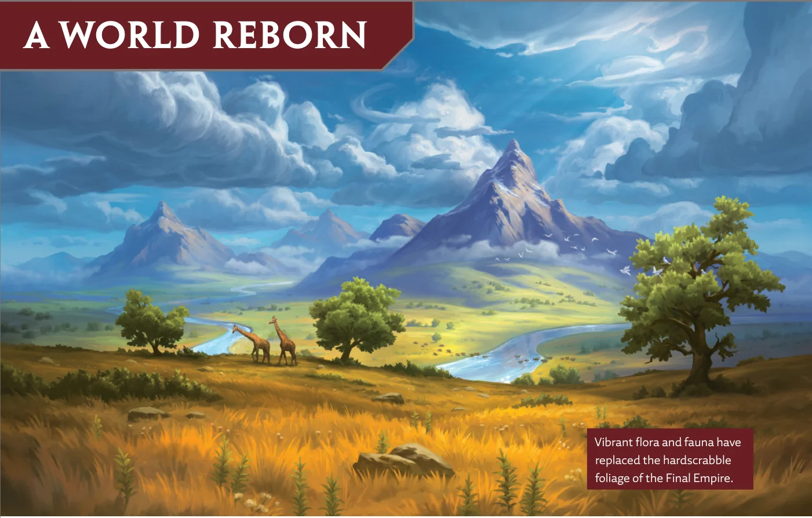
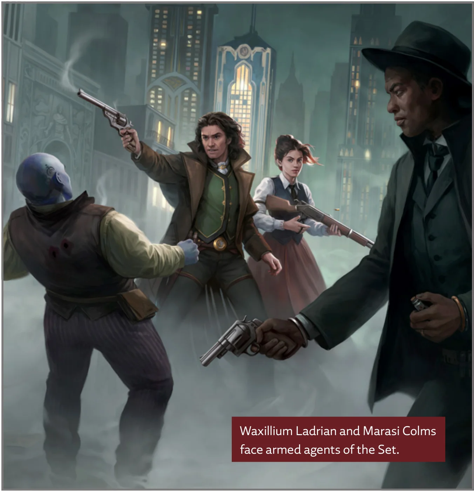
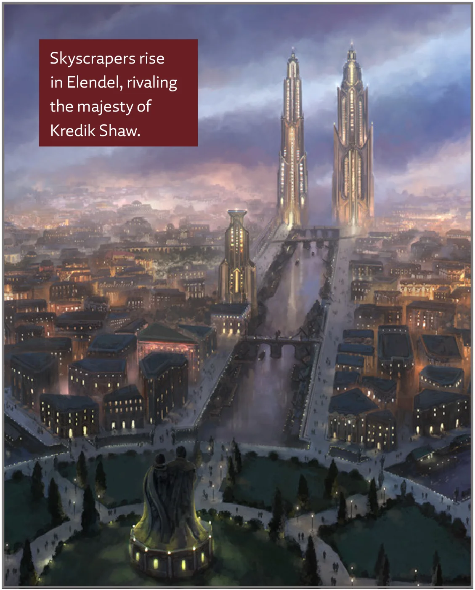
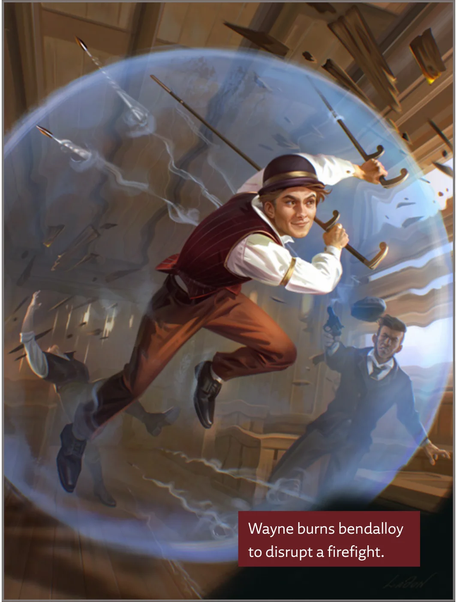
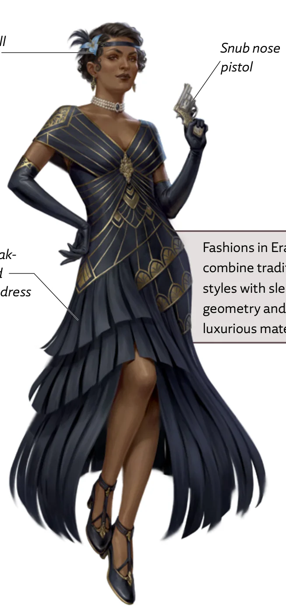

生機蓬勃的動植物取代了最後帝國時期勉強存活的植被。

瓦希黎恩．拉德利安（Waxillium Ladrian）與瑪拉席．科姆斯（Marasi Colms）迎戰「組織」的武裝密探。

卡西爾招募紋加入團隊三百多年後，世界已經變了。黃色太陽照耀藍天，灰山沉寂，依藍戴盆地覆滿蒼翠的田野。多虧永世英雄（Hero of Ages），世界恢復了平衡。在這個和諧的新時代，人類的科技與社會都有了新的進展。

### 槍械

統御主在位時壓制了許多技術，槍械也在其中。三個世紀後，槍枝已十分普遍。從大城市到蠻橫區的農莊，左輪手槍和步槍都是日常生活的一部分。

22

第二時代的服飾融合傳統款式、俐落的幾何線條與華貴材質。

摩天大樓在依藍戴拔地而起，氣勢足以與克雷迪克．霄媲美。

韋恩燃燒彎管合金，打亂一場槍戰。

### 新金屬

隨著新金屬與合金問世，人們發現了新的鎔金能力。其中有些曾為鋼鐵教廷所知，有些則是全新的發現。彎管合金與鎘可以製造讓時間流速加快或減慢的氣泡。鉻與鎳鉻合金能消除或增強其他鎔金術師的能力。鋁是鎔金惰性金屬，鋁製物品也愈來愈常被用來干擾某些金屬技藝。

### 雙生師（Twinborn）

到了新時代，擁有完整能力的迷霧之子已成為傳說。迷霧人仍相對常見，而能使用兩種金屬技藝的雙生師也已出現。經過試驗和練習，雙生師可能發現兩種能力相互作用所產生的效果，稱為共鳴（Resonance）。

Marewill 花

以迷霧披風為靈感的爵士年代洋裝

短管手槍

23

