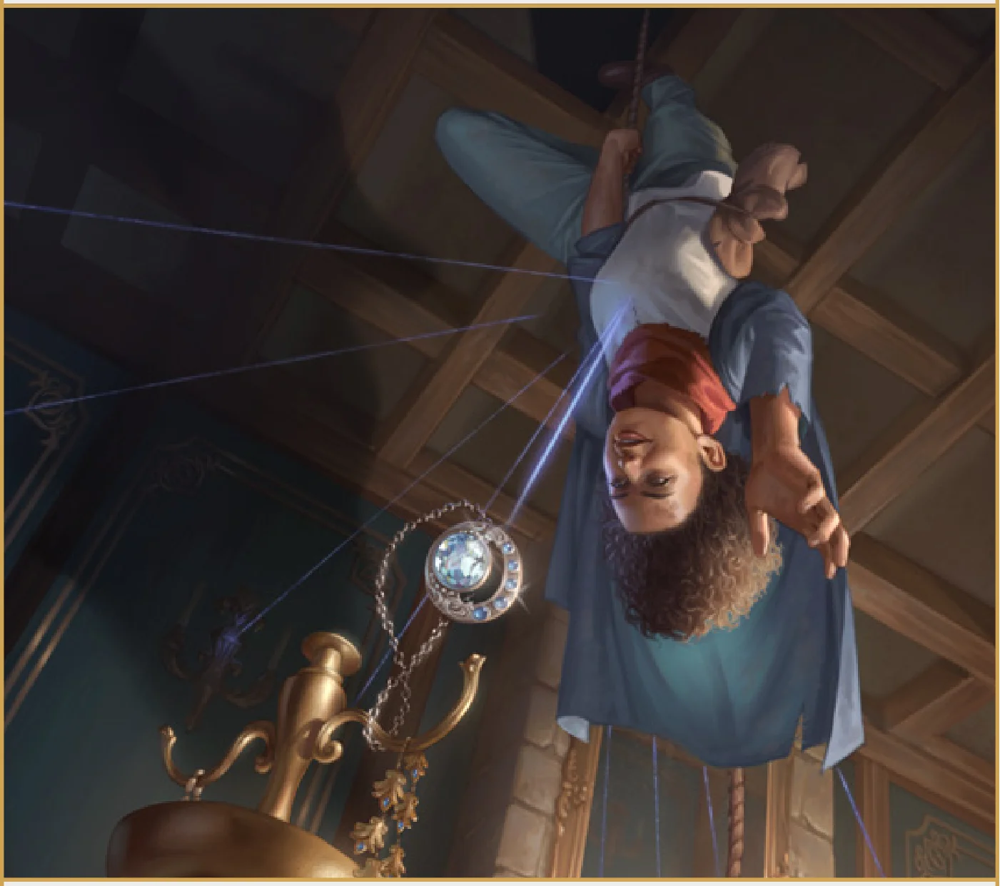
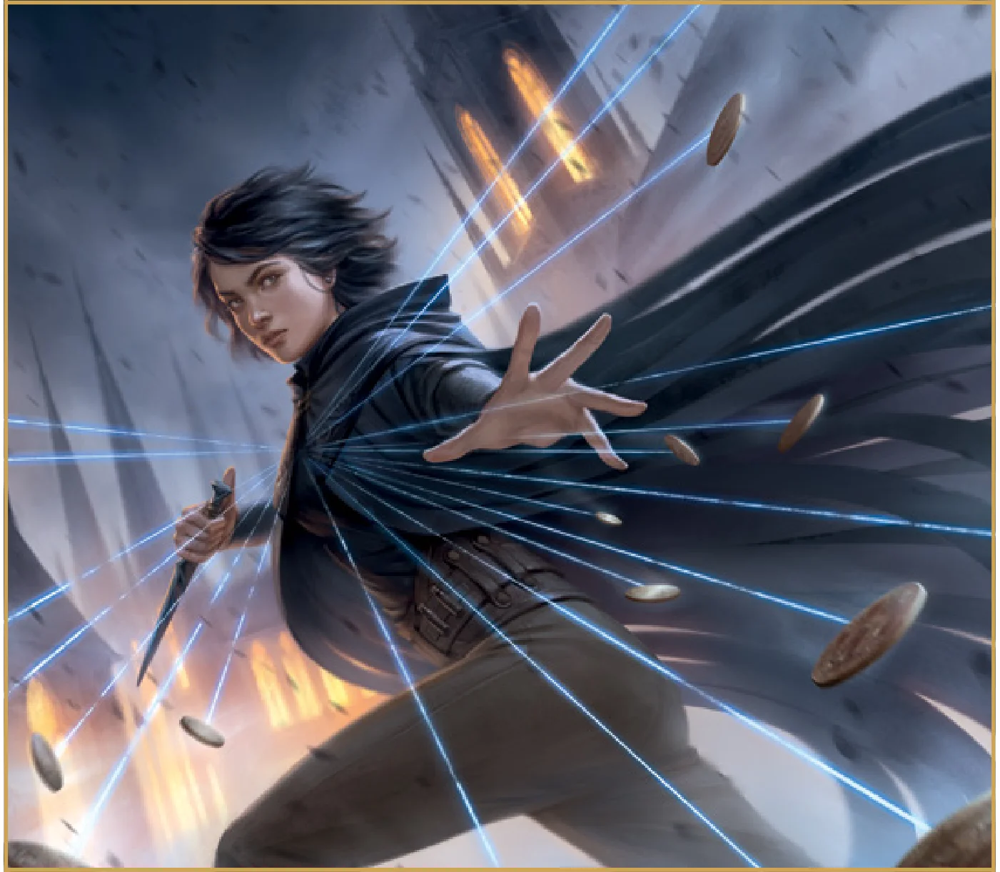
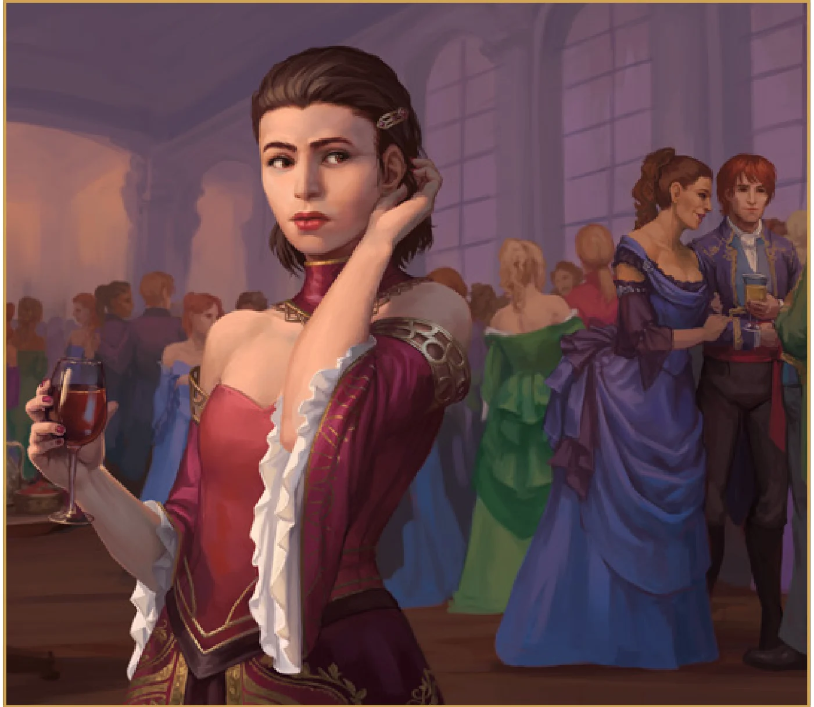
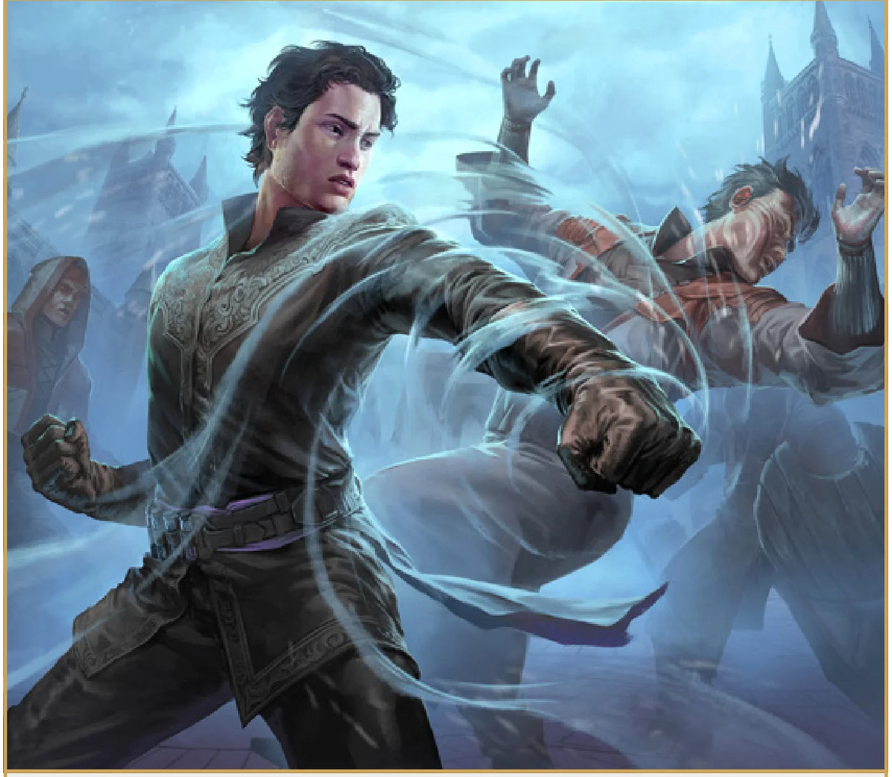
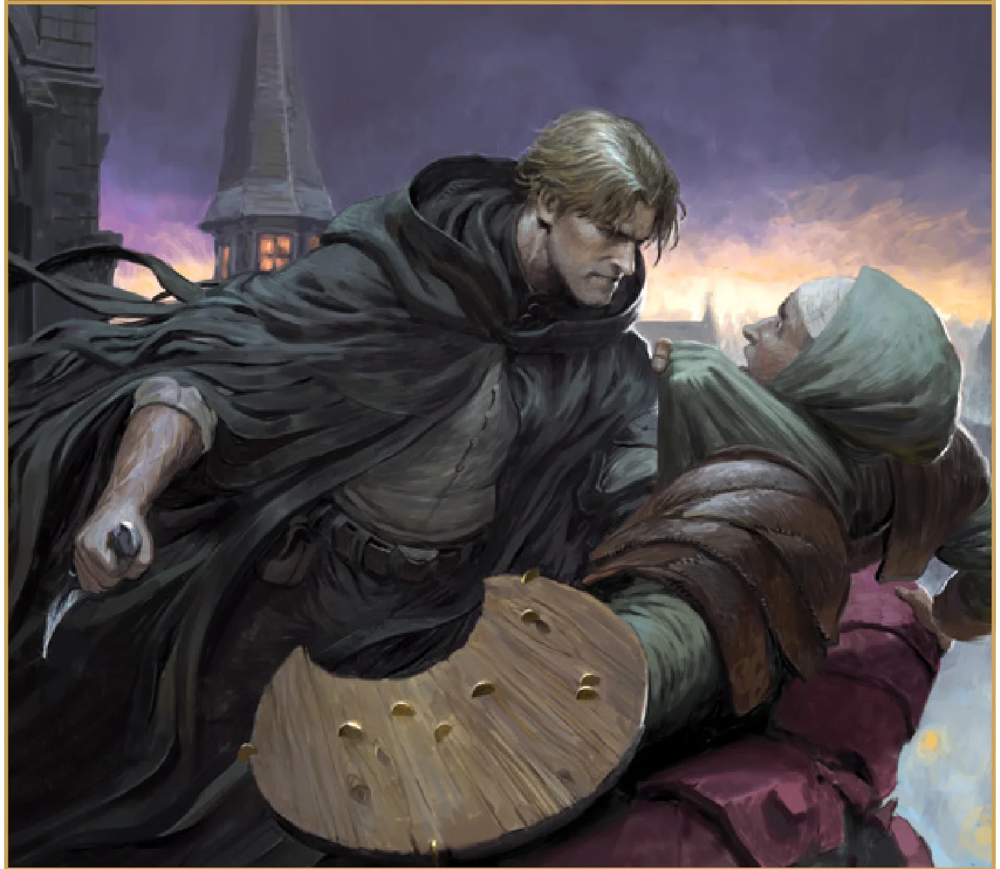
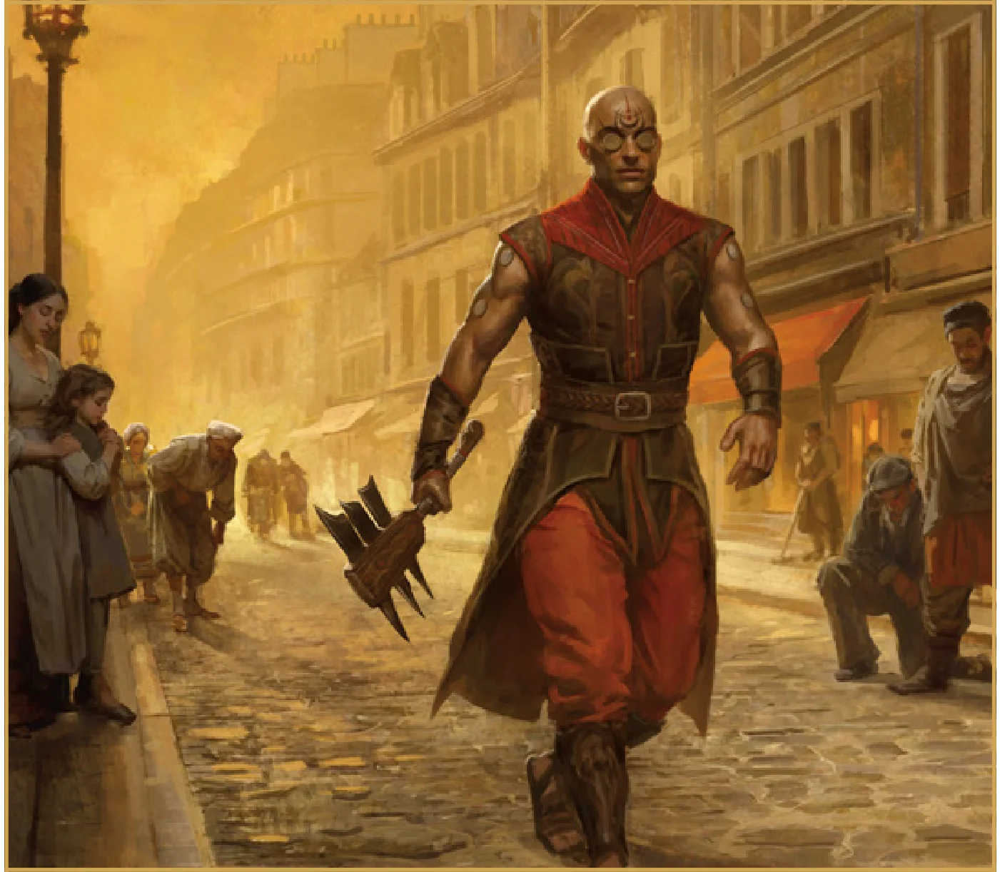
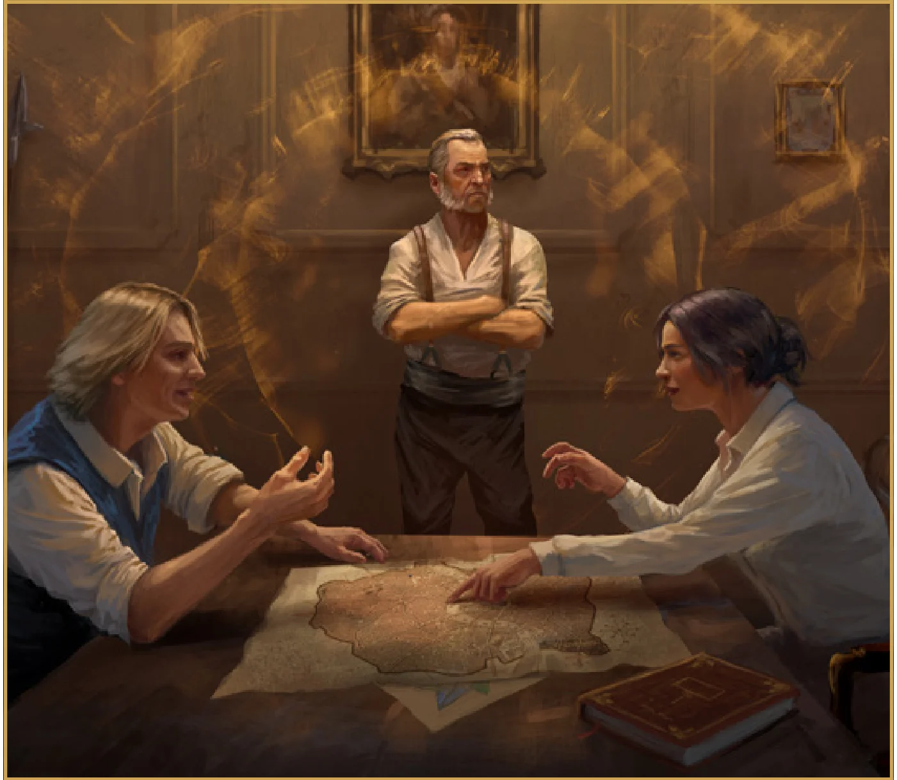
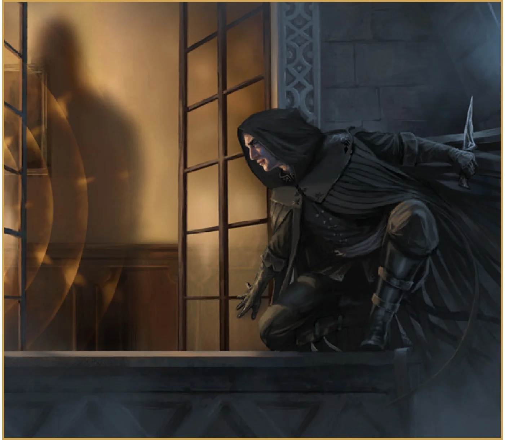

<!-- 原書第 16 頁；PDF 第 16 頁 -->

## 實體金屬

### 鐵（Iron）

實體（Physical） • 外部（External） • 拉引（Pulling）

扯手（Lurcher）能以鐵拉（Ironpull）將金屬來源拉向自己的重心。燃燒鐵時，鎔金術師（Allomancer）可以看見藍色能量線，指向附近的各種金屬。

### 鋼（Steel）

實體 • 外部 • 推力（Pushing）

射幣（Coinshot）能以鋼推（Steelpush）將金屬高速推離自己，也能藉由推動沉重或固定住的金屬物體，把自己推離那些物體。

### 錫（Tin）

實體 • 內部（Internal） • 拉引

能燃燒錫的迷霧人（Misting）稱為錫眼（Tineye），可以將感官提升到超越常人的程度。燃燒錫的鎔金術師必須提防突如其來的強光或巨響。

### 白鑞（Pewter）

實體 • 內部 • 推力

白鑞可以增強鎔金術師的力氣與速度。白鑞臂（Pewterarm）也稱為打手（Thug），是備受重視的士兵與保鑣。

<!-- 原書第 17 頁；PDF 第 17 頁 -->

## 鎔金術與意志金屬

鎔金術（Allomancy）是一種超自然能力，透過吞下並「燃燒」金屬來施展非凡力量。絕大多數鎔金術師都是只能燃燒單一金屬的迷霧人。迷霧之子（Mistborn）則能運用任何鎔金術金屬的力量。每種金屬都有獨特的優勢與限制。

### 鋅（Zinc）

意志（Mental） • 外部 • 拉引

煽動者（Rioter）能激起他人的情緒。卡西爾（Kelsier）燃燒黃銅（Brass），煽動（Riot）貴族家族守衛的恐懼，讓他們更容易受到威嚇。

:::caution[原文疑點：鋅與黃銅]
本段位於原書第 17 頁的 Zinc（鋅）欄，原文卻寫「Kelsier burns brass」。譯文保留原文的 brass（黃銅），未擅自改成鋅。這是原書內部不一致的疑點，尚未確認官方勘誤。
:::

### 黃銅（Brass）

意志 • 外部 • 推力

安撫者（Soother）燃燒黃銅來壓抑特定情緒。圖中的鋼鐵審判者（Steel Inquisitor）壓抑了希望與反抗情緒，使附近的居民安分下來。

### 青銅（Bronze）

意志 • 內部 • 推力

搜尋者（Seeker）可以察覺其他鎔金術師正在燃燒金屬。在青銅能力上足夠出色的人，還能依據金屬發出的脈動來分辨不同金屬。

### 紅銅（Copper）

意志 • 內部 • 拉引

煙陣（Smoker）可以阻撓搜尋者，隱藏周圍一定範圍內的所有鎔金術。這些迷霧人也稱為紅銅雲（Coppercloud），本身可以不受情緒鎔金術影響。

