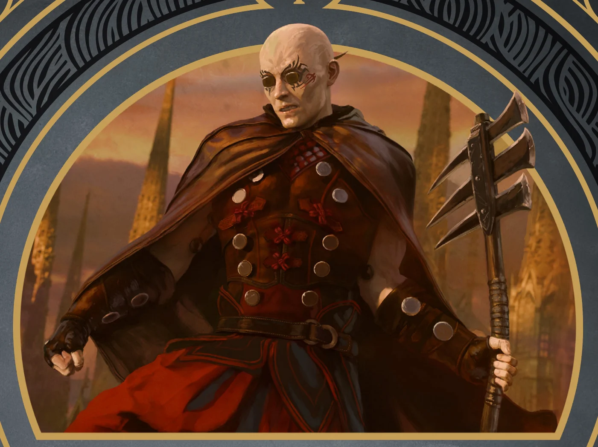

5

8

7

9

角色扮演遊戲

cosmererpg.com

9 781966 528005

51199> ISBN 978-1-966528-00-5

$11.99

### 走進《迷霧之子》的世界！

司卡德利亞是布蘭登．山德森暢銷小說《迷霧之子®》的舞臺，由滅絕與存留兩股力量維持平衡。無論你是初次閱讀小說，還是準備在

寰宇® RPG 裡展開自己的冒險，都可以透過這本圖文指南認識司卡德利亞的歷史、宗教與文化。《歡迎來到司卡德利亞》避開劇情雷點，邀你走進一個奇幻世界。這裡有宛如神明的存在

彼此爭奪主宰權，金屬則藏著通往力量的祕徑。

準備好在司卡德利亞講述自己的故事時，你可以在《迷霧之子™ 玩家手冊》和《迷霧之子™ 世界指南》中找到更多美術與世界設定。

