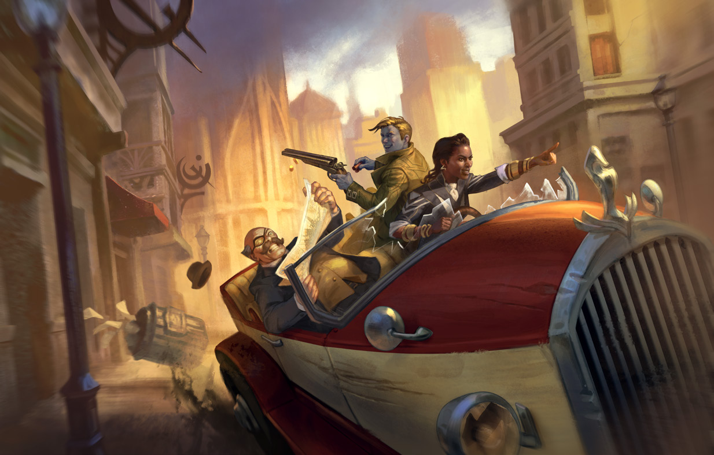
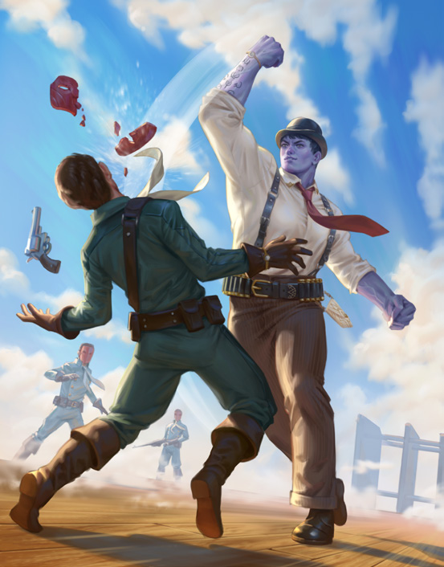
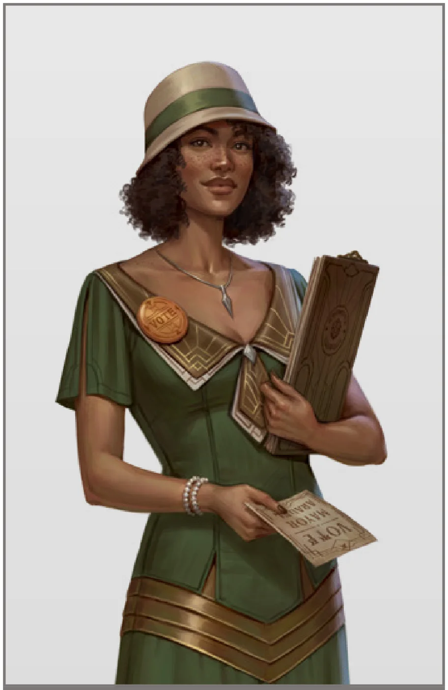
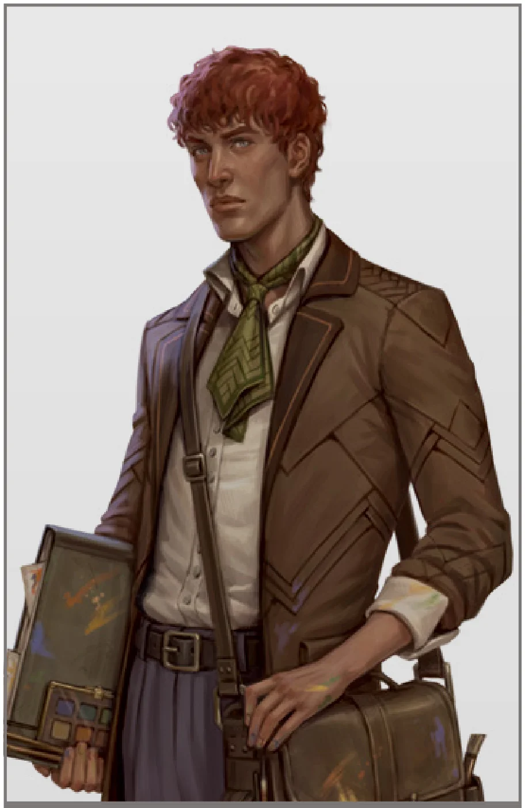
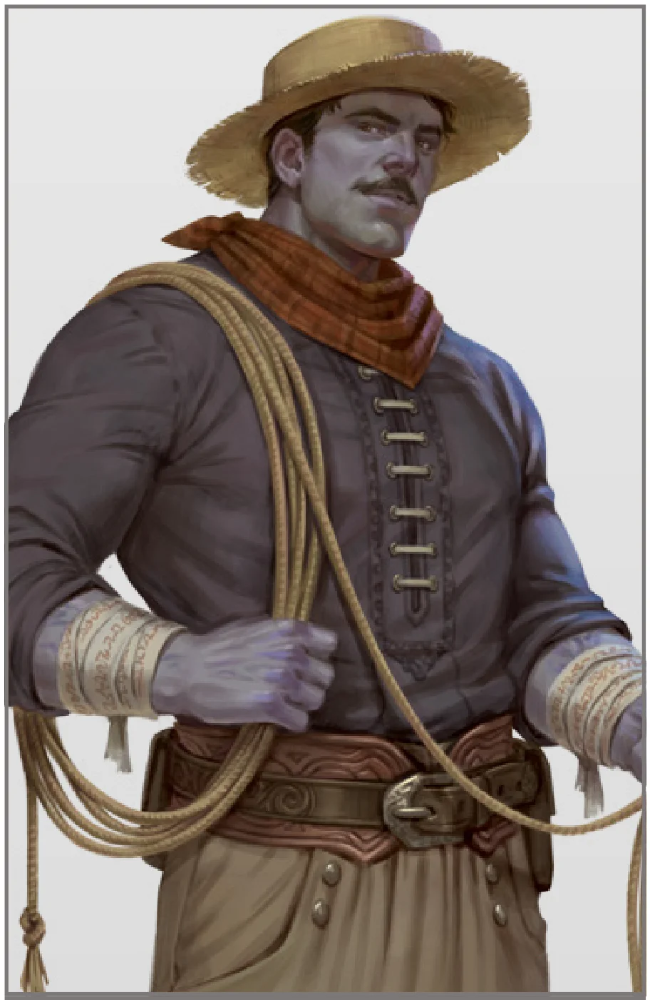
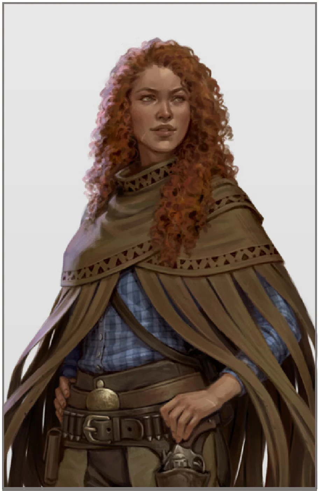

三名英雄駕著汽車在市區街道上飛馳。

一名克羅司混血（koloss-blooded）冒險者在 Malwish 的浮空船（airship）上奮戰。

《創始之書》（Words of Founding）記載的最後帝國（Final Empire）故事，奠定了盆地的文化基礎。對今日的司卡德利亞人來說，昔日的英雄既是傳奇人物，也是宗教信仰中的人物。依藍戴（Elendel）是司卡德利亞最大的城市，居民自認承繼了存留者（Preservers）所見證的重生世界。New Seran、Bilming 等其他城市的居民則對這種自以為是的態度深感不滿。緊張局勢持續升溫，各個秘密結社爭奪權力，暗中卻受到來自司卡德利亞以外的勢力操弄。司卡德利亞再次來到變革的關口。

### 盆地之外

航海探險家和大報（broadsheet）記者推測，已知世界的邊界之外或許還有其他國家。也許是時候讓盆地居民探索更廣闊的司卡德利亞了。

24

運河與鐵路將盆地居民連在一起，各座城市與聚落仍有各自的傳統和觀點。外圍城市（Outer Cities）也愈來愈希望在政治上脫離依藍戴而獨立。

**依藍戴**

依藍戴匯聚了各地的人與文化。居民總覺得全世界都繞著自己的城市轉。

**Bilming**

Bilming 的生活步調很快。這裡的工人與創業者作風張揚，崇尚個人自主。

**泰瑞司（Terris）**

每座主要城市都有泰瑞司人的傳統聚居區，他們在這些地方延續自己的文化。

**克羅司混血**

在這個新時代，擁有克羅司（koloss）血統的人類與其他人共同生活。

**New Seran**

噴泉之城（City of Fountains）的居民舉止文雅、勇於冒險，對依藍戴心懷不滿。

**蠻橫區（the Roughs）**

能吃苦的勘探者、礦工、農民與匪徒都在蠻橫區安家。

25

