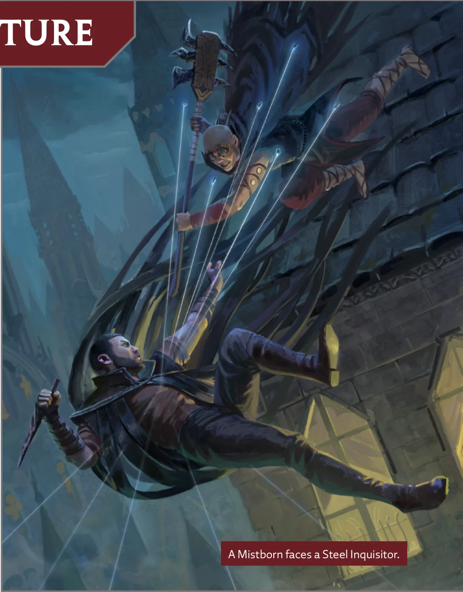
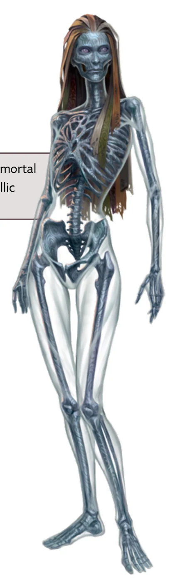
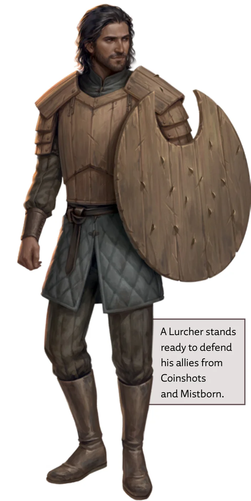
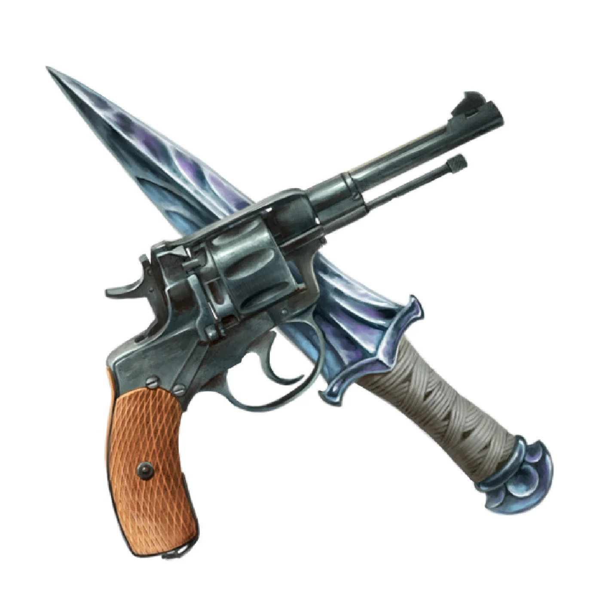

<!-- 原書第 26 頁；PDF 第 26 頁 -->

## 冒險的時代

迷霧之子（Mistborn）的故事橫跨多個時代。本指南僅略述司卡德利亞（Scadrial）在前兩個時代開始時的樣貌。《迷霧之子》系列（Mistborn Saga）小說還會揭露更多祕密，帶來更多驚人的發現。

迷霧之子第一時代呈現一個黑暗奇幻世界，充滿劫案、恐怖、反抗行動，以及舞會上的勾心鬥角。第二時代則加入通俗冒險、偵探故事、祕密結社與槍戰場面。在這兩個時代，英雄都必須面對自身的困境，同時守護世界，使其免受邪惡神祇的影響。

未來的迷霧之子故事將帶來科技與金屬技藝（Metallic Arts）的新進展。司卡德利亞的居民也將開始理解，自己在更廣大的寰宇（cosmere）中處於什麼位置。

### 插圖說明

一名無面不朽者（Faceless Immortal）穿戴著金屬製的真體（True Body）。

一名迷霧之子迎戰鋼鐵審判者（Steel Inquisitor）。

## 寰宇 RPG（Cosmere RPG）

讀完這本司卡德利亞指南，你已經準備好展開自己的冒險了！寰宇 RPG 讓你有機會在迷霧之子的世界中述說原創故事。召集一群朋友、建立角色，再選出一位遊戲主持人（game master，GM），為你們搭起故事的舞臺。

如果你剛接觸桌上角色扮演遊戲，《迷霧之子起始套組》（Mistborn Starter Set）就是理想的起點。這盒套組包含一本精簡版規則書、預先建立的角色，以及一段以最後帝國（Final Empire）為背景的原創冒險。

若想建立自己的角色並閱讀完整規則，可以入手《迷霧之子玩家手冊》（Mistborn Handbook）。如果你是遊戲主持人，也可以考慮《迷霧之子傳承》（Mistborn Legacy）：這本精裝冒險書的故事橫跨第一時代與第二時代。最後，無論你是否遊玩這款 RPG，《迷霧之子世界指南》（Mistborn World Guide）都兼具美術畫冊與設定百科的特色，收錄大量關於司卡德利亞歷史、文化與敵手（adversary）的資訊。

<!-- 原書第 27 頁；PDF 第 27 頁 -->

## 展開你的旅程

建立角色時，先選擇你的血統（ancestry）、最多兩項文化專長（cultural expertise），再從六條英雄路徑（heroic path）中選擇一條，決定你最初接受的訓練與具備的能力。

| 路徑 | 主題 | 專精（specialty） |
| --- | --- | --- |
| 密探（Agent） | 以敏銳的頭腦或靈巧的身手解決問題，才幹出眾的行動者。 | 調查員（Investigator） 反抗者（Rebel） 竊賊（Thief） |
| 使者（Envoy） | 洞察敏銳、善於巧妙影響他人的談判者。 | 信仰者（Faithful） 騙徒（Grifter） 導師（Mentor） |
| 獵手（Hunter） | 精通射擊與野外活動，找出並排除問題的高手。 | 殺霧者（Hazekiller） 神射手（Sharpshooter） 追蹤者（Tracker） |
| 領袖（Leader） | 沉著穩健的指揮官，指引他人發揮最佳表現。 | 策劃者（Mastermind） 軍官（Officer） 政客（Politico） |
| 學者（Scholar） | 思路敏捷，擅長規劃與建造的思考者。 | 發明家（Inventor） 策士（Strategist） 外科醫師（Surgeon） |
| 戰士（Warrior） | 仰賴技巧、蠻力或不屈意志作戰的鬥士。 | 決鬥者（Duelist） 槍手（Gunslinger） 士兵（Soldier） |

你可以從任意組合的英雄路徑中獲得天賦（talent），也可以從金屬之子（Metalborn）路徑與金屬技藝（Metallic Arts）路徑中選擇魔法能力。每條路徑都由一棵天賦樹（talent tree）構成，讓你每次提升等級時，都能強化角色並調整其發展方向。

你將把點數分配到六項屬性（attribute）：力量（Strength）、速度（Speed）、智力（Intellect）、意志（Willpower）、察覺（Awareness）與風采（Presence）。這些屬性決定你的技能（skill）基礎，而你也能選擇技能。每個角色都會獲得一組起始套組（starting kit），從中取得實用的裝備。最後，設定角色最根本的核心目的（purpose）、根深柢固的內在障礙（obstacle）與短期目標（goal），便完成了角色建立。

寰宇（Cosmere）是個充滿生機的宇宙，隨著新故事與新的 RPG 內容持續成長！造訪 [www.cosmererpg.com](https://www.cosmererpg.com)，了解最新推出的作品、下載免費資源，並加入我們的線上玩家社群。

### 插圖說明

一名扯手（Lurcher）嚴陣以待，準備保護盟友，抵擋射幣（Coinshot）與迷霧之子（Mistborn）的攻擊。

