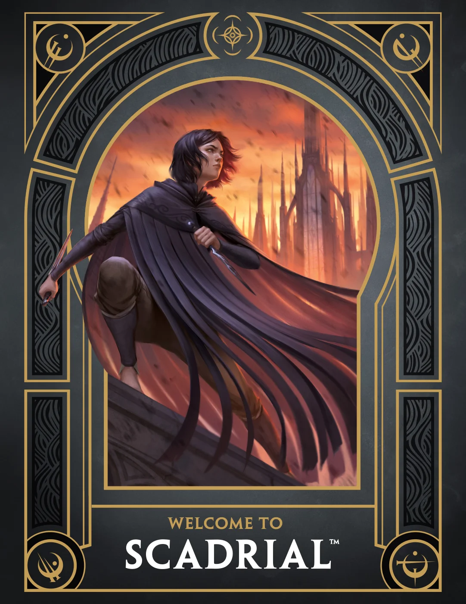
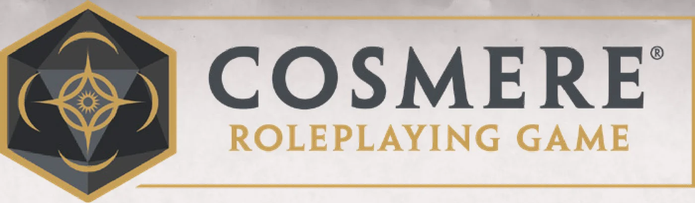
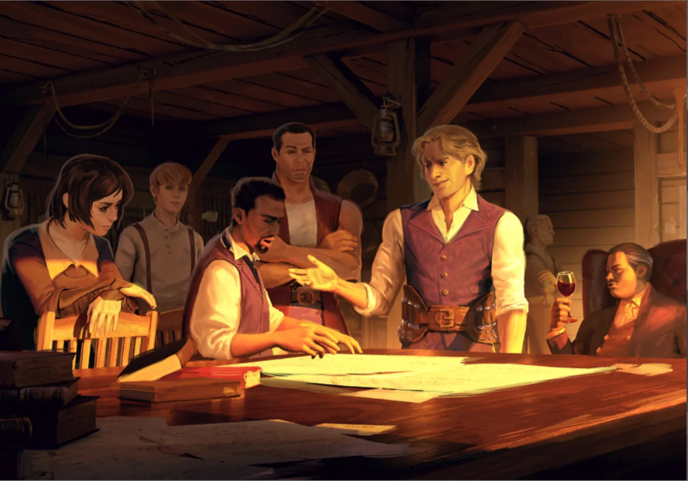

## 歡迎來到司卡德利亞™

5、8、7、9

## 製作名單

寰宇® RPG 由 Brotherwise Games 與 Dragonsteel Entertainment 共同製作。

- **執行製作人**：布蘭登．山德森
- **製作人**：Isaac Stewart、Dan Wells
- **創意總監**：Johnny O’Neal
- **撰稿**：Johnny O’Neal
- **設定一致性編輯**：Karen Ahlstrom
- **Worldsingers**：David Behrens、Joshua Harkey、Eric Lake、Ben Marrow、Ian McNatt、Evgeni「Argent」Kirilov
- **敏感議題顧問**：Basil Wright
- **無障礙顧問**：Chris Hopper
- **編輯**：J. Russell Schneider
- **校對**：Karen Twelves
- **美術總監**：Matt DeMino、Ben McSweeney
- **平面設計**：Igor Freitas
- **概念美術**：Marie Seeberger
- **封面插畫**：Deandra Scicluna
- **Dragonsteel 美術團隊**：Ben McSweeney、Shawn Boyles、Jennifer Neal、Rachael Lynn Buchanan、Anna Earley、Hayley Lazo、Priscilla Spencer
- **內頁插畫**：Andrew Chou、Anna Pazyniuk、Anna Verhoog、Antti Hakosaari、Artur Mósca、Billy Christian、Carson Daniel、Darko Stojanovic、David Astruga、David Frasheski、Deandra Scicluna、Gal Or、Humble Squid、Isaac Stewart、Jenny Tan、Jordan Kerbow、Katerina Ladon、Kieran Yanner、Klaus Pillon、Leon Tukker、Linda Lithén、Logan Feliciano、Lucas Torquato、Marie Seeberger、Matt DeMino、Pedro Dutra、Rodrigo Clark、Sam Perin、Sami Rytkönen、Steve Prescott、Svetlana Kostina、Vladimir Ishelin

### 寰宇® RPG 核心團隊

- **首席設計**：Andrew Fischer、Lydia Suen
- **首席撰稿**：Meric Moir
- **主編**：Laura Hirsbrunner
- **首席平面設計**：Gordon McAlpin
- **專案負責人**：Lyla McBeath Fujiwara

© 2026 Brotherwise Games, LLC。本書以布蘭登．山德森的《迷霧之子》系列®小說為基礎。小說版權 © 2006、2007、2008、2011、2015、2016、2022 Dragonsteel Entertainment, LLC，經 Dragonsteel Entertainment, LLC 明示授權使用。

Plotweaver™ 遊戲系統 © 2025 Brotherwise Games, LLC。

ISBN：978-1-966528-00-5。首次印刷（v1.02）。於中國印製。

## 導讀

對許多讀者來說，布蘭登．山德森的《迷霧之子》系列是他們踏入寰宇的第一站。緊湊的敘事和新穎的魔法體系引領讀者走進這個世界，而讓人愛上這套書的，是鮮活的角色和扣人心弦的情節。

從《最後帝國》開始，《迷霧之子》首部三部曲描繪了一個瀕臨崩潰的世界。在不朽的統御主陰影下，貴族恣意揮霍，平民卻在苦難中勞作。這個世界能否迎來更好的未來，最大的希望繫於一群竊賊和反抗者。他們需要迷霧之子的幫助。迷霧之子能「燃燒」金屬，施展驚人的鎔金術。

布蘭登為寰宇構想的故事，橫跨數個世代與不同的科技發展階段。這在《迷霧之子》中尤其明顯。第一時代的新哥德式奇幻世界，到了第二時代，表面上已步入黃金年代。在寰宇 RPG 中，你可以選擇其中任一時代展開戰役。為了避免劇透，本手冊以第一時代為主，只用幾頁介紹第二時代的世界樣貌。

我們寫這本手冊，是為了桌上角色扮演遊戲的玩家，也為了剛開始閱讀《迷霧之子》首部三部曲、想透過圖像加深閱讀體驗的讀者。即使你才剛翻開《最後帝國》，也可以放心閱讀接下來的內容，書中沒有關於角色或情節的重大劇透。

歡迎來到這個有統治者與亡命之徒、有恐懼與希望的世界。在這裡，金屬技藝大放異彩，英雄也逐漸崛起。歡迎來到司卡德利亞，這裡永遠還有另一個祕密……

——Johnny O’Neal

## 目錄

| 篇名 | 頁碼 |
| --- | ---: |
| 灰燼世界 | 4 |
| 最後帝國 | 6 |
| 司卡 | 8 |
| 貴族 | 10 |
| 泰瑞司 | 12 |
| 司卡德利亞地圖 | 14 |
| 鎔金術 | 16 |
| 迷霧之子 | 18 |
| 卡西爾與他的團隊 | 20 |
| 重生的世界 | 22 |
| 新時代的文化 | 24 |
| 冒險的時代 | 26 |
| 展開你的旅程 | 27 |

