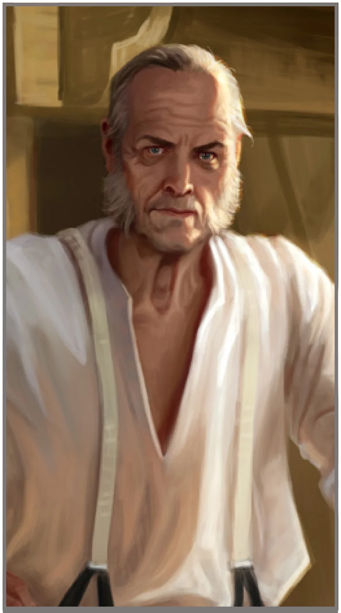
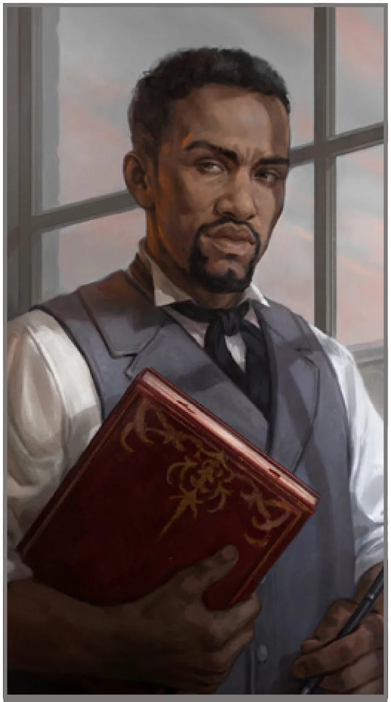
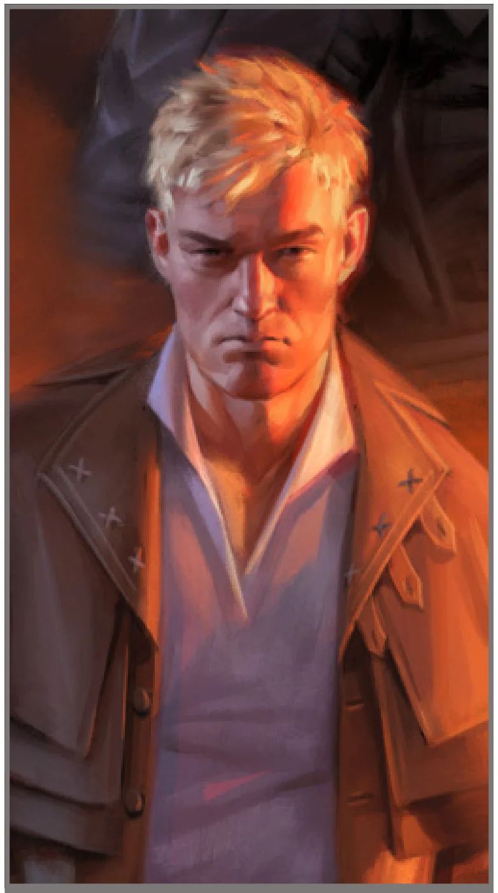
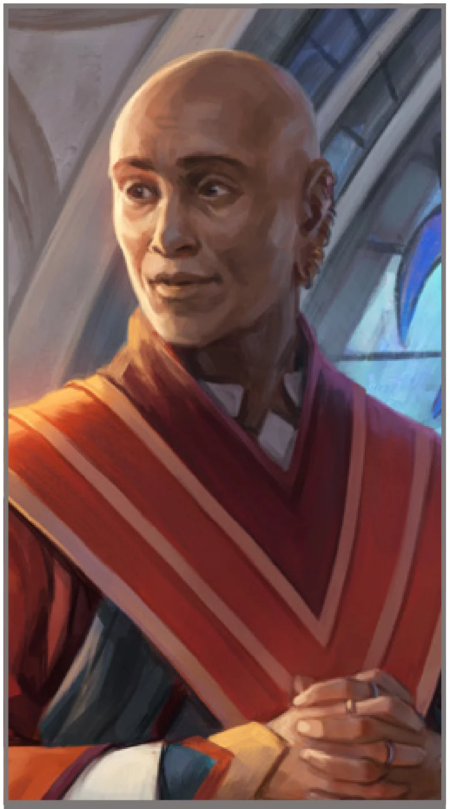
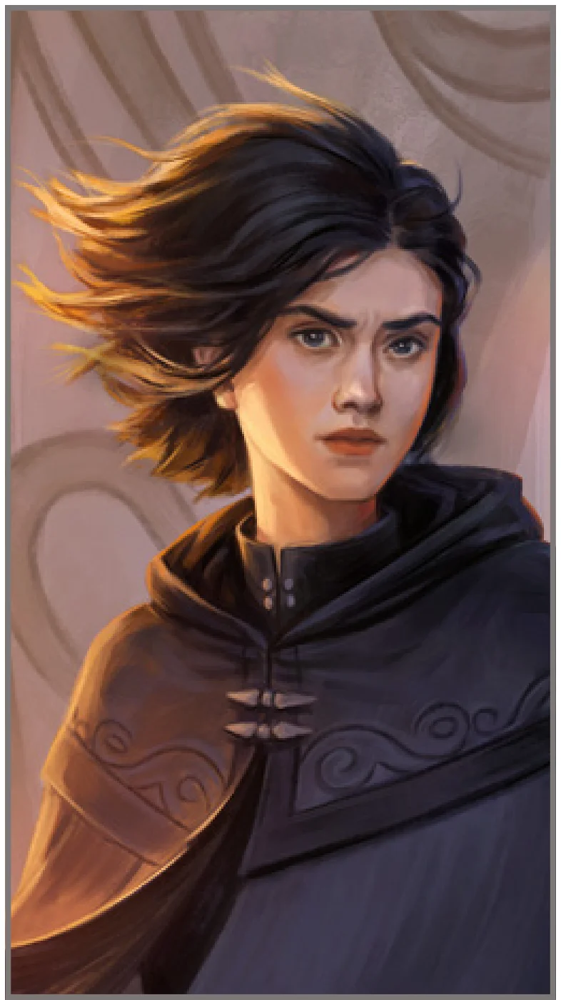
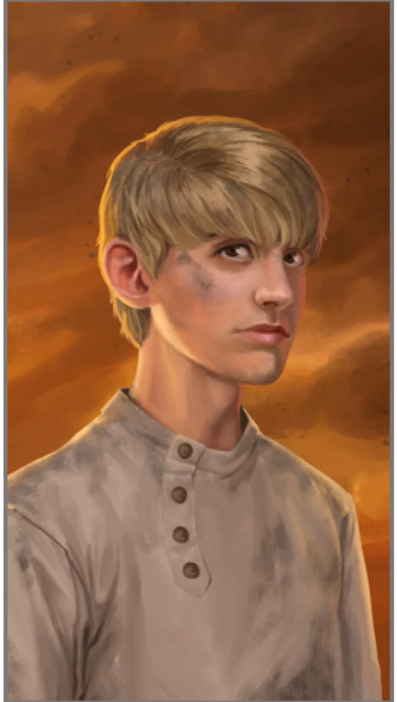
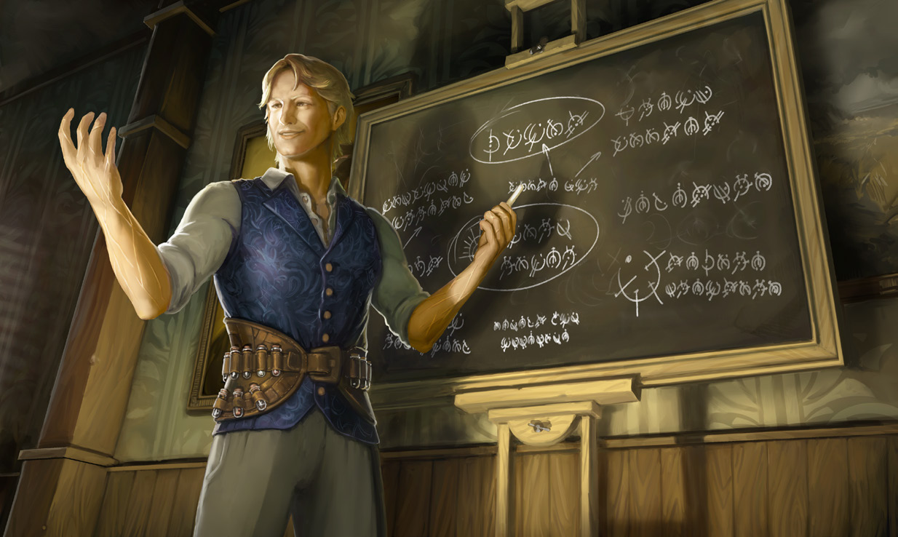
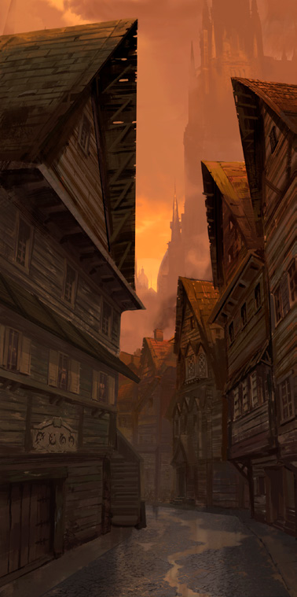
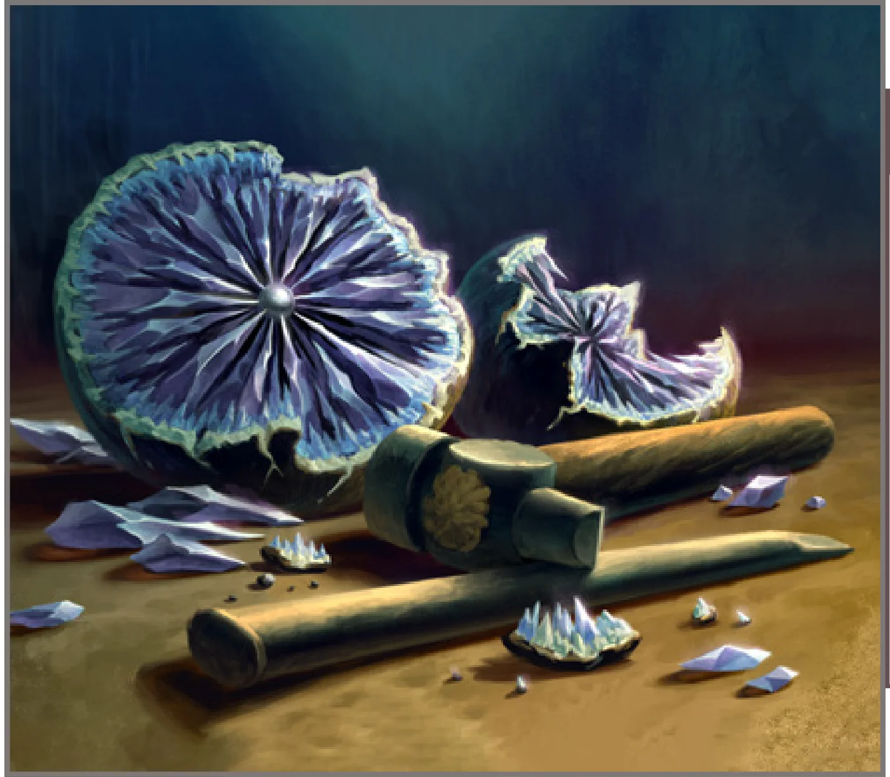

卡西爾（Kelsier）是個聲名狼藉、魅力十足的竊賊，以大膽的計畫和肆無忌憚的劫案聞名。為了接下一樁看似不可能的差事，他召集了一群司卡（skaa）竊賊與迷霧人（Mistings）好手。他們各有所長，個性也各不相同，恰好能動搖最後帝國（Final Empire）的統治。

多克森（Dockson）

這位團隊領袖雖然不是迷霧人，卻出奇地擅長安排後勤。

微風（Breeze）

Edgard Ladrian 人稱「微風」，是個安撫者（Soother），也是個善於斡旋的外交家。

哈姆德（Hammond）

哈姆（Ham）是個身經百戰的白鑞臂（Pewterarm），比起打仗，他更喜歡談哲學。

沙賽德（Sazed）

這名泰瑞司侍從官（Terris steward）加入團隊，暗中監視他被迫服侍的貴族。

歪腳（Clubs）

歪腳是個煙陣（Smoker）。他經營的木工坊就是團隊的據點。

鬼影（Spook）

這名年輕的錫眼（Tineye）負責替團隊把風，說的是東部街頭的俚語。

沼澤（Marsh）

卡西爾的哥哥是個搜尋者（Seeker），已經打入鋼鐵教廷（Steel Ministry）內部。

紋（Vin）

卡西爾最後招募了一名運氣異常好的司卡少女，湊齊了團隊。

20

### 海司辛倖存者

卡西爾小時候過著貴族的生活，直到母親的司卡身分曝光，她也因此被殺。後來，他成了竊賊和騙子，幹下一樁比一樁棘手的案子，最後甚至試圖偷取統御主（Lord Ruler）本人的財物。他被判到海司辛深坑（Pits of Hathsin）服苦役，在那裡發生了綻裂（Snapped）。覺醒迷霧之子（Mistborn）的力量後，他逃出海司辛，開始策劃推翻最後帝國。卡西爾重感情又樂觀，卻也傲慢而冷酷。只要有貴族阻礙他推翻統御主，他就會毫不手軟地殺掉對方。

卡西爾正在擬定計畫。

歪腳在陸沙德（Luthadel）開的木工坊是卡西爾團隊的據點。

海司辛的代價

天金（atium）只出產於危險致命的海司辛深坑。囚犯得爬過布滿鋒利晶體的洞穴，尋找天金晶石（atium geodes）。每顆晶石裡只有一顆價值連城的天金珠。

21

