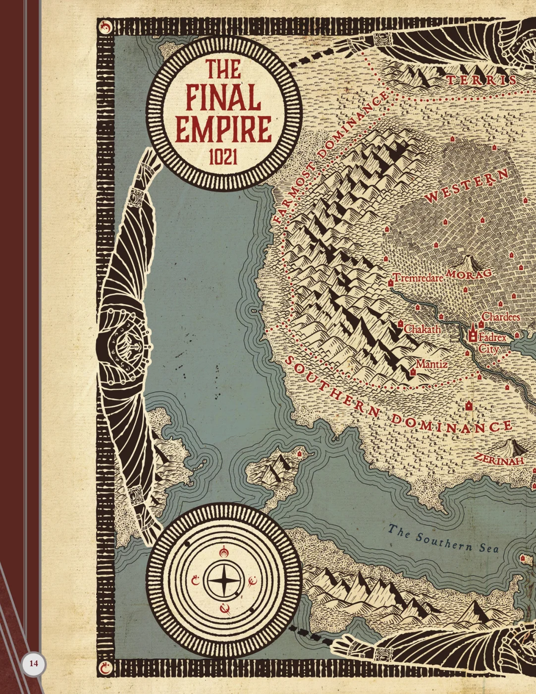
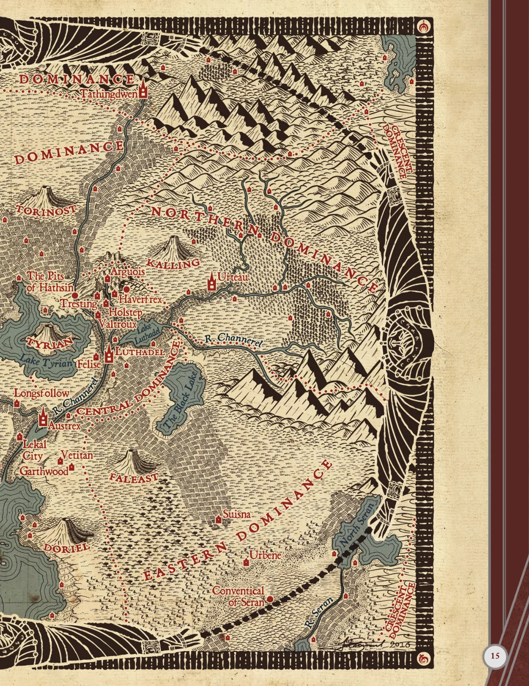

14

## 地圖地名（PDF 第 14–15 頁）

最後帝國 1021 年

- 泰瑞司統御區（Terris Dominance）
- 極遠統御區（Farmost Dominance）
- 西方統御區（Western Dominance）
- 南方統御區（Southern Dominance）
- 北方統御區（Northern Dominance）
- 中央統御區（Central Dominance）
- 東方統御區（Eastern Dominance）
- 新月統御區（Crescent Dominance）
- 塔辛文（Tathingdwen）
- Tremredare
- Chakath
- 哈佛富雷克斯市（Fadrex City）
- Chardees
- Mantiz
- Morag
- Zernath
- Torinost
- Kalling
- Arquoise
- 鎢都（Urteau）
- Haverfrex
- Tresting
- Holstep
- Valtroux
- 海司辛深坑（The Pits of Hathsin）
- 陸沙德（Luthadel）
- Felise
- Longsfollow
- Austrex
- 雷卡城（Lekal City）
- Vetitan
- Garthwood
- Subisna
- Urdene
- 瑟藍集所（Conventical of Seran）
- Tyrian
- Doriel
- Faleast
- 南海（The Southern Sea）
- Tyrian湖（Lake Tyrian）
- 陸沙德湖（Lake Luthadel）
- 黑湖（The Black Lake）
- 香奈瑞湖（Lake Channerel）
- 香奈瑞河（Channerel）
- 北Seran湖（North Seran）
- Seran河（Rio Seran）

15

