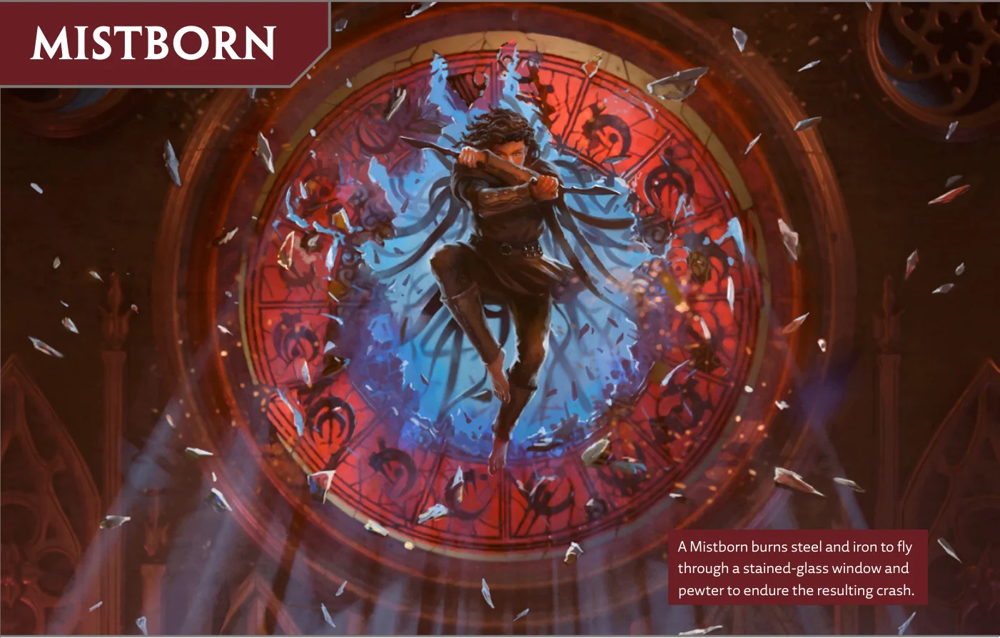
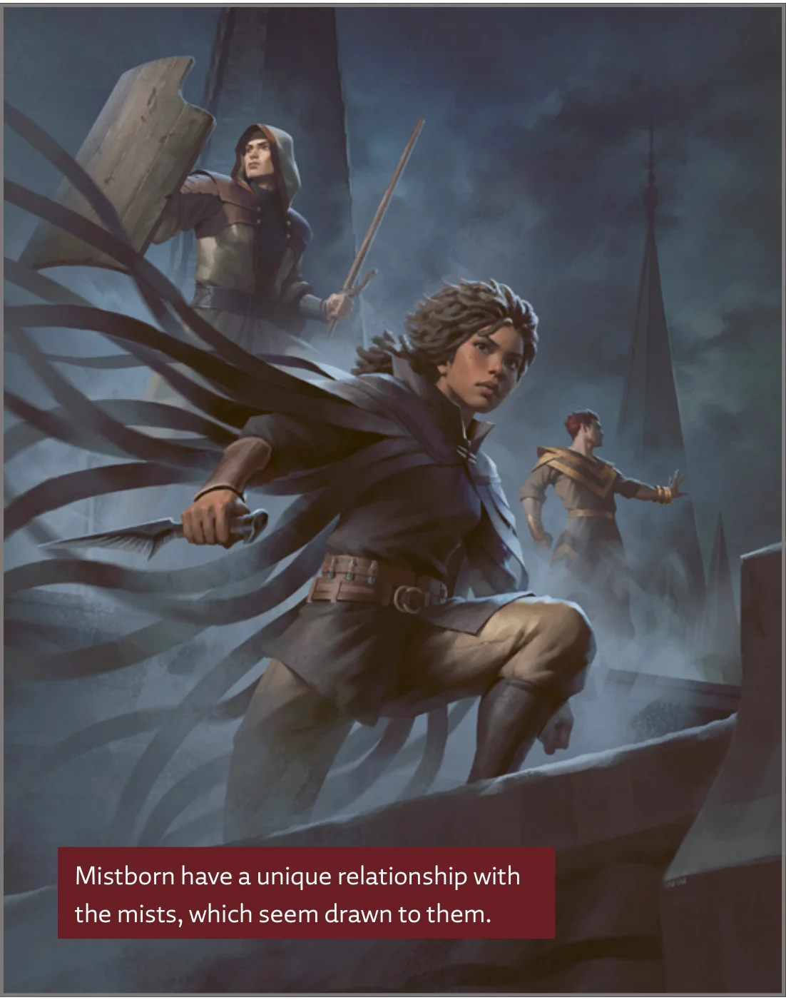
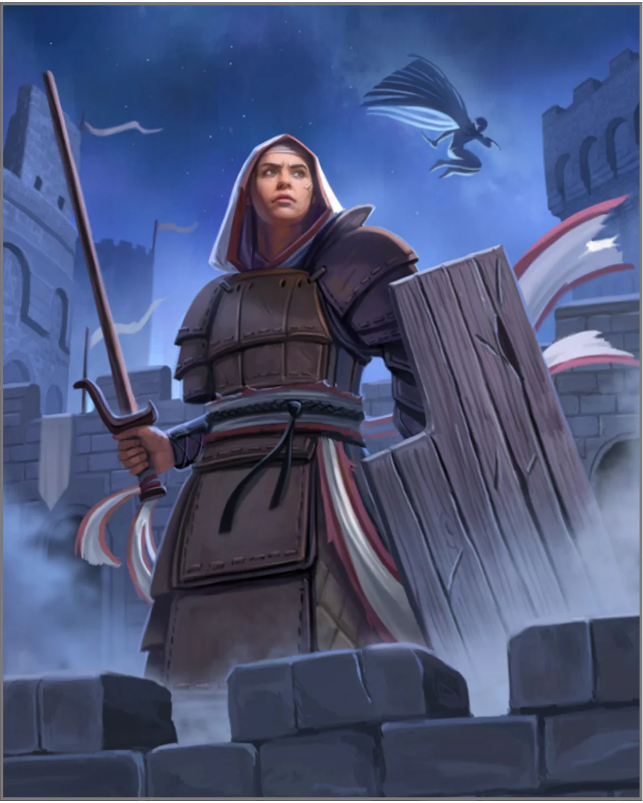
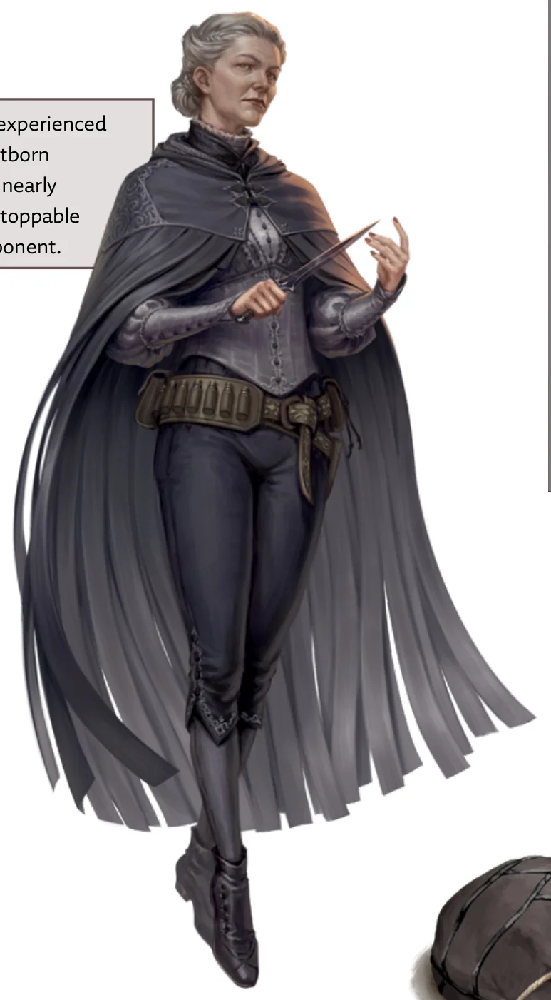
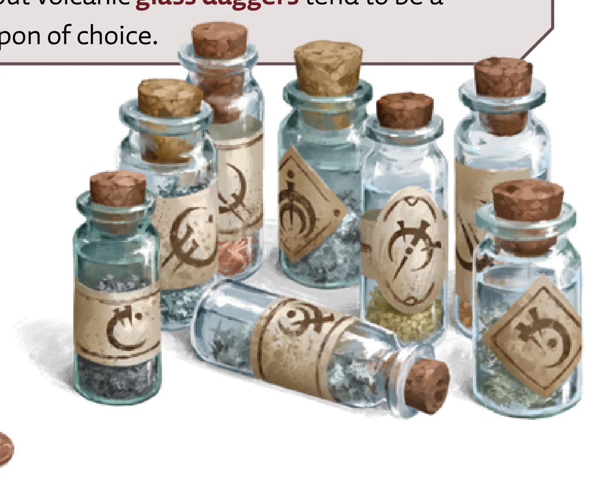
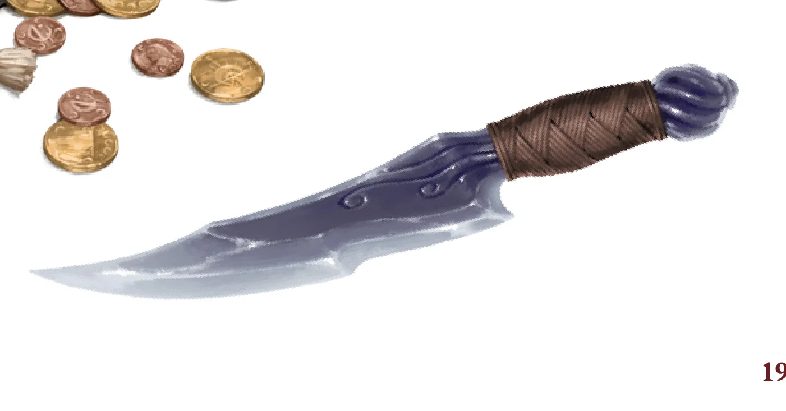

<!-- 原書第 18 頁；PDF 第 18 頁 -->

## 迷霧之子的力量

迷霧之子（Mistborn）擁有傳說中的能力，可以燃燒所有鎔金術（Allomancy）金屬。這些力量通常潛伏到青春期，直到一場創傷經歷使迷霧之子「綻裂」（Snap），力量才隨之顯現。在貴族家族中，迷霧之子會接受密集訓練，並經常隱藏身分，以維持對潛在敵人的戰略優勢。迷霧之子間諜與刺客，是家族競爭中能左右勝負的武器。每一代只有寥寥幾人誕生，一名技藝精湛的迷霧之子，其行動足以決定最後帝國（Final Empire）的走向。

:::note[天金（Atium）]
每個迷霧之子都力求隨身帶著一瓶天金。這種極其稀有的金屬，是迷霧之子手中的終極武器。燃燒天金時，迷霧之子在戰鬥中幾乎無人能擋——除非敵人也在燃燒天金！
:::

### 插圖說明

一名迷霧之子燃燒鋼（Steel）與鐵（Iron），飛身穿過彩繪玻璃窗，再以白鑞（Pewter）承受撞擊。

迷霧之子與迷霧有著獨特的關係；迷霧似乎會受到他們吸引。

<!-- 原書第 19 頁；PDF 第 19 頁 -->

## 殺霧者（Hazekiller）

一名迷霧之子就能擊敗數十名一般士兵，因此貴族家族會雇用接受過嚴格訓練、專門對付迷霧之子的殺霧者。這些專業守衛身穿木甲或皮甲，以決鬥杖（dueling cane）作戰，並使用聲響棒（soundstick）等特殊裝備，騷擾鎔金術師（Allomancer），使其失去方向感。

:::note[隨身裝備]
迷霧之子攜帶金屬瓶來補充能力、以鋼推（Steelpush）發射硬幣作為高速投射物，也會使用敵方鎔金術師無法繳械的非金屬武器。有些人偏好木製決鬥杖，但黑曜石匕首通常才是迷霧之子的首選武器。
:::

## 迷霧披風（mistcloak）

迷霧之子傳統上會穿著迷霧披風。這是一種深灰色或黑色的披風，上面垂著一排排彼此重疊的寬流蘇。迷霧披風可以在霧夜裡充當掩護，同時也是力量的宣示，令人心生畏懼與敬意。

### 插圖說明

經驗老到的迷霧之子，是幾乎無人能擋的對手。

