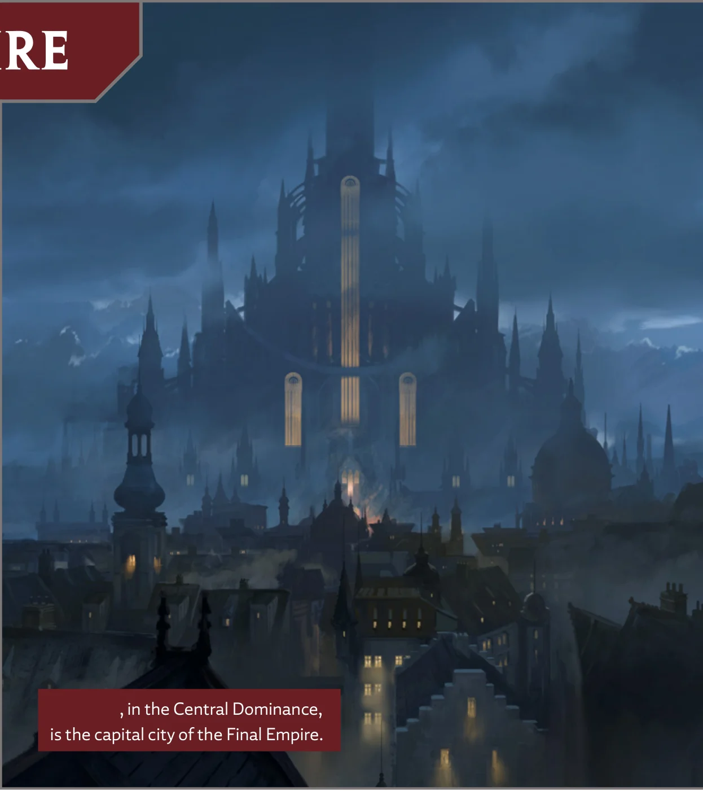
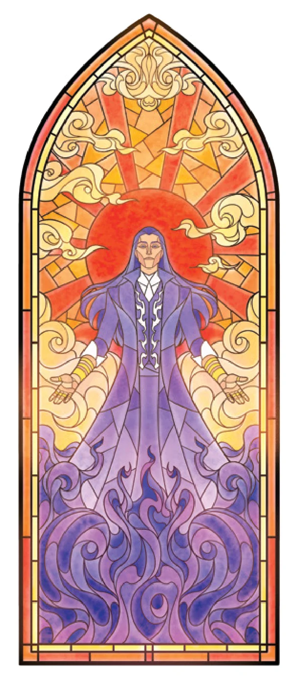
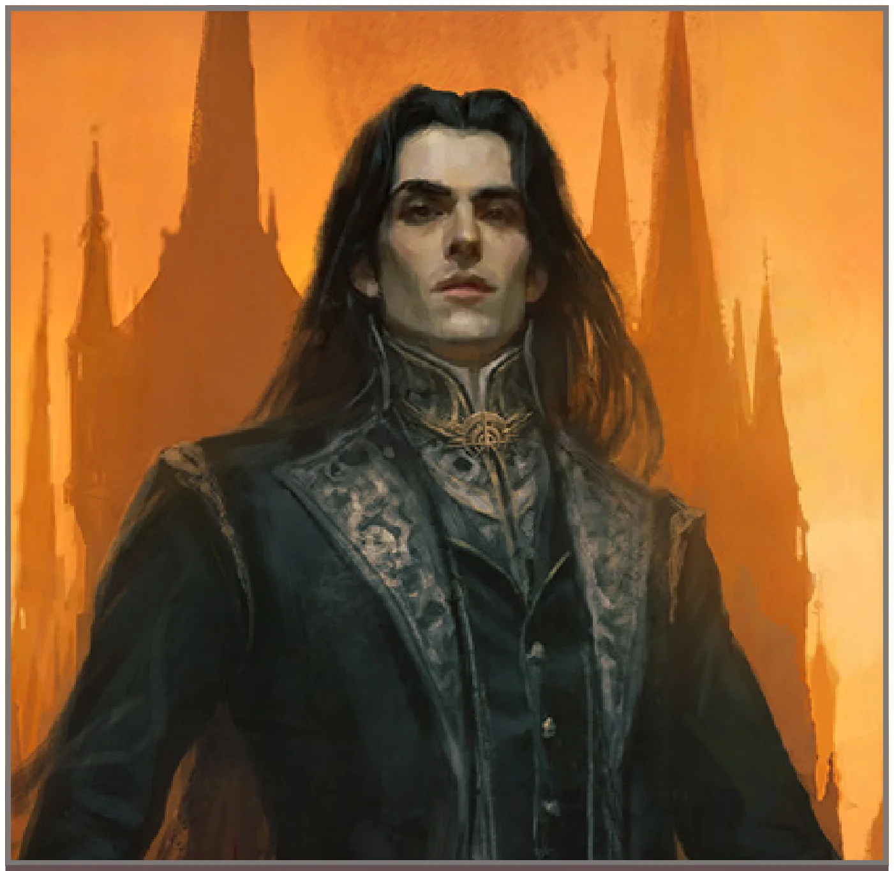
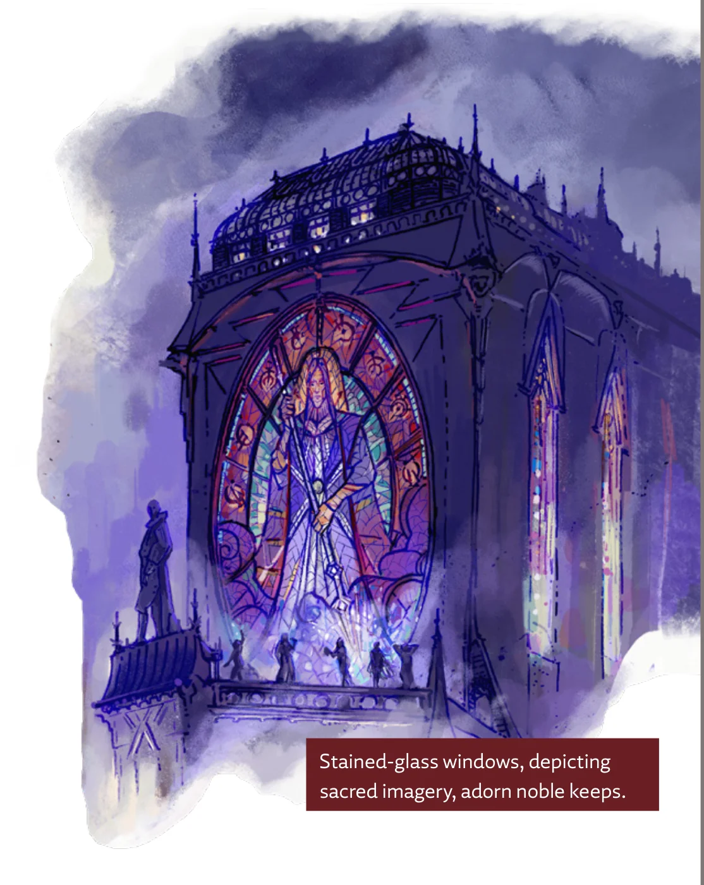
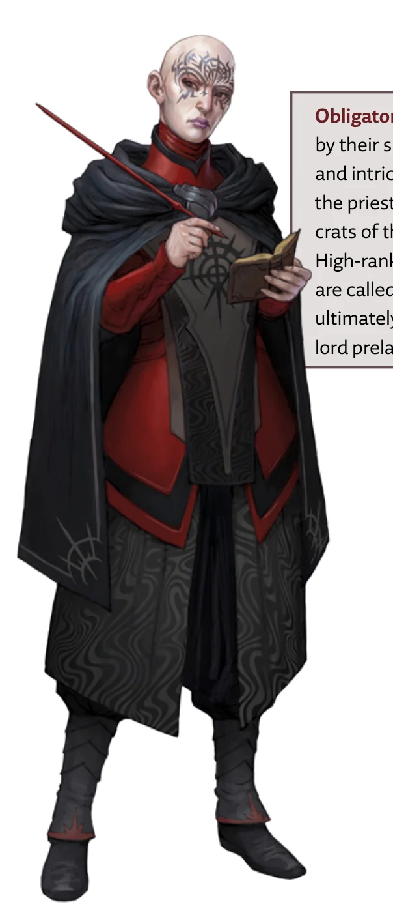
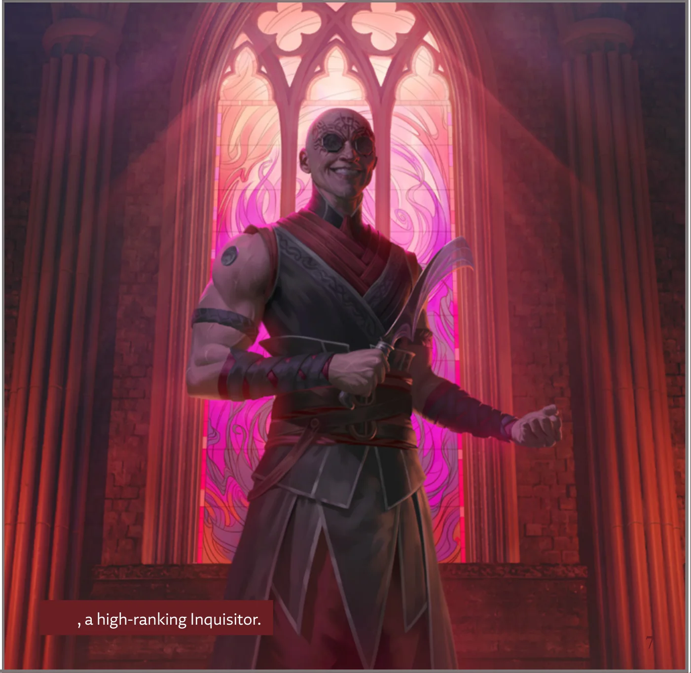

陸沙德（Luthadel）位於中央統御區（Central Dominance），是最後帝國的首都。

最後帝國（Final Empire）統治已知世界已有一千多年。帝國橫跨司卡德利亞北部，劃分為十個稱為統御區（Dominance）的領地。永生的帝國神王統御主（Lord Ruler）住在陸沙德。他將行政權交給貴族，由鋼鐵教廷（Steel Ministry）執行法律、契約及宗教教義。最後帝國的普通百姓稱為司卡（skaa），在這個專制政權下長年受壓迫。

### 克雷迪克．霄（Kredik Shaw）

統御主的權力中心是克雷迪克．霄，又稱千塔之山（Hill of a Thousand Spires），是一座龐大的宮殿群。宮殿採用唯有鋼鐵教廷掌握的工法與材料建造，高踞陸沙德所有建築之上，散發令人絕望、畏懼的氣息。

### 統御主

統御主又稱無限殘體（Sliver of Infinity），最後帝國的每位臣民都以他的名義起誓。鋼鐵教廷宣稱，一千年前他擊敗了名為深暗（Deepness）的混沌力量，並在昇華之井（Well of Ascension）接受神位。他拯救了世界，又以灰燼與迷霧懲罰不信他的人。今日的貴族是當年獲他青睞的人之後裔，他至今仍庇護貴族並賞賜珍貴金屬。

俊美的暴君

統御主深居簡出，最後帝國很少有臣民見過他。他身形高挑修長，黑髮如墨，膚色蒼白。儘管活了難以想像的漫長歲月，他仍英俊而顯得相當年輕。

6

聖務官（Obligator）是鋼鐵教廷的祭司與官僚，剃光頭髮並刺有繁複的刺青，很容易辨認。高階聖務官稱為聖祭司（Prelan），最終都向至上聖祭司（Lord Prelan）負責。

描繪神聖圖像的彩繪玻璃窗裝飾著貴族堡邸。

卡爾（Kar），一名高階審判者。

### 鋼鐵教廷

最後帝國的宗教與官僚體系密不可分，兩者都由鋼鐵教廷統轄。教廷下設財務廷（Canton of Finance）掌管銀行業務，資源廷（Canton of Resource）主管貿易，教義廷（Canton of Orthodoxy）管理信仰事務。令人畏懼的審判廷（Canton of Inquisition）則剷除反抗勢力，嚴格執法。

### 鋼鐵審判者（Steel Inquisitors）

鋼鐵審判者動輒訴諸極端暴力，毫不留情地貫徹統御主的意志。鋼刺貫穿他們的眼睛和頭骨，讓他們無敵的傳聞更顯可信。面對審判者的力量，連迷霧之子也會驚恐逃離。 7

